# Navigazione nella Vista 3D

> [!NOTE]
>  Il Nokia N95 supporta mouse e tastiera (via Bluetooth). Le parti di questa pagina dedicate al Nokia spiegano come usarlo senza mouse né tastiera, solo con i tasti del telefono.

Questa pagina spiega come navigare nella Vista 3D. Navigare significa spostare il tuo punto di vista: girare intorno alla scena, spostarti di lato e avvicinarti o allontanarti.

Saper navigare è importante: per creare modelli 3D e animazioni in modo comodo e veloce, devi saperti muovere nella scena e metterti in una posizione comoda per lavorare.

Per usare i comandi che seguono, la Vista 3D deve essere il [viewport attivo](interfaz.md#il-viewport-attivo), quello con il bordo verde.

Le tre cose che userai di più sono **orbitare**, **spostare la vista** e fare **zoom**. Ognuna si può fare con il mouse, con le dita su uno schermo touch o con la tastiera del Nokia N95. Nei video del PC, il mouse in basso a destra mostra in verde il tasto che si sta premendo.

## Orbitare

Orbitare significa ruotare la vista intorno alla scena, come se girassi intorno a un tavolo per vedere da tutti i lati quello che c'è sopra.

 **Con il mouse:** tieni premuto il **tasto centrale** (si preme spingendo giù la rotella) e trascina. Su un trackpad, o con un mouse senza tasto centrale, tieni premuto <kbd>Alt</kbd> e trascina con il **clic principale** (il sinistro).

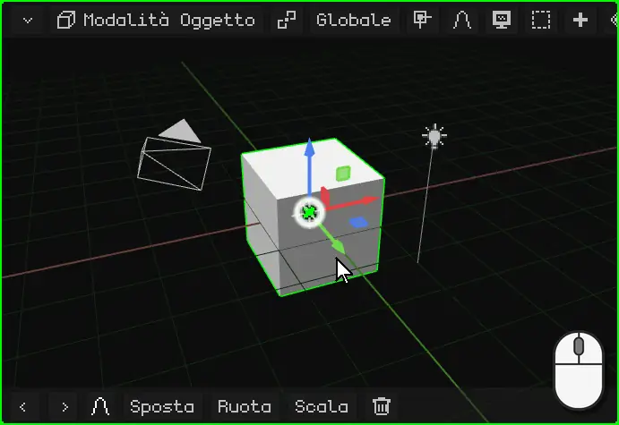

 **Con il dito:** trascina un dito sulla Vista 3D. Parti dallo sfondo: se lo appoggi sul gizmo (le frecce colorate dell'oggetto), finirai per spostarlo.

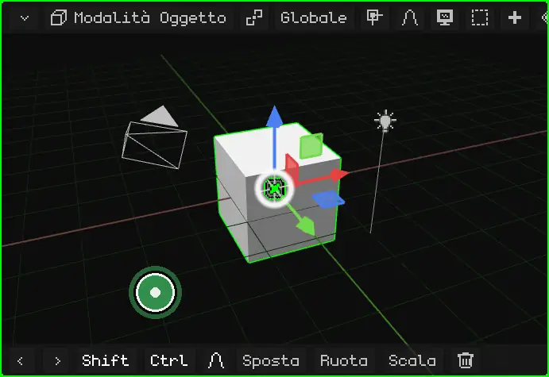

 **Su un Nokia N95:** tieni premuta una **freccia** del pad. La vista ruota da quel lato finché la tieni premuta.

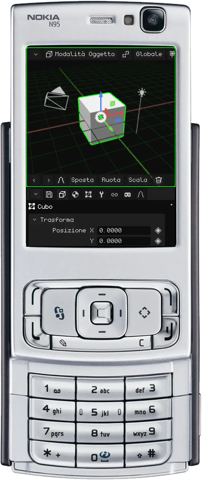

## Spostare la vista

Spostare la vista (o fare *pan*) significa farla scorrere di lato, verso l'alto o verso il basso, senza ruotarla.

 **Con il mouse:** tieni premuto <kbd>Shift</kbd> e trascina con il **tasto centrale**. Su un trackpad: <kbd>Alt</kbd> + <kbd>Shift</kbd> e trascina con il clic principale.

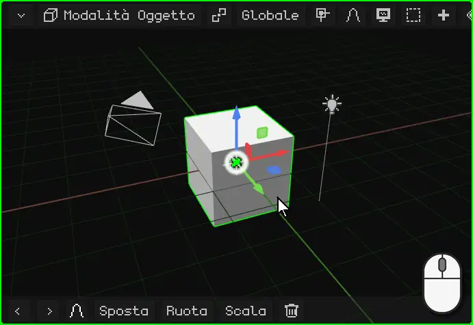

 **Con le dita:** appoggia **due dita** e muovile insieme nella stessa direzione.

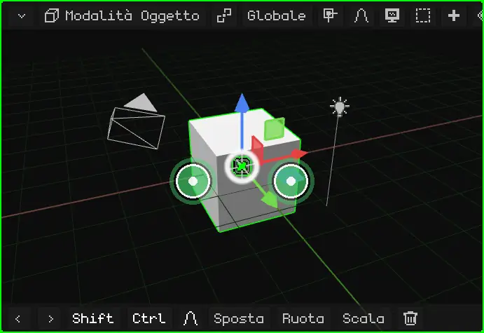

 **Su un Nokia N95:** tieni premuto il tasto <kbd>\*</kbd> e usa le frecce.

## Zoom

Lo zoom ti avvicina o ti allontana. Il passo si adatta alla distanza: vicino a qualcosa di piccolo avanza piano e da lontano avanza veloce, quindi va bene sia per guardare tutta la scena sia per un singolo vertice.

 **Con il mouse:** gira la **rotella**. In avanti avvicina e all'indietro allontana. Su un trackpad, fai scorrere due dita verso l'alto o verso il basso.

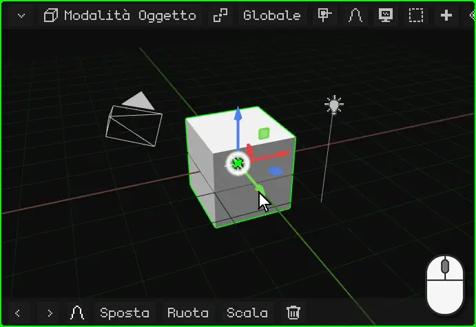

 **Con le dita:** pizzica. Allargare le dita avvicina e stringerle allontana.

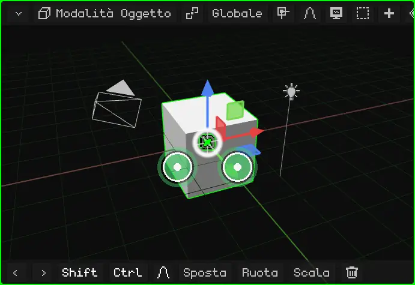

 **Su un Nokia N95:** tieni premuto lo <kbd>0</kbd> e usa la freccia **su** per avvicinare o la freccia **giù** per allontanare.

## Inquadrare la selezione

Se hai perso l'orientamento, o vuoi lavorare su qualcosa in particolare, **inquadralo**: la vista si centra su ciò che è selezionato e regola lo zoom in modo che ci stia giusto. Da lì in poi, orbitando giri intorno a quello.

| | Come si inquadra |
|---|---|
|  PC | <kbd>Num .</kbd> (il punto del tastierino numerico) |
|  Nokia N95 | Una pressione dello <kbd>0</kbd>, senza frecce (tenuto premuto con una freccia fa lo zoom) |
|  Schermo touch | Doppio tocco con due dita |
| Menu | Vista → Inquadra selezionati |

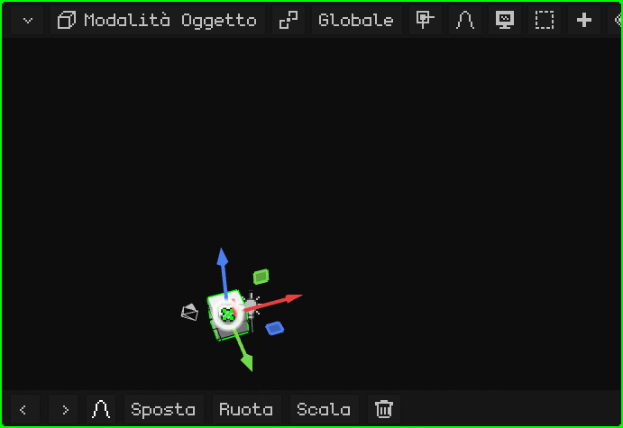

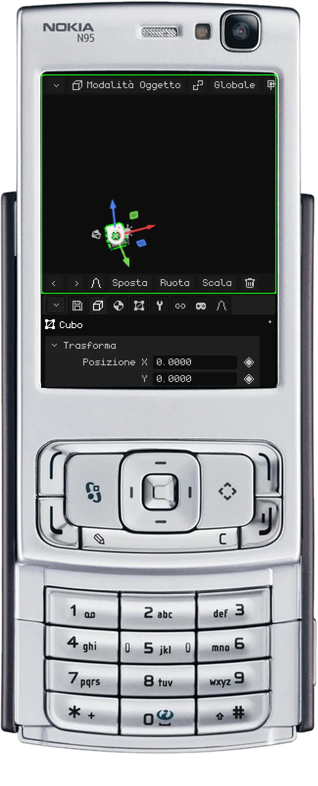

### In Modalità Modifica

In [Modalità Modifica](modo-edicion.md) si inquadra la parte selezionata della mesh: i vertici, gli spigoli o le facce che hai scelto, non l'intero oggetto. Serve per lavorare su un dettaglio di un modello grande: lo selezioni, lo inquadri e ci orbiti intorno.

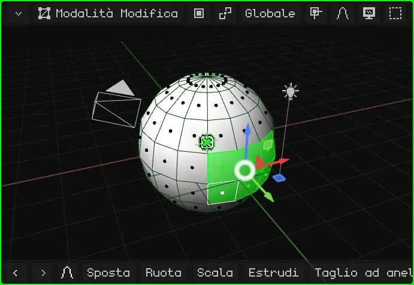

## La vista locale

Quando nella scena ci sono molte cose, lavorare su una sola è scomodo: quelle davanti la coprono, e quando orbiti si mettono in mezzo. La **vista locale** lascia visibile solo ciò che è selezionato (uno o più oggetti) e lo inquadra. Il resto non viene cancellato né nascosto nella scena: smette solo di vedersi in questo viewport. In alto a sinistra compare la scritta "Vista locale".

Per tornare indietro si ripete la stessa cosa: tutto ricompare e la vista torna com'era prima.

| | Come si entra e si esce |
|---|---|
|  PC | <kbd>/</kbd> |
|   Nokia N95 e schermo touch | Menu Vista → Vista locale |

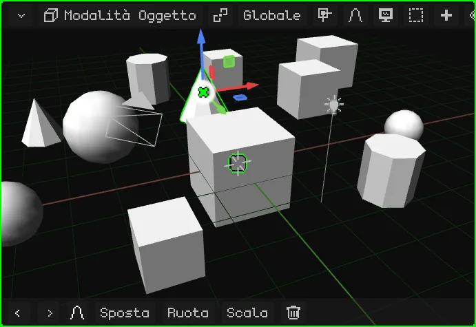

## Le viste di fronte, di lato e dall'alto

Per guardare la scena esattamente da un lato, senza sistemare l'orbita a mano:

| Vista |  PC | Menu |
|---|---|---|
| Frontale / Posteriore | <kbd>Num 1</kbd> / <kbd>Ctrl</kbd> + <kbd>Num 1</kbd> | Vista → Punto di vista → Frontale / Posteriore |
| Destra / Sinistra | <kbd>Num 3</kbd> / <kbd>Ctrl</kbd> + <kbd>Num 3</kbd> | Vista → Punto di vista → Destra / Sinistra |
| Dall'alto / Dal basso | <kbd>Num 7</kbd> / <kbd>Ctrl</kbd> + <kbd>Num 7</kbd> | Vista → Punto di vista → Superiore / Inferiore |

 Con <kbd>Ctrl</kbd>, ogni tasto dà la vista opposta.

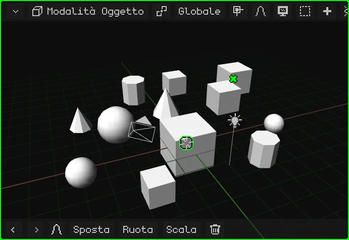

 **Su un Nokia N95:** tieni premuto il tasto <kbd>#</kbd> e premi una freccia. Sinistra e destra ruotano la vista di 90° alla volta intorno alla scena. Su passa alla vista dall'alto; giù torna a quella di lato, e di nuovo giù passa a quella dal basso. Se stavi orbitando liberamente, la prima freccia si limita a raddrizzare la vista su quella più vicina.

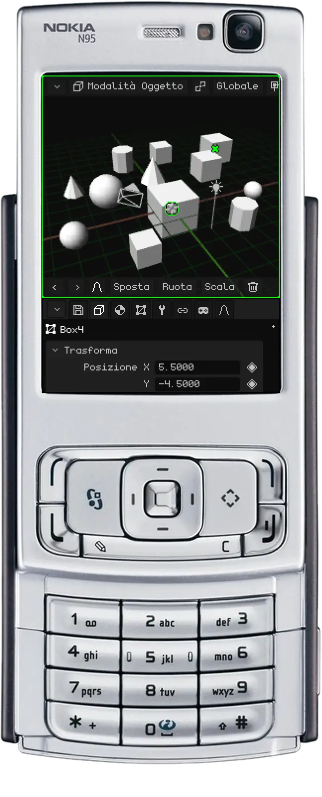

## Prospettiva e vista ortografica

La Vista 3D ha due modi di mostrare la scena:

- **Prospettiva:** come la vede l'occhio o una camera. Ciò che è lontano appare più piccolo, e le linee parallele (i bordi di una strada, le file di scatole del video) si incontrano in un punto dell'orizzonte: il **punto di fuga**. È così che si vede davvero, con profondità.
- **Ortografica:** senza prospettiva. Tutto mantiene la sua dimensione, vicino o lontano che sia, e le linee parallele non si toccano mai. È come una pianta architettonica o un disegno tecnico.

L'ortografica serve per modellare con precisione: allineare le cose, confrontare le dimensioni e misurare senza che la distanza inganni. Insieme alle viste di fronte, di lato e dall'alto, è come lavorare su una pianta. La prospettiva serve per vedere come verrà il risultato.

| | Come si cambia |
|---|---|
|  PC | <kbd>Num 5</kbd> |
|  Nokia N95 | Una pressione del <kbd>#</kbd>, senza frecce |
| Menu | Vista → Prospettiva/Orto |

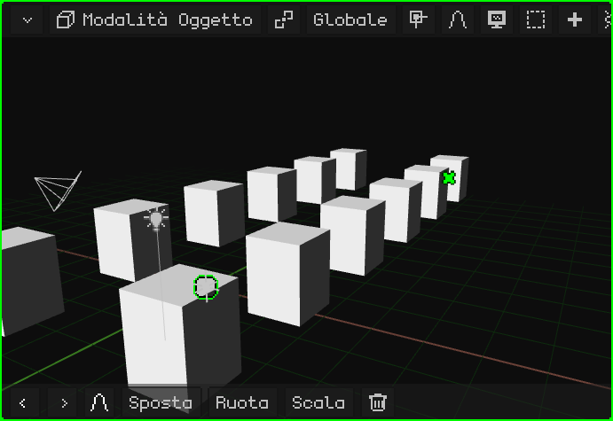

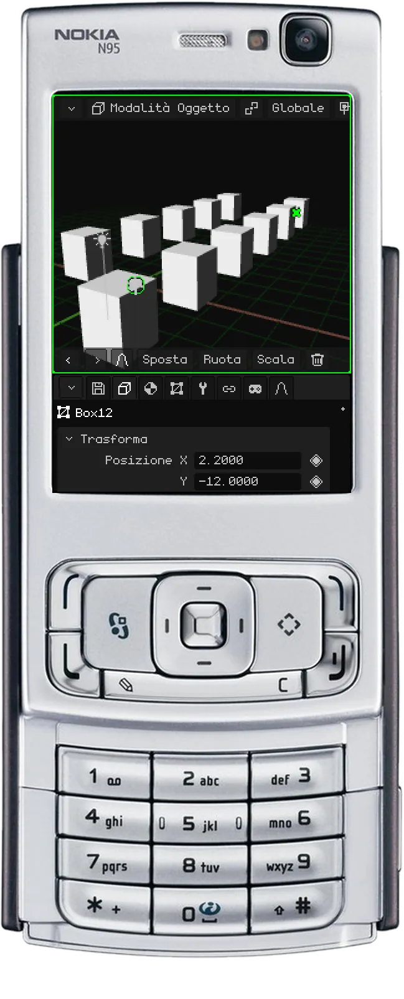

## Bloccare l'orbita

Con l'**orbita bloccata**, la vista smette di ruotare: ciò che prima la faceva orbitare ora la sposta, come se muovessi un foglio su un tavolo. È l'ideale per lavorare comodamente su modelli che si disegnano come una pianta 2D, per esempio la pianta di una casa o un pezzo meccanico: guardando dall'alto e in ortografica, ti muovi su tutta la pianta senza che si inclini mai.

| | Come si blocca e si sblocca |
|---|---|
|  PC | Menu Vista → Blocca orbita |
|  Schermo touch | Menu Vista → Blocca orbita |
|  Nokia N95 | <kbd>9</kbd> |

Quando la blocchi o la sblocchi compare un avviso e, finché è bloccata, Blocca orbita appare in verde nel menu.

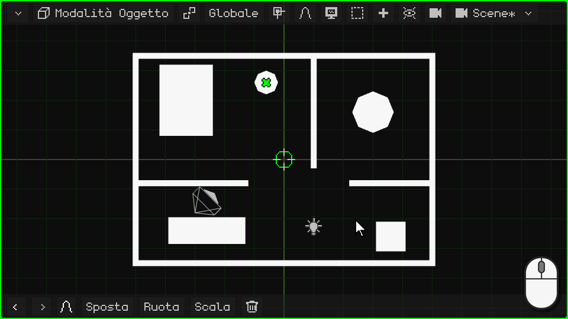

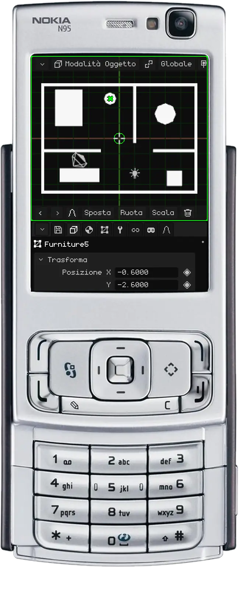

## La camera attiva

La scena può avere più camere, ma una sola è la **camera attiva**: quella che serve per il gioco e per i render. Ciò che vede quella camera è ciò che si vede quando giochi e ciò che esce quando fai il render di un'immagine o di un video. La vista con cui navighi serve solo per lavorare: non compare né nel gioco né nei render.

Per guardare attraverso la camera attiva:

| | Come si entra e si esce |
|---|---|
|  PC | <kbd>Num 0</kbd> |
|  Nokia N95 | <kbd>8</kbd> (fuori dalla Modalità Modifica: lì l'8 è Taglio ad anello) |
| Menu | Vista → Camere → Camera attiva |

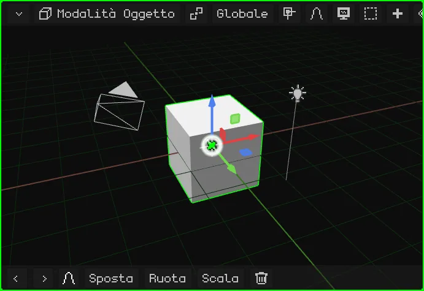

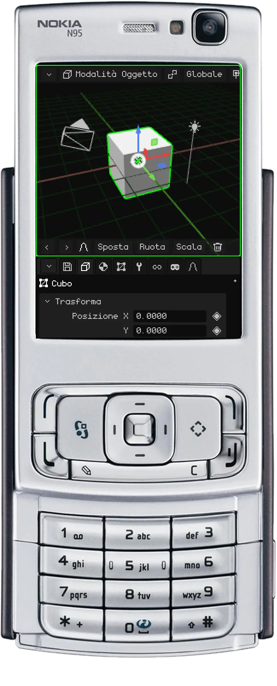

Il rettangolo è l'inquadratura: ciò che sta dentro è ciò che esce. In basso al centro c'è un **lucchetto**:

- **Aperto** (com'è all'inizio): lo zoom e lo spostamento ti avvicinano solo per controllare l'inquadratura, senza toccare la camera. Orbitare ti fa uscire dalla vista della camera e continui a navigare da dove si trovava.
- **Chiuso:** orbitare, spostare la vista e fare zoom muovono la **camera**. Così si sistema la ripresa.

### Bloccare la camera alla vista

Con il lucchetto chiuso, la camera attiva resta bloccata alla vista: orbiti, sposti la vista e fai zoom come nella navigazione normale, e la camera si muove con te. È il modo più comodo per mettere una camera esattamente dove vuoi: guardi attraverso la camera, la blocchi e navighi finché la ripresa non è proprio come la cerchi.

| | Come si blocca e si sblocca |
|---|---|
|  PC | Un clic sul lucchetto |
|  Schermo touch | Un tocco sul lucchetto |
|  Nokia N95 | Il tasto di selezione sinistro apre la barra dei menu (vedi [Quando non si vedono tutte le opzioni della barra dei menu](interfaz.md#quando-non-si-vedono-tutte-le-opzioni-della-barra-dei-menu)); lì, Vista → Blocca la camera alla vista |
| Menu | Vista → Blocca la camera alla vista |

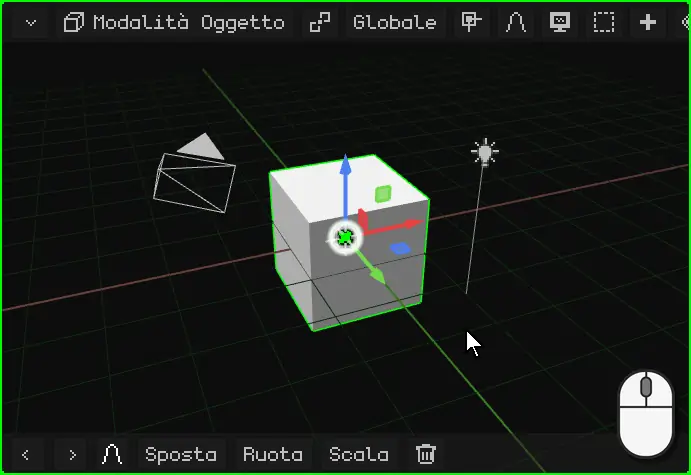

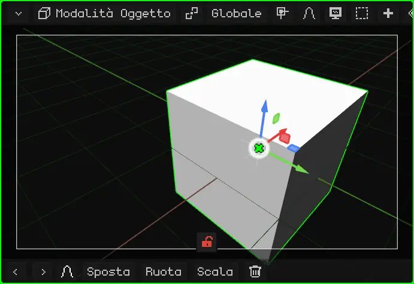

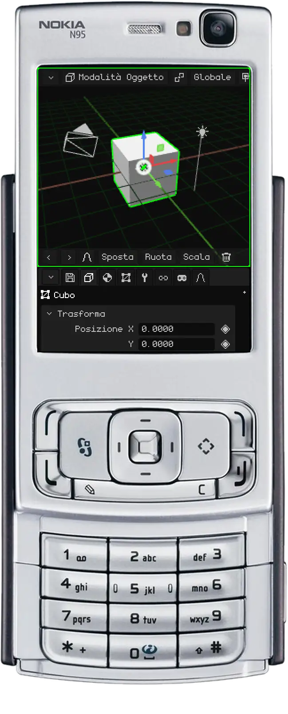

Perché un'altra camera diventi quella attiva: selezionala e premi <kbd>Ctrl</kbd> + <kbd>Num 0</kbd> (oppure Vista → Camere → Oggetto attivo come camera).

## Altre opzioni della vista

| Opzione | Cosa fa |  PC |  Nokia N95 | Menu |
|---|---|---|---|---|
| Ruotare la vista | La ruota di 15° sul proprio asse, come quando inclini la testa. | <kbd>Num 4</kbd> / <kbd>Num 6</kbd> | — | — |

Tutte le scorciatoie dell'editor sono in [Scorciatoie da tastiera](atajos.md).

## Tutti i controlli, a colpo d'occhio

### Con il mouse (PC)

| Funzione | Descrizione | Come si usa |
|---|---|---|
| Orbitare | Ruota la vista attorno al punto di pivot. | Tasto centrale + trascinare, o <kbd>Alt</kbd> + tasto sinistro + trascinare. |
| Spostare la vista (pan) | Sposta la vista lateralmente. | <kbd>Shift</kbd> + tasto centrale, o <kbd>Alt+Shift</kbd> + tasto sinistro + trascinare. |
| Zoom | Avvicina o allontana. | Rotella del mouse. |
| Seleziona | Sceglie ciò che si trova sotto il puntatore (si decide al rilascio). | Clic sinistro; <kbd>Shift</kbd>+clic aggiunge o toglie. |
| Selezione a riquadro | Trascinando sullo sfondo si traccia un rettangolo. | Trascinare con il tasto sinistro, o <kbd>B</kbd>. |
| Menu contestuale | Apre il menu della modalità sul puntatore (durante una trasformazione, la annulla). | Clic destro. |
| Blocca orbita | I comandi che orbitavano ora spostano la vista, che resta come una tavola 2D. | Menu Vista → Blocca orbita. |
| Blocca la camera alla vista | Guardando attraverso la camera attiva, navigare muove la camera: così si sistema la ripresa. | Clic sul lucchetto (in basso, nella vista camera), o menu Vista → Blocca la camera alla vista. |

### Con la tastiera

| Funzione | Descrizione | Scorciatoia |
|---|---|---|
| Vista frontale / posteriore | Guarda di fronte o da dietro. | <kbd>Num1</kbd> / <kbd>Ctrl+Num1</kbd> |
| Vista destra / sinistra | Guarda di lato. | <kbd>Num3</kbd> / <kbd>Ctrl+Num3</kbd> |
| Vista superiore / inferiore | Guarda dall'alto o dal basso. | <kbd>Num7</kbd> / <kbd>Ctrl+Num7</kbd> |
| Prospettiva / Ortografica | Alterna tra le due proiezioni. | <kbd>Num5</kbd> |
| Ruotare la vista | Ruota la vista di 15° sul proprio asse. | <kbd>Num4</kbd> / <kbd>Num6</kbd> |
| Vista camera | Guarda attraverso la camera attiva (di nuovo: esce). | <kbd>Num0</kbd> |
| Imposta camera attiva | L'oggetto attivo diventa la camera attiva. | <kbd>Ctrl+Num0</kbd> |
| Inquadra selezionati | Centra la vista su ciò che è selezionato e regola lo zoom. | <kbd>Num.</kbd> (il punto del tastierino numerico) |
| Vista locale | Mostra solo ciò che è selezionato e lo inquadra; di nuovo, ripristina tutto. | <kbd>/</kbd> |
| Importare un modello | Apre il file browser per importare OBJ, FBX, glTF o GLB (solo PC). | <kbd>Num9</kbd> |

### Con le dita (Android, Web touch)

| Funzione | Descrizione | Gesto |
|---|---|---|
| Orbitare | Ruota la vista. | Trascinare un dito. |
| Zoom e spostare la vista | Pizzicare avvicina o allontana; muovere le due dita insieme sposta la vista. | Due dita. |
| Seleziona | Sceglie ciò che si trova sotto il dito. | Toccare e sollevare senza muoversi. |
| Inquadra selezionati | Come <kbd>Num.</kbd>. | Doppio tocco con due dita. |
| Modificatori touch | Pulsanti Shift e Ctrl della barra degli strumenti: restano attivi (verdi) per aggiungere alla selezione o scegliere percorsi. | Toccare Shift / Ctrl. |
| Vista (navigare) | In Modalità Modifica e nelle modalità di pittura, il dito naviga invece di selezionare o dipingere. | Pulsante a forma di monitor della barra degli strumenti. |

### Con la tastiera del Nokia N95

| Funzione | Tasto |
|---|---|
| Orbitare | Frecce (tenere premute) |
| Zoom / Inquadra selezionati | <kbd>0</kbd> + su/giù / <kbd>0</kbd> da solo |
| Spostare la vista | <kbd>\*</kbd> + frecce |
| Viste (frontale, laterale, dall'alto) / Prospettiva-Ortografica | <kbd>#</kbd> + frecce / <kbd>#</kbd> da solo |
| Sposta / Ruota / Scala (durante la trasformazione: asse X / Y / Z) | <kbd>1</kbd> / <kbd>2</kbd> / <kbd>3</kbd> |
| Conferma / Annulla | OK (centro) / <kbd>C</kbd> |
| Elimina (se non c'è nulla da annullare) / Annulla e Rifai | <kbd>C</kbd> / <kbd>C</kbd> + sinistra o destra |
| Cambiare l'ombreggiatura | <kbd>6</kbd> |
| Estrudi (Modalità Modifica) | <kbd>7</kbd> |
| Taglio ad anello (Modalità Modifica) / vista camera (fuori dalla modifica) | <kbd>8</kbd> |
| Blocca orbita | <kbd>9</kbd> |
| Blocca la camera alla vista (guardando attraverso la camera) | Tasto di selezione sinistro → menu Vista |
| Ciclare la selezione / aggiungere, togliere, tutto o niente | Matita / Matita + frecce |
| Barra dei menu / cursore virtuale | Tasto di selezione sinistro / destro |
| Cambiare viewport, ridimensionare, massimizzare | Tasto verde (da solo, + frecce, + OK) |
| Modalità gioco a schermo intero | Tasto verde + <kbd>0</kbd> (di nuovo: l'immagine copre tutto lo schermo; di nuovo: si torna indietro). Senza la UI, senza il bordo della camera né l'area scura intorno (restano bande nere solo se la camera dichiara un aspetto diverso da quello dello schermo, fino alla seconda pressione), e le frecce non fanno pan: si vede il gioco così com'è |

L'N95 accetta anche mouse e tastiera Bluetooth. Per scrivere testo si usa il T9.
