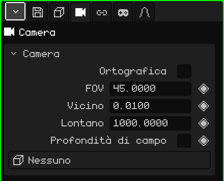

# Camera

Una **camera** è un punto di vista posizionato nella scena. La **camera attiva** è quella che serve per il gioco e per i render: ciò che vede lei è ciò che si vede giocando e ciò che finisce nell'immagine o nel video. Questo articolo è il riferimento delle sue proprietà; come si aggiungono e si spostano gli oggetti è spiegato nel tutorial [La Modalità Oggetto](../tutoriales/modo-objeto.md).

## Le schede

| Scheda | Cosa contiene |
|---|---|
| Oggetto | Posizione, rotazione, nome e visibilità, come in tutti gli oggetti: vedi [Mesh 3D](objeto-malla.md#la-scheda-oggetto). |
| Camera | L'obiettivo della camera: il riquadro qui sotto. |
| Vincoli | Vedi [Vincoli](restricciones.md). |
| Script | Gli script Lua dell'oggetto. Vedi [Lua in Whisk3D](../lua/README.md). |

## Il riquadro Camera

| Proprietà | Cosa fa |
|---|---|
| Ortografica | Senza prospettiva: ciò che è lontano non rimpicciolisce e le linee parallele non convergono. Vedi [Prospettiva e vista ortografica](../tutoriales/navegacion.md#prospettiva-e-vista-ortografica). |
| FOV ◆ | L'angolo di visione, in gradi (dall'alto in basso). Più piccolo è come un teleobiettivo: entra meno e si vede più da vicino. Più grande è un grandangolo: entra di più e la prospettiva si esagera. Di default è 45. |
| Vicino ◆ | La distanza minima di disegno: ciò che è più vicino alla camera non viene disegnato. Di default è 0.01. |
| Lontano ◆ | La distanza massima di disegno: ciò che è più lontano non viene disegnato. Di default è 1000. |
| Profondità di campo | Attiva la sfocatura: ciò che si trova alla distanza di fuoco viene nitido e il resto sfocato. La disegna il ray tracing; anche la Post-elaborazione può usare lo stesso fuoco. |
| Diaframma (f) | Quanto sfoca, come in una vera fotocamera: un numero più piccolo sfoca di più. |
| Distanza di fuoco ◆ | A quanti metri mette a fuoco. La linea e la croce disegnate sulla camera indicano dove. |
| Oggetto di fuoco | Un oggetto che il fuoco segue da solo, ovunque si trovi. Con un oggetto scelto, Distanza di fuoco scompare. **Nessuno** torna alla distanza impostata a mano. |
| Obiettivo | Un oggetto che la camera attiva guarda sempre: se l'oggetto si muove, la camera ruota per seguirlo. **Nessuno** la lascia guardare dove l'hai ruotata. |

Diaframma (f), Distanza di fuoco e Oggetto di fuoco appaiono con la casella Profondità di campo spuntata.

### Quando modificare Vicino e Lontano

Se un muro o un personaggio molto vicino alla camera appare tagliato, abbassa **Vicino**. Se lo sfondo di uno scenario grande scompare, alza **Lontano**. Conviene non allargare l'intervallo più del necessario: con molta distanza tra Vicino e Lontano, le facce molto vicine tra loro possono sfarfallare, soprattutto sul Nokia N95.

Vicino e Lontano si possono animare: serve, per esempio, ad allontanare il limite di disegno quando la camera sale e mostra più scenario.

### Una camera che segue un personaggio

Ci sono due modi, a seconda dell'inquadratura:

- **La camera resta al suo posto e ruota:** metti il personaggio in **Obiettivo**. La camera attiva lo tiene al centro dell'inquadratura anche se corre, come qualcuno che lo guarda passare.
- **La camera viaggia con lui:** lascia Obiettivo su Nessuno e aggiungile un vincolo **Child Of** con il personaggio come sorgente e solo **Posizione** spuntata. Va con lui alla stessa distanza e con la stessa angolazione, senza ruotare quando lui ruota (vedi [Child Of](restricciones.md#child-of)).

## Scegliere la camera attiva

La scena può avere più camere, ma una sola attiva. Per cambiarla:

| | Come si sceglie |
|---|---|
|  PC | Seleziona la camera e <kbd>Ctrl</kbd> + <kbd>Num 0</kbd> |
| Menu | Vista → Camere → Oggetto attivo come camera |
| Proprietà | Scheda Animazione → riquadro **Camera attiva** |

Nel riquadro Camera attiva, il rombo crea i **tagli di camera**: passare da una camera all'altra in un frame. Vedi [Timeline](linea-de-tiempo.md).

Per guardare attraverso la camera attiva e sistemare l'inquadratura navigando, vedi [La camera attiva](../tutoriales/navegacion.md#la-camera-attiva) nel tutorial sulla navigazione.
