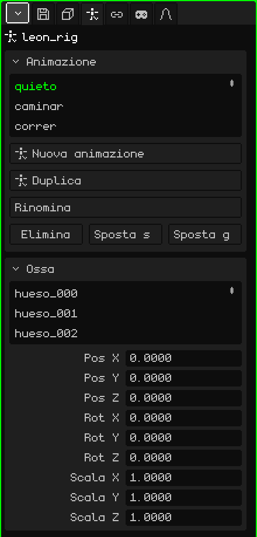

# Armatura

Un'**armatura** è un oggetto fatto di **ossa** che serve per animare personaggi e cose che si piegano. Le ossa si muovono e la mesh le segue, deformandosi: si anima un braccio ruotando un paio di ossa invece di spostare centinaia di vertici. Questo articolo è il riferimento delle sue proprietà; come si aggiungono e si spostano gli oggetti è spiegato nel tutorial [La Modalità Oggetto](../tutoriales/modo-objeto.md).

Aggiungi → Armatura ne crea una con un solo osso, pronta per aggiungerne altri. Nella Vista 3D ogni osso viene disegnato come una linea blu sopra a tutto, per vederlo anche se è dentro la mesh.

## Riposo e posa

Ogni osso ha due modi di stare:

- **Riposo:** dove è stato messo costruendo l'armatura. È la postura in cui la mesh non è deformata (un personaggio con le braccia aperte, per esempio).
- **Posa:** com'è in un frame dell'animazione: il braccio alzato, la testa girata. Mettere in posa non cambia il riposo: ci si può sempre tornare.

## Le modalità

Un'armatura ha tre modalità, che si scelgono nel menu **Modalità** della Vista 3D:

| Modalità | A cosa serve |
|---|---|
| Modalità Oggetto | Spostare, ruotare e scalare l'armatura intera, come qualsiasi oggetto. |
| Modalità Modifica | Costruire l'armatura: creare ossa dalle punte, spostarle, imparentarle. Cambia il riposo. |
| Modalità Posa | Mettere in posa e animare: ruotare le ossa e salvare i keyframe. |

 <kbd>Tab</kbd> alterna tra Modalità Oggetto e Modalità Posa (e dalla Modalità Modifica passa alla Modalità Posa).

Gli strumenti e le scorciatoie di ogni modalità sono in [Armature](esqueletos.md), nel manuale.

## Le schede

| Scheda | Cosa contiene |
|---|---|
| Oggetto | Posizione, rotazione, scala, nome e visibilità dell'armatura intera, come in tutti gli oggetti: vedi [Mesh 3D](objeto-malla.md#la-scheda-oggetto). |
| Armatura | Le animazioni e le ossa: i due riquadri qui sotto. |
| Vincoli | Vedi [Vincoli](restricciones.md). |
| Script | Gli script Lua dell'oggetto. Vedi [Lua in Whisk3D](../lua/README.md). |

## La scheda Armatura

### Animazione

Le animazioni dell'armatura (le **clip**): camminare, correre, saltare. Ogni clip salva le pose delle ossa nel tempo.

| Proprietà | Cosa fa |
|---|---|
| L'elenco | Le clip dell'armatura. Quella scelta è quella che si modifica e si riproduce. |
| Nuova animazione | Crea una clip vuota, con le ossa a riposo. |
| Duplica | Copia la clip scelta, per fare una variante senza toccare l'originale (appare se ci sono clip). |
| Rinomina | Cambia il nome della clip. Non si può ripetere all'interno della stessa armatura. |
| Elimina / Sposta su / Sposta giù | Elimina la clip o la sposta nell'elenco. |

Come si anima: [Timeline](linea-de-tiempo.md).

### Ossa

L'elenco delle ossa dell'armatura. Scegliendone uno, il riquadro mostra i suoi dati:

| Proprietà | Cosa fa |
|---|---|
| Nome | Il nome dell'osso. Cambiandolo si rinomina anche il suo gruppo di vertici nelle mesh dell'armatura, così la mesh continua a seguirlo. |
| Genitore | Da quale osso dipende (**Nessuno** se è la radice). Spostando il genitore si spostano i suoi figli. Il menu non offre l'osso stesso né quelli che dipendono da lui, perché non si formi un cerchio. |
| Connesso | Solo se ha un genitore. Se è spuntato, l'inizio dell'osso resta saldato alla punta del genitore: spostare l'una sposta l'altra. Spuntarlo con l'osso separato lo sposta per attaccarlo. Se non è spuntato, resta figlio ma con la punta libera (si vede una linea tratteggiata). |
| Pos X, Y, Z | Dove si trova l'osso nella posa attuale, misurato dal suo genitore. |
| Rot X, Y, Z | Quanto è ruotato nella posa attuale, in gradi. |
| Scala X, Y, Z | La sua dimensione nella posa attuale: 1 è l'originale. |

Pos, Rot e Scala modificano la **posa** e si vedono all'istante, ma non vengono salvati nell'animazione finché non inserisci un keyframe (Inserisci keyframe, in Modalità Posa).

## Far seguire l'armatura a una mesh

Perché una mesh si deformi con le ossa servono due cose:

1. **Il modificatore Armatura** sulla mesh (Proprietà → scheda Modificatori → Aggiungi → Armatura), con l'armatura scelta in **Obiettivo**. Vedi [Armatura (modificatore)](modificador-esqueleto.md).
2. **Gruppi di vertici** con i nomi delle ossa (Proprietà → scheda Mesh 3D → [Gruppi di vertici](objeto-malla.md#gruppi-di-vertici)). Ogni gruppo dice quali vertici muove il suo osso e quanto; i pesi si dipingono con la [Pittura pesi](pintura.md#pittura-pesi).

Per un oggetto rigido, come una spada in mano o un cappello, non serve niente di tutto questo: basta un vincolo [Child Of](restricciones.md#child-of) con l'armatura come sorgente e l'osso della mano o della testa. È molto più leggero che deformare una mesh, e sul Nokia N95 si nota.

## Importare un personaggio

Aggiungi → Importazioni → glTF o GLB porta un personaggio già pronto in un colpo solo. Per esempio, Leon:

- la **mesh**, come figlia dell'armatura;
- l'**armatura**, con il nome del file e `_rig` alla fine;
- i **gruppi di vertici**, uno per ogni osso che muove la mesh, con i pesi che aveva il file;
- le **animazioni**, come clip nel riquadro Animazione;
- e, se ha animazioni, il **modificatore Armatura** già messo sulla mesh, che punta alla sua armatura.

Scegli una clip dall'elenco, avvia la riproduzione nella Timeline e il personaggio si muove.
