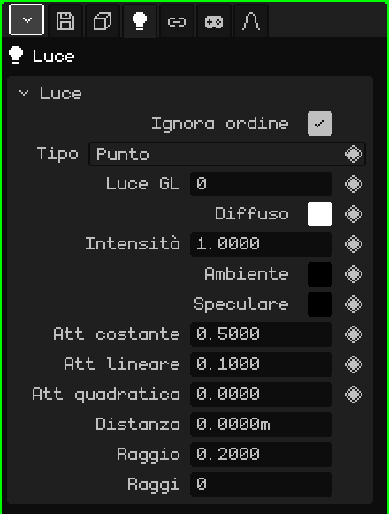

# Luce

Una **luce** illumina la scena: i materiali che hanno Illuminazione attiva appaiono più chiari o più scuri a seconda delle luci che li raggiungono. Questo articolo è il riferimento delle sue proprietà; come si aggiungono e si spostano gli oggetti è spiegato nel tutorial [La Modalità Oggetto](../tutoriales/modo-objeto.md).

## I tre tipi

| Tipo | Come illumina | A cosa serve |
|---|---|---|
| **Punto** | Da un punto, in tutte le direzioni, come una lampadina. | Lampade, candele, falò, il bagliore di un oggetto. |
| **Sole** | Con raggi paralleli che arrivano tutti dallo stesso lato. Conta dove punta, non dove si trova. | La luce del giorno negli esterni. |
| **Faretto** | In un cono, come una torcia. | Torce, fari di un'auto, riflettori di un palcoscenico. |

Aggiungi → Luce crea una luce di tipo Punto; Aggiungi → Sole e Aggiungi → Faretto creano direttamente gli altri due. Il tipo si può cambiare dopo nella proprietà **Tipo**.

Il sole e il faretto si orientano ruotando l'oggetto. Il sole disegna sempre una linea fino al pavimento, verso dove illumina; con la luce selezionata, il faretto mostra il suo cono e la luce Punto una sfera grande quanto la sua **Distanza**.

## Le schede

| Scheda | Cosa contiene |
|---|---|
| Oggetto | Posizione, rotazione, nome e visibilità, come in tutti gli oggetti: vedi [Mesh 3D](objeto-malla.md#la-scheda-oggetto). |
| Luce | Il riquadro qui sotto. |
| Vincoli | Vedi [Vincoli](restricciones.md). |
| Script | Gli script Lua dell'oggetto. Vedi [Lua in Whisk3D](../lua/README.md). |

## Il riquadro Luce

| Proprietà | Cosa fa |
|---|---|
| Ignora ordine | Se è spuntato (come di default), la luce illumina tutta la scena, ovunque si trovi nell'Outliner. Se non è spuntato, illumina solo ciò che viene disegnato **dopo** di lei nell'Outliner: serve per illuminare certe cose con certe luci. |
| Tipo | Punto, Sole o Faretto. |
| Luce GL ◆ | Quale delle 8 luci di OpenGL usa (da 0 a 7). Vedi [Più di 8 luci](#più-di-8-luci). |
| Diffuso ◆ | Il colore della luce. |
| Intensità ◆ | Quanto forte illumina. 1 è il colore così com'è; di più è più forte. |
| Ambiente ◆ | Una luce uniforme che arriva ovunque, anche alle facce che non guardano verso la luce. Di default è nera (niente ambiente). Alzala un po' perché le ombre non restino nere. |
| Speculare ◆ | Il colore del riflesso che la luce lascia sui materiali. Di default è nero (niente riflesso). |
| Att costante, Att lineare, Att quadratica ◆ | L'**attenuazione**: come si spegne la luce con la distanza. Costante la indebolisce in modo uniforme ovunque; Lineare la spegne poco a poco allontanandosi; Quadratica la spegne molto più in fretta da lontano. Non appaiono nel Sole. |
| Angolo faretto ◆ | Solo nel Faretto: quanto è aperto il cono, in gradi, dal centro al bordo. Con 45 il cono si apre di 90° in totale. |
| Esponente faretto ◆ | Solo nel Faretto: come si distribuisce la luce nel cono. 0 illumina in modo uniforme; più alto la concentra al centro e scurisce i bordi. |
| Distanza | Fin dove illumina una luce Punto o un Faretto nel ray tracing, in metri; è anche la lunghezza del cono disegnato. 0 è senza limite. Non appare nel Sole. |
| Raggio | Per il ray tracing: la dimensione della lampada. 0 dà ombre dure, dal bordo netto; più grande dà ombre dal bordo morbido. Nel Sole sono gradi. |
| Raggi | Per il ray tracing: quanti raggi d'ombra lancia questa luce. Più raggi, ombre morbide più pulite ma più lente. 0 usa quelli della scheda File / Render. |

### Distanza e attenuazione

Entrambe cambiano fin dove si nota una luce, ma non allo stesso modo:

- L'**attenuazione** vale sempre, nella Vista 3D, nel gioco e nel ray tracing: la luce si spegne con la distanza, ma non si interrompe mai del tutto.
- La **Distanza** è un taglio per il ray tracing: la luce si spegne dolcemente fino ad arrivare a zero esattamente lì, e oltre non illumina. In OpenGL non taglia: lì comanda l'attenuazione. Serve anche come guida, perché la sfera o il cono mostrano dove finisce.

## Più di 8 luci

OpenGL disegna fino a **8 luci alla volta**, numerate da 0 a 7: è la proprietà **Luce GL**. La scena può averne molte di più; superate le 8, le nuove condividono il numero con qualcuna delle precedenti. Il ray tracing, invece, le usa tutte.

Con **Ignora ordine** non spuntato si può riusare un numero di proposito: una luce con Luce GL 0 illumina ciò che viene disegnato dopo di lei nell'Outliner, e un'altra luce più in basso con la stessa Luce GL 0 la sostituisce per ciò che segue. Così uno scenario lungo può avere luci diverse in ogni zona senza superare le 8.

## Esempi

| Scena | Come si costruisce |
|---|---|
| Un esterno di giorno | Un Sole, con Diffuso appena giallo, e un po' di Ambiente azzurro perché le ombre non restino nere. |
| Una stanza con una lampada | Una luce Punto nella lampada, con Att lineare un po' più alta perché si spenga verso le pareti. Per il ray tracing, una Distanza grande quanto la stanza. |
| Una torcia | Un Faretto con un Angolo faretto piccolo e un Esponente faretto alto, attaccato alla mano del personaggio con un vincolo [Child Of](restricciones.md#child-of). |
| Una luce che tremola | Keyframe sull'Intensità (◆), con valori che salgono e scendono. |
