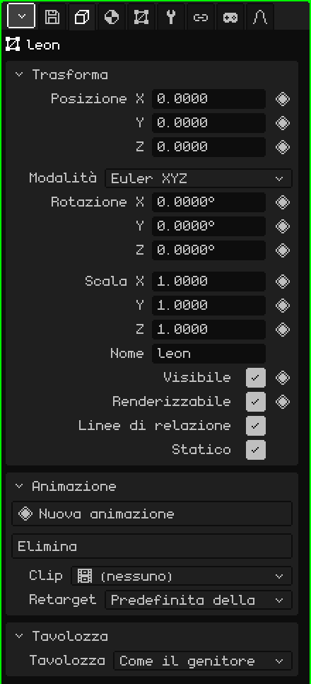
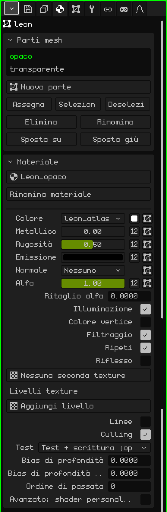
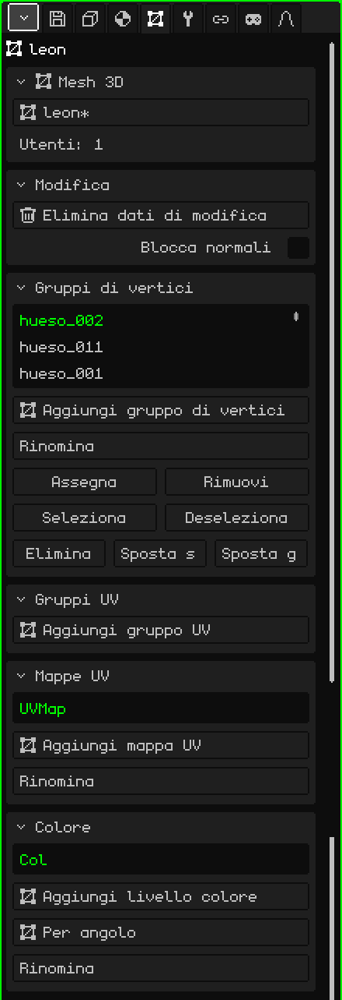
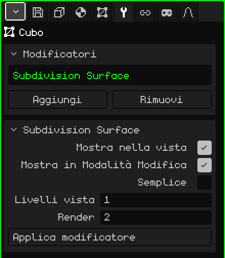

# Mesh 3D

Una **mesh 3D** è l'oggetto che ha una forma: è fatta di vertici, spigoli e facce, ed è ciò che si modella, si dipinge e si anima. Un cubo, un personaggio o uno scenario intero sono mesh. Questo articolo è il riferimento delle sue proprietà; come si creano, si spostano e si imparentano gli oggetti è spiegato nel tutorial [La Modalità Oggetto](../tutoriales/modo-objeto.md).

## Le schede

Con una mesh selezionata, Proprietà mostra queste schede, oltre a File / Render e Animazione, che ci sono sempre:

| Scheda | Cosa contiene |
|---|---|
| Oggetto | Ciò che è comune a tutti gli oggetti: posizione, rotazione, scala, nome e visibilità. |
| Materiale | Le parti della mesh e il materiale di ognuna. |
| Mesh 3D | I dati della mesh: quale usa, i suoi gruppi di vertici, le sue mappe UV e i suoi livelli di colore. |
| Modificatori | I modificatori, che cambiano la forma senza distruggerla. |
| Trasforma | Solo in Modalità Modifica: il centro della selezione, per scriverlo con i numeri. |
| Vincoli | Vedi [Vincoli](restricciones.md). |
| Script | Gli script Lua dell'oggetto. Vedi [Lua in Whisk3D](../lua/README.md). |

## La scheda Oggetto

È uguale per tutti i tipi di oggetto: ce l'hanno anche camere, luci, armature e suoni.

### Trasforma

| Proprietà | Cosa fa |
|---|---|
| Posizione X, Y, Z ◆ | Dove si trova l'oggetto, in metri. Z è l'altezza. |
| Modalità | Come si scrive la rotazione: **Euler XYZ** (tre angoli in gradi, il più facile da leggere), **Quaternione (WXYZ)** o **Asse angolo**. Con gli ultimi due appare **Rotazione W**. Cambiare la modalità non ruota l'oggetto: cambia solo come vengono mostrati i numeri. |
| Rotazione X, Y, Z ◆ | La rotazione su ogni asse. |
| Scala X, Y, Z ◆ | La dimensione su ogni asse: 1 è la dimensione originale, 2 il doppio e 0.5 la metà. |
| Nome | Il nome dell'oggetto, lo stesso che mostra l'Outliner. Non si può ripetere: se esiste già, gli si aggiunge un numero (`.001`). |
| Visibile ◆ | Se l'oggetto si vede. È lo stesso occhio dell'Outliner. |
| Renderizzabile ◆ | Se compare nei render. Se non è spuntato, continua a vedersi nella Vista 3D ma non appare nell'immagine né nel video. |
| Linee di relazione | La linea che unisce l'oggetto al suo genitore. Conviene spegnerla quando un oggetto ha molti figli e le linee coprono la vista. |
| Statico | Indica che l'oggetto non si muove mai. Conta solo dentro un oggetto Culling con il metodo a griglia: un oggetto statico viene collocato nella sua cella una sola volta, invece di misurarlo a ogni fotogramma. |

### Animazione e Tavolozza

- **Animazione:** le animazioni proprie dell'oggetto, come un'animazione dei vertici, e le loro clip. Vedi [Timeline](linea-de-tiempo.md).
- **Tavolozza:** quale tavolozza di colori usa l'oggetto. Con **Come il genitore** (come di default) la eredita; scegliere una tavolozza del progetto ridipinge lui e tutto ciò che dipende da lui.

## La scheda Materiale

### Parti mesh

Una mesh può essere divisa in **parti**, e ogni parte ha il suo materiale. Una casa, per esempio, può avere i muri in una parte e il vetro delle finestre in un'altra.

| Proprietà | Cosa fa |
|---|---|
| L'elenco | Le parti della mesh. Quella scelta è quella che mostra il riquadro Materiale qui sotto. |
| Nuova parte | Crea una parte vuota. |
| Assegna | Sposta nella parte scelta le facce selezionate in Modalità Modifica. |
| Seleziona / Deseleziona | Seleziona o deseleziona le facce di quella parte. Se serve, Seleziona passa alla Modalità Modifica per mostrarle. |
| Elimina / Rinomina | Elimina la parte (le sue facce passano alla precedente) o le cambia nome. Elimina appare se ce n'è più di una. |
| Sposta su / Sposta giù | Cambiano l'ordine. Le parti vengono disegnate in quell'ordine: conviene lasciare ciò che è trasparente alla fine. |

### Materiale

Il materiale decide come si vede la parte: il suo colore, la sua texture e come la colpisce la luce. Il materiale predefinito non si modifica: per cambiare qualcosa, prima se ne crea uno con il selettore in alto (**Nuovo materiale**), che serve anche a scegliere un altro materiale del progetto. Le opzioni più usate:

| Proprietà | Cosa fa |
|---|---|
| Rinomina materiale | Cambia il nome del materiale. |
| Colore | La texture della parte, il quadratino del **Colore base** e la mappa UV usata dalla texture. |
| Metallico, Rugosità, Emissione, Normale, Alfa | Ognuno può essere un numero o una texture (il pulsante **Numero / texture**). Alfa è la trasparenza: con meno di 1, o con una texture alfa, il materiale diventa trasparente. |
| Ritaglio alfa | Taglia ciò che ha un alfa basso, senza mescolare: per grate, reti metalliche o foglie. 0 lo disattiva. |
| Trasmissione, IOR | Vetro e rifrazione. Solo con il **Ray tracing** attivo (scheda File / Render). |
| Illuminazione | Se le luci della scena lo colpiscono. Se è spenta, il colore si vede piatto, sempre uguale. Se il backend grafico ha gli shader, appare **Ombreggiatura**: Per vertice o Per pixel. |
| Colore vertice | Usa i colori dipinti sulla mesh (vedi [Pittura vertici](pintura.md#pittura-vertici)) invece del colore base. |
| Filtraggio / Ripeti | Ammorbidisce la texture da vicino (se non è spuntato si vedono i pixel) / la ripete come un mosaico. |
| Riflesso | Un riflesso dell'ambiente, come il cromo. |
| Livelli texture | Fino a quattro texture in più sopra la prima, ognuna con la sua mappa UV e il suo modo di fusione. |
| Linee / Spessore linea | Disegna gli spigoli della parte, con lo spessore in pixel. |
| Culling | Non disegna le facce posteriori. |
| Test, Bias di profondità, Ordine di passata | Opzioni avanzate di profondità, per decalcomanie e cose appoggiate sopra altre. |
| Avanzato: shader personalizzato | Un file che disegna il materiale su misura: vedi [Shader scritti](shaders.md). |

Se l'oggetto ha la fisica (Aggiungi → Fisica), il suo riquadro **Fisica** appare anche in questa scheda.

## La scheda Mesh 3D

### Mesh 3D

La forma dell'oggetto è una risorsa del progetto, e più oggetti possono **condividere** la stessa mesh (è ciò che fa Duplica collegato): modificarne una le modifica tutte.

| Proprietà | Cosa fa |
|---|---|
| Il selettore | La mesh usata dall'oggetto (con un `*` se ha modifiche non salvate). Da lì si sceglie un'altra mesh del progetto o **Nuova copia**. |
| Utenti | Quanti oggetti della scena usano questa mesh. |
| Rendi unico | Appare se la mesh è condivisa: dà all'oggetto la sua copia personale, per modificarla senza toccare gli altri. |

Se la mesh proviene da una libreria appare l'avviso "Appartiene a una libreria (sola lettura): apri la libreria per modificarlo", e ciò che la cambierebbe scompare dal pannello.

### Modifica

**Elimina dati di modifica** serve per uno scenario che non verrà più modellato: toglie alla mesh i dati usati dalla Modalità Modifica, così si carica più in fretta e occupa meno memoria (conta sul Nokia N95). Nel frattempo non si può entrare in Modalità Modifica. **Converti in mesh modificabile** li ricalcola.

La casella **Blocca normali** fa sì che, in Modalità Modifica, spostando i vertici le normali di questa mesh non vengano ricalcolate. Così si conservano quelle arrivate con un modello importato o quelle sistemate a mano. È disattivata di default, e ogni mesh ha la sua.

### Gruppi di vertici

Un **gruppo di vertici** è un elenco di vertici, ognuno con un peso. È ciò che usa un'[armatura](objeto-esqueleto.md) per sapere quali vertici muove ogni osso: il gruppo si chiama come l'osso. I pesi si dipingono con la [Pittura pesi](pintura.md#pittura-pesi).

| Proprietà | Cosa fa |
|---|---|
| Aggiungi gruppo di vertici / Rinomina | Crea un gruppo o gli cambia nome. |
| Assegna / Rimuovi | Mette nel gruppo (con peso 1) o toglie i vertici selezionati in Modalità Modifica. |
| Seleziona / Deseleziona | Seleziona o deseleziona i vertici del gruppo, per vedere cosa prende. |
| Elimina / Sposta su / Sposta giù | Elimina il gruppo o lo sposta nell'elenco. |

**Gruppi UV** funziona allo stesso modo, ma i suoi pesi sono per le armature 2D dell'[Editor UV](editor-uv.md).

### Mappe UV

Una **mappa UV** dice come si appoggia la texture sulla mesh. Una mesh può averne diverse: per esempio, una per la texture del colore e un'altra per un livello di texture che si ripete in modo diverso. Ogni texture del materiale sceglie quale usa.

**Aggiungi mappa UV** ne crea una, **Rinomina** le cambia nome, ed Elimina, Sposta su e Sposta giù appaiono quando ce n'è più di una.

### Colore

I **livelli colore** salvano i colori dipinti sulla mesh con la Pittura vertici. **Aggiungi livello colore** ne crea uno; **Modalità colore** alterna tra **Per vertice** (le facce che condividono un vertice condividono il suo colore) e **Per angolo** (ogni faccia può avere il suo, per bordi netti). Rinomina, Elimina, Sposta su e Sposta giù, come nelle mappe UV.

## La scheda Modificatori

Un **modificatore** cambia la mesh senza distruggerla: si può disattivare, riordinare o eliminare quando si vuole, e la mesh originale resta lì.

Il riquadro **Modificatori** contiene l'elenco (si applicano in ordine, dall'alto in basso), **Aggiungi** (il menu con i tipi), **Rimuovi** e **Sposta su / Sposta giù**. Sotto, il riquadro del modificatore scelto (con il suo nome come titolo) ha **Mostra nella vista** (se è disattivato non viene calcolato), **Mostra in Modalità Modifica** (se è disattivato, modificare è più veloce e si ricalcola all'uscita), le sue proprietà e **Applica modificatore**, che lo rende definitivo nella mesh e lo toglie dall'elenco.

Ogni modificatore ha il suo articolo:

| Modificatore | A cosa serve |
|---|---|
| [Vite](modificador-screw.md) | Fa ruotare un profilo attorno a un asse: viti, vasi, molle. |
| [Specchio](modificador-espejo.md) | Riflette la mesh: si modella una metà e l'altra viene da sola. |
| [Array](modificador-array.md) | Copie in fila: scale, recinzioni, catene. |
| [Superficie di suddivisione](modificador-subdivision.md) | Ammorbidisce la mesh suddividendola. |
| [Booleano](modificador-booleano.md) | Unisce, interseca o sottrae un altro oggetto. |
| [Culling](modificador-culling.md) | Ottimizzazione: non disegna ciò che non si vede dalla camera. |
| [Armatura](modificador-esqueleto.md) | Deforma la mesh con un'armatura. |
