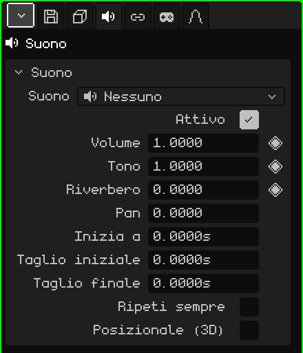

# Suono

Un oggetto **Suono** è un audio posizionato nella scena: una musica, un effetto, il rumore di una macchina. Nella Vista 3D si vede come un altoparlante. Può suonare uguale ovunque, come una musica, oppure dal punto in cui si trova, più forte quanto più ci si avvicina. Questo articolo è il riferimento delle sue proprietà; come si aggiungono e si spostano gli oggetti è spiegato nel tutorial [La Modalità Oggetto](../tutoriales/modo-objeto.md).

Un nuovo oggetto Suono parte senza audio: **Nessuno**. Il file si sceglie nel riquadro Suono.

## Con il suono già scelto

-  Trascinare un suono dalla [Libreria](outliner.md#vista-libreria) alla Vista 3D crea un oggetto Suono nel punto in cui cade, con quel suono.
-  Rilasciare un file audio (per esempio un `.wav`) sulla Vista 3D lo aggiunge al progetto e crea lì l'oggetto.

## Le schede

| Scheda | Cosa contiene |
|---|---|
| Oggetto | Posizione, nome e visibilità, come in tutti gli oggetti: vedi [Mesh 3D](objeto-malla.md#la-scheda-oggetto). Un suono nascosto non suona, e nascondere una collezione zittisce i suoni che contiene. |
| Suono | Il riquadro qui sotto. |
| Vincoli | Vedi [Vincoli](restricciones.md). |
| Script | Gli script Lua dell'oggetto, che possono farlo suonare o zittirlo in un gioco. Vedi [Lua in Whisk3D](../lua/README.md). |

## Il riquadro Suono

| Proprietà | Cosa fa |
|---|---|
| Suono | Il file che suona, con la sua durata. Il menu elenca i suoni del progetto, **Nessuno** e **Carica suono dal browser file...**, che porta un suono dal disco al progetto. |
| Attivo | Se non è spuntato, non suona. Serve per spegnerlo senza eliminarlo. |
| Volume ◆ | Quanto forte suona: 1 è il volume del file, 0 è muto e 2 il doppio. |
| Tono ◆ | Più acuto o più grave. 1 è l'originale; 2 suona un'ottava più acuto e il doppio più veloce, 0.5 un'ottava più grave e a metà velocità. Per questo cambiare il tono cambia anche quanto dura. |
| Riverbero ◆ | Quanto di questo suono va all'eco del riverbero: 0 niente, 1 tutto. Dà la sensazione di una grotta, di una chiesa o di un corridoio. |
| Pan | Da quale lato suona: -1 a sinistra, 0 al centro, 1 a destra. Solo senza Posizionale (3D): con quello attivo, il lato lo decide la posizione. |
| Inizia a | In quale secondo della scena parte. |
| Taglio iniziale | Quanti secondi si tagliano all'inizio del file. |
| Taglio finale | Quanti secondi si tagliano alla fine del file. |
| Ripeti sempre | Il tratto che resta tra i due tagli si ripete senza sosta, senza interruzioni. Per musiche di sottofondo e rumori continui. |
| Posizionale (3D) | Suona dal punto in cui si trova l'oggetto. Vedi più sotto. |
| Raggio a volume pieno | Solo con Posizionale (3D): fino a questa distanza, in metri, suona a volume pieno. |
| Raggio udibile | Solo con Posizionale (3D): da questa distanza, in metri, non si sente più. |

## I tempi sono in secondi

I tempi del suono si misurano in **secondi**, non in frame. Così, se la scena passa da 30 a 60 fotogrammi al secondo, i suoni restano agganciati allo stesso momento e non c'è niente da risistemare.

Nella [Timeline](linea-de-tiempo.md#suoni), ogni suono selezionato ha la sua **striscia**: dove parte e quanto dura. Trascinare la striscia cambia **Inizia a**, e prendere una delle sue estremità cambia i tagli. Suona con il Play della timeline e si zittisce quando la fermi.

In un gioco, il suono parte quando compare (per esempio, quello di un'esplosione che fa parte di un prefab), più quanto indicato in **Inizia a**.

## Posizionale (3D)

Se non è spuntato, il suono si sente uguale ovunque si trovi, come una musica. Se è spuntato, si sente **dal punto in cui si trova**, rispetto a chi ascolta:

- Più vicino, più forte: fino al **Raggio a volume pieno** suona a volume pieno, e da lì scende fino a spegnersi al **Raggio udibile**.
- Se è a destra, suona a destra; se è a sinistra, a sinistra.
- Se è dietro, suona più basso e più verso il centro.

Chi ascolta è la camera attiva nel gioco e la Vista 3D attiva nell'editor (o la camera, se si sta guardando attraverso di essa). Con il suono selezionato, la Vista 3D disegna due sfere: quella del raggio a volume pieno e quella del raggio udibile.

## Esempi

| Suono | Come si costruisce |
|---|---|
| Musica di sottofondo | Senza Posizionale (3D), con Ripeti sempre. |
| Una cascata | Posizionale (3D) e Ripeti sempre, con un Raggio a volume pieno piccolo e un Raggio udibile grande: si comincia a sentire da lontano e cresce avvicinandosi. |
| Un colpo al secondo 4 di un'animazione | Inizia a su 4, o la striscia spostata fin lì nella Timeline. A 30 FPS è il frame 121: il frame 1 è il secondo 0. |
| Una musica che si spegne alla fine | Keyframe sul Volume (◆): 1 poco prima della fine e 0 alla fine. |
