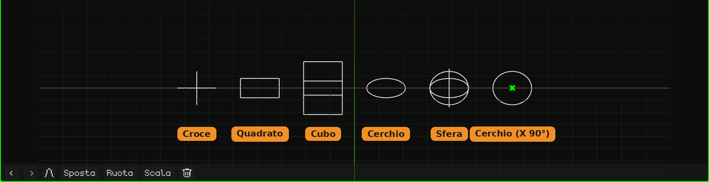

# Vuoto

Un **Vuoto** è un oggetto senza mesh: non si vede nel render né nel gioco. Serve come punto di riferimento: un perno per ruotare o scalare altri oggetti che dipendono da lui, un punto a cui far puntare una camera o un vincolo, un controllo per animare. Si aggiunge con **Aggiungi → Vuoto**, nel cursore 3D. Come si aggiungono e si spostano gli oggetti è spiegato nel tutorial [La Modalità Oggetto](../tutoriales/modo-objeto.md).

Nella Vista 3D viene disegnato con linee. Un Vuoto nuovo è un **cerchio steso sul pavimento**, facile da vedere e da afferrare. La forma, la dimensione e la rotazione del disegno si cambiano nel suo riquadro. È **solo il suo aspetto**: non cambia l'oggetto, né la sua trasformazione, né i suoi figli.

## Le schede

| Scheda | Cosa contiene |
|---|---|
| Oggetto | Posizione, rotazione, scala, nome e visibilità, come in tutti gli oggetti: vedi [Mesh 3D](objeto-malla.md#la-scheda-oggetto). Scalare il Vuoto scala anche i suoi figli. |
| Vuoto (la croce) | Il riquadro qui sotto. |
| Vincoli | Vedi [Vincoli](restricciones.md). |
| Script | Gli script Lua dell'oggetto. Vedi [Lua in Whisk3D](../lua/README.md). |

## Il riquadro Vuoto

| Proprietà | Cosa fa |
|---|---|
| Forma | Come viene disegnato, ognuna con la sua icona: **Croce** (i tre assi), **Quadrato**, **Cubo**, **Cerchio** o **Sfera** (tre cerchi, uno per asse). Il quadrato e il cerchio nascono stesi sul pavimento. Sugli schermi piccoli (il Nokia N95, la PSP, il 3DS e il Dreamcast) il cerchio e la sfera vengono disegnati con metà delle linee: lì la differenza non si nota e il telefono disegna meno. |
| Dimensione | Quanto misura il disegno, in metri, da un'estremità all'altra. 1 è un metro. |
| Rotazione X, Y, Z | Ruota il disegno, in gradi. Per esempio, il cerchio con **X** a 90 resta in piedi. |

Niente di tutto questo sposta o ruota l'oggetto: il Vuoto resta nello stesso punto e i suoi figli non se ne accorgono. Si salva con il progetto.

## A cosa serve

- **Un perno:** un oggetto figlio di un Vuoto ruota e si scala a partire dal Vuoto. Per esempio, una palla imparentata a un Vuoto posto nel suo punto più basso si schiaccia contro il pavimento quando scali il Vuoto.
- **Ordinare la scena:** più oggetti che dipendono da un Vuoto si spostano insieme spostando solo il Vuoto.
- **Un bersaglio:** i [vincoli](restricciones.md) possono puntare a un Vuoto, per esempio perché una camera continui a guardarlo.
