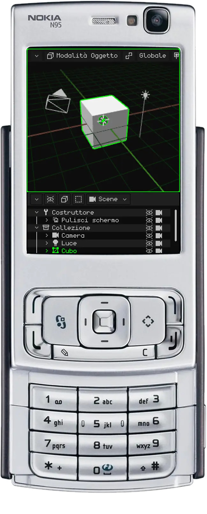
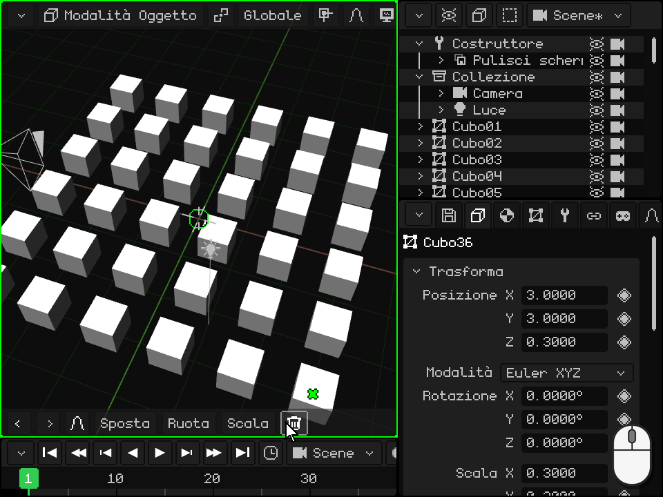
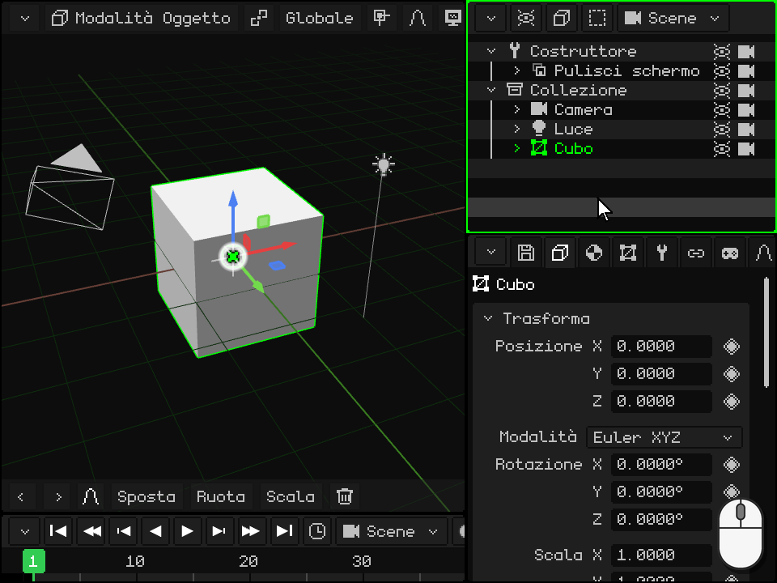

# L'Outliner

> [!NOTE]
>  Il Nokia N95 supporta mouse e tastiera (via Bluetooth). Le parti di questa pagina dedicate al Nokia spiegano come usarlo senza mouse né tastiera, solo con i tasti del telefono.

L'**Outliner** è l'elenco di tutto ciò che c'è nella scena: oggetti, camere, luci e collezioni. È uno dei viewport visti in [I viewport](interfaz.md); sul PC si trova in alto a destra. Da qui si scelgono gli oggetti, si nascondono, si riordinano, si mettono uno dentro l'altro e si rinominano.

Ciò che scegli nell'Outliner resta scelto anche nella Vista 3D, e viceversa. L'ultimo che hai scelto è l'**oggetto attivo**: quello che mostra Proprietà.

 **Su Android** l'Outliner non è sullo schermo: lo spazio resta alla Vista 3D e a Proprietà. Per usarlo, trasforma un viewport in Outliner (o dividine uno) con il pulsante dell'angolo, come in [Cambiare il tipo](interfaz.md#cambiare-il-tipo). Si può lavorare anche senza l'Outliner: gli oggetti si scelgono toccandoli nella Vista 3D, e Proprietà ha il nome e le caselle **Visibile** e **Renderizzabile**.

 **Sul Nokia N95** l'Outliner non è sullo schermo: ci stanno solo due viewport. Mentre metti in ordine la scena, trasforma Proprietà in Outliner: con il **tasto di selezione sinistro** entri nelle sue schede e con la freccia sinistra arrivi al menu del pulsante dell'angolo; lì scegli Outliner. Per tornare indietro, il tasto di selezione sinistro nell'Outliner apre direttamente quel menu. Con il **tasto verde**  lo rendi il viewport attivo: tutto ciò che segue per l'N95 si fa con il bordo verde sull'Outliner.

## Cosa mostra ogni riga

Ogni riga è un oggetto. La **freccia** comprime o espande ciò che ha dentro; l'**icona** indica il suo tipo (mesh, camera, luce, collezione...); poi viene il **nome**, in verde se è l'attivo e in un verde più scuro se è selezionato; e a destra, l'**occhio** e la **camera**. Un oggetto che sta dentro un altro appare più a destra, appeso a esso, e una riga sbiadita è un oggetto nascosto.

In un progetto nuovo, in alto c'è il **Costruttore**, una routine che prepara lo schermo, e sotto la **Collezione** con la camera, la luce e il cubo. Una collezione è una cartella per mettere in ordine.

## Scegliere

| | Come si sceglie |
|---|---|
|  PC | Un clic sulla riga sceglie solo quell'oggetto. <kbd>Shift</kbd> + clic sceglie tutte le righe dall'attivo fino a quella. <kbd>Ctrl</kbd> + clic ne aggiunge o ne toglie una. Con il mouse sull'Outliner, le frecce su e giù passano alla riga precedente o alla successiva. |
|  Schermo touch | Un tocco sulla riga. Con **Shift** o **Ctrl** attivi nella barra degli strumenti della Vista 3D, il tocco fa lo stesso che con la tastiera. Trascinare il dito fa scorrere l'elenco. |
|  Nokia N95 | Le frecce su e giù passano alla riga precedente o alla successiva, e l'elenco scorre da solo per seguirla. |
| Menu | Seleziona → Seleziona tutto, Deseleziona tutto o Inverti selezione |

## Comprimere ed espandere

Quando un oggetto ne ha altri dentro, la sua freccia li mostra o li nasconde. Comprimere ciò che non stai usando mantiene l'elenco corto.

| | Come si comprime e si espande |
|---|---|
|  PC | Un clic sulla freccia. Con il mouse sull'Outliner, la freccia destra della tastiera espande l'attivo e la sinistra lo comprime; se era già compresso, la sinistra sale a quello che lo contiene e lo comprime. |
|  Schermo touch | Un tocco sulla freccia. |
|  Nokia N95 | Destra espande l'attivo e sinistra lo comprime; se era già compresso, sinistra sale a quello che lo contiene e lo comprime. |

## Nascondere: l'occhio e la camera

- L'**occhio** mostra o nasconde l'oggetto nella Vista 3D. Un oggetto nascosto non esce nemmeno nel render. Se ne ha altri dentro, si nascondono con lui e le loro righe appaiono sbiadite.
- La **camera** decide se l'oggetto esce nel **render**. Spenta, l'oggetto continua a vedersi mentre lavori, ma non appare nelle immagini né nei video che renderizzi.

Toccarli non cambia la selezione.

| | L'occhio | La camera |
|---|---|---|
|  PC | Clic sull'occhio, o <kbd>H</kbd> (con il mouse sull'Outliner) per l'attivo | Clic sulla camera |
|  Schermo touch | Un tocco sull'occhio | Un tocco sulla camera |
|  Nokia N95 | <kbd>2</kbd>, quello dell'attivo | <kbd>3</kbd>, quella dell'attivo |
| Menu | Elemento → Nascondi/Mostra (quello dell'attivo) | — |

Entrambi si trovano anche in Proprietà, nel riquadro Trasforma: **Visibile** e **Renderizzabile**. Hanno il loro rombo, quindi si possono animare: per esempio, per far apparire qualcosa in un momento preciso del video.

## Riordinare e mettere un oggetto dentro un altro

L'ordine dell'elenco si può cambiare, e un oggetto si può mettere **dentro** un altro: diventa suo **figlio**, e quando il genitore si sposta, ruota o scala, il figlio lo segue. È ciò che in [La Modalità Oggetto](../tutoriales/modo-objeto.md#loutliner-gli-oggetti-della-scena) si chiama **imparentare**. L'oggetto non si sposta dal suo posto nella scena: cambia solo nell'elenco.

 **Con il mouse:** afferra la riga e trascinala. Sul bordo superiore o inferiore di un'altra riga appare una **linea verde**: quando rilasci, l'oggetto resta prima o dopo quella riga, al suo stesso livello. Sul centro di un'altra riga, quella riga si evidenzia: quando rilasci, l'oggetto resta **dentro** di essa. Rilasciato sotto l'ultima riga, esce da tutto ciò che lo conteneva. Vicino al bordo superiore o inferiore, l'elenco scorre da solo, così si arriva a qualsiasi riga di un elenco lungo.

 **Con il dito:** tieni il dito fermo sulla riga per un secondo, finché il telefono non vibra: la riga resta afferrata. Poi trascinala e rilasciala come con il mouse. Se la rilasci senza muoverla, si apre il menu dell'oggetto. Senza quell'attesa, trascinare il dito fa scorrere l'elenco.

 **Sul Nokia N95:** scegli la riga con le frecce e premi <kbd>1</kbd>. La riga diventa verde, e ora le frecce la spostano:

-  **Su** e **giù** la fanno salire o scendere tra quelle che stanno al suo stesso livello.
-  **Destra** la mette dentro quella che ha sopra, al suo stesso livello.
-  **Sinistra** la toglie da quella che la contiene: resta dopo di essa, al suo livello.
-  <kbd>1</kbd> di nuovo (o <kbd>OK</kbd>) la lascia lì. <kbd>C</kbd> annulla e la riporta dov'era.

 Tutto lo spostamento si annulla in una volta, con <kbd>C</kbd> + sinistra. Serve, per esempio, per mettere una luce prima degli oggetti che illumina.

## Trovare l'attivo e inquadrarlo

In una scena grande l'elenco è lungo, e scegliere qualcosa nella Vista 3D non lo fa scorrere: la sua riga può restare fuori vista. Per trovarla nell'elenco, o per vedere l'oggetto nella Vista 3D (**inquadrarlo**, come in [Inquadrare la selezione](../tutoriales/navegacion.md#inquadrare-la-selezione)):

| | Nell'Outliner | Nella Vista 3D |
|---|---|---|
|  PC | <kbd>Num .</kbd> con il mouse sull'Outliner (**Mostra l'attivo**): l'elenco scorre finché ciò che è selezionato non resta al centro. Se sta dentro qualcosa di compresso non ha una riga: espandilo prima. | <kbd>Num .</kbd> con il mouse sulla Vista 3D |
|  Schermo touch | Trascina l'elenco con il dito | Doppio tocco con due dita sulla Vista 3D |
|  Nokia N95 | L'elenco segue da solo la riga che scegli con le frecce | Una pressione dello <kbd>0</kbd>, anche se il viewport attivo è l'Outliner |
| Menu | — | Vista → Inquadra selezionati, nella barra della Vista 3D |

## Rinominare

| | Come si rinomina |
|---|---|
|  PC | Doppio clic sul nome, o <kbd>F2</kbd> per l'attivo: la riga diventa un campo di testo. Scrivi il nuovo nome e conferma con <kbd>Enter</kbd> o con un clic fuori; <kbd>Esc</kbd> lo lascia com'era. |
|  Schermo touch | Doppio tocco sul nome: si apre la tastiera sullo schermo. |
|  Nokia N95 | Con il tasto di selezione sinistro entri nella barra e con la freccia destra arrivi a Elemento → Rinomina. Scrivi con il T9 e conferma con <kbd>OK</kbd>. |
| Menu | Elemento → Rinomina |

Due oggetti della stessa scena non possono avere lo stesso nome: se il nome è già usato, Whisk3D gli aggiunge un numero e ti avvisa. Se uno script nominava l'oggetto, si aggiorna da solo.

## Duplicare ed eliminare

| | Duplicare | Eliminare |
|---|---|---|
|  PC | <kbd>Shift</kbd> + <kbd>D</kbd>; <kbd>Alt</kbd> + <kbd>D</kbd> per Duplica collegato | <kbd>X</kbd> o <kbd>Delete</kbd> |
|  Nokia N95 | Elemento → Duplica | <kbd>C</kbd> |
| Menu | Elemento → Duplica o Duplica collegato | Elemento → Elimina |

Dall'Outliner, la copia resta proprio sopra l'originale, senza seguire il mouse come nella Vista 3D: spostala dopo. Eliminare chiede conferma, ed entrambe le cose si possono annullare.

## La barra dei menu dell'Outliner

| Pulsante | Cosa contiene |
|---|---|
| **Opzioni vista** (l'occhio) | Cosa si mostra: il Costruttore, le altre routine, e le colonne dell'occhio e della camera (**Icone di visibilità** e **Icone di render**). |
| **Elemento** (il cubo) | Elimina, Rinomina, Sposta, Nascondi/Mostra, Duplica, Duplica collegato, Crea prefab e Spacchetta prefab. |
| **Seleziona** | Seleziona tutto, Deseleziona tutto e Inverti selezione. |
| La scena | Quale scena, gioco o prefab del progetto si sta modificando ([Scene, giochi e prefab](outliner.md#scene-giochi-e-prefab)). |

 Un clic destro su una riga la sceglie e apre lo stesso menu lì, sul puntatore.

 Con il dito, tieni premuta la riga finché non vibra e rilasciala senza muoverla: si apre lo stesso menu.

## La Libreria

Le **risorse** del progetto (mesh, materiali, texture, animazioni, suoni, script, prefab...) non sono nell'Outliner: hanno un loro viewport, la **Libreria**, che si sceglie con il pulsante dell'angolo. Mostra miniature in cartelle, dice quali risorse sono usate e quali no, e una risorsa si può trascinare nella Vista 3D: una mesh crea un oggetto, e un materiale viene assegnato a ciò che sta sotto. È spiegata in [Vista Libreria](outliner.md#vista-libreria); il resto dell'Outliner, nel suo [manuale](outliner.md) e in [Scorciatoie](atajos.md#outliner).

## Vista Libreria

| Funzione | Descrizione |
|---|---|
| Risorse | Mesh, materiali, texture, animazioni, prefab, scene, suoni, script, [shader](shaders.md), font e video, in cartelle. Un materiale o uno shader trascinato su una mesh del 3D si vede sulla parte sotto il puntatore prima di rilasciarlo. Spunta verde = in uso; croce rossa = orfana; `*` = non salvata. |
| Filtro / Lista o Griglia | Mostrare un solo tipo; vedere le miniature. |
| Trascinare una risorsa | In una cartella (la sposta), nella Vista 3D (mesh = nuovo oggetto, materiale o texture = si assegna a ciò che si tocca, prefab = istanza) o in un menu a tendina di Proprietà. |
| Nuova cartella / Sposta in cartella | Organizzare (le cartelle servono solo a mettere in ordine). |
| Duplica risorsa / Seleziona utenti / Elimina orfani | Copiare, trovare chi la usa, eliminare ciò che nessuno usa. |
| Dentro il .w3d / Esterno | Da Proprietà (riquadro Risorsa): sposta la risorsa dentro o fuori dal progetto. |

## Scene, giochi e prefab

Il pulsante con il nome della scena (nell'Outliner e nella Vista 3D) elenca le scene, i giochi e i prefab del progetto. Da lì se ne creano di nuovi, si sceglie la scena iniziale e si converte una scena in gioco (o viceversa).
