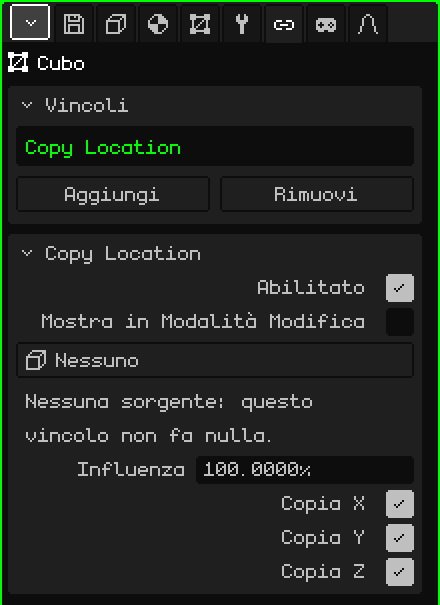
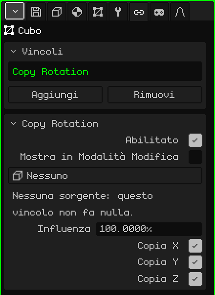
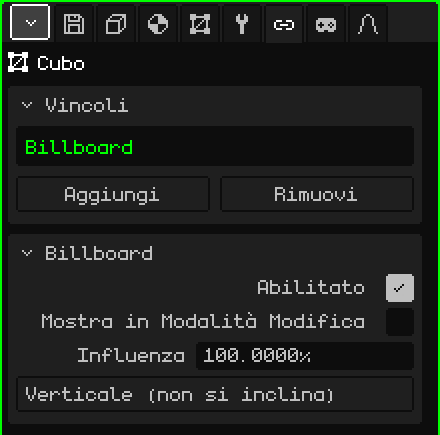
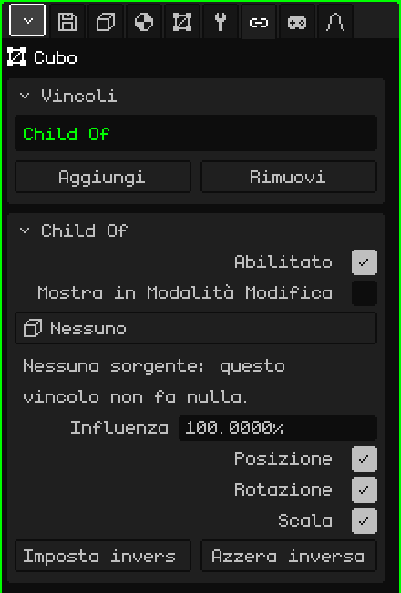

# Vincoli

Un **vincolo** (in inglese, *constraint*) fa sì che un oggetto prenda qualcosa da un altro: la sua posizione, la sua rotazione, che guardi sempre verso la camera o che lo segua come se fosse suo figlio. Serve perché le cose si sistemino da sole, senza animarle a mano: un'ombra che sta sotto il personaggio, un albero piatto che è sempre rivolto verso di te, una spada attaccata alla mano. Questo articolo spiega ciascuno di essi e tutti i suoi parametri; come si aggiungono e si spostano gli oggetti è spiegato nel tutorial [La Modalità Oggetto](../tutoriales/modo-objeto.md).

## Dove si trovano

In Proprietà → scheda **Vincoli**. Ce l'ha qualsiasi oggetto 3D: mesh, camere, luci, armature, suoni, vuoti. Gli elementi 2D di un'interfaccia non ce l'hanno.

Prima di vederli uno per uno, tre cose che valgono per tutti:

- **Non cambiano i numeri dell'oggetto.** Il vincolo si applica sopra, al momento del disegno. Il riquadro Trasforma della scheda Oggetto continua a mostrare la posizione e la rotazione proprie dell'oggetto, e se il vincolo viene disattivato o eliminato, l'oggetto torna esattamente lì.
- **Si calcolano per ogni vista.** Quelli che dipendono dalla camera (Billboard, o una sorgente **Vista**) usano la camera che sta disegnando: con due Viste 3D aperte, ognuna vede il risultato dal proprio punto di vista. Nel gioco, la camera attiva.
- **Funzionano allo stesso modo ovunque:** nell'editor, nel gioco compilato, su Android e sul Nokia N95.

## Il riquadro Vincoli

| Proprietà | Cosa fa |
|---|---|
| L'elenco | I vincoli dell'oggetto. Quello scelto è quello che mostra il riquadro qui sotto. |
| Aggiungi | Il menu con i quattro tipi: **Copy Location**, **Copy Rotation**, **Billboard** e **Child Of**. |
| Rimuovi | Elimina il vincolo scelto. |
| Sposta su / Sposta giù | Cambiano l'ordine (appaiono con due o più). |

L'**ordine** conta: si applicano dall'alto in basso, e ognuno lavora su ciò che hanno lasciato quelli sopra. Se due toccano la stessa cosa, vince quello più in basso.

## Ciò che è comune a tutti

Sotto appare il riquadro del vincolo scelto, con il suo nome come titolo. Queste tre righe ci sono in tutti i tipi:

| Proprietà | Cosa fa |
|---|---|
| Abilitato | Attiva o disattiva il vincolo senza eliminarlo. Serve per confrontare il risultato con e senza. |
| Mostra in Modalità Modifica | Se è disattivato (come di default), mentre si modificano i vertici dell'oggetto il vincolo non si applica: la mesh si vede e si modifica dove si trova davvero. Se è attivo, si applica anche in Modalità Modifica. |
| Influenza | Quanto pesa, da 0 a 100 %. Con 100 si applica per intero; con 0 non fa nulla; nel mezzo, l'oggetto resta tra dove sarebbe da solo e dove lo porta il vincolo (con 50, a metà strada). |

**Mostra in Modalità Modifica** è disattivato di proposito: modificare un albero che ruota inseguendo la camera, o una mesh che scappa in un altro punto, è molto scomodo.

## Copy Location

**Copia la posizione** di un altro oggetto: l'oggetto si mette esattamente dove si trova la sorgente, sugli assi scelti.

| Proprietà | Cosa fa |
|---|---|
| Sorgente | Da dove copia. **Nessuno**, **Vista** (la camera che sta disegnando) o qualsiasi oggetto della scena tranne se stesso e quelli che dipendono da lui. |
| Copia X, Copia Y, Copia Z | Quali assi copia. Gli assi sono gli stessi del riquadro Trasforma: Z è l'altezza. Un asse non spuntato resta con il valore proprio dell'oggetto. |

Copia la posizione così com'è, senza lasciare distanza: con i tre assi, l'oggetto finisce sopra la sorgente. Perché resti spostato, si toglie la spunta all'asse che non deve seguire, o si sposta la mesh in Modalità Modifica (vedi [Child Of](#child-of) per seguire qualcosa mantenendo la distanza).

Avvisi del riquadro:

- "Nessuna sorgente: questo vincolo non fa nulla." Appare con la sorgente su Nessuno, e anche se l'oggetto sorgente viene eliminato: il pulsante passa da solo a dire Nessuno.
- "Nessun asse: questo vincolo non fa nulla." Appare con i tre assi non spuntati.

**Esempi:**

- **Un'ombra rotonda sotto il personaggio:** un piano con una macchia scura, con Copia X e Copia Y spuntate e Copia Z non spuntata. Sta sotto il personaggio su tutto il pavimento, e quando salta l'ombra resta a terra.
- **Un cielo che non si raggiunge mai:** una grande sfera con il cielo dipinto e la sorgente su **Vista**. Il cielo è sempre centrato sulla camera, quindi per quanto si cammini non si arriva mai al bordo.
- **Una luce che accompagna il personaggio:** una luce con il personaggio come sorgente e solo Copia X e Copia Y. Lo segue dall'alto, all'altezza propria della luce.

## Copy Rotation

**Copia la rotazione** di un altro oggetto: l'oggetto ruota come la sorgente, senza spostarsi dal suo posto.

| Proprietà | Cosa fa |
|---|---|
| Sorgente | Da dove copia: **Nessuno**, **Vista** (la camera che sta disegnando) o un oggetto della scena tranne se stesso e quelli che dipendono da lui. |
| Copia X, Copia Y, Copia Z | Quali rotazioni copia, con gli stessi assi della rotazione del riquadro Trasforma. Con tutti e tre, l'oggetto prende esattamente lo stesso orientamento della sorgente; con uno o due, copia solo quegli angoli e gli altri restano i propri. |

Ha gli stessi avvisi di Copy Location ("Nessuna sorgente…" e "Nessun asse…"). Con un'influenza intermedia la rotazione segue sempre il percorso più breve.

**Esempi:**

- **I ventilatori a soffitto di un bar:** si anima la rotazione delle pale di uno solo, e le pale degli altri copiano la sua rotazione. Siccome sono tutti appesi dritti, bastano i tre assi spuntati. Per cambiare la velocità di tutti, si cambia l'animazione di uno.
- **Qualcosa attaccato allo schermo in prima persona** (le mani e l'arma di un gioco, la cabina di un'astronave): due vincoli sullo stesso oggetto, Copy Location e Copy Rotation, entrambi con la sorgente su **Vista**. L'oggetto va dove va la camera e ruota con lei. La mesh si sposta in Modalità Modifica perché stia davanti, in basso e a destra.

## Billboard

Fa sì che l'oggetto **sia rivolto verso la camera**: ruota da solo per restare di fronte allo schermo. Non ha sorgente: è sempre la camera che sta disegnando.

| Proprietà | Cosa fa |
|---|---|
| Modalità | **Verticale (non si inclina)**: ruota solo di lato, come una persona che si gira, e resta sempre dritto. **Guarda la camera**: in più si inclina per guardare la camera quando è sopra o sotto. |

Il billboard si allinea con il **piano** dello schermo, non con il punto in cui si trova la camera: tutti i billboard della vista restano paralleli allo schermo.

Con influenza 100, la rotazione la decide il billboard e quella del riquadro Trasforma non conta. Se il piano resta di taglio, lo si ruota in Modalità Modifica (siccome Mostra in Modalità Modifica è disattivato di default, lì si vede senza il vincolo).

Avviso del riquadro: "Con influenza tra 0 e 100 il billboard può girare di 180 gradi quando attraversa la camera. Con 100% non succede." È così per come si mescola con un orientamento che sta ruotando: se quella rotazione dà fastidio, si usa 100 %.

**Esempi:**

- **Alberi economici:** un piano con la foto di un albero (con trasparenza) e la modalità Verticale (non si inclina). Da qualsiasi lato sembra un albero intero, ed è un solo piano: ideale per riempire un bosco sul Nokia N95.
- **Fumo, scintille, il bagliore di una lampada, un sole sullo sfondo:** un piano con la texture e la modalità Guarda la camera, perché si veda di fronte anche dall'alto.
- **Un'insegna con il nome di un personaggio o una barra della vita** sopra la testa: Guarda la camera, e imparentato al personaggio perché lo segua.

## Child Of

Fa sì che l'oggetto si comporti come **figlio** di un altro oggetto, o di un **osso** di un'armatura, anche se nell'Outliner dipende da un'altra parte. Lo segue quando si sposta, ruota o si scala, come se fosse attaccato.

| Proprietà | Cosa fa |
|---|---|
| Sorgente | L'oggetto che fa da genitore: **Nessuno** o un oggetto della scena tranne se stesso e quelli che dipendono da lui. Qui non c'è l'opzione Vista. |
| Osso | Solo se la sorgente è un'armatura: l'osso da cui dipende. **Nessuno** segue l'armatura intera. |
| Posizione | Se segue i movimenti della sorgente. |
| Rotazione | Se ruota quando la sorgente ruota. |
| Scala | Se si ingrandisce o si rimpicciolisce con la sorgente. |
| Imposta inversa | Lascia l'oggetto dov'era prima del vincolo e, da quel momento, gli fa seguire la sorgente. |
| Azzera inversa | Torna a misurare la posizione dell'oggetto dalla sorgente: con Posizione 0, 0, 0 resta esattamente sulla sorgente (o alla base dell'osso). |

Se la sorgente viene eliminata appare l'avviso "Nessuna sorgente: questo vincolo non fa nulla.", come negli altri.

### Impostare o azzerare l'inversa

Quando scegli la sorgente, l'oggetto salta: la sua posizione comincia a essere misurata dalla sorgente. Ci sono due modi di lavorare:

- **Prima posizionarlo, poi impostare:** metti l'oggetto dove deve andare (la spada in mano, per esempio), scegli la sorgente e l'osso, e premi **Imposta inversa**: torna dove l'avevi messo e da lì segue la sorgente.
- **Azzerare e scrivere:** con **Azzera inversa**, il riquadro Trasforma dell'oggetto diventa la distanza dalla sorgente. Serve quando si conosce il numero esatto: Posizione 0, 0, 0 lo mette esattamente sull'osso.

Il vincolo nasce con l'inversa azzerata, per questo l'oggetto salta quando si sceglie la sorgente.

### L'influenza in Child Of

Con 0 comanda il genitore reale dell'oggetto (quello dell'Outliner) e con 100 comanda la sorgente. Per questo una spada può essere figlia del personaggio nell'Outliner (così si sposta con lui quando lo si porta da un'altra parte) e avere in più un Child Of alla mano: la segue senza muoversi due volte.

**Esempi:**

- **Un'arma nella mano di Leon:** Child Of con l'armatura di Leon come sorgente e l'osso della mano destra in Osso; si sistema l'arma nella mano e si preme Imposta inversa. Per un oggetto rigido è molto più leggero che deformare una mesh con l'armatura, e sul Nokia N95 si nota.
- **Un cappello o degli occhiali:** allo stesso modo, con l'osso della testa.
- **Una camera che accompagna senza ruotare:** solo Posizione spuntata. La camera va con il personaggio alla stessa distanza, ma non gira quando lui si gira.
- **Un oggetto su una piattaforma che si muove:** Child Of alla piattaforma, con Posizione e Rotazione, perché viaggi con lei senza spostarlo di posto nell'Outliner.

## Quando usare ciascuno

| Perché l'oggetto… | Vincolo |
|---|---|
| vada dove si trova un altro oggetto, o la camera | Copy Location |
| ruoti come un altro oggetto, o come la camera | Copy Rotation |
| sia sempre rivolto verso la camera | Billboard |
| segua un altro oggetto o un osso, mantenendo la distanza | Child Of |

Se due oggetti si copiano a vicenda (A copia da B e B copia da A), Whisk3D interrompe il cerchio perché non si blocchi e lo segnala nella [Console](consola.md): uno dei due resta con la propria posizione. La soluzione è togliere uno dei due vincoli.
