# La barra dei menu della Vista 3D

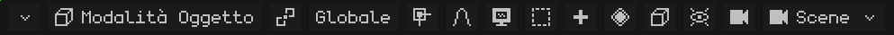

Se la barra dei menu non ci sta tutta, si può far scorrere: vedi [Quando non si vedono tutte le opzioni della barra dei menu](interfaz.md#quando-non-si-vedono-tutte-le-opzioni-della-barra-dei-menu).

## La modalità

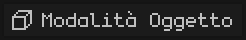 Mostra la modalità in cui si sta lavorando, e toccandolo se ne sceglie un'altra. Le modalità che appaiono dipendono dall'oggetto attivo: una mesh ha la Modalità Modifica e le tre pitture; un'armatura, la Modalità Modifica e la Modalità Posa. Con un altro tipo di oggetto (una luce, una camera) il pulsante non appare, perché l'unica modalità è la Modalità Oggetto. Ogni modalità è spiegata in [Le modalità](vista-3d.md#le-modalità).

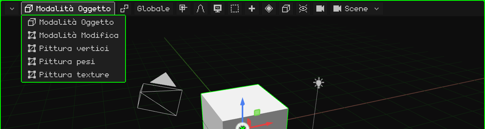

 <kbd>Tab</kbd> passa dalla Modalità Oggetto alla Modalità Modifica e viceversa.  Sull'N95, <kbd>OK</kbd>.

In **Modalità Modifica** di una mesh appare accanto il pulsante **Vertice / Spigolo / Faccia**: cosa si sceglie con un clic (vedi [Modalità Modifica](modo-edicion.md)).

## Il perno

 Il **punto di perno** è il punto a partire dal quale avviene la trasformazione: attorno a cosa si ruota e da dove si scala ciò che è scelto. L'icona del pulsante cambia a seconda del perno scelto, così si vede a colpo d'occhio quale è impostato.

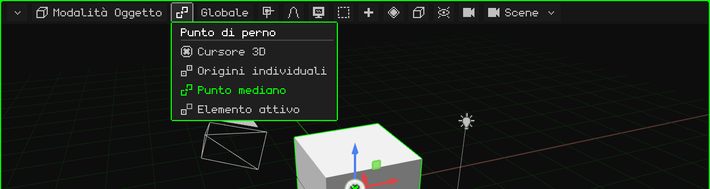

| Perno | Da dove ruota e scala |
|---|---|
|  **Cursore 3D** | Dal cursore 3D. Serve per ruotare le cose attorno a un punto qualsiasi: si mette lì il cursore (con il [menu Aggancio](#laggancio)) e si ruota. |
|  **Origini individuali** | Ogni oggetto dalla propria origine: ruotano tutti insieme, ognuno al suo posto. |
|  **Punto mediano** | Dal centro di tutto ciò che è scelto. È quello predefinito. |
|  **Elemento attivo** | Dall'origine dell'oggetto attivo (l'ultimo scelto): gli altri ruotano attorno a lui. |

Un esempio di ciascuno, in video, si trova nel tutorial [La Modalità Oggetto](../tutoriales/modo-objeto.md#il-punto-di-perno).

## L'orientamento

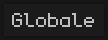 Gli assi usati quando si sposta, si ruota o si scala lungo un asse (con <kbd>X</kbd>, <kbd>Y</kbd>, <kbd>Z</kbd>, con il gizmo o con i tasti dell'N95). Il pulsante mostra l'orientamento scelto.

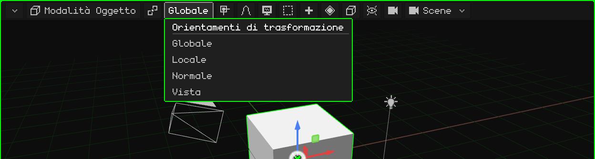

| Orientamento | Gli assi |
|---|---|
| **Globale** | Quelli del mondo: sempre uguali, con la Z verso l'alto. È quello predefinito. |
| **Locale** | Quelli dell'oggetto stesso: ruotano con lui. Un'auto ruotata avanza lungo il suo asse Locale. |
| **Normale** | In Modalità Modifica: la direzione verso cui guarda la faccia scelta (è quella usata da Estrudi). |
| **Vista** | Quelli dello schermo: X verso il lato, Y verso l'alto. |

 Durante una trasformazione, la seconda pressione della lettera dell'asse passa da Globale a Locale: <kbd>G</kbd> <kbd>Y</kbd> <kbd>Y</kbd>.

## L'aggancio

 Con l'**aggancio** attivo, ciò che si sposta si attacca a qualcosa: ai vertici, agli spigoli o alle facce di altri oggetti, o ai loro centri. Il pulsante diventa verde quando è attivo.

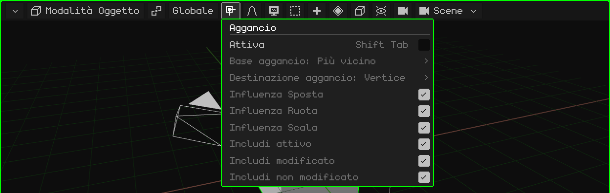

| Opzione | Cosa fa | Scorciatoia |
|---|---|---|
| Attiva | Attiva o disattiva l'aggancio. | <kbd>Shift+Tab</kbd> |
| Base aggancio | Quale punto di ciò che si sposta si attacca: il più vicino, il centro, la mediana o l'attivo. | Menu |
| Destinazione aggancio | A cosa si attacca: vertice, spigolo, faccia, i loro centri. Con Proietta su faccia / Faccia più vicina, i vertici si appoggiano su un'altra superficie (per la retopologia). | Menu |
| Influenza Sposta / Ruota / Scala | In quali operazioni agisce. | Menu |
| Includi attivo / modificato / non modificato | A quali oggetti ci si può attaccare. | Menu |

Il **cursore 3D** si sposta con un altro menu, quello dell'aggancio del cursore: <kbd>Shift</kbd> + <kbd>S</kbd> o menu Oggetto → Aggancio (Cursore al selezionato, Selezione al cursore...). È spiegato in [La Modalità Oggetto](../tutoriales/modo-objeto.md#il-cursore-3d).

## La modifica proporzionale

 Con la **modifica proporzionale**, quando sposti, ruoti o scali qualcosa, ciò che sta vicino lo accompagna dolcemente: tanto più quanto più è vicino. Serve per modellare forme organiche (un terreno, un volto) senza spostare un vertice alla volta. Diventa verde quando è attiva.

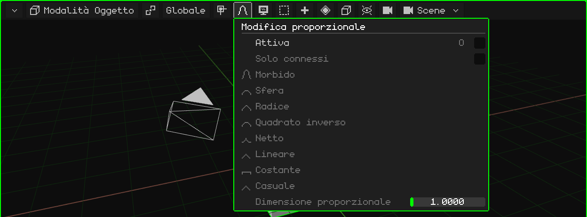

| Opzione | Cosa fa | Scorciatoia |
|---|---|---|
| Attiva | Attiva o disattiva la modifica proporzionale. | <kbd>O</kbd> |
| Solo connessi | Misura la distanza lungo gli spigoli: non trascina pezzi separati che stanno vicino. | Menu |
| Decadimento | Come si distribuisce l'influenza con la distanza: Morbido, Sfera, Radice, Quadrato inverso, Netto, Lineare, Costante o Casuale. | Menu |
| Dimensione proporzionale | Il raggio d'influenza. Durante la trasformazione si cambia con la rotella o con <kbd>PageUp</kbd> / <kbd>PageDown</kbd>. | Menu / rotella |

## Vista

 Tutto ciò che riguarda la **navigazione**: da dove si guarda la scena. Ogni opzione, con il suo video, si trova nel tutorial [Navigare nella Vista 3D](../tutoriales/navegacion.md).

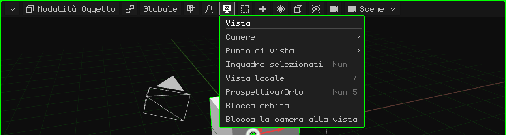

| Opzione | Cosa fa |  Scorciatoia |
|---|---|---|
| Camere | Guardare attraverso la camera attiva, o rendere camera attiva l'oggetto scelto. | <kbd>Num 0</kbd> / <kbd>Ctrl+Num 0</kbd> |
| Punto di vista | Frontale, Posteriore, Destra, Sinistra, Superiore, Inferiore. | <kbd>Num 1</kbd>, <kbd>Num 3</kbd>, <kbd>Num 7</kbd> (con <kbd>Ctrl</kbd>, quella opposta) |
| Inquadra selezionati | Centra la vista su ciò che è scelto e la avvicina perché ci stia esattamente. | <kbd>Num .</kbd> |
| Vista locale | Lascia in vista solo ciò che è scelto, e torna indietro. | <kbd>/</kbd> |
| Prospettiva/Orto | Passa dalla prospettiva alla vista ortografica e viceversa. | <kbd>Num 5</kbd> |
| Blocca orbita | Ciò che faceva orbitare passa a spostare la vista. | — |
| Blocca la camera alla vista | Guardando attraverso la camera: navigare sposta la camera. | — |

## Seleziona

 Scegliere in una volta tutto, niente, il contrario di ciò che c'è, o ciò che resta dentro un riquadro.

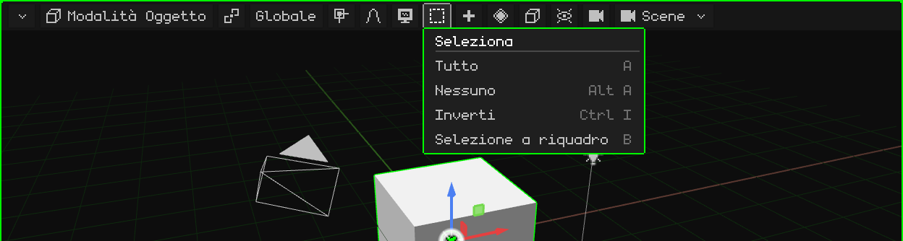

| Opzione | Cosa fa | Scorciatoia |
|---|---|---|
| Tutto | Sceglie tutto. | <kbd>A</kbd> |
| Nessuno | Non lascia niente di scelto. | <kbd>Alt+A</kbd> |
| Inverti | Ciò che è scelto smette di esserlo, e viceversa. | <kbd>Ctrl+I</kbd> |
| Selezione a riquadro | Un riquadro che si trascina: da sinistra a destra (verde) sceglie solo ciò che resta interamente dentro; da destra a sinistra (blu) basta sfiorare. <kbd>Shift</kbd> aggiunge. | <kbd>B</kbd>, o trascinare sullo sfondo |

In Modalità Modifica si aggiungono Seleziona collegati, i loop e i percorsi (vedi [Modalità Modifica](modo-edicion.md)).

## Aggiungi

 Crea nuovi oggetti, che appaiono nel cursore 3D e restano scelti. C'è solo in Modalità Oggetto.

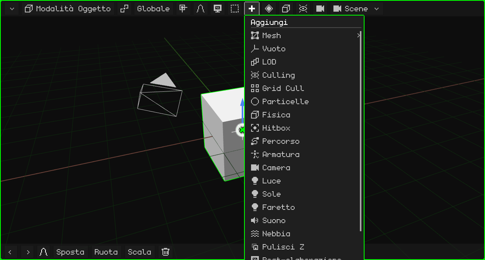

Ogni tipo si trova in [Modalità Oggetto → Menu Aggiungi](modo-objeto.md#menu-aggiungi).  <kbd>Shift</kbd> + <kbd>A</kbd> lo apre dove si trova il mouse.

In Modalità Modifica, al suo posto appaiono **Mesh** (le operazioni di modellazione, vedi [Modalità Modifica](modo-edicion.md)) e **UV** (fare l'unwrap e proiettare le UV, vedi [Editor UV](editor-uv.md)). In Pittura texture appare un **dischetto**, che salva la texture dipinta; diventa verde quando c'è pittura non salvata.

## Animazione

 I **keyframe** di ciò che è scelto: salvare il valore della posizione, della rotazione o della scala nel frame attuale, perché l'animazione vada da un keyframe all'altro. Appare quando c'è qualcosa di scelto, in Modalità Oggetto e in Modalità Posa, e le sue opzioni dipendono da ciò che è scelto.

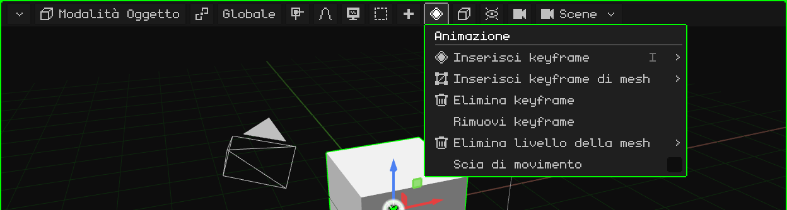

| Opzione | Cosa fa | Scorciatoia |
|---|---|---|
| Inserisci keyframe | Un menu per scegliere cosa salvare: posizione, rotazione, scala o tutto. | <kbd>I</kbd> (<kbd>Shift+I</kbd>: tutto senza chiedere) |
| Inserisci keyframe di mesh | Solo con una mesh 3D: sceglie cosa salvare dell'animazione della mesh, i vertici, le normali o le UV. | Menu |
| Elimina keyframe | Elimina il keyframe del frame attuale. | Menu |
| Rimuovi keyframe | Elimina tutta l'animazione di ciò che è scelto. | Menu |
| Elimina livello della mesh | Solo con una mesh 3D: elimina per intero un livello dell'animazione della mesh, quello dei **vertici**, quello delle **normali** (per esempio, in un modello senza illuminazione) o quello delle **UV**. Resta sempre almeno un keyframe. | Menu |
| Scia di movimento | Disegna nella vista il percorso che compiono gli oggetti animati. | Menu |

### In Modalità Posa

Mettendo in posa un'armatura, il menu lavora con i keyframe delle ossa scelte (e di quello attivo):

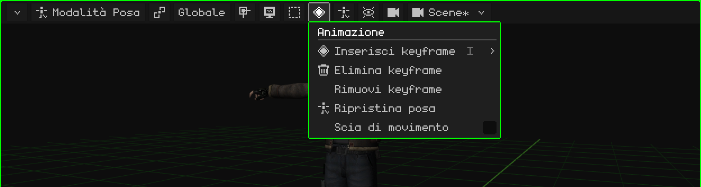

| Opzione | Cosa fa | Scorciatoia |
|---|---|---|
| Inserisci keyframe | Salva la posa delle ossa scelte nel frame attuale: posizione, rotazione, scala o tutto. | <kbd>I</kbd> |
| Elimina keyframe | Elimina il keyframe del frame attuale di quelle ossa. Si annulla con <kbd>Ctrl+Z</kbd>. | Menu |
| Rimuovi keyframe | Elimina tutti i keyframe di quelle ossa nell'animazione attiva. Si annulla con <kbd>Ctrl+Z</kbd>. | Menu |
| Ripristina posa | Le ossa scelte (o tutte, se non ne è scelta nessuna) tornano alla posizione, alla rotazione e alla scala che hanno in Modalità Modifica. Si annulla con <kbd>Ctrl+Z</kbd>. | Menu |
| Scia di movimento | Disegna nella vista il percorso che compiono gli oggetti animati. | Menu |

L'animazione ha il suo tutorial e il suo capitolo, [Timeline](linea-de-tiempo.md).

## Oggetto

 Ciò che si può fare a ciò che è scelto. È lo stesso menu che si apre con il clic destro nella vista (o, su uno schermo touch, tenendo fermo un dito). Appare quando c'è qualcosa di scelto.

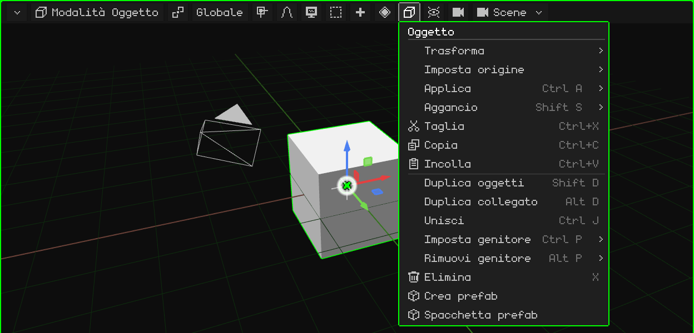

Ogni opzione si trova in [Modalità Oggetto](modo-objeto.md). In Modalità Modifica, questo pulsante diventa il menu di ciò che si sceglie (Vertice, Spigolo o Faccia); in Modalità Posa, quello di Posa; nella modifica di un'armatura, quello di Armatura.

## Sovrapposizioni

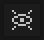 Le **sovrapposizioni** sono gli aiuti che vengono disegnati sopra la scena per lavorare e che non compaiono nel render: il pavimento, gli assi, il gizmo, il cursore 3D. Da qui si attivano e si disattivano, tutti insieme o uno alla volta.

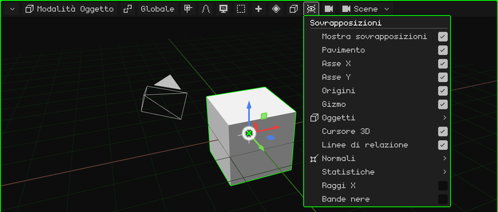

| Opzione | Cosa fa | Scorciatoia |
|---|---|---|
| Mostra sovrapposizioni | Attiva o disattiva tutti gli aiuti in una volta. | <kbd>K</kbd> |
| Pavimento, Asse X, Asse Y, Origini, Cursore 3D, Linee di relazione | Ogni aiuto separatamente. Le linee di relazione uniscono ogni figlio al suo genitore. | Menu |
| Gizmo | Il gizmo per spostare, ruotare e scalare. Sul Nokia N95 è disattivato di default. | Menu |
| Oggetti | Quali tipi di oggetto vengono disegnati: armature, luci, camere, vuoti, particelle, curve, hitbox. | Menu |
| Normali | Disegna le normali dei vertici o delle facce, con la loro dimensione. | Menu |
| Statistiche | I fotogrammi al secondo, i vertici, le facce, le chiamate di disegno e i tempi. | Menu |
| Raggi X | In Modalità Modifica, la mesh appare semitrasparente e si possono scegliere gli elementi che stanno dietro. | Menu |
| Bande nere | Guardando attraverso una camera con una proporzione diversa da quella dello schermo, copre ciò che resta fuori dall'inquadratura. | Menu |

## Render

 La **modalità di ombreggiatura**: come viene disegnata la scena nella vista. Non cambia il progetto, solo come si vede mentre lavori.

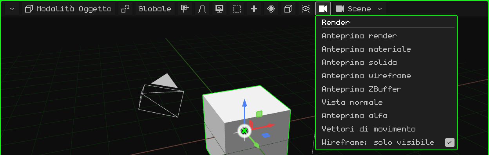

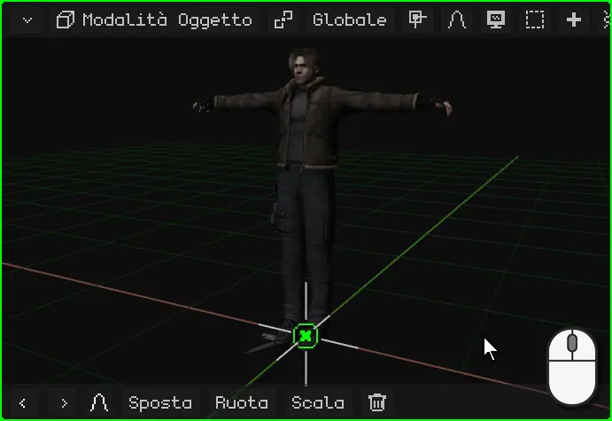

| Modalità | Come si vede |
|---|---|
| Anteprima render | Con le luci della scena. Con il ray tracing attivo, mostra l'immagine tracciata poco a poco. |
| Anteprima materiale | Quella predefinita: i materiali e le texture con una luce neutra dalla vista, senza dipendere dalle luci della scena. |
| Anteprima solida | Tutto grigio, per vedere la forma. |
| Anteprima wireframe | Solo gli spigoli. Con **Wireframe: solo visibile**, solo quelli di ciò che si vede di fronte. |
| Anteprima ZBuffer | La profondità: chiaro vicino, scuro lontano. |
| Vista normale | Le normali, a colori. |
| Anteprima alfa | La trasparenza, in bianco e nero. |
| Vettori di movimento | Quanto si è mosso ogni pixel dal fotogramma precedente (rosso = X, verde = Y). È la stessa immagine della passata `_vectores` del render. |

 <kbd>Z</kbd> passa alla modalità successiva.  Sull'N95, il <kbd>6</kbd>.

## La scena

 Il nome di ciò che si sta modificando: una **scena**, un **gioco** o un **prefab** del progetto. Toccandolo se ne sceglie un'altra, se ne crea una nuova o si converte la scena in gioco.

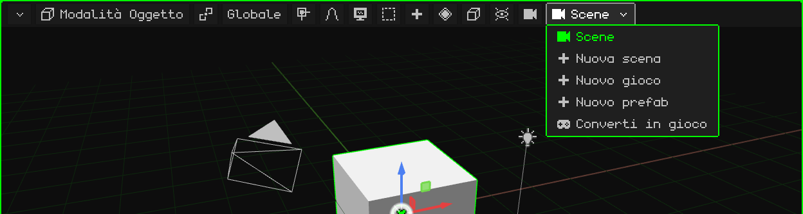

Le scene, i giochi e i prefab sono spiegati in [Il progetto](proyecto.md).
