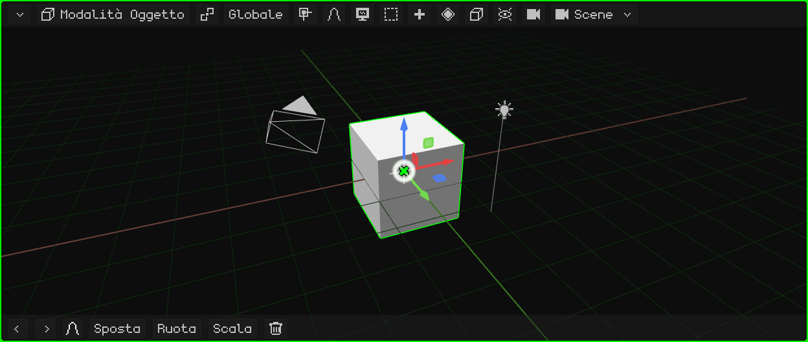
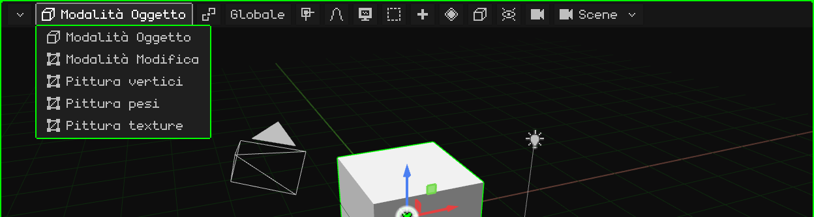
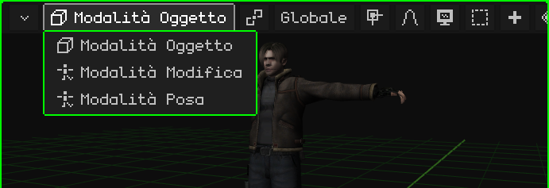
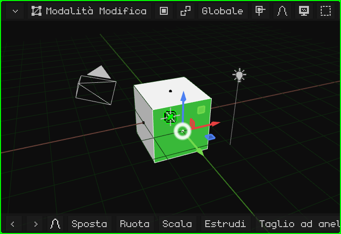
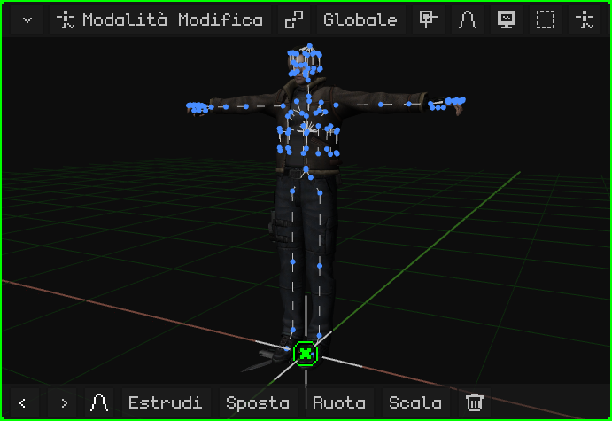
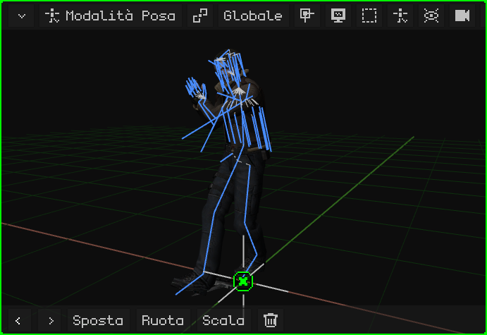
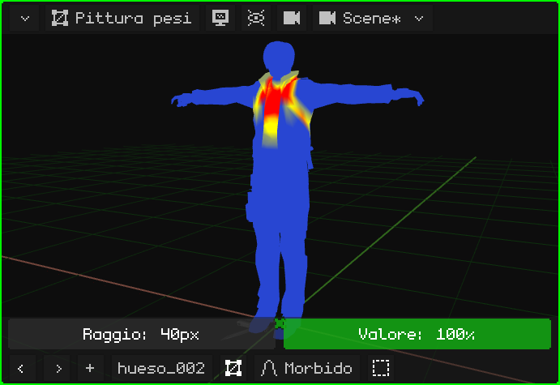
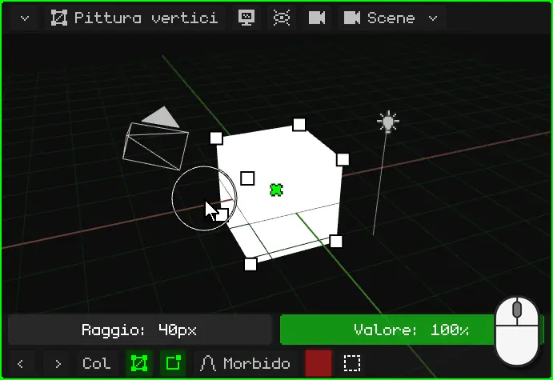
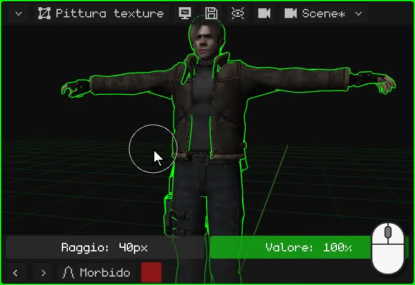
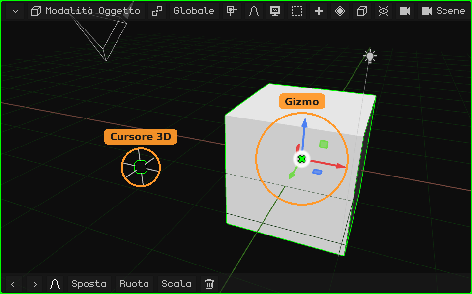

# Vista 3D

La **Vista 3D** è il viewport dove si vede e si modifica la scena: lì si modella, si spostano gli oggetti, si dipinge, si mette in posa e si anima. Come tutti i viewport, ha in alto la sua **barra dei menu** e in basso la sua **barra degli strumenti**.

- **La barra dei menu**, pulsante per pulsante, con i suoi menu: [La barra dei menu della Vista 3D](vista-3d-barra.md).
- **Navigare** (orbitare, spostarsi, zoom, le viste, la camera): [Navigazione nella Vista 3D](navegacion.md) e il tutorial [Navigare nella Vista 3D](../tutoriales/navegacion.md).
- **Spostare, ruotare e scalare**, il gizmo, il perno e l'orientamento: [Spostare, ruotare e scalare](transformar.md).

## Le modalità

La Vista 3D lavora in diverse **modalità**: ciò che fanno i clic, i tasti e i menu dipende dalla modalità in cui si trova. La modalità si sceglie con il primo pulsante della barra dei menu, che mostra la modalità attuale, o con <kbd>Tab</kbd> (Oggetto ↔ Modifica; sul Nokia N95, <kbd>OK</kbd>).

Le modalità che si possono scegliere dipendono dall'**oggetto attivo**. La **Modalità Oggetto** ce l'hanno tutti. Una mesh 3D aggiunge la Modalità Modifica e le tre pitture; un'armatura, la Modalità Modifica e la Modalità Posa. Con qualsiasi altro oggetto (una luce, una camera, un suono) l'unica modalità è la Modalità Oggetto, e il pulsante non appare.

| Modalità | Per quali oggetti | A cosa serve |
|---|---|---|
| [Modalità Oggetto](modo-objeto.md) | Tutti | Lavorare con gli oggetti interi: crearli, spostarli, ruotarli, scalarli, duplicarli, imparentarli ed eliminarli. |
| [Modalità Modifica](modo-edicion.md) | Mesh 3D e curve | Modellare: spostare, aggiungere ed eliminare i vertici, gli spigoli e le facce della mesh. |
| [Modalità Modifica](esqueletos.md#modalità-modifica-dellarmatura) | Armature | Costruire l'armatura: creare le ossa e sistemarle nella loro posizione di riposo. |
| [Modalità Posa](esqueletos.md#modalità-posa) | Armature | Mettere in posa le ossa e salvare le pose: così si anima un personaggio. |
| [Pittura pesi](pintura.md#pittura-pesi) | Mesh 3D | Dipingere quanto ogni osso muove ogni vertice. |
| [Pittura vertici](pintura.md#pittura-vertici) | Mesh 3D | Dipingere colori direttamente sui vertici. |
| [Pittura texture](pintura.md#pittura-texture) | Mesh 3D | Dipingere sulla texture, direttamente sopra l'oggetto. |

### Modalità Oggetto

È la modalità con cui si avvia Whisk3D, e l'unica che hanno tutti gli oggetti. Si lavora con gli oggetti interi: si scelgono, si spostano, si ruotano, si scalano, si aggiungono e si eliminano. Vedi [Modalità Oggetto](modo-objeto.md) e il tutorial [La Modalità Oggetto](../tutoriales/modo-objeto.md).

### Modalità Modifica di una mesh

Si modella la **forma** della mesh: i vertici, gli spigoli e le facce. Nella barra dei menu appaiono il pulsante **Vertice / Spigolo / Faccia** (cosa si sceglie con un clic) e i menu **Mesh** e **UV**. Il resto della scena si continua a vedere, ma non si può toccare.

### Modalità Modifica di un'armatura

Si costruisce l'**armatura**: si creano le ossa (estrudendole dalla punta di un altro), si spostano e si imparentano. È la sua posizione di **riposo**, quella che ha quando non è animata.

### Modalità Posa

Si **mette in posa** l'armatura: le ossa si ruotano e si spostano senza cambiare l'armatura in sé, e la mesh le segue. Le pose salvate in diversi frame sono l'animazione del personaggio.

### Pittura pesi

Si dipinge **quanto ogni osso muove ogni parte della mesh**: in rosso ciò che l'osso scelto muove del tutto, in blu ciò che non muove. È ciò che fa sì che, piegando il braccio, si pieghi il braccio e non la vita.

### Pittura vertici

Si dipingono **colori sui vertici** della mesh, senza texture. Serve per dare colore a modelli semplici, per ombre dipinte a mano e per effetti negli shader.

### Pittura texture

Si dipinge **direttamente sulla texture**, sopra l'oggetto, come su un pupazzo. Ciò che si è dipinto si salva con il dischetto che appare nella barra dei menu.

Nelle modalità di pittura, sopra la barra degli strumenti appare la fila del pennello (il **Raggio** e il **Valore**). Vedi [Modalità di pittura](pintura.md).

## La barra degli strumenti

In fondo alla Vista 3D ci sono **Annulla** e **Rifai** (le frecce), gli **ultimi comandi usati** (all'inizio, Sposta, Ruota, Scala ed Elimina; ciò che si usa passa davanti) e la **modifica proporzionale**. Mentre si sposta, si ruota o si scala, la barra degli strumenti cambia: la spunta verde conferma, la croce rossa annulla, l'orientamento, e **X**, **Y** e **Z** limitano il movimento a quegli assi. Vedi [Spostare, ruotare e scalare](transformar.md#barra-degli-strumenti).

 Su uno schermo touch aggiunge **Shift** e **Ctrl**, che restano accesi (in verde) e fanno da quei tasti, e il pulsante **Vista** (il monitor), perché in Modalità Modifica e nelle pitture il dito navighi invece di scegliere o dipingere.

 Sul Nokia N95 è nascosta, per lasciare lo schermo alla scena, e appare quando serve: nelle modalità di pittura esce la fila del pennello (il **Raggio** e il **Valore**), e mentre si sposta, si ruota o si scala con la modifica proporzionale accesa, la barra del suo raggio. I suoi pulsanti si usano con il **mouse virtuale**: si accende con il tasto di selezione destro, le frecce lo muovono e <kbd>OK</kbd> fa clic.

## Il gizmo e il cursore 3D

- Il **gizmo** sono le frecce colorate sopra ciò che è scelto: si afferrano per spostare, ruotare e scalare. Un clic sul gizmo passa da una modalità all'altra. Vedi [Il gizmo](transformar.md#il-gizmo).
- Il **cursore 3D** è il cerchio con una croce: lì appare ciò che si aggiunge con Aggiungi, e può essere il punto di perno. Vedi [Il cursore 3D](../tutoriales/modo-objeto.md#il-cursore-3d).

 Sul Nokia N95 il gizmo è spento, perché lo schermo è piccolo e lì si sposta con i tasti. Si accende in **Sovrapposizioni → Gizmo**, e si afferra con il mouse virtuale.
