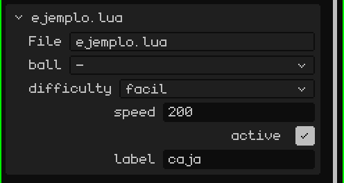
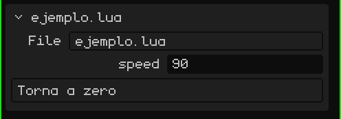

# Uno script è un componente di un oggetto

In Whisk3D uno script appartiene sempre a un **oggetto** della scena (una mesh, un empty, un pulsante 2D…). Un oggetto può avere più script; ognuno viene eseguito separatamente, con le proprie variabili, nell'ordine in cui compaiono.

Dallo script, `self()` restituisce l'oggetto proprietario. Per usare *altri* oggetti, lo script dichiara una tabella globale chiamata `properties`. L'editor la legge e mostra un campo per ogni voce nel riquadro dello script, nel pannello Proprietà:

```lua
properties = {
  ball       = "object",                          -- un campo per scegliere un oggetto della scena
  difficulty = { "facil", "normal", "dificil" },  -- un menu a tendina (la prima è quella predefinita)
  speed      = 200,                               -- un numero proprio di ogni oggetto che usa lo script
  active     = true,                              -- un sì/no
  label      = "caja",                            -- un testo
}

function start()
  local p   = object("ball")         -- l'oggetto scelto nel campo "pelota"
  local dif = option("difficulty")   -- "facil", "normal" o "dificil"
  local v   = property("speed")      -- 200, o il valore impostato in quell'oggetto
end
```

**Per nome:** una proprietà si legge anche scrivendo solo il suo nome: `speed` equivale a `property("speed")`, `difficulty` a `option("difficulty")` e `ball` a `object("ball")`. Viene letta al momento, quindi vede ciò che cambi in Proprietà con il gioco in esecuzione. Due eccezioni: se lo script ha una variabile con quel nome (`speed = 5`), vale la variabile; e se la proprietà si chiama come una funzione di Whisk3D (per esempio `target` o `view`), il nome è la funzione: quella proprietà si legge con `property()`, `option()` o `object()`.

> [!NOTE]
> Per leggere `properties`, l'editor **esegue il file** anche se il gioco non è in esecuzione. Per questo, fuori dalle funzioni metti solo dichiarazioni (tabelle, costanti, `local`), mai codice che fa qualcosa.

Ecco come appare nel riquadro dello script, in Proprietà: un campo per ogni proprietà, nello stesso ordine del codice.



Così lo stesso script serve per molti oggetti con valori diversi: il campo `speed` di un nemico può valere 200 e quello di un altro 350.

## Cambiare le proprietà in tempo reale

`property("speed")` legge il valore in quel momento. Se lo cambi in Proprietà con il gioco in esecuzione, lo script lo vede nel fotogramma successivo, ma solo se lo rilegge con `property()`. Se l'hai salvato in una variabile (`local v = property("speed")` in `start()`), la variabile resta con il valore iniziale.

```lua
function update(dt)
  -- si legge a ogni fotogramma: vede quello che cambi in Proprietà con il gioco in esecuzione
  move(self(), property("speed") * dt, 0, 0)
end
```

Leggere `property()` a ogni fotogramma è più lento che usare una variabile. Non conviene lavorare così in tutto il gioco: usalo mentre regoli i valori e, quando sono a posto, salvali in variabili in `start()`.

## Pulsanti

Se una proprietà è una **funzione**, nel riquadro compare un **pulsante**: toccarlo chiama quella funzione. Perché il pulsante mostri qualcosa di diverso dal nome, metti il testo e la funzione in una tabella:

```lua
properties = {
  speed    = 90,
  zero = { "Torna a zero", function()
    setRotation(self(), 0, 0, 0)
  end },
}
```



Con il gioco in esecuzione, la funzione viene eseguita nello script in gioco. Senza il gioco, lo script viene caricato solo per quella chiamata: così un pulsante funziona come un **componente aggiuntivo dell'editor**, che fa qualcosa alla scena. Per esempio, con `selected()`, gli oggetti selezionati nell'editor:

```lua
properties = {
  upload = { "Alza la selezione", function()
    for _, o in ipairs(selected()) do
      move(o, 0, 0, 1)   -- un metro verso l'alto
    end
  end },
}
```

> [!NOTE]
> Quello che fa un pulsante con il gioco fermo resta nella scena, come se l'avessi fatto a mano, e si annulla allo stesso modo: <kbd>Ctrl</kbd> + <kbd>Z</kbd> annulla in un colpo tutto quello che ha fatto il pulsante. Mentre il gioco è in corso non va niente nella cronologia: quando tocchi **Ferma**, tutto torna com'era.

Gli script non condividono variabili tra loro. Per passarsi dati (i punti, se il giocatore ha vinto…) usano uno spazio condiviso: `setShared("puntos", 10)` scrive e `getShared("puntos")` legge. Memorizza numeri, sì/no e testi, e si svuota quando si ferma il gioco.
