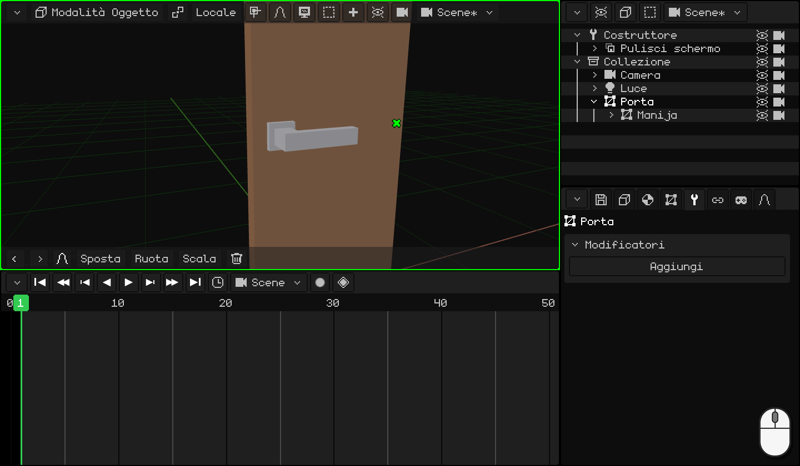
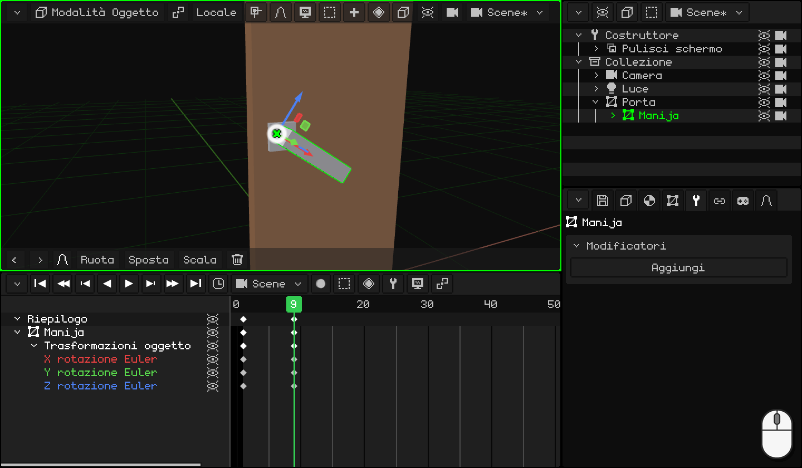
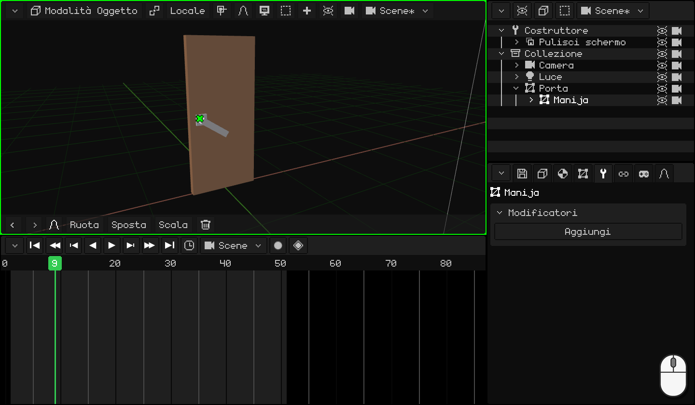
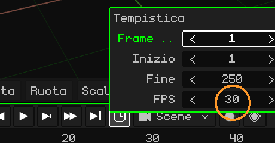
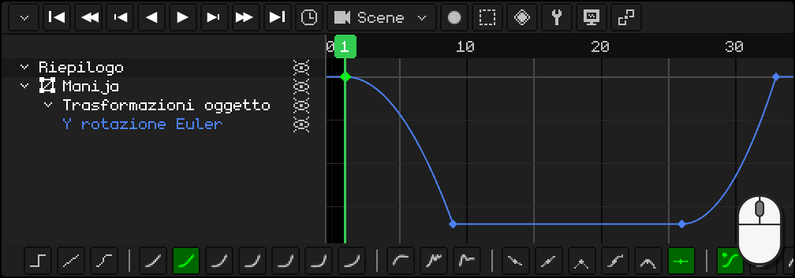

# Animare la porta

Partiamo dalla porta con la sua maniglia del tutorial precedente, [Modellare la maniglia](modelar-picaporte.md): la porta ha l'origine sul cardine, la leva ha la sua dove gira ed è figlia della porta. Ora la animeremo come una porta vera: prima si abbassa la maniglia, solo quando è giù la porta comincia ad aprirsi, e alla fine la maniglia torna al suo posto.

Lungo il percorso imparerai a:

- mettere dei **keyframe**: la posa di un oggetto in un fotogramma;
- **duplicare** keyframe che sono già come li vuoi;
- regolare il **tempo** dell'animazione e sceglierne i **fotogrammi al secondo**;
- usare l'**editor delle curve**: cos'è una curva e come si cambia con un clic e la barra degli strumenti.

## 1. La maniglia

Un **keyframe** salva com'è un oggetto in un fotogramma: la sua posizione, la sua rotazione o la sua scala. Con due keyframe, il programma calcola tutti i fotogrammi intermedi: questa è l'animazione.

1. Fai clic sulla **leva** per selezionarla. Nella **Timeline**, vai al fotogramma **1**: la maniglia è su.
2. Con il mouse sulla Vista 3D, premi <kbd>I</kbd> e scegli **Solo rotazione**: nella Timeline compare un rombo al fotogramma 1.
3. Vai al fotogramma **9** (un clic sui numeri della Timeline) e abbassa la maniglia: <kbd>R</kbd> <kbd>Y</kbd> `-34` <kbd>Enter</kbd>. Gira attorno alla sua origine, quella che le abbiamo messo nel tutorial precedente.
4. Di nuovo <kbd>I</kbd> → **Solo rotazione**: un altro rombo, al 9.

 Su uno schermo touch: il keyframe si mette con il pulsante del rombo nella barra dei menu della Vista 3D, **Animazione → Inserisci keyframe → Solo rotazione**, e il fotogramma si cambia con un tocco sui numeri della Timeline. La maniglia si abbassa con **Ruota** **Y** `-34` nella barra degli strumenti, con i numeri nel tastierino della barra in alto.

 Sul Nokia N95: <kbd>2</kbd> (ruotare), <kbd>2</kbd> (l'asse Y), la matita + `-34` e <kbd>OK</kbd>. Il keyframe, con **Animazione → Inserisci keyframe → Solo rotazione**.

## 2. Duplicare keyframe

La maniglia deve restare giù mentre si apre la porta e, alla fine, tornare su. Queste due pose le hai già: non serve ruotarla di nuovo.

1. Nella Timeline, clic sul rombo del fotogramma **9** (giù), <kbd>Shift</kbd> + <kbd>D</kbd>, porta la copia al fotogramma **26** e fai clic. Dal 9 al 26 la maniglia resta giù.
2. Clic sul rombo del fotogramma **1** (su), <kbd>Shift</kbd> + <kbd>D</kbd> e la copia al **33**: la maniglia torna su.

Guarda il rombo della copia, non il puntatore: compare un fotogramma a destra del mouse. Mentre la copia passa sopra un altro keyframe non gli succede niente: lo **sostituisce** solo se la rilasci esattamente sopra.

  Su touch e sull'N95 (con il mouse virtuale), invece di duplicare si copia e si incolla: un tocco sul keyframe del fotogramma 9 e, nel menu **Key** della Timeline (il pulsante del rombo), **Copia**; un tocco sui numeri per andare al fotogramma 26 e **Key → Incolla**. Lo stesso con quello dell'1 al 33.

## 3. La porta

1. Fai clic sulla **porta**, per selezionarla da sola. Vai al fotogramma **11** e <kbd>I</kbd> → **Solo rotazione**: fino a qui la porta è chiusa. Solo all'11 comincia ad aprirsi, quando la maniglia è già giù.
2. Vai al fotogramma **26**, aprila: <kbd>R</kbd> <kbd>Z</kbd> `-80` <kbd>Enter</kbd>, e di nuovo <kbd>I</kbd> → **Solo rotazione**.

Premi **Play** (<kbd>Space</kbd>, o il pulsante ▶ della Timeline): la maniglia si abbassa, la porta si apre e la maniglia torna su. Nel frattempo la maniglia segue la porta, perché è sua figlia.

 Su uno schermo touch: **Ruota** **Z** `-80` e **Animazione → Inserisci keyframe → Solo rotazione**.

 Sul Nokia N95: <kbd>2</kbd>, <kbd>3</kbd> (l'asse Z), la matita + `-80` e <kbd>OK</kbd>; e **Animazione → Inserisci keyframe → Solo rotazione**.

## 4. Il tempo

Succede tutto troppo in fretta, o troppo piano? Bisogna spostare i keyframe:

- <kbd>G</kbd> sposta nel tempo i keyframe selezionati (per esempio, la maniglia che torna, dal 33 al 36).
- <kbd>S</kbd> li scala: con tutti selezionati, `2` fa durare l'animazione il doppio.

L'animazione finisce al fotogramma **50**: nell'**orologio** della Timeline, **Fine** `50` <kbd>Enter</kbd>.

### I fotogrammi al secondo

Il tempo di un'animazione si conta in **fotogrammi**, e quanti fotogrammi ci sono in un secondo lo dicono gli **FPS** (*frames per second*: fotogrammi al secondo). Si cambiano nello stesso **orologio**, in **FPS**. Ogni animazione ha i suoi: quella della scena e ogni clip possono andare a FPS diversi.

Whisk3D parte da **30**: i 50 fotogrammi della porta durano un secondo e mezzo abbondante.

| FPS | A cosa serve |
|---|---|
| **24** | Il cinema. Dà all'animazione uno stile più cinematografico e, se la renderizzi, sono molti meno fotogrammi: un minuto a 24 sono 1440 fotogrammi; a 30, 1800. |
| **30** o **60** | Serie e videogiochi. |

Non serve animare a 60. Nel gioco, il motore calcola da solo i fotogrammi intermedi: un'animazione fatta a 30 si vede fluida su uno schermo a 60 e occupa meno memoria.

Scegli gli FPS **prima** di animare. I keyframe restano al loro fotogramma: se dopo alzi gli FPS, l'animazione va più veloce, e se li abbassi, più lenta.

## 5. Le curve

Passa la Timeline all'**editor delle curve** (**Vista → Curve**). Lì ogni valore animato è una **curva**: ti dice in che posizione, rotazione o scala si trova l'oggetto in ogni momento. Da sinistra a destra c'è il **tempo**; dal basso verso l'alto, il **valore**.

**Solo rotazione** salva i tre assi, ma la maniglia e la porta girano su uno solo: le altre due curve sono linee piatte che non fanno niente. Eliminale: seleziona quelle righe e <kbd>X</kbd>. Restano solo le curve che cambiano, e si lavora più comodi.

### La forma della curva

Se la curva è una **linea retta**, l'oggetto si muove sempre alla stessa velocità: parte e si ferma di colpo. Sembra **robotico**. A volte vogliamo proprio questo, ma quasi niente si muove così nella vita reale: le cose **accelerano** quando partono e **frenano** quando arrivano.

Guarda sei palle che vanno da sinistra a destra nello **stesso tempo**, ognuna con una curva diversa. Accanto a ognuna c'è la sua curva, con un punto che avanza insieme a lei:

| Curva | Come si muove | A cosa serve |
|---|---|---|
| **Lineare** | Sempre alla stessa velocità. | Una macchina, un nastro trasportatore, qualcosa di robotico. |
| **Accelera e frena** (in entrata e uscita) | Parte piano, va veloce a metà e arriva piano. | Quasi tutto: una persona che cammina, una porta, una camera. |
| **Accelera e frena di colpo** (in entrata) | Parte piano e arriva a tutta velocità. | Qualcosa che cade e urta, una maniglia che arriva al fermo. |
| **Parte veloce e va rallentando** (in uscita) | Parte a tutta velocità e rallenta poco a poco. | Qualcosa che viene lanciato, un cassetto che si chiude da solo. |
| **Rimbalzo** | Arriva, rimbalza contro la fine qualche volta e si ferma. | Qualcosa che cade e rimbalza, un coperchio che si chiude. |
| **Elastica** | Va oltre, torna indietro e oscilla come una molla fino a fermarsi. | Una molla, un'antenna, qualcosa che compare sullo schermo con grazia. |

Le curve rendono l'animazione **naturale**.

### La barra degli strumenti

Con un keyframe o un tratto selezionato, la barra degli strumenti della Timeline ne cambia la curva con un clic:

- **Modalità interpolazione:** **Costante**, **Lineare** e **Bezier**; poi quelle calcolate, dalla più morbida alla più brusca (**Sinusoidale**, **Quadratica**, **Cubica**, **Quartica**, **Quintica**, **Esponenziale** e **Circolare**), e quelle a effetto (**Ritorno**, **Rimbalzo** ed **Elastica**).
- **Tipo maniglia:** come si costruiscono le maniglie di una curva **Bezier**.
- **Easing:** in quelle calcolate, dove va l'effetto: **Automatica**, **In entrata**, **In uscita** o **In entrata e uscita**.

Con la tastiera: <kbd>E</kbd> apre la **Modalità interpolazione** e <kbd>Ctrl</kbd> + <kbd>E</kbd>, l'**Easing**.

### La maniglia: TAC!

Una maniglia vera la abbassi, prende velocità e si ferma di colpo contro il fermo: TAC! Quando la lasci, la molla la riporta su e di nuovo si ferma di colpo in alto. Tutte e due le volte **accelera e frena di colpo**.

1. Con la **leva** selezionata, nell'editor delle curve, fai clic sulla riga della curva rimasta: la Timeline la inquadra per intero.
2. Fai clic sul tratto della curva che scende, tra il fotogramma 1 e il 9: un clic sulla linea seleziona quel tratto.
3. Nella barra degli strumenti, **Quadratica**. Il suo easing **Automatica** è **In entrata**: accelera e frena di colpo.
4. Lo stesso con il tratto che torna, tra il 26 e il 33.

  Su touch e sull'N95: un tocco (o il mouse virtuale) sul tratto e un altro su **Quadratica**: la barra degli strumenti è la stessa.

### La porta

La porta sta bene con la curva di sempre, **Bezier**: **accelera e frena**. La spingi, prende velocità e rallenta fino a restare aperta. Non serve cambiarle niente.

Nel prossimo tutorial, [Far rimbalzare una palla](pelota.md), useremo le curve per dare peso a una palla, insieme a un altro principio dell'animazione: allungare e schiacciare.
