# Modellare la maniglia

Partiamo dalla porta del tutorial precedente, [Cambiare l'origine: una porta](puerta.md): misura 0,90 × 0,10 × 2 metri e ha l'origine sul cardine. Le faremo una maniglia in due parti: una **placca** attaccata alla porta e una **leva** che gira.

Lungo il percorso imparerai a:

- duplicare una faccia e costruire un pezzo nuovo a partire da essa;
- **separare** una parte di una mesh in un altro oggetto (<kbd>P</kbd>) e **unirla** di nuovo (<kbd>Ctrl</kbd> + <kbd>J</kbd>);
- dare un **materiale** diverso a ogni parte di una mesh;
- usare il modificatore **Specchio** per avere la maniglia su entrambi i lati della porta;
- vedere con i **Raggi X** le facce che non si vedono mai, ed eliminarle;
- mettere l'**origine** dove girerà la leva, con il cursore 3D;
- **imparentare** la leva alla porta, perché si muovano insieme.

## 1. La placca

1. Con la porta selezionata, entra in **Modalità Modifica** (<kbd>Tab</kbd>) e, nel pulsante **Vertice / Spigolo / Faccia**, scegli **Faccia**.
2. Fai clic sulla faccia grande sul davanti della porta.
3. **Duplicala:** <kbd>Shift</kbd> + <kbd>D</kbd>. La copia resta attaccata al mouse; un clic destro (o <kbd>Esc</kbd>) la lascia dov'era, esattamente sopra l'originale.
4. **Rimpiccioliscila** finché non resta un quadrato piccolo. A occhio: <kbd>S</kbd> e muovi il mouse; poi <kbd>S</kbd> <kbd>Z</kbd> per regolare solo l'altezza. Con i numeri: <kbd>S</kbd> `0.15` <kbd>Enter</kbd> e <kbd>S</kbd> <kbd>Z</kbd> `0.45` <kbd>Enter</kbd> lasciano un quadrato di 13,5 cm.
5. **Portala** sul lato opposto al cardine, dove va la maniglia: <kbd>G</kbd> <kbd>X</kbd> `-0.31` <kbd>Enter</kbd>.
6. **Estrudila** un pochino, perché abbia spessore: <kbd>E</kbd> `0.03` <kbd>Enter</kbd> (3 cm).

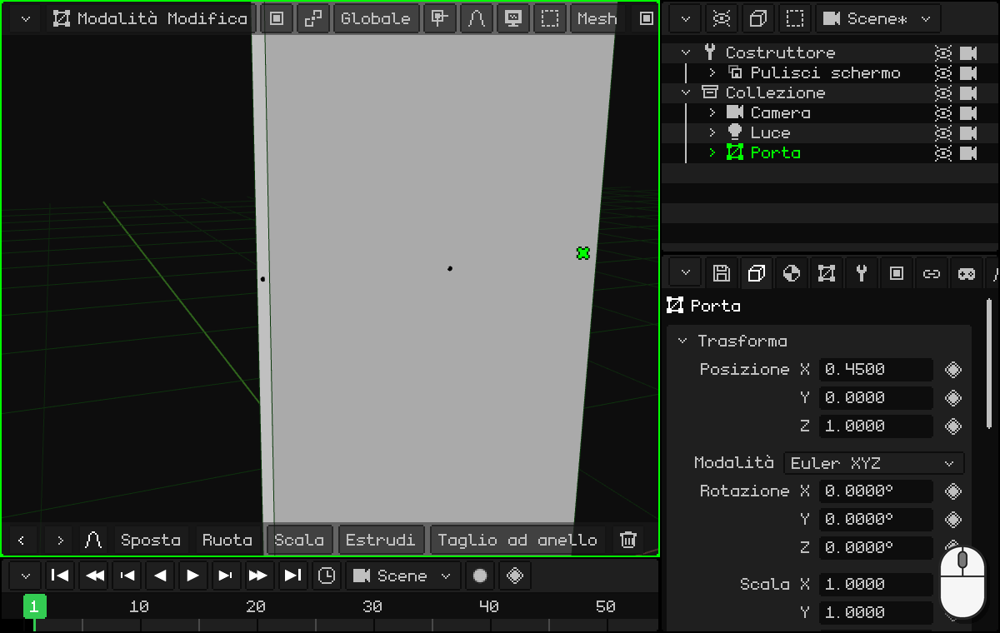

 Su uno schermo touch: un tocco sulla faccia e **Mesh → Duplica** (la copia resta sopra). Poi **Scala**, **Sposta** ed **Estrudi** nella barra degli strumenti, con i numeri nel tastierino della barra in alto, e la spunta.

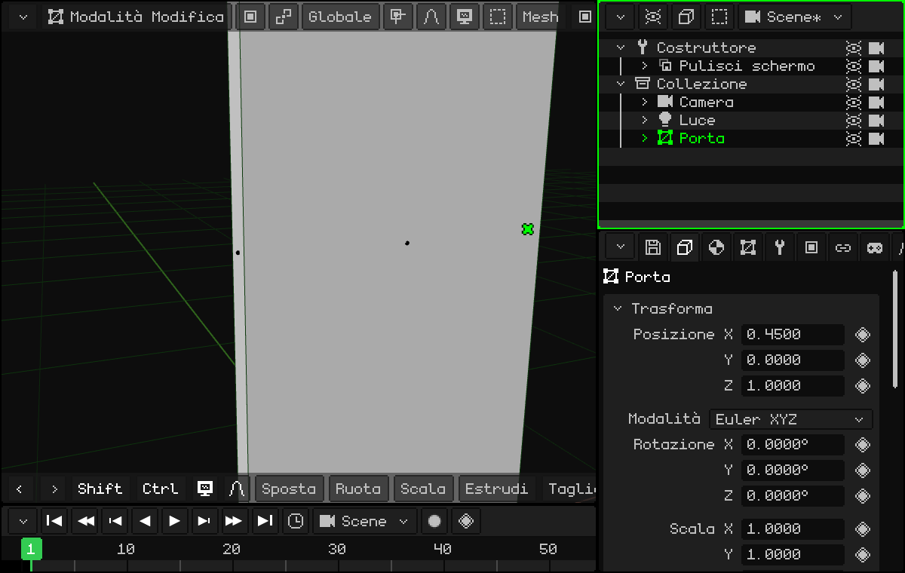

 Sul Nokia N95: **Mesh → Duplica** con il tasto di selezione sinistro; poi <kbd>3</kbd> (scalare), <kbd>1</kbd> (spostare) e <kbd>7</kbd> (estrudere), tenendo premuto il tasto matita per i numeri, e <kbd>OK</kbd>.

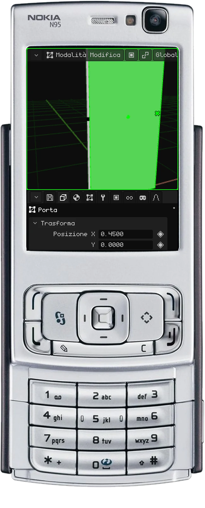

## 2. Separare la placca

La placca è ancora parte della mesh della porta. La trasformiamo in un oggetto a sé:

1. Con la placca selezionata, <kbd>L</kbd> (**Seleziona collegati**) seleziona tutto il pezzo: le 6 facce della placca, senza la porta.
2. <kbd>P</kbd> (**Separa**): la placca diventa un oggetto nuovo, **Porta.001**. Lo vedi nell'Outliner.

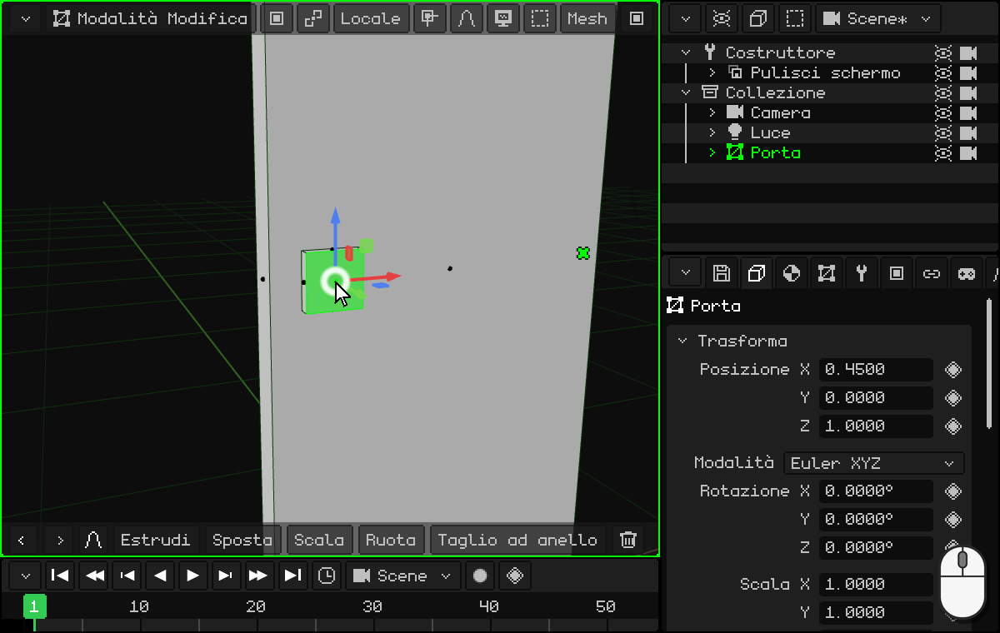

  Su touch e sull'N95: **Seleziona → Seleziona collegati** e un tocco sulla placca; poi **Mesh → Separa**.

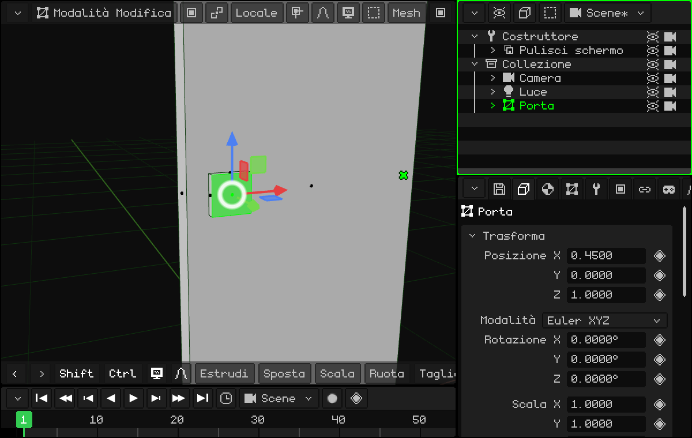

Dopo la separazione, nella porta non resta niente della placca: né le sue facce né le sue linee.

## 3. I materiali: legno e metallo

Ora ogni parte può avere il suo materiale. In **Proprietà**, nella scheda **Materiale**:

1. Seleziona la porta. In **Rinomina materiale** scrivi `Legno`, e in **Colore** scegli un marrone.
2. Seleziona la placca (Porta.001). Dato che è uscita dalla porta, ha anche lei il Legno: tocca **Nuovo materiale**, chiamalo `Metallo` e dagli un grigio.

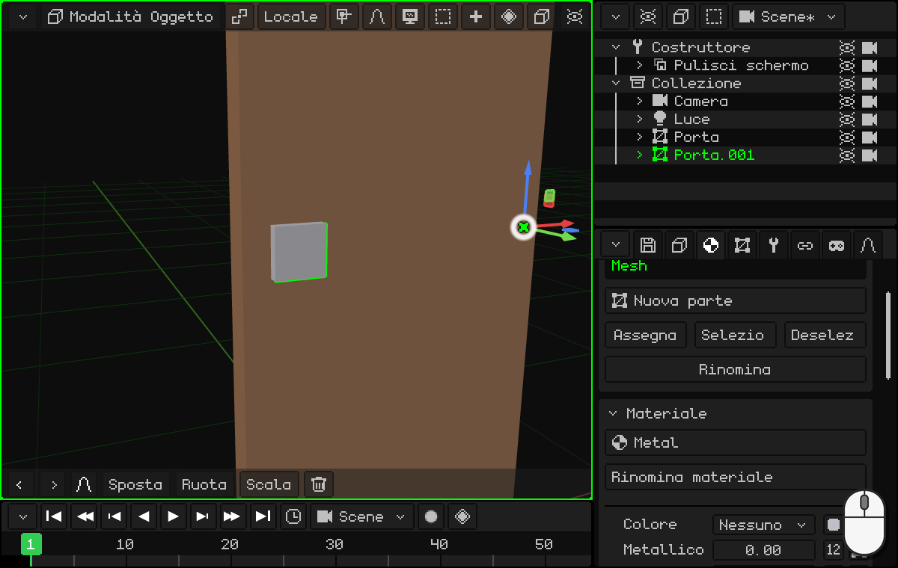

## 4. Dall'altro lato della porta: lo Specchio

Una maniglia va su entrambi i lati. Invece di fare un'altra placca, usiamo il modificatore **Specchio**:

1. Con la placca selezionata, in **Proprietà → Modificatori**, aggiungi **Specchio**.
2. Disattiva **Specchio X** e attiva **Specchio Y**: compare l'altra placca, dall'altro lato della porta.

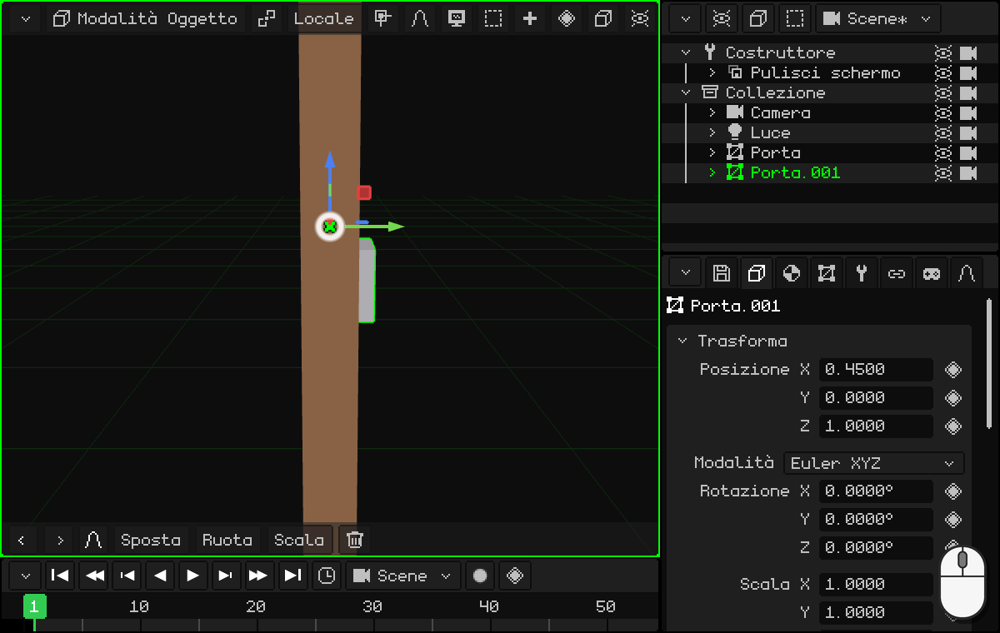

Lo specchio si fa rispetto all'**origine** dell'oggetto. La placca è uscita dalla porta, quindi ha la stessa origine: il cardine, esattamente a metà dello spessore della porta. Per questo la copia resta esattamente dall'altro lato. Vedi [Specchio](../editor/modificador-espejo.md).

## 5. La leva

La leva esce dalla placca, con lo stesso trucco:

1. Con la placca selezionata, premi <kbd>/</kbd> sul tastierino numerico (**Vista locale**): si vede solo la placca, così è più facile lavorarci. Entra in **Modalità Modifica**.
2. Seleziona la faccia davanti della placca, **duplicala** (<kbd>Shift</kbd> + <kbd>D</kbd> e clic destro) e rimpiccioliscila: <kbd>S</kbd> `0.6` <kbd>Enter</kbd>.
3. **Estrudila** verso l'esterno: <kbd>E</kbd> `0.08` <kbd>Enter</kbd>. È il perno della leva.

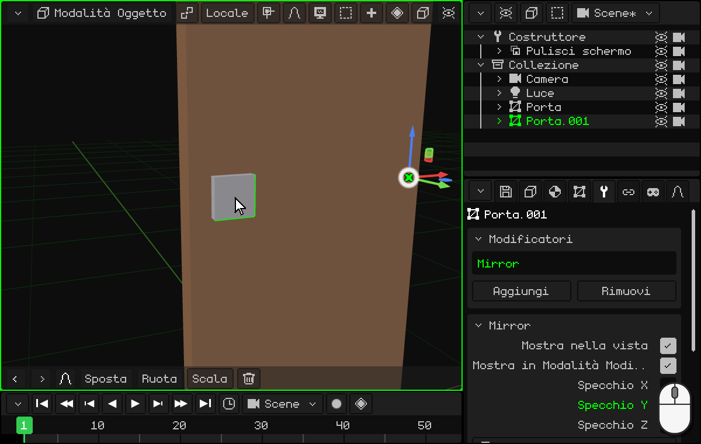
4. Passa a **Spigolo** e seleziona lo spigolo esterno dal lato del bordo della porta. Spostalo verso l'esterno: <kbd>G</kbd> <kbd>Y</kbd> `0.05` <kbd>Enter</kbd>. La faccia davanti resta inclinata.
5. Passa a **Faccia** e seleziona quella faccia inclinata. Estrudila **su X**, non lungo la sua normale: <kbd>E</kbd>, <kbd>X</kbd>, `0.34` e <kbd>Enter</kbd>. Esce il braccio della leva.
6. La punta è rimasta inclinata. Per raddrizzarla, scalala a zero su X: <kbd>S</kbd> <kbd>X</kbd> `0` <kbd>Enter</kbd>. Tutti i suoi vertici restano alla stessa X: la punta diventa piatta.

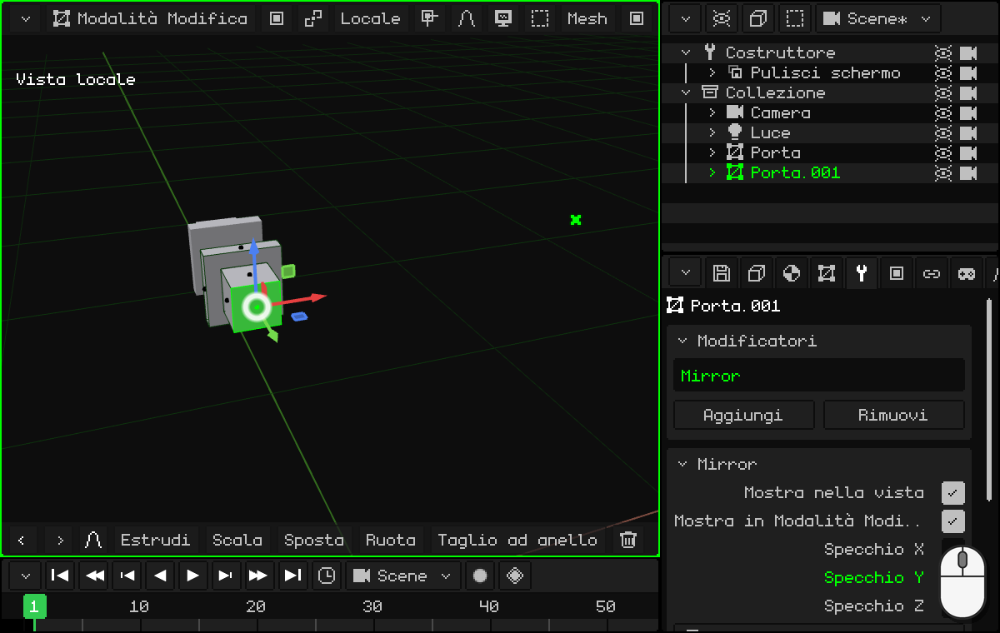
7. <kbd>L</kbd> seleziona tutta la leva e <kbd>P</kbd> la separa: diventa **Porta.002**. Dalle un nome: doppio clic nell'Outliner e scrivi `Leva`.

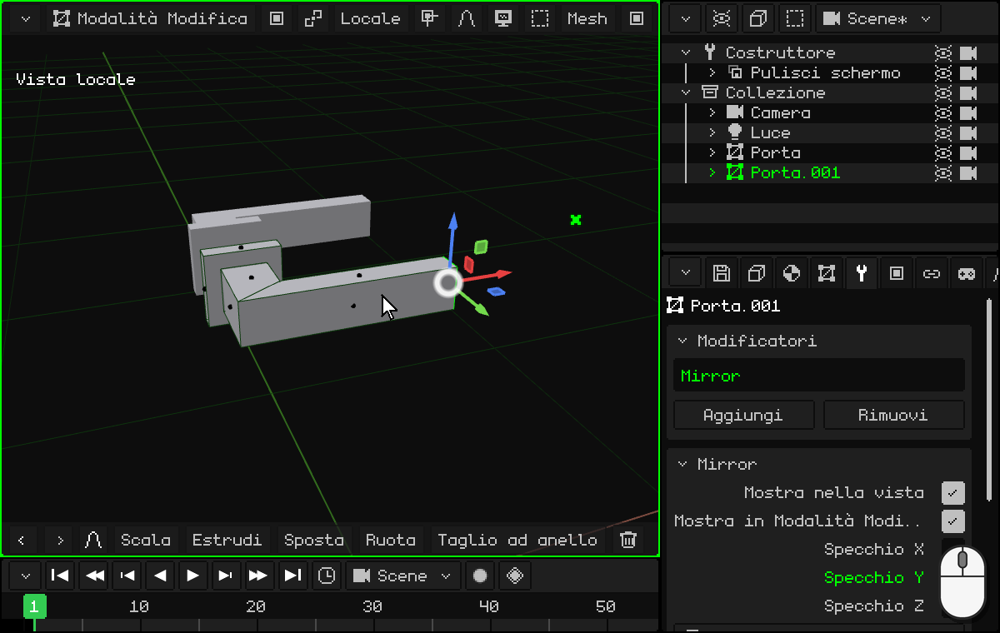

 Su uno schermo touch: un tocco sulla faccia, **Mesh → Duplica**, **Scala** `0.6` ed **Estrudi** `0.08`; **Spigolo**, un tocco su quello esterno e **Sposta** **Y** `0.05`; **Faccia**, un tocco su quella inclinata, **Estrudi** **X** `0.34` e **Scala** **X** `0`. Per separare, **Seleziona → Seleziona collegati** e **Mesh → Separa**.

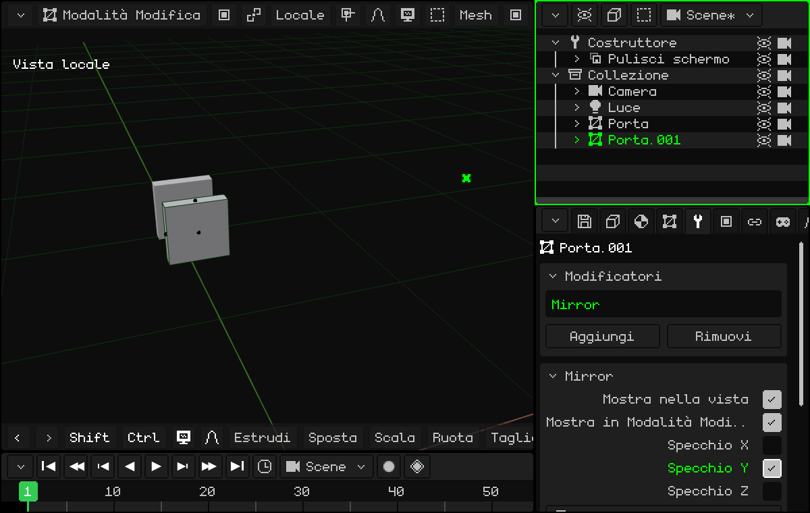

 Sul Nokia N95: <kbd>3</kbd> e `0.6`, <kbd>7</kbd> e `0.08`; lo spigolo (con il mouse virtuale), <kbd>1</kbd>, <kbd>2</kbd> (l'asse Y) e `0.05`; la faccia inclinata, <kbd>7</kbd>, <kbd>1</kbd> (l'asse X) e `0.34`; <kbd>3</kbd>, <kbd>1</kbd> e `0`.

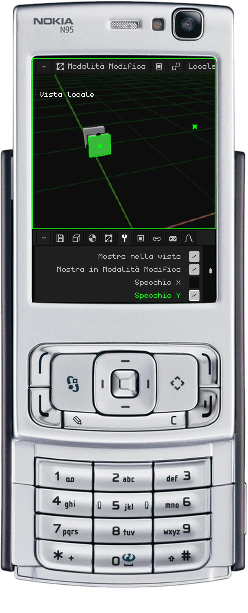

La leva è uscita dalla placca, quindi si porta dietro il suo materiale (Metallo) e il suo modificatore Specchio.

## 6. Unire la placca alla porta

La placca non si muove da sola: fa parte della porta. La uniamo di nuovo:

1. Seleziona la placca e, in **Modificatori**, tocca **Applica modificatore**: lo specchio diventa geometria vera.
2. Seleziona la placca, poi la porta con <kbd>Shift</kbd> + clic (la porta resta attiva) e <kbd>Ctrl</kbd> + <kbd>J</kbd> (**Unisci**). Ora sono una sola mesh, con i suoi due materiali.

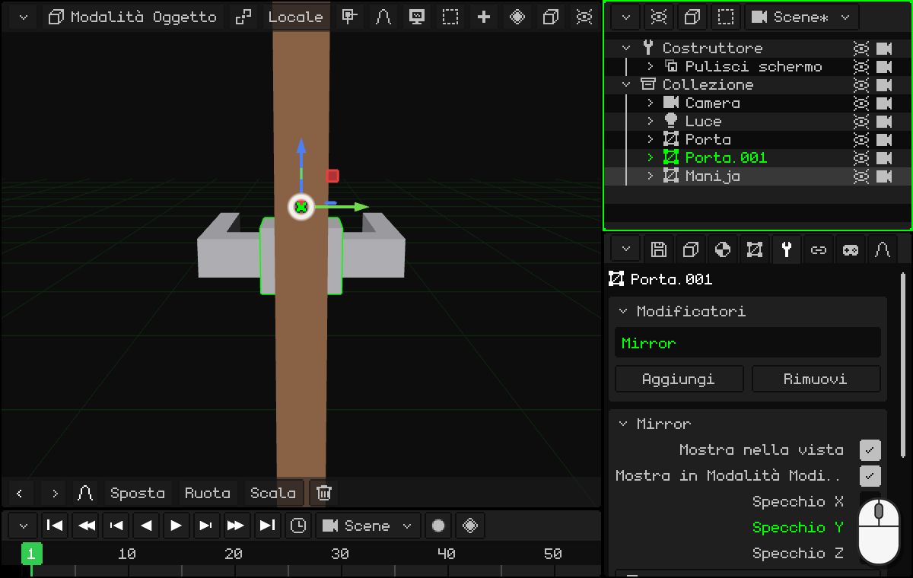

  Su touch e sull'N95: **Oggetto → Unisci**.

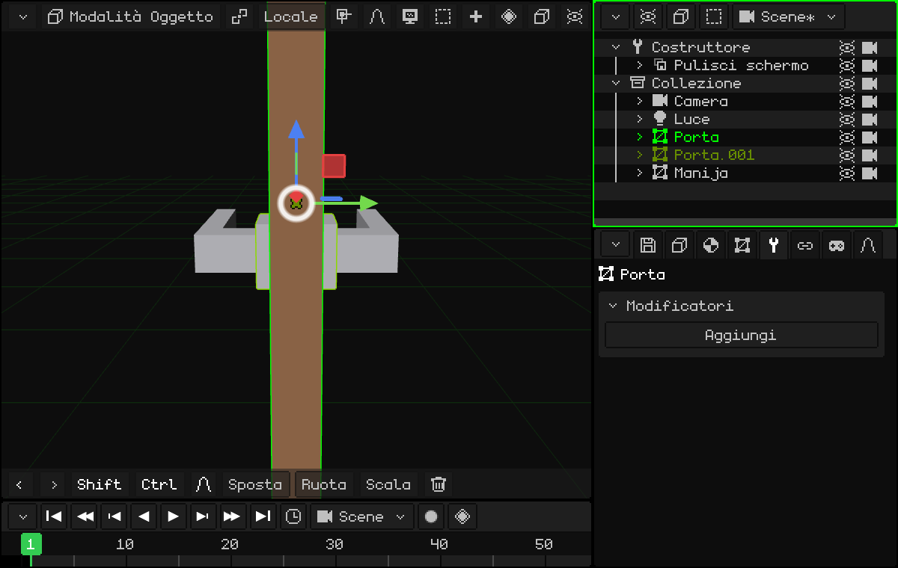

Così si separano e si uniscono le parti di una mesh: <kbd>P</kbd> per separare, <kbd>Ctrl</kbd> + <kbd>J</kbd> per unire.

## 7. Le facce che non si vedono mai

La placca è appoggiata contro la porta. La faccia posteriore di ogni placca resta coperta: non si vedrà mai, ma il programma la disegna lo stesso. Per vederla:

1. Seleziona la porta ed entra in **Modalità Modifica**.
2. In **Sovrapposizioni**, attiva **Raggi X**: la mesh diventa trasparente e si vedono le facce posteriori.
3. Seleziona la faccia posteriore di ogni placca (quella che tocca la porta) ed eliminale: <kbd>X</kbd> → **Facce**.

Conviene eliminare la geometria che non si vede: sono facce che vengono disegnate per niente. In un modello piccolo non si nota, ma in una scena grande, o su un telefono, sono prestazioni guadagnate.

## 8. Dove gira la leva: l'origine

La leva deve girare sul proprio asse, non sul cardine della porta.

1. Seleziona la leva e applica il suo Specchio (**Modificatori → Applica modificatore**).
2. Entra in **Modalità Modifica**, con i **Raggi X**. Seleziona le due facce posteriori della leva, quelle che toccano le placche (una per lato).
3. <kbd>Shift</kbd> + <kbd>S</kbd> → **Cursore al selezionato**: il cursore 3D si mette a metà tra le due, esattamente sull'asse della leva.
4. Anche quelle due facce non si vedono: eliminale (<kbd>X</kbd> → **Facce**).
5. Torna in **Modalità Oggetto** e porta l'origine sul cursore: <kbd>W</kbd> (o clic destro) → **Imposta origine → Origine al cursore 3D**.

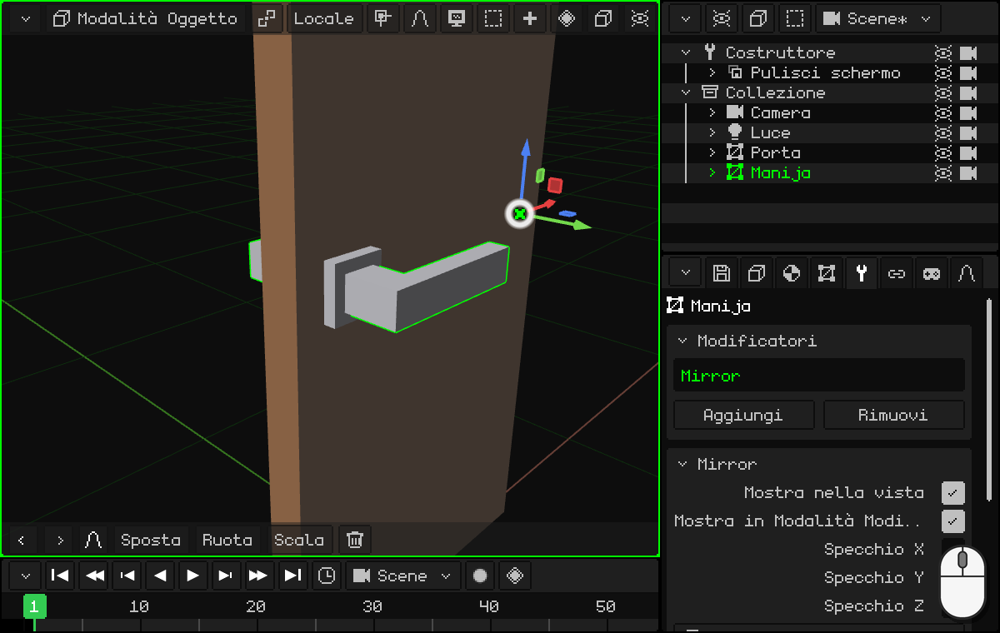

È la stessa cosa che abbiamo fatto con il cardine in [Cambiare l'origine: una porta](puerta.md#portare-lorigine-sul-cardine).

## 9. Far sì che la leva segua la porta

Prova a ruotare la porta: la leva resta sospesa in aria. Sono due oggetti separati. Annulla la rotazione (<kbd>Ctrl</kbd> + <kbd>Z</kbd>).

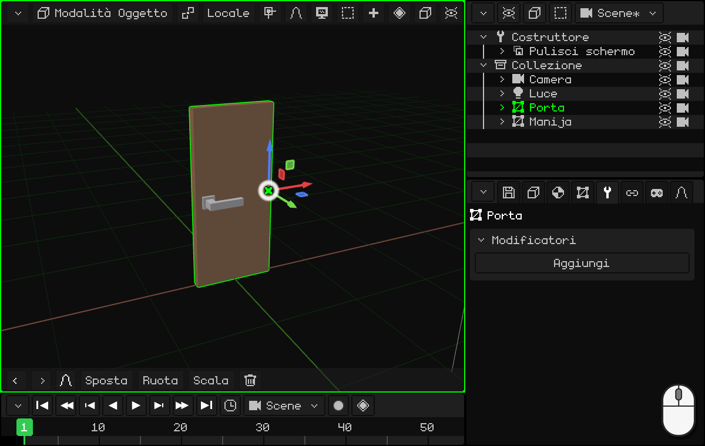

Perché la leva si muova con la porta, bisogna **imparentarla**: la leva diventa **figlia** della porta.

1. Seleziona la leva e poi la porta con <kbd>Shift</kbd> + clic (la porta, il genitore, resta attiva).
2. <kbd>Ctrl</kbd> + <kbd>P</kbd> → **Oggetto (mantieni trasf.)**. Nell'Outliner, la leva finisce dentro la porta.

Seleziona solo la porta (un clic su di essa) e ruotala di nuovo: ora la leva la segue. E la leva continua a girare sul proprio asse, come una maniglia vera. Se sono selezionate entrambe, gira solo la porta, e la leva la segue perché è sua figlia.

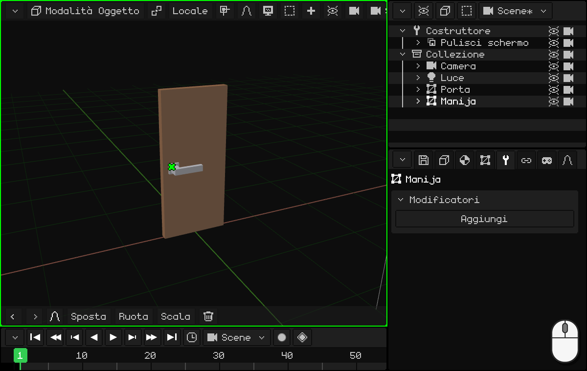

  Su touch e sull'N95: **Oggetto → Imposta genitore → Oggetto (mantieni trasf.)**.

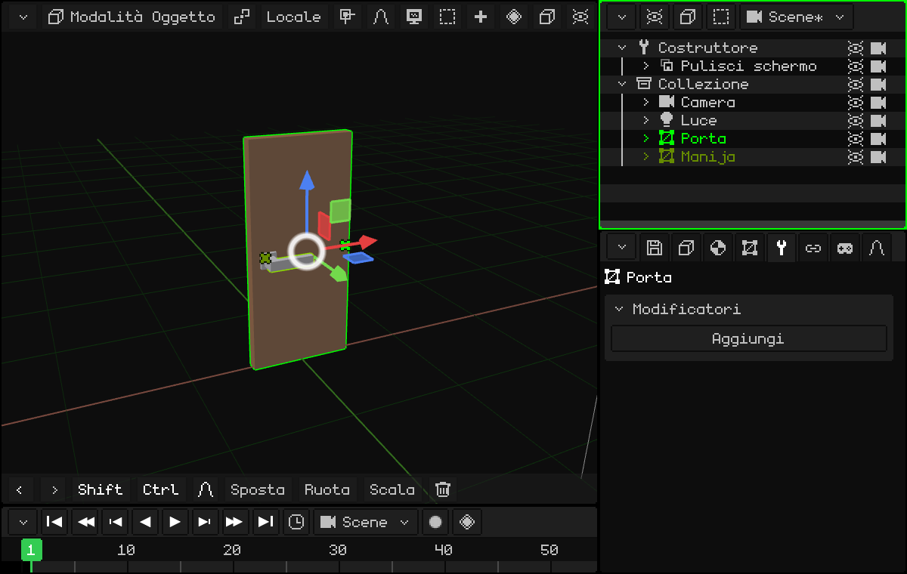

Nel prossimo tutorial animeremo la porta: [Animare la porta](animar-puerta.md).
