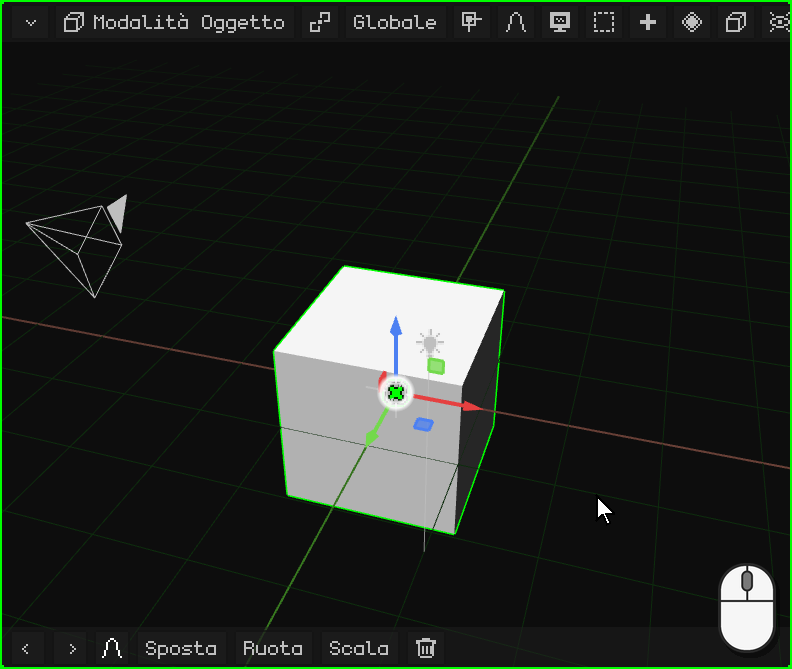
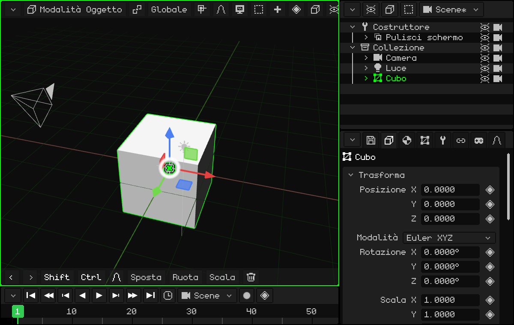
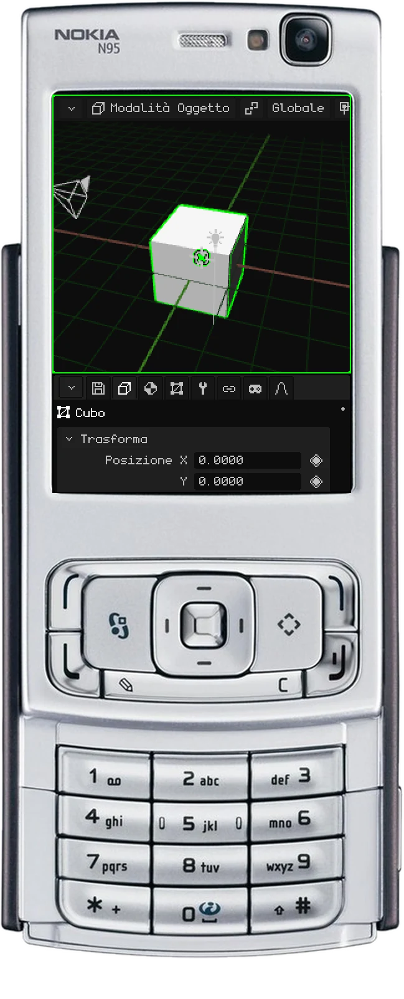
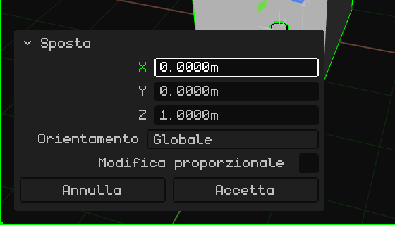
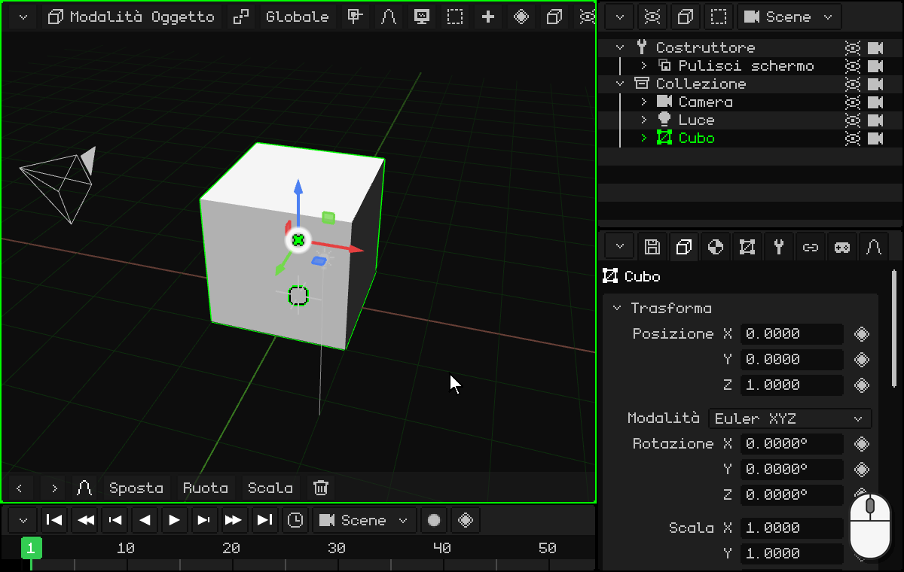
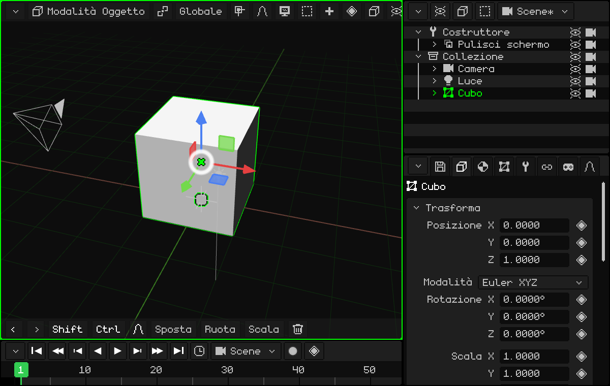
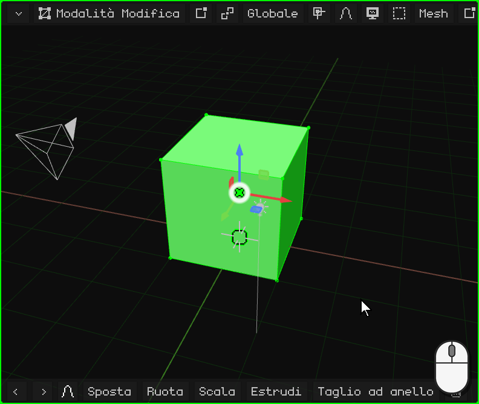
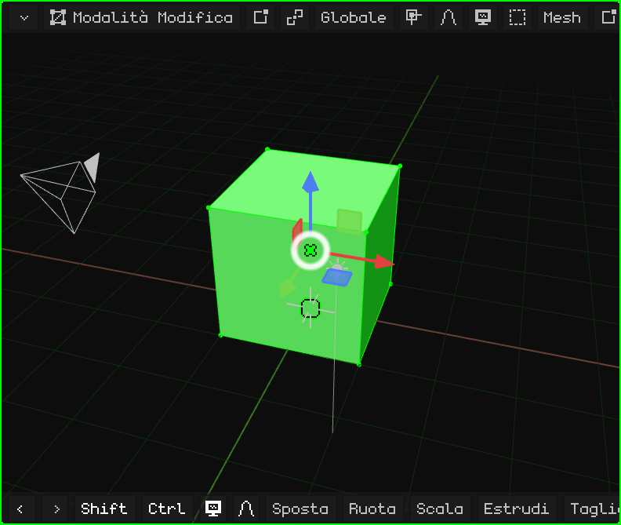
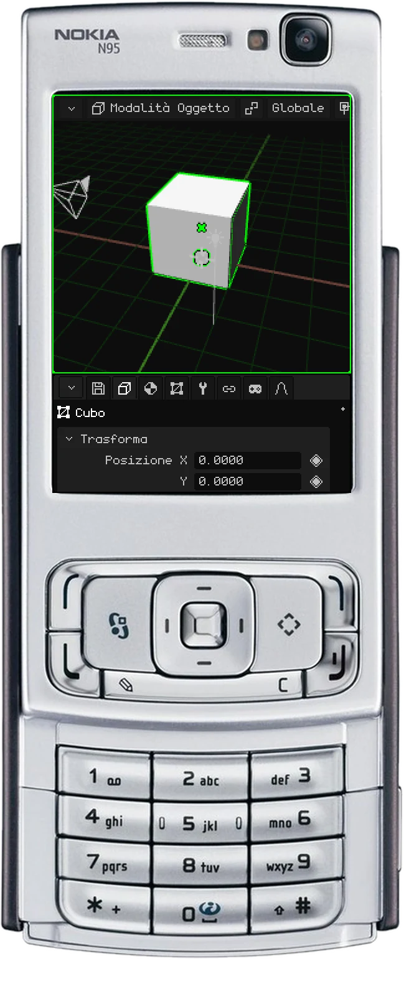
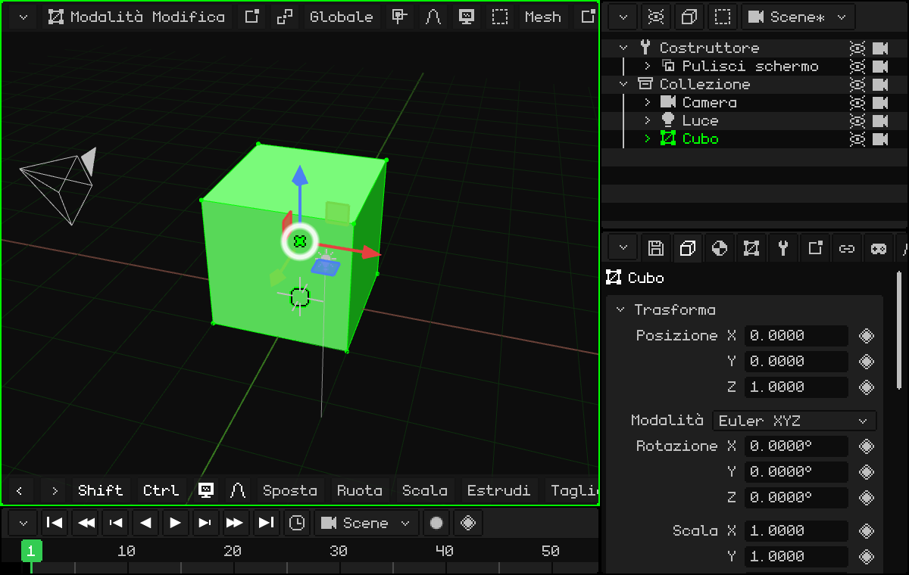

# Modellare una porta

Facciamo il nostro primo modello semplice: una porta! Per cominciare ci basta il cubo che c'è nella scena, che misura 2 × 2 × 2 metri.

Io (Dante) uso molto le porte per creare spazi: è una cosa che ho imparato studiando edilizia. Le porte sono quasi sempre alte 2 metri, e una persona (di solito) è più bassa di una porta. Con una porta nella scena hai subito la scala di tutto il resto.

## Appoggiarla sul pavimento

Il cubo ha il centro sul pavimento, quindi metà resta sotto. Lo alziamo di 1 metro sull'asse Z perché resti appoggiato. Con il cubo selezionato:

 Premi <kbd>G</kbd>: il cubo segue il mouse. Poi <kbd>Z</kbd>: resta vincolato all'asse Z (compare la linea blu). Scrivi `1` e premi <kbd>Enter</kbd>.

 Tocca **Sposta** nella barra degli strumenti, poi **Z**, un tocco sulla barra in alto per il tastierino numerico, `1`, **OK** e la spunta verde.

 <kbd>1</kbd> (spostare), <kbd>3</kbd> (l'asse Z), il tasto **matita** tenuto premuto e <kbd>1</kbd>, e <kbd>OK</kbd>.

Come si scrivono i numeri su ogni dispositivo è spiegato in [Con numeri esatti](modo-objeto.md#con-numeri-esatti).

### Correggere l'ultima operazione

Dopo aver spostato, ruotato o scalato compare in basso a sinistra un piccolo pannello, **Regola l'ultima operazione**, al posto della barra degli strumenti. Chiuso dice solo cosa hai fatto (per esempio, **Sposta**); un tocco o un clic sul suo titolo lo apre:

Ogni valore si può correggere: se invece di 1 metro volevi 1,2, tocchi Z, scrivi `1.2` e l'operazione viene rifatta con il nuovo valore. **Accetta** lo chiude e torna la barra degli strumenti; **Annulla** annulla l'operazione.

## Darle forma

Ci sono due modi per modellare la porta.

### Il più facile, che non consiglio: scalare l'oggetto

In Modalità Oggetto, scala il cubo sull'asse X e sull'asse Y finché non ha la forma della porta. Per esempio, <kbd>S</kbd> <kbd>X</kbd> `0.45` <kbd>Enter</kbd> (90 cm di larghezza) e <kbd>S</kbd> <kbd>Y</kbd> `0.05` <kbd>Enter</kbd> (10 cm di spessore).

Non lo consiglio perché l'oggetto resta con una scala diversa su ogni asse (0,45, 0,05 e 1), e l'ideale è che abbia scala **1** su tutti e tre gli assi (vedi [Meglio con la scala a 1](modo-objeto.md#meglio-con-la-scala-a-1)). Se lo fai così, **applica sempre la trasformazione**: <kbd>Ctrl</kbd> + <kbd>A</kbd> → **Scala** (o Oggetto → Applica → Scala). La forma non cambia e la scala torna a 1.

 Su uno schermo touch: **Scala**, **X**, la barra in alto, `0.45` e OK, e lo stesso con **Y** e `0.05`. Poi, **Oggetto → Applica → Scala**.

### Quello che consiglio: la Modalità Modifica

Con il cubo selezionato, entra in Modalità Modifica: premi <kbd>Tab</kbd> o scegli **Modalità Modifica** nel pulsante della modalità della Vista 3D. Entrando, tutti i vertici risultano selezionati.

In Modalità Modifica si selezionano **vertici**, **spigoli** e **facce**: questa è la base. E, come in Modalità Oggetto, si possono spostare, ruotare e scalare (vedi [Modalità Modifica](../editor/modo-edicion.md)).

Con tutto selezionato, rimpicciolisci su X e su Y finché la porta non è come la vuoi. Su Z non serve, perché è già alta 2 metri! Dato che a cambiare è la mesh e non l'oggetto, la scala resta a 1.

**A occhio, con il gizmo:** un clic (o un tocco) sul centro del gizmo lo passa a Ruota, e un altro a **Scala**. Prendi la punta rossa (X) e trascinala verso il centro fino alla larghezza che vuoi; poi quella verde (Y), finché non resta sottile come una porta.

**Con i numeri:** <kbd>S</kbd>, <kbd>X</kbd>, `0.45`, <kbd>Enter</kbd> e <kbd>S</kbd>, <kbd>Y</kbd>, `0.05`, <kbd>Enter</kbd>.

 Su uno schermo touch: il pulsante della modalità → **Modalità Modifica**; poi **Scala**, **X**, un tocco sulla barra in alto, `0.45`, **OK** e la spunta, e lo stesso con **Y** e `0.05`.

 Sul Nokia N95: <kbd>OK</kbd> passa alla Modalità Modifica. <kbd>3</kbd> (scalare), <kbd>1</kbd> (l'asse X), il tasto matita tenuto premuto e `0` <kbd>*</kbd> `45` (il <kbd>*</kbd> è il punto), e <kbd>OK</kbd>. Lo stesso con <kbd>2</kbd> (l'asse Y) e `0.05`.

## Con misure esatte

Se invece di farlo a occhio vuoi, per esempio, una porta larga esattamente **90 cm**: nel pulsante **Vertice / Spigolo / Faccia** scegli **Faccia** e fai clic su uno dei lati. Sappiamo che il cubo misura 2 metri, quindi dobbiamo togliere ciò che avanza perché resti 0,9: bisogna spostare quel lato di **1,1 metri**. <kbd>G</kbd> <kbd>X</kbd> `-1.1` <kbd>Enter</kbd>.

Durante lo spostamento, l'asse **X** blocca il movimento su un solo asse, perché il cubo non si deformi:

-  Con il tasto <kbd>X</kbd>.
-  Con un tocco su **X** nella barra degli strumenti. Il `-1.1` si scrive con il tastierino numerico, toccando la barra in alto.
-  Con <kbd>1</kbd> mentre si sposta. Il numero si scrive tenendo premuto il tasto matita: <kbd>#</kbd> cambia il segno e <kbd>*</kbd> è il punto. La faccia si seleziona con il mouse virtuale (il tasto di selezione destro, le frecce e <kbd>OK</kbd>).

Per lo spessore, con tutto selezionato, <kbd>S</kbd> <kbd>Y</kbd> `0.05` <kbd>Enter</kbd>, come prima.

Ed ecco il nostro primo modello 3D! Complimenti.

Nel prossimo tutorial faremo in modo che la porta si apra dal cardine: [Cambiare l'origine: una porta](puerta.md).
