# La Modalità Oggetto

In **Modalità Oggetto** si lavora con gli oggetti interi: si selezionano, si spostano, si ruotano, si scalano, si aggiungono, si eliminano e si mettono uno dentro l'altro. È la modalità con cui parte Whisk3D, e lo dice il pulsante in alto a sinistra della Vista 3D. Per cambiare la forma di una mesh (i suoi vertici, spigoli e facce) c'è la Modalità Modifica, che ha il suo tutorial.

## Cos'è un oggetto

Tutto ciò che c'è nella scena è un **oggetto**: il cubo con cui parte un progetto, la camera, la luce, un personaggio. Ogni oggetto ha:

- un **nome**, che si vede nell'Outliner;
- la sua **trasformazione**: dove si trova (posizione), come è girato (rotazione) e quanto è grande (scala);
- delle **proprietà**, che dipendono dal suo tipo: una luce ha colore e intensità, una camera ha il suo obiettivo, una mesh ha il suo materiale.

Ci sono oggetti di molti tipi, ma tutti si selezionano, si spostano, si ruotano e si scalano allo stesso modo.

## Selezionare un oggetto

| | Come si seleziona |
|---|---|
|  PC | Un clic sull'oggetto. <kbd>Shift</kbd> + clic ne aggiunge o ne toglie un altro. Un clic nel vuoto non lascia niente selezionato. |
|  Schermo touch | Un tocco sull'oggetto. Con **Shift** attivo nella barra degli strumenti della Vista 3D, ogni tocco ne aggiunge o ne toglie un altro. |
|  Nokia N95 | Il tasto **matita** passa da un oggetto al successivo. Con la matita e le frecce si aggiunge, si toglie, si seleziona tutto o niente. |

Ciò che è selezionato si vede con un bordo, e l'ultimo che hai selezionato è l'**oggetto attivo**: quello che mostra Proprietà.

### Selezionare più oggetti con un riquadro

 Trascina il mouse con il clic principale sulla Vista 3D, partendo dallo sfondo: si disegna un **riquadro** e, quando rilasci, restano selezionati gli oggetti che ha preso. Si crea anche con <kbd>B</kbd>.

 Su uno schermo touch, trascinare un dito fa orbitare la vista: il riquadro si attiva dal menu **Seleziona → Selezione a riquadro**, e poi si trascina il dito.

La direzione del trascinamento cambia ciò che si seleziona, e il riquadro lo segnala con il suo colore:

| Trascinamento | Colore del riquadro | Cosa seleziona |
|---|---|---|
| Da sinistra a destra | Verde | Solo ciò che resta **interamente dentro** il riquadro. |
| Da destra a sinistra | Blu | Tutto ciò che il riquadro **tocca**, anche appena. |

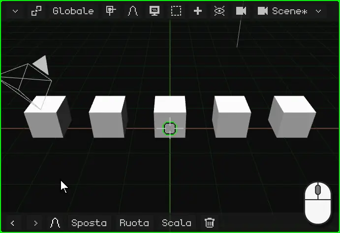

## Il menu contestuale

Come in qualsiasi programma, il **menu contestuale** tiene a portata di mano ciò che si può fare con la selezione. In Modalità Oggetto è il menu **Oggetto**, che si apre dove si trova il puntatore:

| | Come si apre |
|---|---|
|  PC | Clic destro sulla Vista 3D |
|  Schermo touch | Tenere un dito fermo sulla Vista 3D, mezzo secondo |
|  Nokia N95 | Il tasto di selezione sinistro apre la barra dei menu; lì, il menu Oggetto |

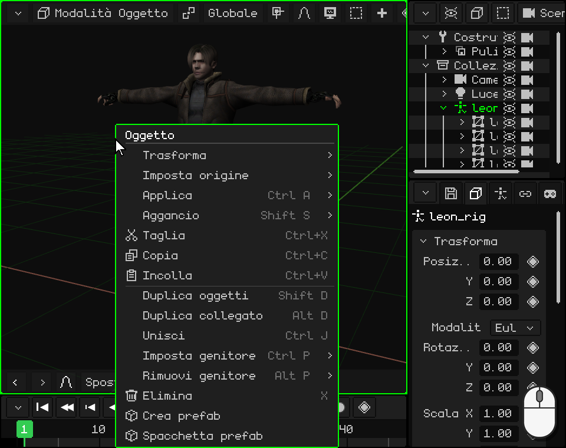

 Con Leon selezionato, un dito fermo sulla Vista 3D: dopo mezzo secondo il telefono vibra e si apre il menu. Quando sollevi il dito non si sceglie niente: l'opzione si tocca dopo.

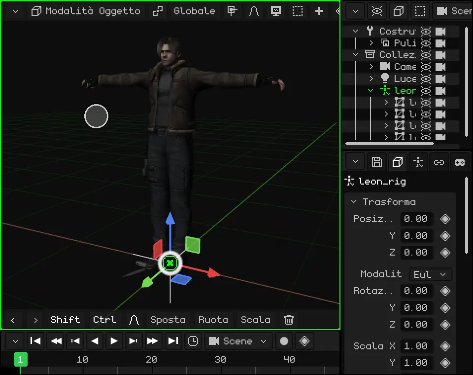

| Opzione | Cosa fa |  Scorciatoia |
|---|---|---|
| **Taglia** | Salva la selezione per incollarla dopo e la toglie dalla scena. | <kbd>Ctrl</kbd> + <kbd>X</kbd> |
| **Copia** | Salva una copia della selezione, con i suoi figli, per incollarla dopo: in questa scena, in un altro progetto o in un'altra finestra di Whisk3D aperta. | <kbd>Ctrl</kbd> + <kbd>C</kbd> |
| **Incolla** | Mette nella scena l'ultima cosa copiata o tagliata, nello stesso posto, e la lascia selezionata. | <kbd>Ctrl</kbd> + <kbd>V</kbd> |
| **Duplica oggetti** | Fa una copia della selezione, indipendente dall'originale, e la lascia afferrata perché tu la sposti: un clic (o <kbd>OK</kbd>) la lascia dove si trova. | <kbd>Shift</kbd> + <kbd>D</kbd> |
| **Duplica collegato** | Come Duplica, ma la copia **condivide la mesh** con l'originale: se cambi la forma di una, cambiano entrambe. Posizione, rotazione e scala sono di ognuna. Serve per molte cose uguali, come gli alberi di un bosco o le sedie di una sala: si modificano tutte in una volta e occupano meno memoria. | <kbd>Alt</kbd> + <kbd>D</kbd> |
| **Elimina** | Elimina la selezione. Chiede conferma. | <kbd>X</kbd> o <kbd>Delete</kbd> |

Le altre opzioni del menu si vedono in questo stesso tutorial: Trasforma (spostare, ruotare e scalare), [Imposta origine e l'Aggancio](#da-dove-si-sposta-si-ruota-e-si-scala), [Applica](#meglio-con-la-scala-a-1), [Imposta genitore e Rimuovi genitore](#loutliner-gli-oggetti-della-scena). **Unisci** unisce più mesh in una sola, e i **prefab** (oggetti costruiti per essere riutilizzati) hanno il loro tutorial.

## Spostare, ruotare e scalare

Le tre operazioni di base di un oggetto sono **spostare**, **ruotare** e **scalare**. Ognuna si può fare con il gizmo, con la tastiera o, su uno schermo touch, con i comandi della barra degli strumenti. Se qualcosa va storto, **Annulla** (<kbd>Ctrl</kbd> + <kbd>Z</kbd> sul PC) lo riporta indietro.

### Il gizmo

Il **gizmo** sono le frecce colorate che compaiono sull'oggetto selezionato. Ogni colore è un asse: il **rosso** è X, il **verde** è Y e il **blu** è Z, quello verso l'alto.

Il gizmo ha tre modalità, una per ogni operazione. **Un clic sul gizmo, senza trascinare, passa alla successiva**: da Sposta a Ruota, da Ruota a Scala e da Scala di nuovo a Sposta.

 Un clic con il mouse sul gizmo cambia modalità.

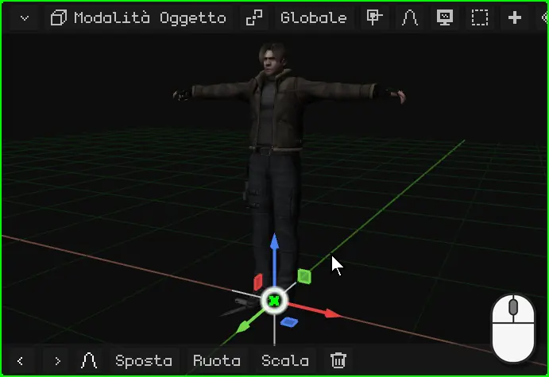

 Un tocco sul gizmo cambia modalità.

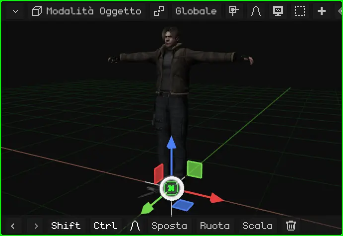

Per usarlo, si afferra una parte del gizmo e si trascina. Quando rilasci, è fatto.

| Modalità | Cosa si afferra | Cosa fa |
|---|---|---|
| Sposta | Una freccia | Sposta solo su quell'asse. |
| Sposta | Un quadratino | Sposta su un piano: il quadratino blu sposta su X e Y, senza cambiare l'altezza. |
| Sposta | Il cerchio centrale | Sposta liberamente, seguendo il puntatore. |
| Ruota | Un semicerchio colorato | Gira attorno a quell'asse. |
| Ruota | L'anello bianco | Gira di fronte alla vista. |
| Scala | Una punta quadrata | Allunga o accorcia su quell'asse. |
| Scala | Il cerchio centrale | Ingrandisce o rimpicciolisce in modo uniforme, sui tre assi. |

 Con il mouse: clic su una parte del gizmo e trascina.

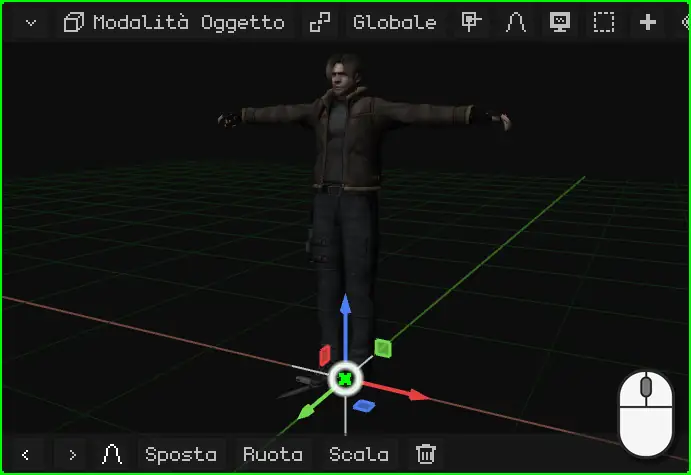

 Con il dito: appoggialo su una parte del gizmo e trascina. Se lo appoggi sullo sfondo, fai orbitare la vista.

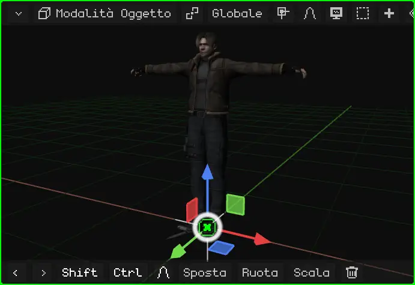

 Sul Nokia N95 il gizmo è spento: si sposta, si ruota e si scala con i tasti, come spiegato qui sotto. Si può attivare in Sovrapposizioni → Gizmo, per usarlo con un mouse Bluetooth.

### Con la tastiera o i comandi

Con la tastiera non serve puntare niente: premi il tasto e l'oggetto segue il mouse (o le frecce, sul telefono) finché non confermi.

| | Spostare | Ruotare | Scalare | Solo su un asse | Confermare | Annullare |
|---|---|---|---|---|---|---|
|  PC | <kbd>G</kbd> | <kbd>R</kbd> | <kbd>S</kbd> | <kbd>X</kbd> / <kbd>Y</kbd> / <kbd>Z</kbd> | Clic o <kbd>Enter</kbd> | <kbd>Esc</kbd> o clic destro |
|  Nokia N95 | <kbd>1</kbd> | <kbd>2</kbd> | <kbd>3</kbd> | <kbd>1</kbd> / <kbd>2</kbd> / <kbd>3</kbd> | <kbd>OK</kbd> (il centro del pad) | <kbd>C</kbd> |

 Premi <kbd>G</kbd> e muovi il mouse: l'oggetto lo segue. Se premi <kbd>X</kbd>, si sposta solo su X; un'altra <kbd>X</kbd> passa da Globale a Locale. Lo stesso quando ruoti: <kbd>R</kbd> e poi <kbd>Z</kbd> gira sull'asse Z, quello verticale; senza asse, gira di fronte alla vista. Puoi anche scrivere un numero: <kbd>G</kbd>, <kbd>X</kbd>, <kbd>2</kbd> e <kbd>Enter</kbd> lo spostano di 2 metri su X.

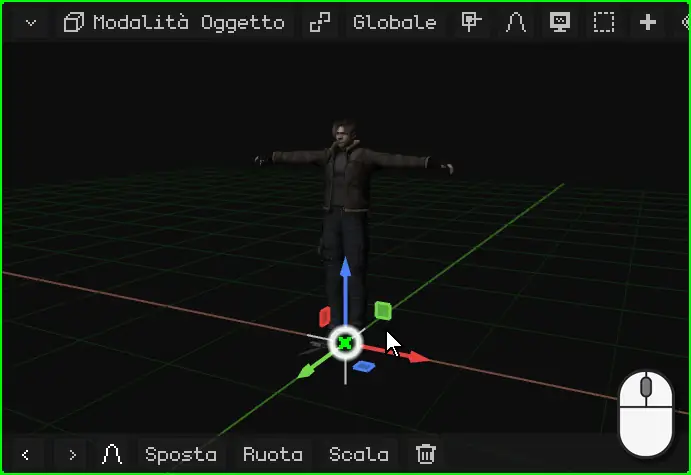

 Sul Nokia N95: <kbd>1</kbd> per spostare, <kbd>2</kbd> per ruotare e <kbd>3</kbd> per scalare, e le **frecce** fanno il movimento. Mentre dura, <kbd>1</kbd>, <kbd>2</kbd> e <kbd>3</kbd> non cambiano più operazione: scelgono l'asse X, Y o Z. Per esempio, <kbd>2</kbd> e poi <kbd>3</kbd> gira sull'asse Z, quello verticale. <kbd>OK</kbd> conferma e <kbd>C</kbd> annulla.

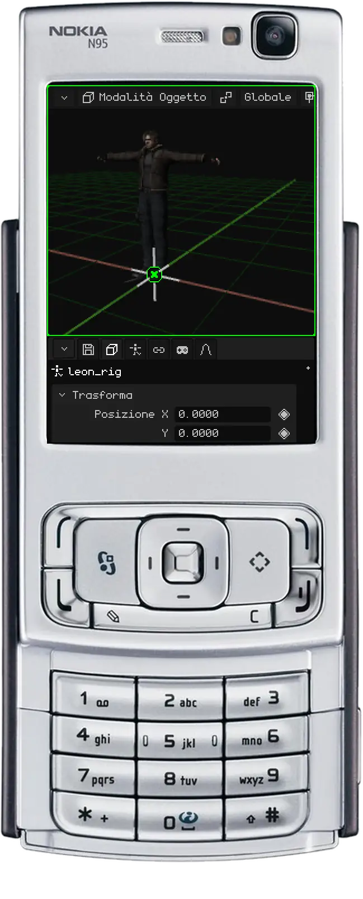

 **Su uno schermo touch**, senza tastiera, si può usare il gizmo, come visto sopra, o i **comandi** della barra degli strumenti della Vista 3D. Tocchi **Sposta**, **Ruota** o **Scala** e trascini il dito in qualsiasi punto della vista: l'oggetto segue il dito. La barra cambia: la **spunta verde** conferma, la **croce rossa** annulla, e i pulsanti **X**, **Y** e **Z** limitano il movimento a quegli assi.

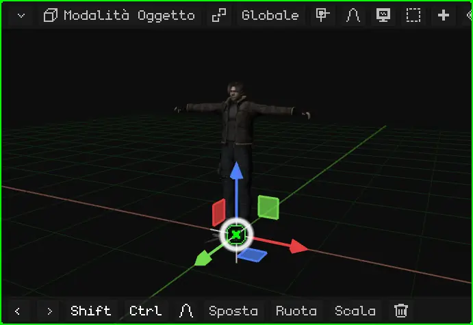

### Con numeri esatti

Per lavorare con precisione, il movimento si scrive con un numero: girare qualcosa esattamente di 90°, scalarlo a metà con `0.5` o al doppio esatto della sua dimensione con `2`, o spostarlo di 1,5 metri. **Un'unità di Whisk3D è un metro.**

Mentre dura l'operazione, la barra dei menu della Vista 3D mostra ciò che si sta facendo e il valore.

 **Con la tastiera:** dopo <kbd>G</kbd>, <kbd>R</kbd> o <kbd>S</kbd>, scrivi il numero e premi <kbd>Enter</kbd>. <kbd>R</kbd> <kbd>Z</kbd> <kbd>9</kbd> <kbd>0</kbd> <kbd>Enter</kbd> lo gira di 90° sull'asse verticale; <kbd>S</kbd> <kbd>0</kbd> <kbd>.</kbd> <kbd>5</kbd> <kbd>Enter</kbd> lo riduce a metà e <kbd>S</kbd> <kbd>2</kbd> <kbd>Enter</kbd>, al doppio; <kbd>G</kbd> <kbd>X</kbd> <kbd>1</kbd> <kbd>.</kbd> <kbd>5</kbd> <kbd>Enter</kbd> lo sposta di 1,5 metri su X.

 **Su uno schermo touch:** inizia l'operazione con **Sposta**, **Ruota** o **Scala** nella barra degli strumenti e tocca la barra in alto, quella che mostra il valore: si apre il tastierino numerico di Whisk3D. Scrivi il numero e tocca **OK**; la spunta verde conferma. Il tastierino fa anche i calcoli, come `90/2`.

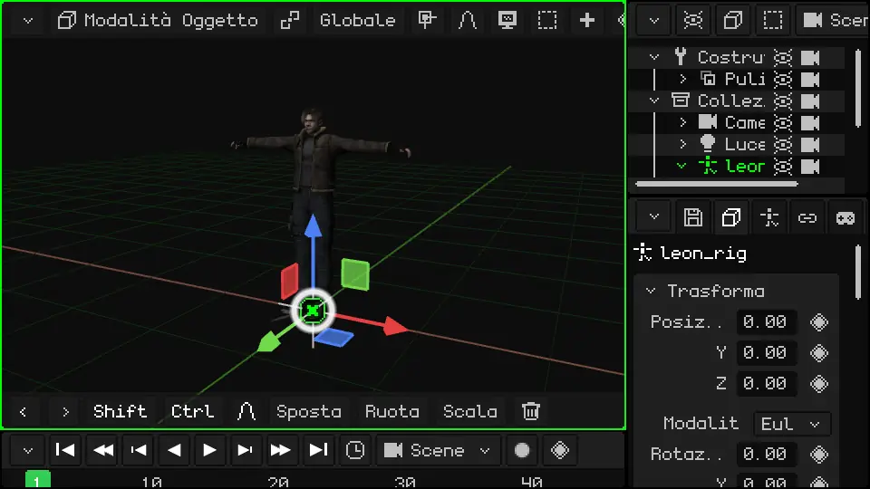

Tutte le scorciatoie della Modalità Oggetto sono nel manuale: [Spostare, ruotare e scalare](../editor/transformar.md) e [Modalità Oggetto](../editor/modo-objeto.md).

### La barra degli strumenti: gli ultimi comandi

  Nella **barra degli strumenti** della Vista 3D (quella in basso) ci sono Annulla e Rifai (le frecce), e poi **gli ultimi comandi che hai usato**, con l'ultimo davanti. All'inizio sono Sposta, Ruota, Scala ed Elimina. Se scali un oggetto, Scala passa davanti: ciò che usi di più resta sempre a portata di mano.

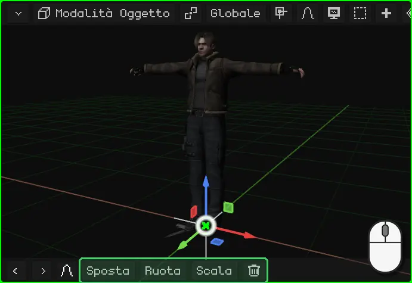

 Sul Nokia N95 la barra degli strumenti è nascosta, per lasciare lo schermo alla scena: spostare, ruotare e scalare si fa con i tasti del telefono. Quando compare (per esempio, quella della modifica proporzionale durante una trasformazione), i suoi pulsanti si usano con il **mouse virtuale**: si attiva con il tasto di selezione destro, le frecce lo muovono e <kbd>OK</kbd> fa clic.

## Da dove si sposta, si ruota e si scala

### L'origine

Ogni oggetto ha un'**origine**: il punto da cui esce il gizmo. È il punto a partire dal quale si trasforma: l'oggetto gira attorno alla sua origine e si ingrandisce o si rimpicciolisce a partire da essa. La **posizione** che mostra Proprietà è quella della sua origine.

Nelle primitive, l'origine è al centro. In un modello importato è dove l'ha lasciata il programma con cui è stato fatto: in Leon, ai suoi piedi.

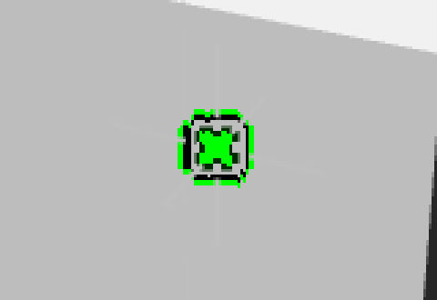

### Il cursore 3D

Il **cursore 3D** è il cerchio con una croce della Vista 3D. All'inizio è al centro del mondo.

 Serve a due cose:

- tutto ciò che si aggiunge con **Aggiungi** compare lì;
- può essere il centro da cui si ruota e si scala, come si vede in [Il punto di perno](#il-punto-di-perno).

Il cursore 3D si sposta con il menu **Aggancio**, che porta anche gli oggetti fino al cursore:

| | Come si apre il menu Aggancio |
|---|---|
|  PC | <kbd>Shift</kbd> + <kbd>S</kbd> |
| Menu | Oggetto → Aggancio (in Modalità Modifica, Mesh → Aggancio) |

| Opzione | Cosa fa |
|---|---|
| Cursore al selezionato | Porta il cursore 3D al centro della selezione. In Modalità Modifica, al centro dei vertici, spigoli o facce selezionati. |
| Cursore all'attivo | Porta il cursore 3D all'origine dell'oggetto attivo. |
| Cursore all'origine del mondo | Lo riporta al centro del mondo. |
| Cursore alla griglia | Lo porta al punto della griglia più vicino. |
| Selezione al cursore | Porta la selezione fino al cursore 3D. |
| Selezione al cursore (mantieni offset) | Uguale, ma con più oggetti mantiene la distanza tra loro: il gruppo arriva intero. |
| Selezione all'attivo | Porta la selezione fino all'oggetto attivo. |
| Selezione alla griglia | Attacca ogni oggetto selezionato al punto della griglia più vicino. |

Per esempio, per mettere una scatola in mano a qualcuno, o un oggetto esattamente dove si trova un altro: selezioni quello di destinazione, **Cursore al selezionato**; poi selezioni quello che vuoi portare e **Selezione al cursore**.

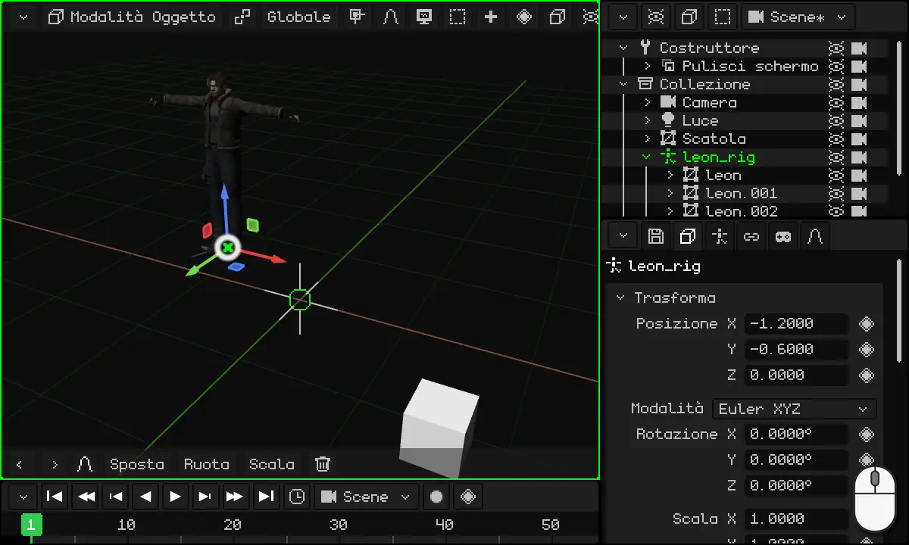

### Il punto di perno

Il **punto di perno** è il centro da cui si ruota e si scala la selezione. Si sceglie con il pulsante del perno nella barra della Vista 3D, a sinistra di **Globale** (la sua icona cambia secondo il perno scelto):

| Perno | Da dove ruota e scala |
|---|---|
| **Punto mediano** | Dal centro di tutta la selezione. È quello predefinito. Con un solo oggetto, è la sua origine. |
| **Elemento attivo** | Dall'origine dell'oggetto attivo (l'ultimo che hai selezionato): gli altri girano attorno a lui. |
| **Origini individuali** | Ogni oggetto dalla propria origine: girano tutti insieme, ognuno al suo posto. |
| **Cursore 3D** | Dal cursore 3D. |

Con **Cursore 3D** si può ruotare qualsiasi cosa attorno a qualsiasi punto: metti lì il cursore (con il menu Aggancio) e ruoti. Serve a sistemare le sedie attorno a un tavolo, le lancette di un orologio o qualsiasi cosa debba girare attorno a qualcosa.

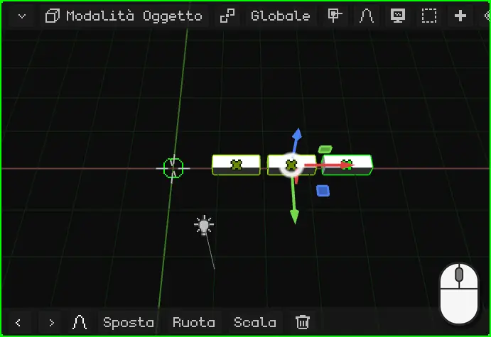

### Globale e Locale

Quando sposti, ruoti o scali su un asse, quell'asse può essere quello del **mondo** o quello dell'**oggetto**. Si sceglie con il pulsante **Globale** della barra della Vista 3D:

| Orientamento | Gli assi |
|---|---|
| **Globale** | Quelli del mondo: sempre uguali, con la Z verso l'alto. È quello predefinito. |
| **Locale** | Quelli dell'oggetto stesso, che girano con lui. |
| **Vista** | Quelli dello schermo: X di lato, Y verso l'alto. |
| **Normale** | In Modalità Modifica, la direzione verso cui guarda la faccia selezionata. |

La differenza si vede quando l'oggetto è girato. Per esempio, Leon ruotato di 40°: in **Globale**, il suo asse Y è quello del mondo e si sposta in diagonale rispetto a dove guarda; in **Locale**, l'asse Y gira con lui e Leon cammina dritto in avanti. Lo stesso vale per un'auto che ha svoltato a un incrocio: per farla avanzare, si sposta sul suo asse Locale.

 Con la tastiera, la seconda lettera dell'asse passa da Globale a Locale: <kbd>G</kbd> <kbd>Y</kbd> sposta sulla Y del mondo e <kbd>G</kbd> <kbd>Y</kbd> <kbd>Y</kbd>, sulla Y dell'oggetto. Sul Nokia N95, lo stesso con <kbd>2</kbd> <kbd>2</kbd> mentre si sposta.

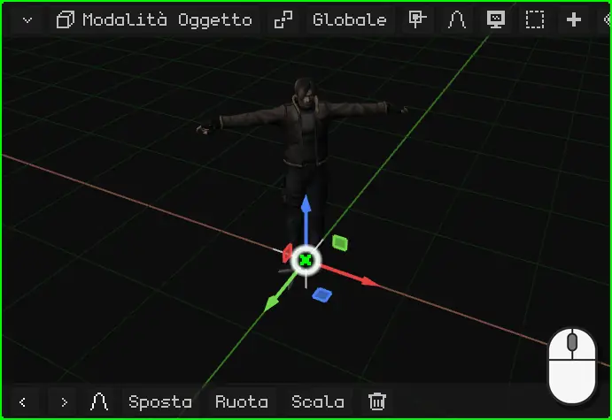

### Cambiare l'origine

L'origine di una mesh 3D si può spostare senza muovere la mesh, con **Oggetto → Imposta origine**. Come si fa, con l'esempio di una porta che deve aprirsi dal cardine, è spiegato nel tutorial [Cambiare l'origine: una porta](puerta.md).

## Le proprietà

Le **proprietà** dell'oggetto attivo sono nel viewport Proprietà. La scheda **Oggetto** (quella del cubo) è uguale per tutti gli oggetti: in alto c'è il riquadro **Trasforma**, con la posizione, la rotazione e la scala. I numeri si possono scrivere a mano: un clic (o un tocco) sul numero e si digita. Spostare l'oggetto nella Vista 3D cambia questi numeri, e cambiare i numeri lo sposta.

Le altre schede dipendono dal tipo di oggetto: una luce ha la scheda della luce, una mesh ha quella del materiale e quella dei modificatori.

### Il rombo: ciò che si può animare

Accanto a molte proprietà c'è un **rombo**. Il rombo significa che quella proprietà **si può animare**: un clic sul rombo salva il suo valore nel frame attuale (un *keyframe*), e un altro clic sul rombo verde lo toglie. Con più keyframe, la proprietà cambia da sola nel tempo.

Il colore del rombo dice com'è la proprietà: **grigio**, non è ancora animata; **verde** acceso, è già animata e ha un keyframe in questo frame; **verde tenue**, è animata, ma non ha un keyframe in questo frame.

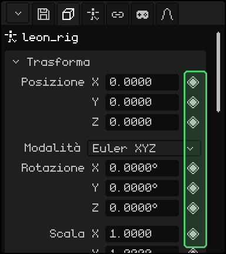

L'animazione ha un suo tutorial più avanti.

### Meglio con la scala a 1

Un consiglio: **lascia la scala degli oggetti a 1**. Ingrandire o rimpicciolire un oggetto con Scala è comodo, ma un oggetto scalato può dare problemi dopo: i figli ereditano la scala e si deformano quando ruotano, e la fisica, le collisioni e alcuni modificatori possono fare calcoli sbagliati.

Se hai scalato un oggetto, **applica la scala**: la dimensione che ha diventa la sua dimensione reale e la scala torna a 1, senza che cambi ciò che si vede.

| | Come si applica la scala |
|---|---|
|  PC | <kbd>Ctrl</kbd> + <kbd>A</kbd> → Scala |
| Menu | Oggetto → Applica → Scala |

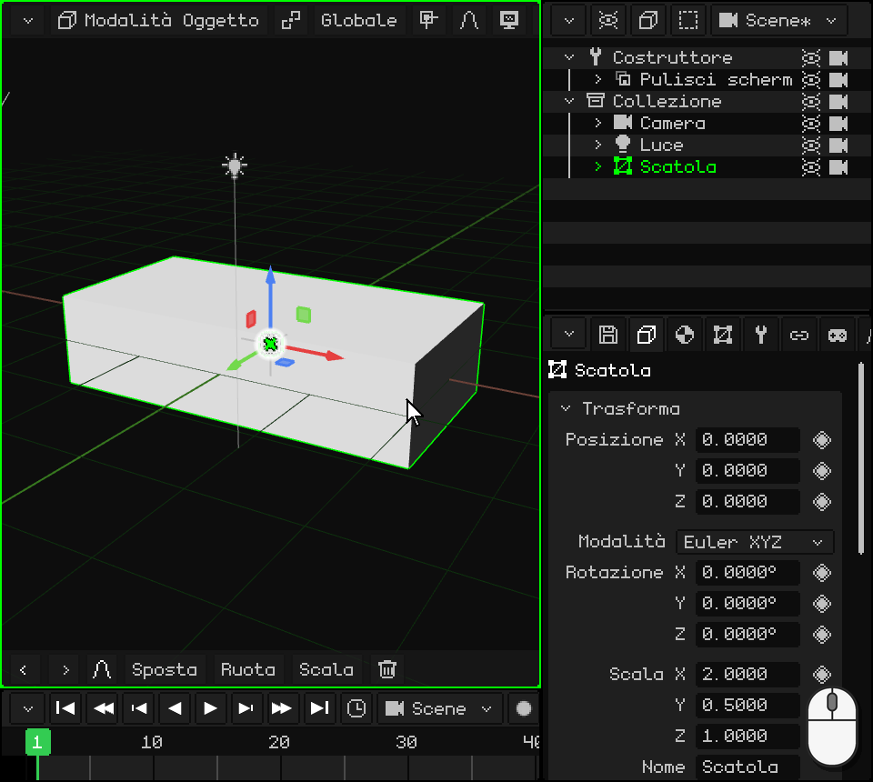

Nello stesso menu, **Posizione** e **Rotazione** fanno lo stesso con la posizione e la rotazione, e **Tutte le trasformazioni** applica tutte e tre.

## L'Outliner: gli oggetti della scena

L'**Outliner** è l'elenco di tutti gli oggetti della scena. Un clic (o un tocco) su una riga seleziona quell'oggetto, come nella Vista 3D. Sul PC si trova in alto a destra.

Un oggetto può stare **dentro un altro**: appare più spostato a destra, appeso a lui. Quello esterno è il **genitore** e quello interno è il **figlio**. Il figlio **eredita le trasformazioni** del genitore: se sposti, ruoti o scali il genitore, il figlio lo segue. Il figlio si può continuare a muovere da solo, ma sempre rispetto al genitore.

Leon è un esempio: le sue mesh, le quattro parti che si vedono, sono figlie della sua armatura, `leon_rig`. Spostare l'armatura sposta Leon intero.

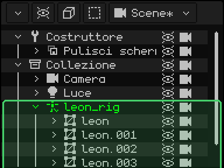

Mettere un oggetto dentro un altro si chiama **imparentare**:

| | Come si imparenta |
|---|---|
|  PC | Nell'Outliner, trascinare la riga del figlio e rilasciarla sopra quella del genitore. Oppure selezionare il figlio, poi il genitore (con <kbd>Shift</kbd>) e <kbd>Ctrl</kbd> + <kbd>P</kbd>. |
|  Schermo touch | Selezionare il figlio; attivare **Shift** nella barra degli strumenti e toccare il genitore; poi, menu Oggetto → Imposta genitore. |
|  Nokia N95 | Con l'Outliner attivo e il figlio selezionato: <kbd>1</kbd>, la freccia **destra** lo mette dentro quello sopra e la **sinistra** lo toglie; <kbd>1</kbd> di nuovo conferma. |
| Menu | Oggetto → Imposta genitore; per toglierlo, Oggetto → Rimuovi genitore |

 Nel video, una scatola si trascina nell'Outliner fino a `leon_rig`: diventa sua figlia, e quando si sposta Leon la scatola lo segue.

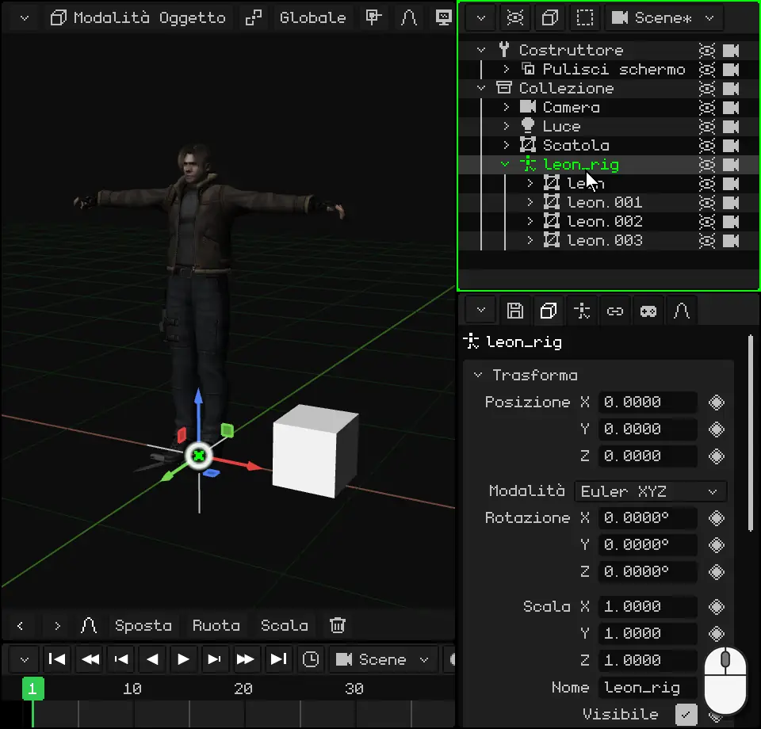

## I tipi di oggetti

Tutti gli oggetti si aggiungono dal menu **Aggiungi** (il pulsante **+** della barra della Vista 3D, o <kbd>Shift</kbd> + <kbd>A</kbd> sul PC). Il nuovo oggetto compare sul cursore 3D e resta selezionato.

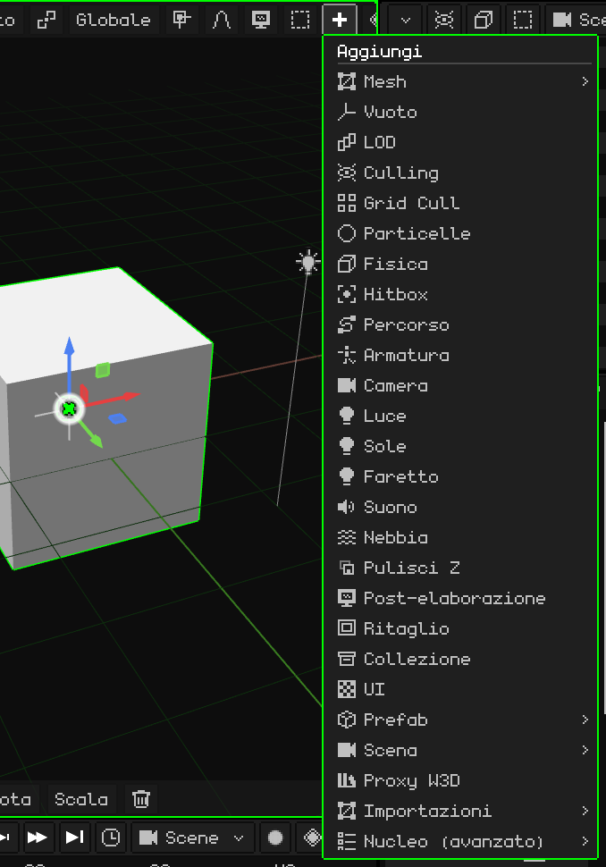

Quelli di base sono questi:

| Oggetto | Cos'è |
|---|---|
| [Mesh 3D](../editor/objeto-malla.md) | Un modello 3D: un personaggio, una casa, una pietra. È fatto di vertici, spigoli e facce, e si vede con il suo materiale e le sue texture. Le primitive di Aggiungi → Mesh (cubo, sfera, cilindro...) sono mesh per cominciare a modellare. |
| [Camera](../editor/objeto-camara.md) | Il punto di vista del gioco e dei render. Ciò che vede la camera attiva è ciò che si vede quando giochi e ciò che esce in un'immagine o in un video. |
| [Luce](../editor/objeto-luz.md) | Illumina la scena. Ci sono tre tipi: Punto (una lampadina), Sole (luce del giorno, con raggi paralleli) e Faretto (un cono, come una torcia). |
| [Armatura](../editor/objeto-esqueleto.md) | Una catena di ossa che muove una mesh, per animare personaggi. Leon ne ha una: quando l'armatura cammina, la mesh la segue. |
| [Suono](../editor/objeto-sonido.md) | Un suono messo nella scena. Può suonare di sottofondo, come una musica, o da dove si trova l'oggetto. |
| Vuoto | Un oggetto senza forma: un punto nella scena. Serve da genitore per raggruppare altri oggetti o come riferimento. |
| Collezione | Una cartella per mettere in ordine gli oggetti nell'Outliner. |

Ce ne sono altri: percorsi, nebbia, particelle, hitbox per le collisioni, interfacce 2D per i giochi e oggetti per ottimizzare. E in futuro se ne aggiungeranno molti altri. Questo tutorial parla degli oggetti in generale; ognuno ha il suo articolo, dove si spiegano le sue proprietà una per una.

## Ciò che hanno tutti gli oggetti

Oltre alla sua trasformazione e alle sue proprietà, qualsiasi oggetto può avere:

- **Script** Lua, che gli danno un comportamento nel gioco: che si muova da solo, che risponda ai tasti, che urti. Si vedono più avanti.
- **Animazioni**: qualsiasi proprietà con il rombo si può animare. Hanno il loro tutorial.
- **Vincoli**: regole che lo legano a un altro oggetto, come copiarne la posizione o guardare sempre la camera. Sono spiegati in [Vincoli](../editor/restricciones.md).

Alcuni tipi hanno inoltre cose proprie. Le mesh 3D, per esempio, hanno i **modificatori**, che cambiano la forma senza distruggerla: rifletterla come in uno specchio, ripeterla, ammorbidirla. Sono in [Mesh 3D](../editor/objeto-malla.md).

## Importare modelli 3D

Oltre a modellare in Whisk3D, si possono importare modelli fatti con altri programmi. I formati supportati sono:

| Formato | Cosa importa |
|---|---|
| **GLB** e **glTF** | La mesh, i materiali e le texture, l'armatura e le animazioni. È il formato più completo: Leon è in un .glb. |
| **OBJ** | La mesh, i materiali e le texture (con il suo .mtl). Senza armatura né animazioni. |
| **FBX** | La mesh, i materiali, l'armatura e le animazioni. |
| **STL** | Solo la forma: i triangoli, senza materiali né colori. È il formato della stampa 3D e dei programmi CAD. |

Si importano da **Aggiungi → Importazioni**, scegliendo il formato e poi il file.

 Sul PC si può anche trascinare il file dalla cartella e rilasciarlo sulla Vista 3D.

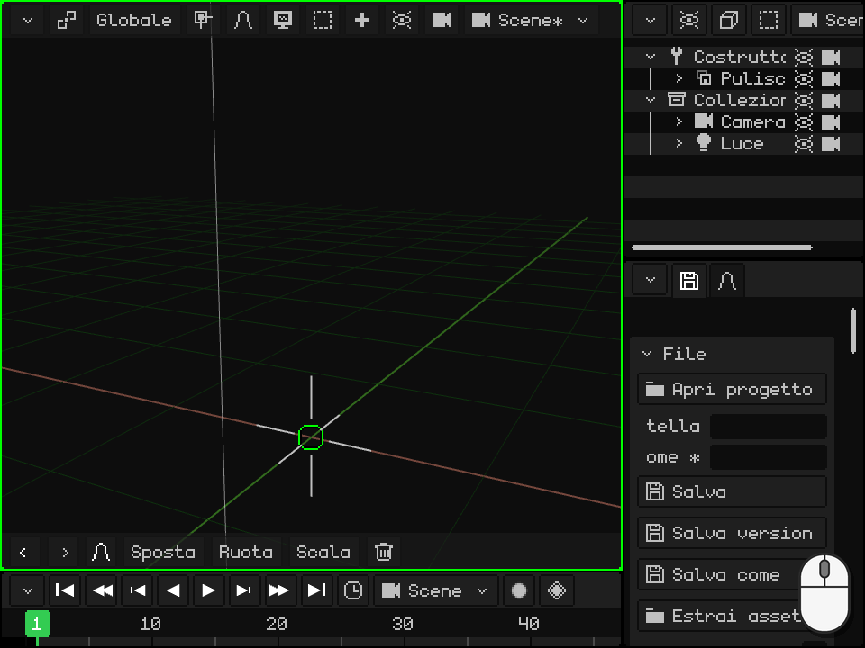

Un modello con armatura entra come un'**armatura con le mesh dentro**: l'armatura è il genitore e le mesh, le sue figlie, come si è visto nell'[Outliner](#loutliner-gli-oggetti-della-scena). Le animazioni restano salvate nell'armatura, pronte per l'uso.

Per portare un modello in un altro programma o su una stampante 3D c'è il percorso inverso: Proprietà → la scheda del dischetto → **Esporta**, con OBJ, glTF, GLB o STL.
