# Navigare nel 3D Viewport

> [!NOTE]
> Il Nokia N95 supporta mouse e tastiera (via Bluetooth). Le parti di questo tutorial dedicate al Nokia spiegano come usarlo senza mouse né tastiera, solo con i tasti del telefono.

Questo tutorial spiega come navigare nel 3D Viewport. Navigare significa spostare il tuo punto di vista: girare intorno alla scena, spostarti di lato e avvicinarti o allontanarti.

Saper navigare è importante: per creare modelli 3D e animazioni in modo comodo e veloce, devi saperti muovere nella scena e metterti in una posizione comoda per lavorare.

Come spiegato nel [tutorial precedente](viewports.md#il-viewport-attivo), per usare i comandi che seguono il 3D Viewport deve essere il viewport attivo, quello con il bordo verde.

Le tre cose che userai di più sono **orbitare**, **spostare la vista** e fare **zoom**. Ognuna si può fare con il mouse, con le dita su uno schermo touch o con la tastiera del Nokia N95. Nei video del PC, il mouse in basso a destra mostra in verde il tasto che si sta premendo.

## Orbitare

Orbitare significa ruotare la vista intorno alla scena, come se girassi intorno a un tavolo per vedere da tutti i lati quello che c'è sopra.

**Con il mouse:** tieni premuto il **tasto centrale** (si preme spingendo giù la rotella) e trascina. Su un trackpad, o con un mouse senza tasto centrale, tieni premuto <kbd>Alt</kbd> e trascina con il **clic principale** (il sinistro).

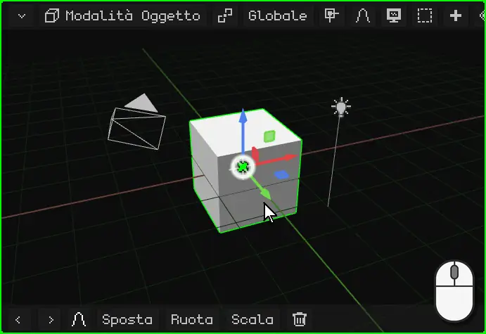

**Con il dito:** trascina un dito sul 3D Viewport. Parti dallo sfondo: se lo appoggi sul gizmo (le frecce colorate dell'oggetto), finirai per spostarlo.

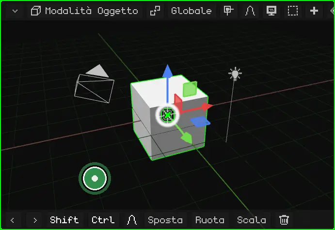

**Su un Nokia N95:** tieni premuta una **freccia** del pad. La vista ruota da quel lato finché la tieni premuta.

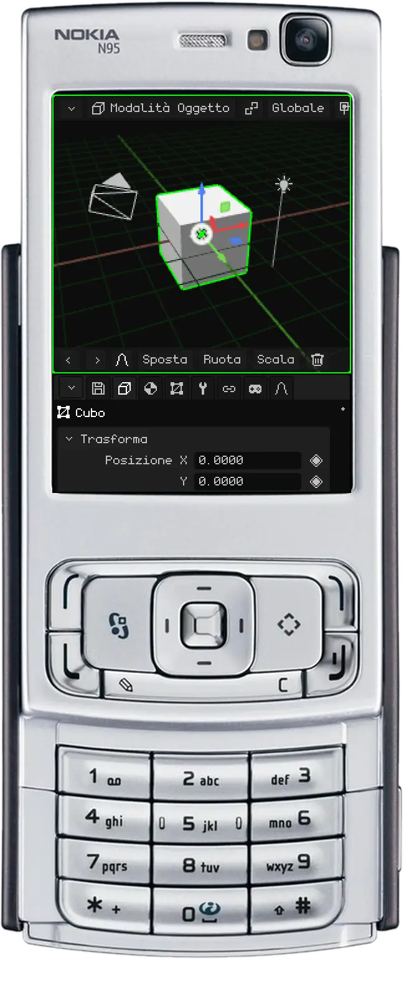

## Spostare la vista

Spostare la vista (o fare *pan*) significa farla scorrere di lato, verso l'alto o verso il basso, senza ruotarla.

**Con il mouse:** tieni premuto <kbd>Shift</kbd> e trascina con il **tasto centrale**. Su un trackpad: <kbd>Alt</kbd> + <kbd>Shift</kbd> e trascina con il clic principale.

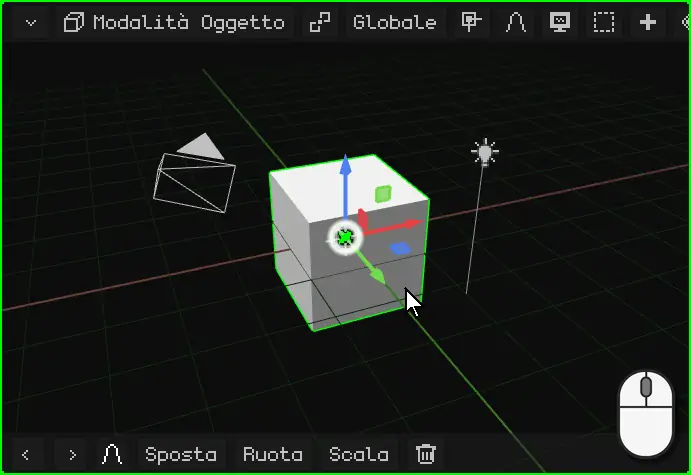

**Con le dita:** appoggia **due dita** e muovile insieme nella stessa direzione.

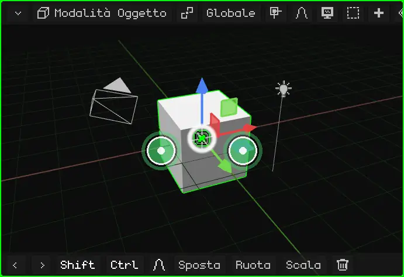

**Su un Nokia N95:** tieni premuto il tasto <kbd>\*</kbd> e usa le frecce.

## Zoom

Lo zoom ti avvicina o ti allontana. Il passo si adatta alla distanza: vicino a qualcosa di piccolo avanza piano e da lontano avanza veloce, quindi va bene sia per guardare tutta la scena sia per un singolo vertice.

**Con il mouse:** gira la **rotella**. In avanti avvicina e all'indietro allontana. Su un trackpad, fai scorrere due dita verso l'alto o verso il basso.

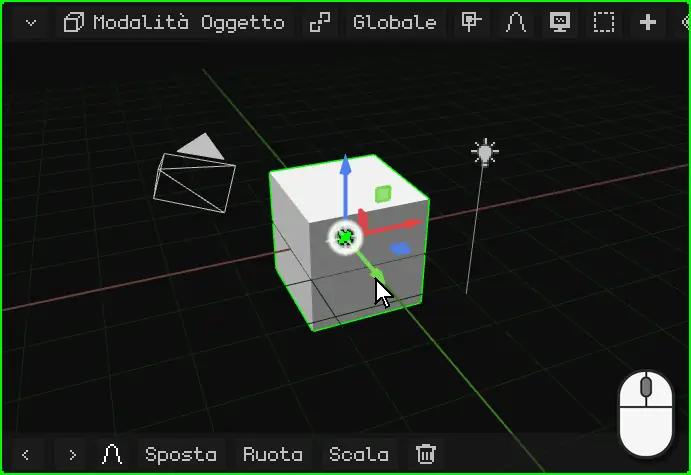

**Con le dita:** pizzica. Allargare le dita avvicina e stringerle allontana.

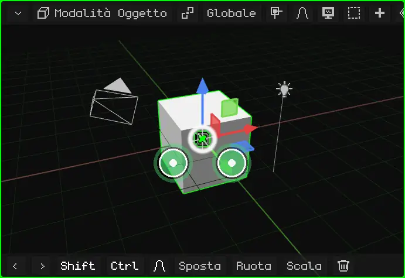

**Su un Nokia N95:** tieni premuto lo <kbd>0</kbd> e usa la freccia **su** per avvicinare o la freccia **giù** per allontanare.

## Inquadrare la selezione

Se hai perso l'orientamento, o vuoi lavorare su qualcosa in particolare, **inquadralo**: la vista si centra su ciò che è selezionato e regola lo zoom in modo che ci stia giusto. Da lì in poi, orbitando giri intorno a quello.

| | Come si inquadra |
|---|---|
| PC | <kbd>Num .</kbd> (il punto del tastierino numerico) |
| Nokia N95 | Una pressione dello <kbd>0</kbd>, senza frecce (tenuto premuto con una freccia fa lo zoom) |
| Schermo touch | Doppio tocco con due dita |
| Menu | View → Frame Selected |

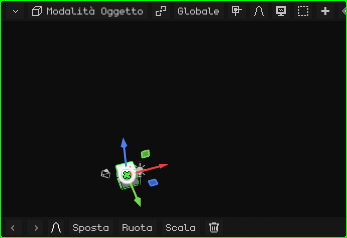

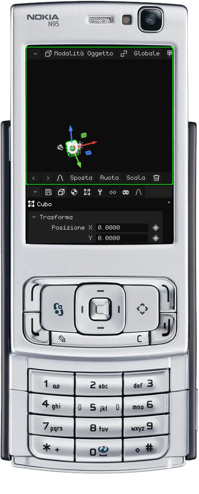

### In Edit Mode

In [Edit Mode](../editor/modo-edicion.md) si inquadra la parte selezionata della mesh: i vertici, gli spigoli o le facce che hai scelto, non l'intero oggetto. Serve per lavorare su un dettaglio di un modello grande: lo selezioni, lo inquadri e ci orbiti intorno.

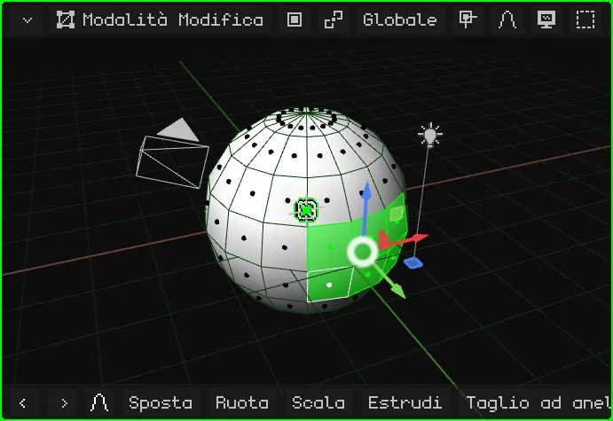

## La vista locale

Quando nella scena ci sono molte cose, lavorare su una sola è scomodo: quelle davanti la coprono, e quando orbiti si mettono in mezzo. La **vista locale** lascia visibile solo ciò che è selezionato (uno o più oggetti) e lo inquadra. Il resto non viene cancellato né nascosto nella scena: smette solo di vedersi in questo viewport. In alto a sinistra compare la scritta "Local View".

Per tornare indietro si ripete la stessa cosa: tutto ricompare e la vista torna com'era prima.

| | Come si entra e si esce |
|---|---|
| PC | <kbd>/</kbd> |
| Nokia N95 e schermo touch | Menu View → Local View |

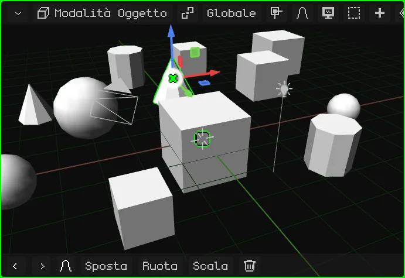

## Le viste di fronte, di lato e dall'alto

Per guardare la scena esattamente da un lato, senza sistemare l'orbita a mano:

| Vista | PC | Menu |
|---|---|---|
| Frontale / Posteriore | <kbd>Num 1</kbd> / <kbd>Ctrl</kbd> + <kbd>Num 1</kbd> | View → Viewpoint → Front / Back |
| Destra / Sinistra | <kbd>Num 3</kbd> / <kbd>Ctrl</kbd> + <kbd>Num 3</kbd> | View → Viewpoint → Right / Left |
| Dall'alto / Dal basso | <kbd>Num 7</kbd> / <kbd>Ctrl</kbd> + <kbd>Num 7</kbd> | View → Viewpoint → Top / Bottom |

Con <kbd>Ctrl</kbd>, ogni tasto dà la vista opposta.

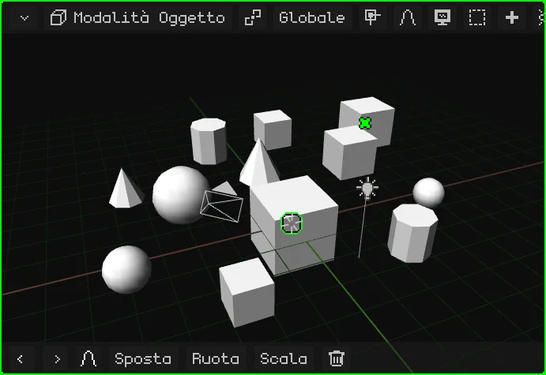

**Su un Nokia N95:** tieni premuto il tasto <kbd>#</kbd> e premi una freccia. Sinistra e destra ruotano la vista di 90° alla volta intorno alla scena. Su passa alla vista dall'alto; giù torna a quella di lato, e di nuovo giù passa a quella dal basso. Se stavi orbitando liberamente, la prima freccia si limita a raddrizzare la vista su quella più vicina.

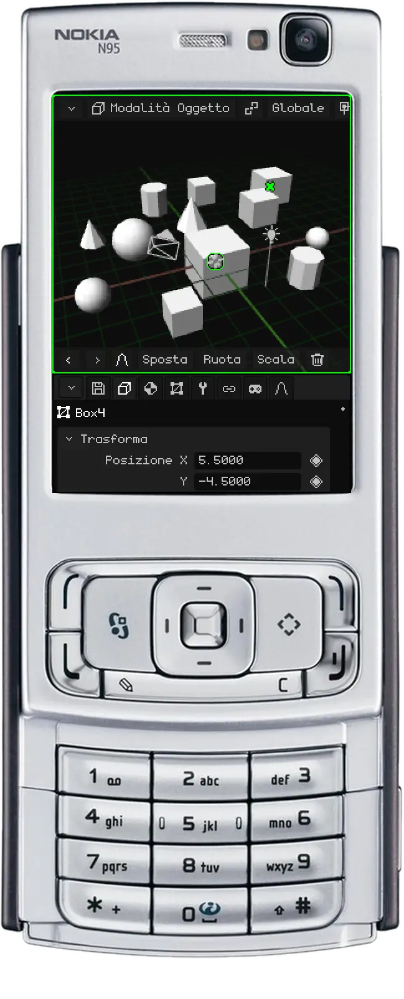

## Prospettiva e vista ortografica

Il 3D Viewport ha due modi di mostrare la scena:

- **Prospettiva:** come la vede l'occhio o una camera. Ciò che è lontano appare più piccolo, e le linee parallele (i bordi di una strada, le file di scatole del video) convergono verso l'orizzonte. È così che si vede davvero, con profondità.
- **Ortografica:** senza prospettiva. Tutto mantiene la sua dimensione, vicino o lontano che sia, e le linee parallele restano parallele. È come una pianta architettonica o un disegno tecnico.

L'ortografica serve per modellare con precisione: allineare le cose, confrontare le dimensioni e misurare senza che la distanza inganni. Insieme alle viste di fronte, di lato e dall'alto, è come lavorare su una pianta. La prospettiva serve per vedere come verrà il risultato.

| | Come si cambia |
|---|---|
| PC | <kbd>Num 5</kbd> |
| Nokia N95 | Una pressione del <kbd>#</kbd>, senza frecce |
| Menu | View → Perspective/Ortho |

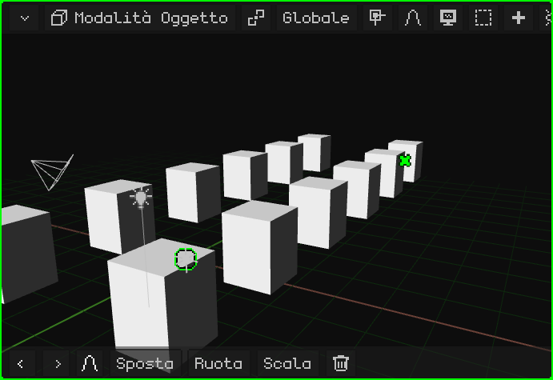

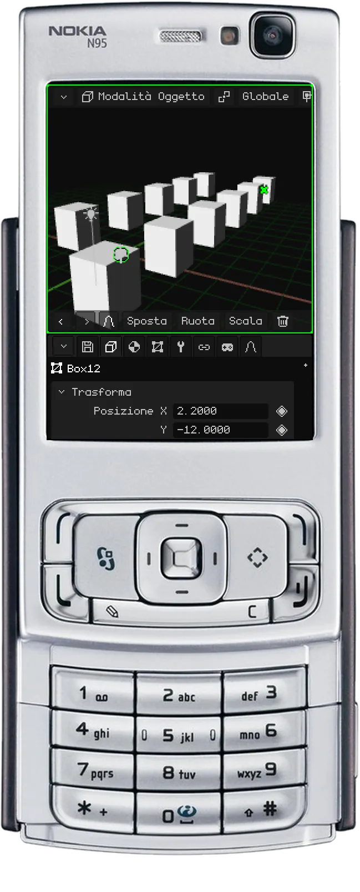

## La camera attiva

La scena può avere più camere, ma una sola è la **camera attiva**: quella che serve per il gioco e per i render. Ciò che vede quella camera è ciò che si vede quando giochi e ciò che esce quando fai il render di un'immagine o di un video. La vista con cui navighi serve solo per lavorare: non compare né nel gioco né nei render.

Per guardare attraverso la camera attiva:

| | Come si entra e si esce |
|---|---|
| PC | <kbd>Num 0</kbd> |
| Nokia N95 | <kbd>8</kbd> (fuori da Edit Mode: lì l'8 è Loop Cut) |
| Menu | View → Cameras → Active Camera |

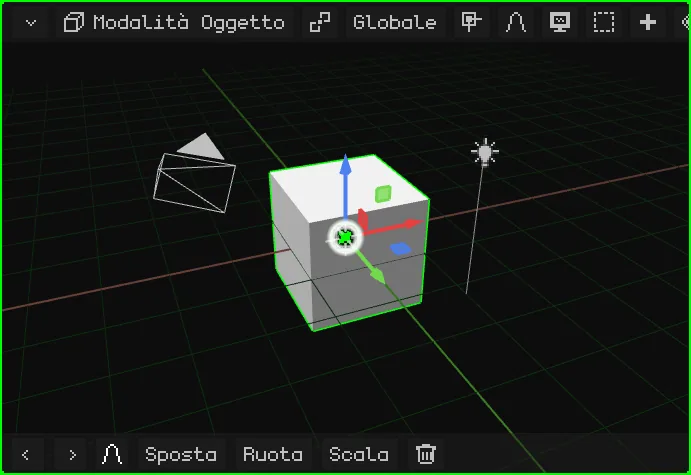

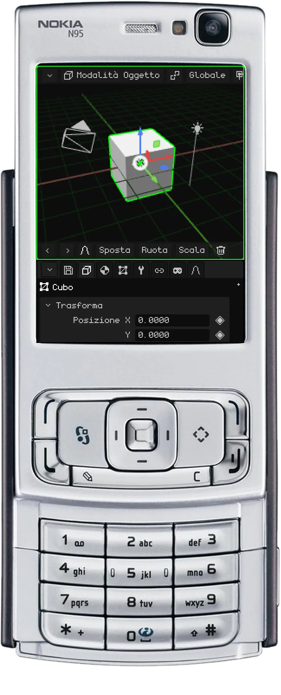

Il rettangolo è l'inquadratura: ciò che sta dentro è ciò che esce. In basso al centro c'è un **lucchetto**:

- **Aperto** (com'è all'inizio): lo zoom e lo spostamento ti avvicinano solo per controllare l'inquadratura, senza toccare la camera. Orbitare ti fa uscire dalla vista della camera e continui a navigare da dove si trovava.
- **Chiuso:** orbitare, spostare la vista e fare zoom muovono la **camera**. Così si sistema la ripresa.

Si apre e si chiude toccandolo o con un clic.

Perché un'altra camera diventi quella attiva: selezionala e premi <kbd>Ctrl</kbd> + <kbd>Num 0</kbd> (oppure View → Cameras → Set Active Object as Camera).

## Altre opzioni della vista

| Opzione | Cosa fa | PC | Nokia N95 |
|---|---|---|---|
| Ruotare la vista | La ruota di 15° sul proprio asse, come quando inclini la testa. | <kbd>Num 4</kbd> / <kbd>Num 6</kbd> | — |
| Lock Orbit | La vista smette di ruotare: ciò che la faceva orbitare ora la sposta, come su una tavola 2D. | View → Lock Orbit | <kbd>9</kbd> |

Tutte le scorciatoie dell'editor sono in [Scorciatoie da tastiera](../editor/atajos.md), e la pagina [Navigazione](../editor/navegacion.md) del manuale le riassume in tabelle.
