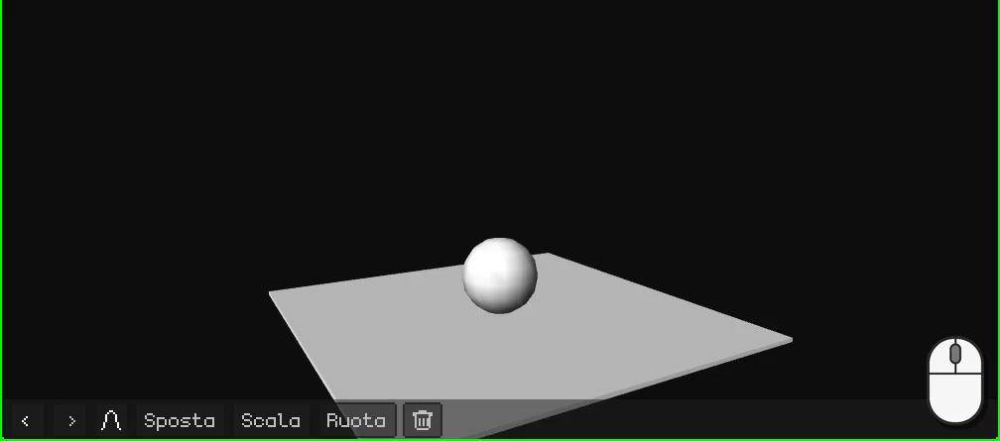
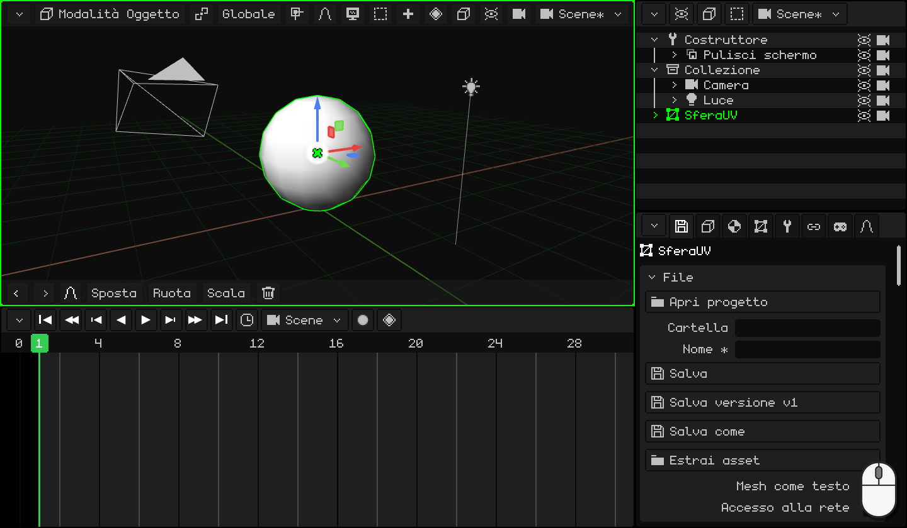
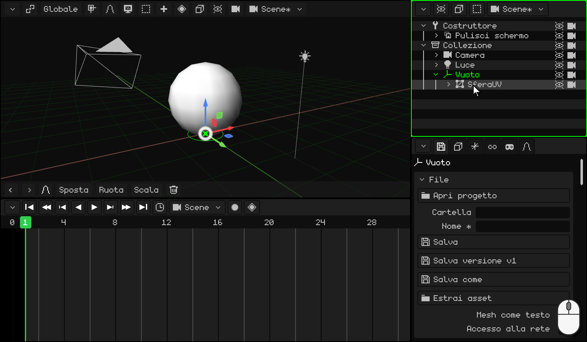
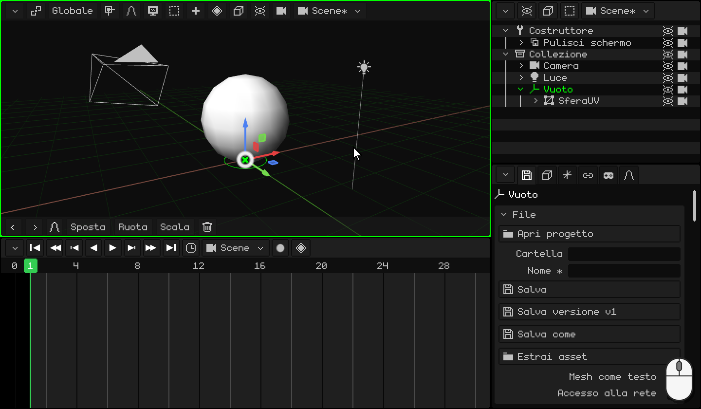
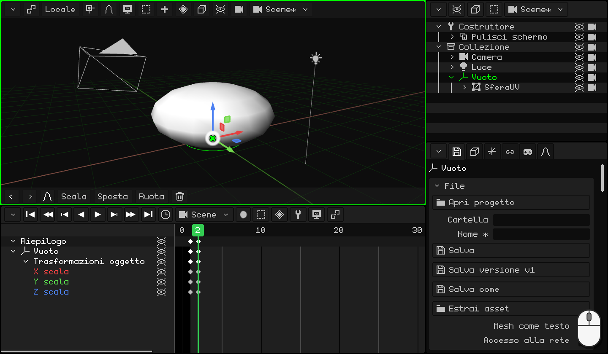
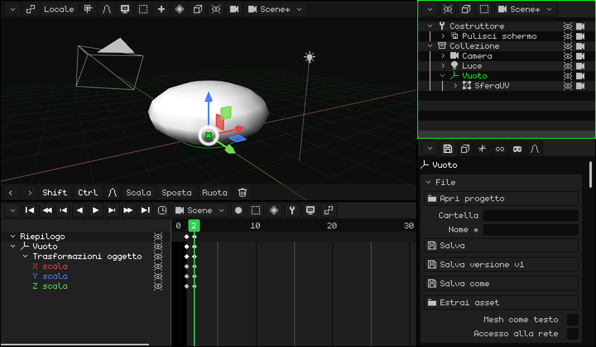
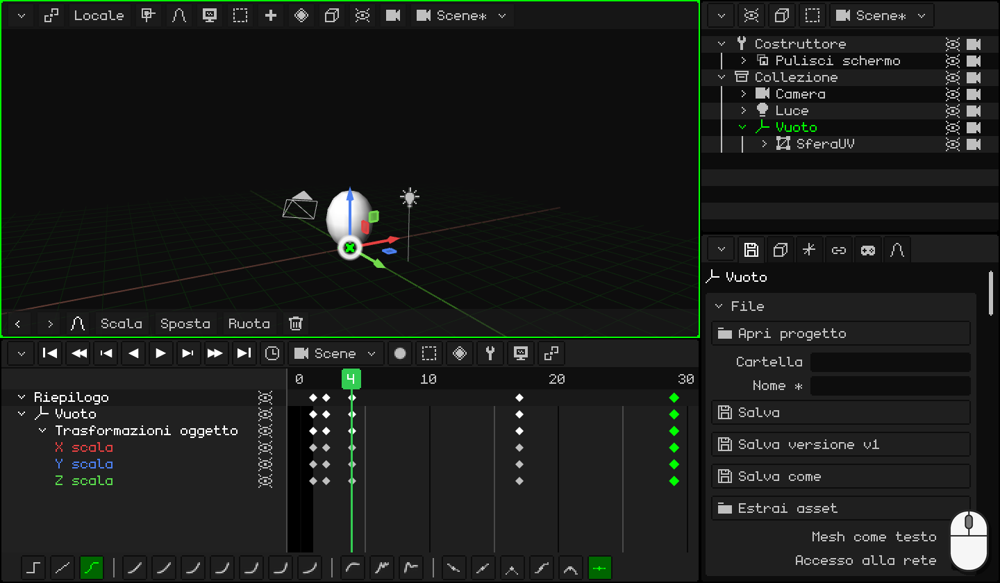
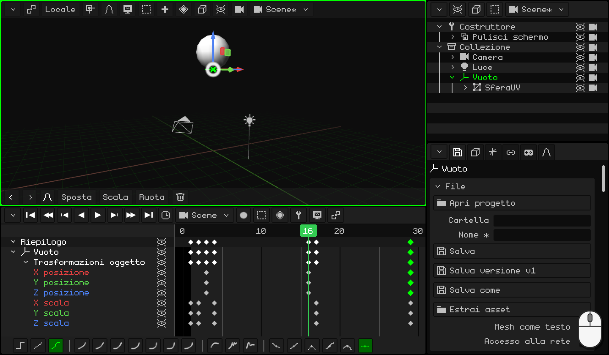
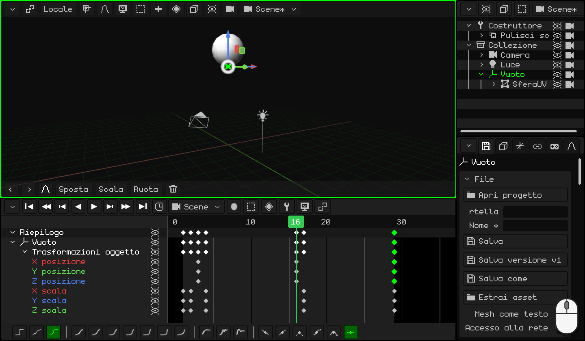
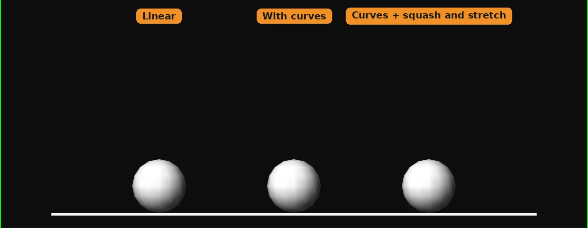

# Far rimbalzare una palla

Una palla che rimbalza e rimbalza, all'infinito: è l'esercizio con cui comincia qualsiasi animatore. Sembra facile, ma perché venga bene servono due dei principi più importanti dell'animazione:

- **allungare e schiacciare**: la palla si schiaccia contro il pavimento e si allunga quando si stacca. Questo le dà peso ed elasticità;
- **accelerare e frenare**: sale sempre più piano e scende sempre più veloce, come con la gravità.

Lungo il percorso imparerai a:

- mettere un **Vuoto** sul pavimento per schiacciare la palla contro il pavimento e non verso il suo centro;
- **duplicare** keyframe per tornare a una posa che hai già;
- fare un **loop**: un'animazione che si ripete senza che si noti lo stacco;
- usare le **curve** perché la palla abbia peso.

Se non hai ancora animato niente, comincia da [Animare la porta](animar-puerta.md): lì ci sono i keyframe, la Timeline e le curve.

## 1. La palla e il suo Vuoto

1. Elimina il cubo e aggiungi una sfera: <kbd>Shift</kbd> + <kbd>A</kbd> → **Mesh → Sfera UV**. È alta 2 metri e nasce con il centro sul pavimento: alzala perché resti appoggiata, <kbd>G</kbd> <kbd>Z</kbd> `1` <kbd>Enter</kbd>.
2. Entra in **Modalità Modifica** (<kbd>Tab</kbd>) e scegli **Vertice** nel pulsante **Vertice / Spigolo / Faccia**. Il vertice più in basso è nascosto dalla sfera: attiva **Sovrapposizioni → Raggi X** per vederlo attraverso di essa e fai clic su di lui.
3. <kbd>Shift</kbd> + <kbd>S</kbd> → **Cursore al selezionato**: il cursore 3D va nel punto più basso della palla, sul pavimento.
4. Torna in **Modalità Oggetto** (<kbd>Tab</kbd>) e disattiva i **Raggi X**.
5. <kbd>Shift</kbd> + <kbd>A</kbd> → **Vuoto**. Nasce dove si trova il cursore 3D: sul pavimento, esattamente sotto la palla.
6. **Imparenta** la palla al Vuoto. Nell'**Outliner**, clic su **SferaUV** e <kbd>Ctrl</kbd> + clic su **Vuoto** (l'ultimo che selezioni è il genitore). Con il mouse sulla Vista 3D, <kbd>Ctrl</kbd> + <kbd>P</kbd> → **Oggetto (mantieni trasf.)**. Nell'Outliner, la sfera finisce dentro il Vuoto.

### A cosa serve il Vuoto?

Scalare rimpicciolisce o ingrandisce a partire dall'**origine**. Quella della sfera è al suo centro: se la schiacci, si rimpicciolisce verso il centro e resta sospesa. Il Vuoto è sul pavimento: se schiacci lui, la palla si schiaccia **contro il pavimento**, come quando rimbalza.

Da ora in poi si anima **il Vuoto**, mai la sfera.

  Su touch e sull'N95: il vertice, con un tocco (o con il mouse virtuale); il cursore, con **Mesh → Aggancio → Cursore al selezionato**; il Vuoto, con **Aggiungi → Vuoto**; e per imparentare, con la sfera e il Vuoto selezionati (il Vuoto attivo), **Oggetto → Imposta genitore → Oggetto (mantieni trasf.)**.

## 2. Schiacciare

Quando la palla tocca il pavimento si **schiaccia**: diventa più bassa e più larga. Perché non sembri che si rimpicciolisca, ciò che perde in altezza lo guadagna in larghezza.

1. Seleziona il **Vuoto**. Al fotogramma **1**, la palla è rotonda e tocca il pavimento: <kbd>I</kbd> → **Solo scala**.
2. <kbd>→</kbd> (la freccia destra) passa al fotogramma **2**. Schiacciala: <kbd>S</kbd> <kbd>Z</kbd> `0.75` <kbd>Enter</kbd> la rende più bassa, e <kbd>S</kbd> <kbd>Shift</kbd> + <kbd>Z</kbd> `1.6` <kbd>Enter</kbd>, più larga. <kbd>Shift</kbd> + <kbd>Z</kbd> significa *tutti gli assi tranne Z*: X e Y insieme.
3. <kbd>I</kbd> → **Solo scala**.

 Su uno schermo touch: il keyframe si mette con il pulsante del rombo nella barra dei menu della Vista 3D, **Animazione → Inserisci keyframe → Solo scala**; il fotogramma si cambia con un tocco sui numeri della Timeline. Per schiacciarla, **Scala** **Z** `0.75`, **Scala** **X** `1.6` e **Scala** **Y** `1.6`, con i numeri nel tastierino della barra in alto.

 Sul Nokia N95: <kbd>3</kbd>, <kbd>3</kbd> (l'asse Z), la matita + `0.75` e <kbd>OK</kbd>; poi <kbd>3</kbd>, <kbd>1</kbd> (X) e `1.6`, e <kbd>3</kbd>, <kbd>2</kbd> (Y) e `1.6`. Il keyframe, con **Animazione → Inserisci keyframe → Solo scala**.

## 3. Allungare

Quando si stacca dal pavimento, la palla si **allunga** nella direzione in cui va: più alta e più sottile. E quando arriva in alto torna rotonda.

1. La palla rotonda ce l'hai già, nel keyframe del fotogramma 1: duplicalo. Nella Timeline, clic sul rombo del fotogramma **1**, <kbd>Shift</kbd> + <kbd>D</kbd>, porta la copia al fotogramma **4** e fai clic. Guarda il rombo della copia, non il puntatore: compare un fotogramma a destra del mouse.
2. Fai lo stesso per i fotogrammi **17** e **29**: lì la palla torna rotonda.
3. Vai al fotogramma **4** (un clic sui numeri della Timeline). Allungala: <kbd>S</kbd> <kbd>Z</kbd> `1.1` <kbd>Enter</kbd> e <kbd>S</kbd> <kbd>Shift</kbd> + <kbd>Z</kbd> `0.9` <kbd>Enter</kbd>.
4. <kbd>I</kbd> → **Solo scala**.

  Su touch e sull'N95 (con il mouse virtuale), invece di duplicare si copia e si incolla: un tocco sul keyframe del fotogramma 1 e, nel menu **Key** della Timeline (il pulsante del rombo), **Copia**; un tocco sui numeri per andare al fotogramma 4 e **Key → Incolla**. Lo stesso per il 17 e il 29. Per allungarla, **Scala** **Z** `1.1`, **Scala** **X** `0.9` e **Scala** **Y** `0.9`.

## 4. Il salto

1. Vai al fotogramma **3**: la palla è ancora sul pavimento, è il momento in cui si stacca. <kbd>I</kbd> → **Solo posizione**.
2. Vai al fotogramma **16** e alzala: <kbd>G</kbd> <kbd>Z</kbd> `5` <kbd>Enter</kbd> (5 metri). <kbd>I</kbd> → **Solo posizione**.
3. Perché torni sul pavimento, duplica il keyframe del fotogramma **3** al **29**.

Premi **Play** (<kbd>Space</kbd>): la palla rimbalza. Ma qualcosa non va: rallenta prima di toccare il pavimento, come se galleggiasse. Questo lo sistemano le curve, nella parte 6.

 Su uno schermo touch: **Sposta** **Z** `5` e **Animazione → Inserisci keyframe → Solo posizione**. Il keyframe del 3 si porta al 29 con **Key → Copia** e **Key → Incolla**, come nella parte 3.

 Sul Nokia N95: <kbd>1</kbd>, <kbd>3</kbd> (l'asse Z), la matita + `5` e <kbd>OK</kbd>; e **Animazione → Inserisci keyframe → Solo posizione**.

## 5. Il loop

Il fotogramma **29** è uguale all'**1**: la palla rotonda, che tocca il pavimento. Se l'animazione arrivasse fino al 29, si vedrebbero due fotogrammi uguali di seguito e la palla resterebbe ferma per un istante: si noterebbe lo stacco. Per questo finisce al **28**: dopo il 28 viene l'1, che è uguale al 29.

Fai clic sull'**orologio** della Timeline e, in **Fine**, scrivi `28` <kbd>Enter</kbd>.

Nello stesso orologio ci sono gli **FPS** di questa animazione. La palla va a 30: ogni rimbalzo dura 28 fotogrammi, quasi un secondo. Se la vuoi con uno stile da cinema, mettila a 24, ma **prima** di animare: con gli stessi fotogrammi, a 24 andrebbe più lenta. Quali FPS convengono in ogni caso è spiegato in [Animare la porta](animar-puerta.md), nella parte sul tempo.

## 6. Le curve: la gravità

**Solo posizione** ha salvato i tre assi, ma la palla si muove solo su Z: le righe **X posizione** e **Y posizione** sono linee piatte. Eliminale: clic su ognuna e <kbd>X</kbd>.

Ora passa all'editor delle curve (**Vista → Curve**). La curva di Z è il salto: sale e scende. Pensa a una palla vera:

- **Quando sale**, si stacca dal pavimento a tutta velocità e va rallentando fino a restare ferma in alto: **parte veloce e va rallentando**. Seleziona il keyframe del fotogramma **3** e, nella barra degli strumenti della Timeline, **Cubica** e **In uscita**.
- **Quando scende**, parte piano e cade sempre più veloce, fino al colpo contro il pavimento: **accelera e frena di colpo**. Seleziona il keyframe del fotogramma **16**: **Cubica** e **In entrata**.

(Con la tastiera: <kbd>E</kbd> per la **Modalità interpolazione** e <kbd>Ctrl</kbd> + <kbd>E</kbd> per l'**Easing**.)

La curva diventa come gli archi di una palla vera: arrotondata in alto e a punta in basso, dove colpisce il pavimento. Premi **Play**: ora ha peso.

Vuoi che rimbalzi più in alto o più in basso? Nell'editor delle curve, prendi il keyframe in alto (quello del fotogramma 16) e spostalo.

## 7. Guardala

Per vederla senza la griglia né il Vuoto, disattiva **Sovrapposizioni → Mostra sovrapposizioni** e premi **Play**.

Le tre palle qui sotto rimbalzano nello stesso tempo. La prima ha curve lineari: sale e scende sempre alla stessa velocità, come una macchina. La seconda ha le curve della gravità: rallenta in alto e colpisce il pavimento. La terza, in più, si allunga e si schiaccia: è quella di questo tutorial.

