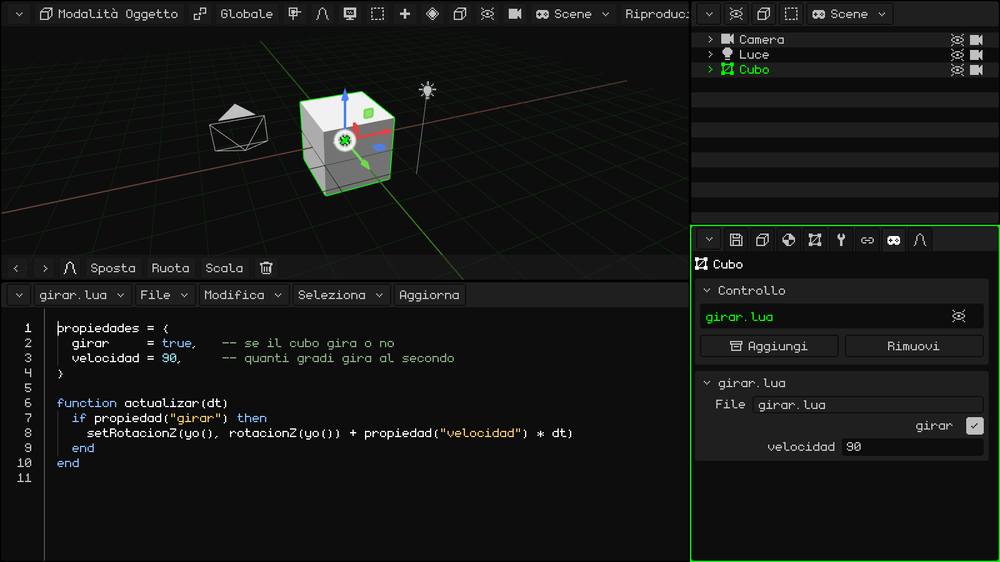
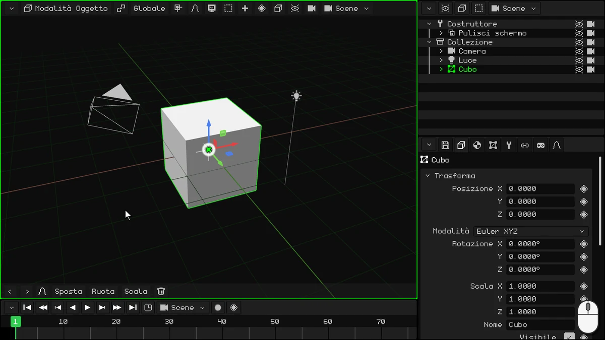
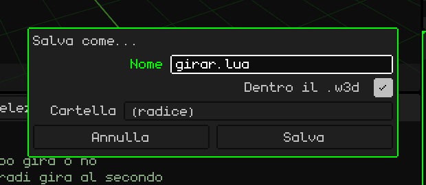
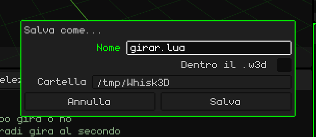
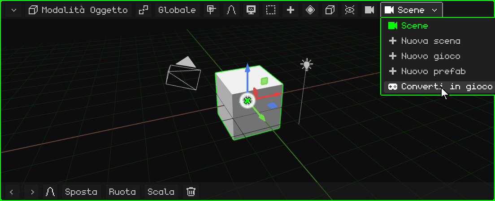
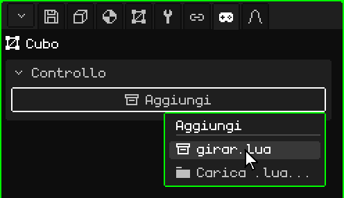
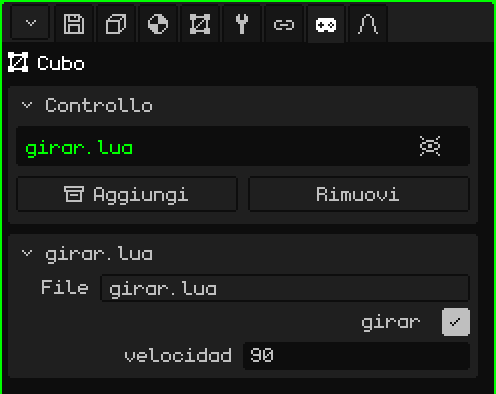
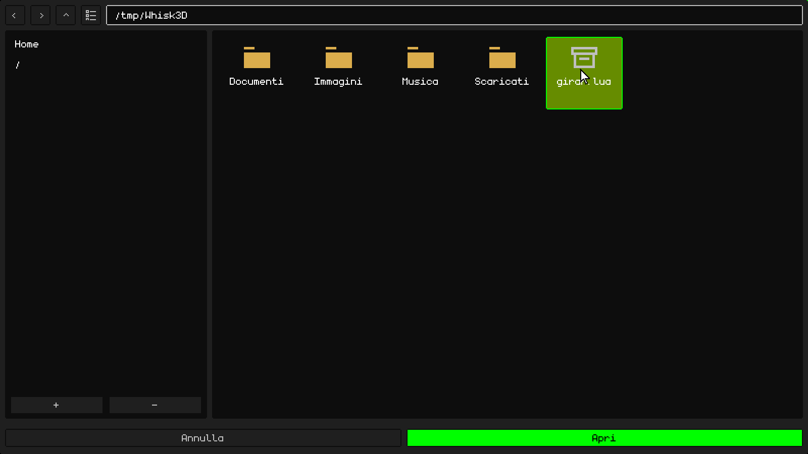
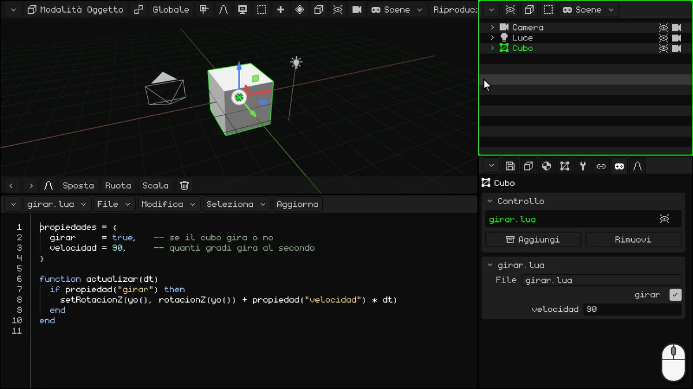

# Il tuo primo script: un cubo che gira

In questo tutorial scriverai il tuo primo script in **Lua**: uno che fa girare il cubo.



## 1. L'IDE

In questo tutorial non userai la Timeline: trasformala nell'IDE, l'editor di script. Tocca il pulsante dell'angolo della Timeline (in alto a sinistra) e scegli **IDE**.

L'IDE parte vuoto. Per scrivere più comodamente, ingrandiscilo: trascina verso l'alto lo stesso pulsante dell'angolo.



> [!NOTE]
> Si possono usare anche altri editor o IDE esterni e caricare gli script. Gli script possono stare fuori o dentro i progetti W3D.

## 2. Scrivi lo script

Lo script ha due parti: in alto, le **proprietà**, e in basso, la **funzione** che fa girare il cubo.

### Le proprietà

```lua
propiedades = {
  girar     = true,   -- se il cubo gira o no
  velocidad = 90,     -- quanti gradi gira al secondo
}
```

- **`propiedades`** sono i valori dello script che si possono cambiare dal pannello Proprietà, uno per riga. `girar = true` è un valore **booleano** (vero o falso: `true` o `false`), e nel pannello appare come una casella. `velocidad = 90` è un numero, e appare come un campo numerico. Quello che scrivi qui è il valore **predefinito**: ogni oggetto che usa lo script può avere il suo.
- Quello che viene dopo `--` è un **commento**: Lua non lo legge, è per te.

### La funzione

```lua
function actualizar(dt)
  if propiedad("girar") then
    setRotacionZ(yo(), rotacionZ(yo()) + propiedad("velocidad") * dt)
  end
end
```

Una **funzione** è un blocco di codice con un nome: comincia con `function nome()` e finisce con `end`. Quello che c'è dentro non viene eseguito quando lo scrivi, ma ogni volta che qualcuno **chiama** la funzione.

Whisk3D ha delle **funzioni riservate**: se il tuo script ha una funzione con uno di quei nomi, il motore la chiama da solo, al momento giusto. Per esempio:

- **`inicio()`**: una sola volta, quando premi Play. Serve a preparare le cose.
- **`actualizar(dt)`**: a **ogni fotogramma**, finché il gioco è in esecuzione.

Ce ne sono altre, come quelle che avvisano quando un oggetto urta un altro. Sono tutte nel manuale di Lua: [Quando il motore chiama il tuo script](../lua/ciclo-del-script.md).

`actualizar` è ideale per un videogioco. Un gioco disegna lo schermo molte volte al secondo, e ognuna di quelle immagini è un **fotogramma**: tutto ciò che si muove, si muove un pochino a ogni fotogramma. Qui, a ogni fotogramma il cubo gira un po' di più.

- Viene eseguita finché l'oggetto è **visibile**: se lo nascondi, il suo script si ferma finché l'oggetto non torna visibile.
- `dt` sono i secondi passati dal fotogramma precedente. Moltiplicare la velocità per `dt` fa sì che il cubo giri di 90 gradi **al secondo**, che il gioco vada a 30 o a 60 fotogrammi al secondo.

Cosa fa al suo interno:

**`if propiedad("girar") then` … `end`** è una **condizione**. Un `if` («se») esegue il codice che ha dentro solo se ciò che sta tra `if` e `then` è vero. Può avere un `elseif` («altrimenti, se…»), che prova un'altra condizione, e un `else` («altrimenti»), che viene eseguito quando non se n'è verificata nessuna; sono facoltativi tutti e due. Finisce sempre con `end`. Per esempio:

```lua
if punti >= 100 then
  premio = "oro"
elseif punti >= 50 then
  premio = "argento"
else
  premio = "niente"
end
```

Con 120 punti il premio è oro; con 70, argento, e con 10, niente. Viene eseguita solo la prima parte che si verifica. (In Lua, `elseif` si scrive tutto attaccato.)

Nello script, l'`if` non ha né `elseif` né `else`: se **girar** è vero (la casella è spuntata), il cubo gira; se è falso, non succede niente e la funzione finisce. `propiedad("girar")` legge il valore che ha quell'oggetto nel pannello. Siccome viene letto a ogni fotogramma, se lo cambi con il gioco in esecuzione, lo script se ne accorge in quel momento.

- **`yo()`** è l'oggetto che ha lo script: il cubo. **`rotacionZ(yo())`** dà la sua rotazione in gradi attorno alla Z (la verticale, la stessa Z che vedi nel pannello Proprietà), e **`setRotacionZ`** gliene mette una nuova: la stessa, un po' di più. Così il cubo gira come una trottola.

Anche `propiedad`, `yo`, `rotacionZ` e `setRotacionZ` sono funzioni, ma al contrario: le fornisce Whisk3D e le chiami tu. Sono nel [manuale di Lua](../lua/README.md).

### Lo script completo

Tocca dentro l'IDE e scrivi tutto insieme:

```lua
propiedades = {
  girar     = true,   -- se il cubo gira o no
  velocidad = 90,     -- quanti gradi gira al secondo
}

function actualizar(dt)
  if propiedad("girar") then
    setRotacionZ(yo(), rotacionZ(yo()) + propiedad("velocidad") * dt)
  end
end
```

## 3. Salvalo

Prima salva il progetto, se non l'hai ancora salvato: lo script si può salvare dentro il progetto solo se il progetto è già salvato. In Proprietà, nella scheda del **dischetto** (il riquadro **File**), scrivi un **Nome**, per esempio `girar-cubo`, e tocca **Salva**. Viene salvato nella **Cartella** che mostra il riquadro.

Poi, nella barra dei menu dell'IDE, **File → Salva come...**:

1. In **Nome**, metti `girar.lua`.
2. Spunta **Dentro il .w3d**: lo script viene salvato dentro il progetto, nello stesso file `.w3d`. La **Cartella** diventa una di quelle interne al progetto: **(radice)** è la principale.
3. Tocca **Salva**.



Se non spunti **Dentro il .w3d**, lo script viene salvato come file a parte, fuori dal progetto, nella **Cartella** che scegli. Serve, per esempio, per modificarlo con un altro programma.



## 4. Converti la scena in un gioco

Una **scena** serve per modellare e animare; gli script vengono eseguiti in un **gioco**. Un gioco non ha animazioni proprie: le animazioni si fanno in una scena o in un modello 3D con scheletro, e si importano nel gioco per usarle lì. Nella barra dei menu della Vista 3D (o dell'Outliner), tocca il pulsante della scena, quello che mostra il suo nome, e scegli **Converti in gioco**.



**Converti in gioco** non cambia la tua scena: ne fa una copia, che è un gioco, con tutto così come si vede nel fotogramma attuale della Timeline. Nel gioco non restano le animazioni della scena: quel fotogramma resta registrato come la posizione e lo stato iniziale del gioco. La scena originale resta uguale, con le sue animazioni, e la ritrovi nel menu del pulsante della scena.

Ora sei nel gioco: il pulsante della scena mostra un joystick, e nella barra dei menu della Vista 3D compare **Riproduci**.

## 5. Aggiungilo al cubo

1. Seleziona il **Cubo** del gioco (nell'Outliner o nella Vista 3D).
2. In Proprietà, vai alla scheda del **joystick**.
3. Nel riquadro **Controllo**, tocca **Aggiungi**: si apre un menu con gli script del progetto. Scegli `girar.lua`.



Lo script compare nell'elenco del riquadro Controllo, e sotto si aggiunge il suo riquadro, **girar.lua**, con le proprietà che hai scritto: la casella **girar** (spuntata) e la **velocidad** (90).

Nell'elenco, a destra dello script, c'è un **occhio**: toccandolo, lo script si spegne (il motore non lo usa) senza toglierlo dall'oggetto né nascondere l'oggetto. Un altro tocco lo riaccende.



### Uno script esterno

Se hai scritto lo script con un altro editor, o l'hai salvato fuori dal `.w3d`, tocca **Aggiungi → Carica .lua...**. Si apre il file browser, **Carica script**: scegli il file e tocca **Apri**.



## 6. Premi Play

Tocca **Riproduci**: il cubo gira. Mentre il gioco è in esecuzione, la barra dei menu della Vista 3D mostra **Ferma** e **Pausa**.

Con il gioco in esecuzione, prova a cambiare le proprietà nel riquadro **girar.lua**:

- metti **velocidad** a 360: gira quattro volte più veloce;
- togli la spunta a **girar**: resta fermo. Spuntala di nuovo e riprende.

Per finire, tocca **Ferma**: il cubo torna com'era prima di premere Play.



> [!NOTE]
> Tutto quello che succede con il gioco in esecuzione si perde quando tocchi **Ferma**: il cubo torna al suo posto, e **girar** e **velocidad** tornano ai valori che avevano prima di premere Play. Per cambiarli davvero, cambiali con il gioco fermo.

## Per continuare

- [Lua in Whisk3D](../lua/README.md): il manuale di Lua, con tutte le funzioni.
- [Uno script è un componente di un oggetto](../lua/scripts-y-objetos.md): le proprietà (anche elenchi, testi e oggetti della scena).
- [Quando il motore chiama il tuo script](../lua/ciclo-del-script.md): `actualizar`, `inicio` e le altre.

## Scarica l'esempio

Ecco il progetto finito, per provarlo o confrontarlo con il tuo: **[girar-cubo.w3d](ejemplos/girar-cubo.w3d)**. Aprilo in Whisk3D e premi **Riproduci**. Lo script è dentro il `.w3d` e si vede nell'IDE.
