# Proprietà

> [!NOTE]
>  Il Nokia N95 supporta mouse e tastiera (via Bluetooth). Le parti di questa pagina dedicate al Nokia spiegano come usarlo senza mouse né tastiera, solo con i tasti del telefono.

**Proprietà** è il viewport con i dati dell'**oggetto attivo**, l'ultimo che hai selezionato: la sua posizione, il suo nome, il suo materiale, il colore di una luce, i modificatori di una mesh. È organizzato in **schede**, e ogni scheda ha dei **riquadri** con righe di valori. Quasi tutto ciò che cambi qui si vede subito nella Vista 3D.

Come spiegato in [I viewport](viewports.md#il-viewport-attivo), i tasti vanno al viewport attivo, quello con il bordo verde.

 Sul Nokia N95, Proprietà è a destra della Vista 3D: il **tasto verde**  lo rende il viewport attivo. Quando ci torni, resta sulla riga dove l'avevi lasciato.

## Le schede

Le schede sono le icone della barra dei menu di Proprietà. Ognuna mostra un gruppo di riquadri.

Le schede **cambiano secondo l'oggetto attivo**: ogni tipo di oggetto mostra solo quelle che gli servono. Una mesh ha Materiale, Mesh 3D e Modificatori; una luce ha, al posto del materiale, la scheda Luce; una camera, la scheda Camera.

| Scheda | Quando compare |
|---|---|
| File / Render (il dischetto) | Sempre, anche se non c'è niente di selezionato. |
| Oggetto | Con qualsiasi oggetto 3D: posizione, rotazione, scala, nome e visibilità. |
| Quella del tipo di oggetto | Materiale in una mesh, Luce in una luce, Camera in una camera, e così via con ogni tipo. La sua icona cambia con il tipo. |
| Mesh 3D e Modificatori | Solo con una mesh. |
| Trasforma | Solo con una mesh in Modalità Modifica. |
| Vincoli | Con qualsiasi oggetto 3D. |
| Script | Con qualsiasi oggetto. |
| Animazione | Sempre. |

La scheda del tipo resta al suo posto: se eri sul materiale di una mesh e selezioni una luce, passi alla scheda Luce. Se la scheda su cui eri non esiste per il nuovo oggetto (Modificatori, selezionando una luce), Proprietà torna alla scheda Oggetto.

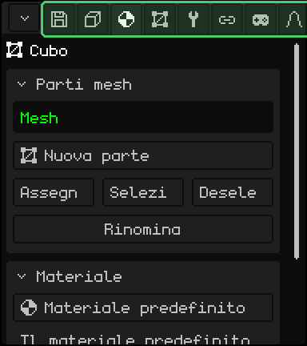

| | Come si cambia scheda |
|---|---|
|  PC | Un clic sulla scheda. Se non ci stanno tutte, gira la rotella sopra la barra. |
|  Schermo touch | Un tocco sulla scheda. Se non ci stanno tutte, trascina la barra di lato. |
|  Nokia N95 | Sali con la freccia **su** fino al titolo del primo riquadro e ancora una volta: la scheda attuale diventa verde. **Sinistra** e **destra** cambiano scheda, e **giù** torna ai riquadri. Sulla prima scheda, la sinistra apre il menu del pulsante dell'angolo. |

## I riquadri

I **riquadri** sono i box di ogni scheda: un titolo e le sue righe. La freccia del titolo dice se il riquadro è aperto o compresso. Comprimere quelli che non usi lascia a portata di mano quelli che usi.

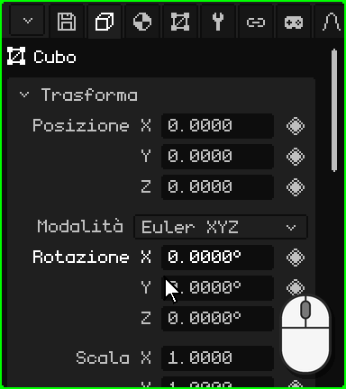

| | Come si comprime e si espande |
|---|---|
|  PC | Un clic sul titolo. |
|  Schermo touch | Un tocco sul titolo. |
|  Nokia N95 | <kbd>OK</kbd> sul titolo. La freccia **sinistra** comprime il riquadro da qualsiasi sua riga, e la **destra**, sul titolo, lo espande. |

Se i riquadri non ci stanno nel viewport, il pannello scorre: con la rotella del mouse sul PC, o trascinando il dito in su o in giù su uno schermo touch. Sul Nokia, il pannello segue da solo la riga scelta.

### Muoversi con i tasti

 Sul Nokia N95 c'è una **riga scelta**: il suo nome appare in verde e il suo valore, con un bordo bianco. **Su** e **giù** passano da una riga all'altra e da un riquadro al successivo, e <kbd>OK</kbd> usa la riga: modifica il numero, spunta la casella, apre il menu a tendina. Durante la modifica, il bordo diventa verde.

 Sul PC, con il mouse sopra Proprietà, le frecce e <kbd>Enter</kbd> fanno lo stesso, e <kbd>Esc</kbd> annulla ciò che stai modificando.

## I numeri

La maggior parte delle righe sono **numeri**: il nome a sinistra e il valore a destra, come Posizione, Rotazione e Scala del riquadro Trasforma. Un numero si può **scrivere** o **trascinare**. Ognuno ha il suo ritmo, e alcuni hanno un limite: la Luce GL di una luce va da 0 a 7.

### Scrivere un numero

 Un clic sul numero, senza muovere il mouse: il valore resta evidenziato e ciò che digiti lo sostituisce. <kbd>Enter</kbd> lo applica e <kbd>Esc</kbd> lo lascia com'era. Anche un clic in qualsiasi altro punto lo applica.

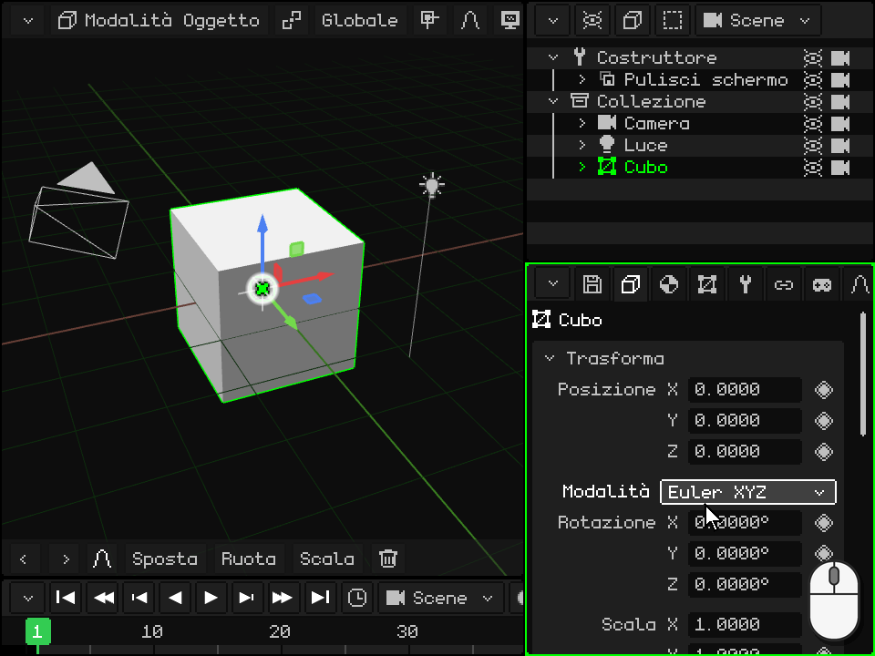

 Un tocco sul numero apre in basso il **tastierino numerico** di Whisk3D, con il nome della riga e il suo valore. Ha i numeri, il punto, **DEL** per cancellare e le frecce per muovere il cursore. **OK** applica il valore e **X** lo annulla; anche toccare fuori dal tastierino lo applica.

 Il tastierino numerico fa anche i **calcoli**: con <kbd>+</kbd>, <kbd>-</kbd>, <kbd>\*</kbd>, <kbd>/</kbd> e le parentesi puoi scrivere `2*3` o `1.5+0.25`, e toccando OK resta il risultato. Il <kbd>-</kbd> serve anche a scrivere un numero negativo.

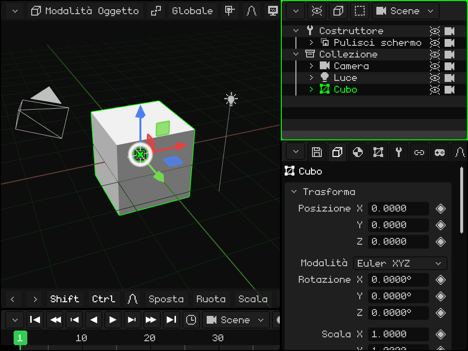

 Arriva alla riga con le frecce e premi <kbd>OK</kbd>: il valore resta evidenziato e i tasti del telefono scrivono numeri (la barra di Proprietà mostra **123**). Il primo numero che scrivi sostituisce quello che c'era. Il <kbd>\*</kbd> è il punto decimale, <kbd>C</kbd> cancella, **sinistra** e **destra** muovono il cursore, <kbd>OK</kbd> lo applica e il **tasto di selezione sinistro** lo annulla.

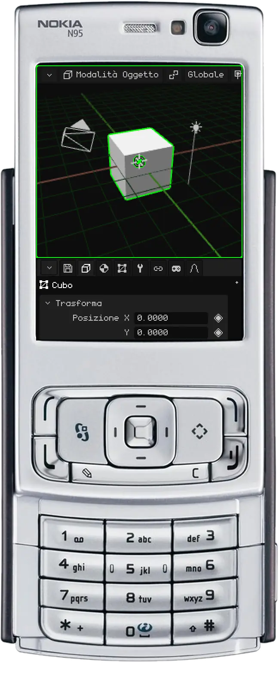

### Trascinare un numero

 Tieni premuto il clic sul numero e muovi il mouse di lato: verso destra il valore sale e verso sinistra scende. Se il puntatore arriva al bordo del viewport, ricompare dall'altro lato e puoi continuare a trascinare. Quando rilasci, il valore resta.

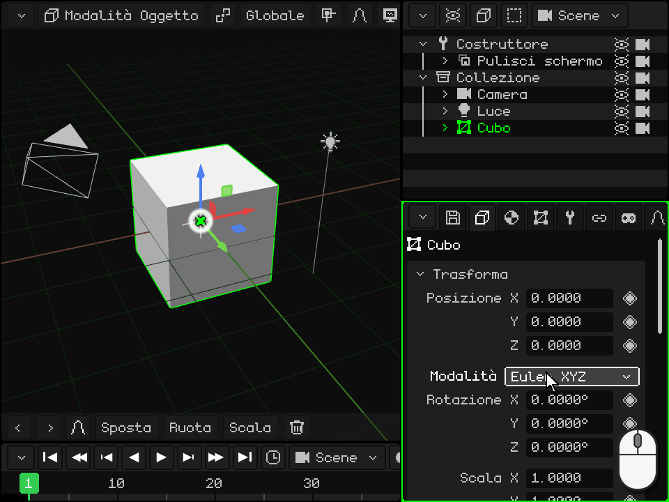

 Appoggia il dito sul numero (non sul suo nome) e trascinalo di lato. Se lo trascini in su o in giù, invece di cambiare il valore scorre il pannello.

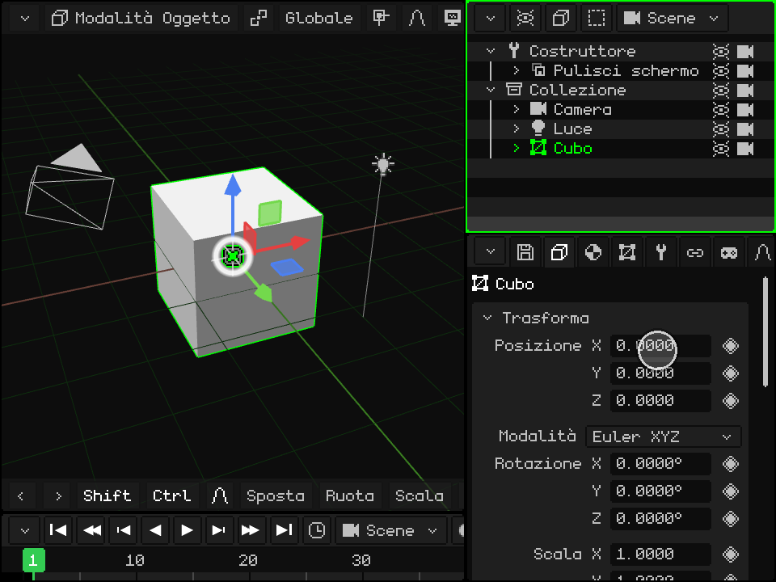

## I menu a tendina

Un **menu a tendina** è un pulsante che mostra l'opzione scelta, come il **Tipo** di una luce (Punto, Sole o Faretto) o la **Modalità** della rotazione. Attivandolo si apre l'elenco delle opzioni, con quella attuale in verde; scegliendone un'altra, l'elenco si chiude.

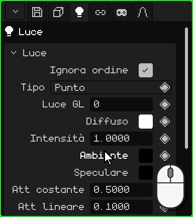

| | Come si apre e si sceglie |
|---|---|
|  PC | Un clic sul pulsante e un altro sull'opzione. |
|  Schermo touch | Un tocco sul pulsante e un altro sull'opzione. |
|  Nokia N95 | <kbd>OK</kbd> lo apre, **su** e **giù** scorrono le opzioni e <kbd>OK</kbd> sceglie. <kbd>C</kbd> lo chiude senza cambiare niente. |

## Le caselle

Una **casella** si attiva o si disattiva: spuntata è sì e vuota è no. Sta a destra della riga, come **Illuminazione** nel materiale: se è disattivata, l'oggetto non riceve le luci e si vede del suo colore, piatto. Un clic o un tocco sulla riga (sulla casella o sul suo nome) la cambia, e sul Nokia, <kbd>OK</kbd>.

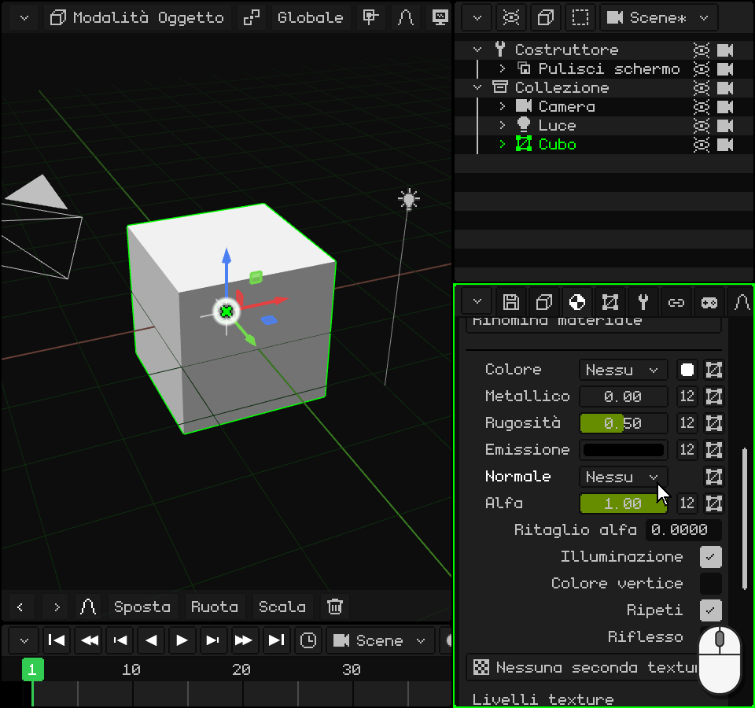

## I testi

Un **campo di testo** contiene un nome o un percorso, come il **Nome** dell'oggetto, in fondo al riquadro Trasforma. Attivandolo compare il cursore alla fine del testo. Il nuovo nome si vede anche nell'Outliner.

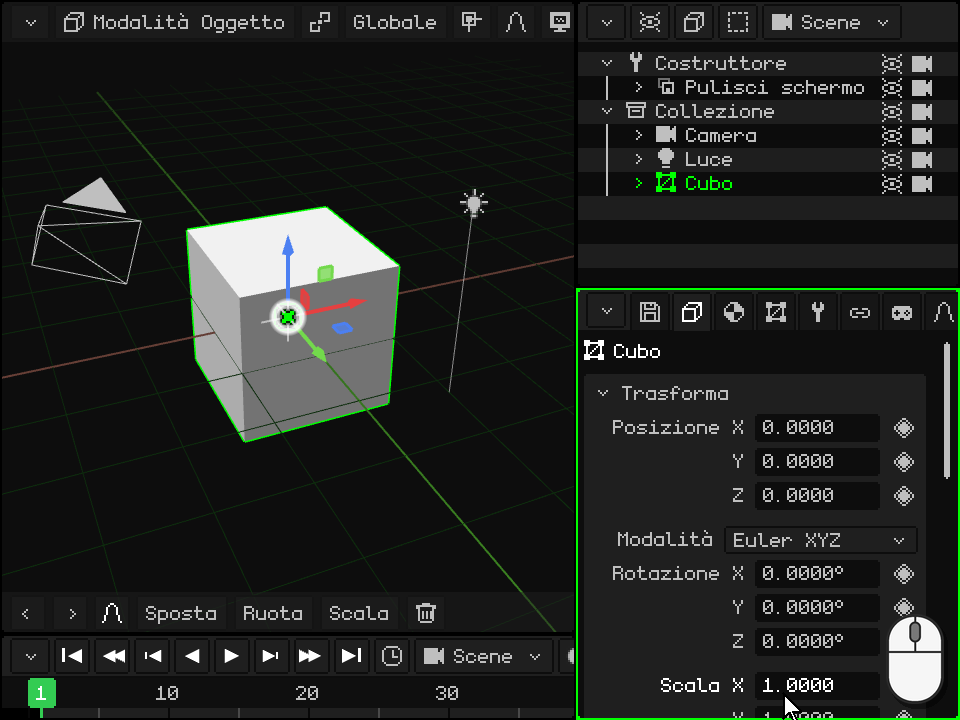

-  **Sul PC:** un clic sul campo e digita. <kbd>Enter</kbd> (o un clic altrove) lo conferma e <kbd>Esc</kbd> torna al testo di prima.
-  **Su uno schermo touch:** un tocco apre la tastiera di Whisk3D, con la ñ. **Aa** passa alle maiuscole, **123** ai numeri e ai simboli, **DEL** cancella e **OK** conferma. Nella versione web si apre la tastiera del telefono.
-  **Sul Nokia N95:** <kbd>OK</kbd> e si scrive con la tastiera del telefono, come un SMS: ogni tasto dà le sue lettere premendolo più volte. <kbd>#</kbd> passa tra Abc, abc e ABC, e tenuto premuto passa a 123 (la barra di Proprietà mostra la modalità). Lo <kbd>0</kbd> è lo spazio, l'<kbd>1</kbd> i segni di punteggiatura e il <kbd>\*</kbd> apre altri simboli. <kbd>C</kbd> cancella, **sinistra** e **destra** muovono il cursore, <kbd>OK</kbd> conferma e il **tasto di selezione sinistro** annulla.

## I colori

Una riga di **colore** mostra un quadratino con il colore, a destra, come **Diffuso**, **Ambiente** e **Speculare** nel riquadro di una luce. Attivandola si apre il **selettore di colore**:

- il **cerchio** sceglie la tonalità e la saturazione, e la barra accanto, il valore (quanto è chiaro);
- le schede **RGB**, **HSV** e **Hex** mostrano il colore in numeri: Rosso, Verde e Blu; Tonalità, Saturazione e Valore; o il codice esadecimale (`#FF8800`), con Copia e Incolla;
- **Alfa** è la trasparenza;
- **OK** mantiene il colore e **Annulla** torna a quello di prima.

Il colore cambia mentre lo muovi, quindi si vede nella scena prima di confermarlo. Anche un clic o un tocco fuori dal selettore lo chiude e mantiene il colore.

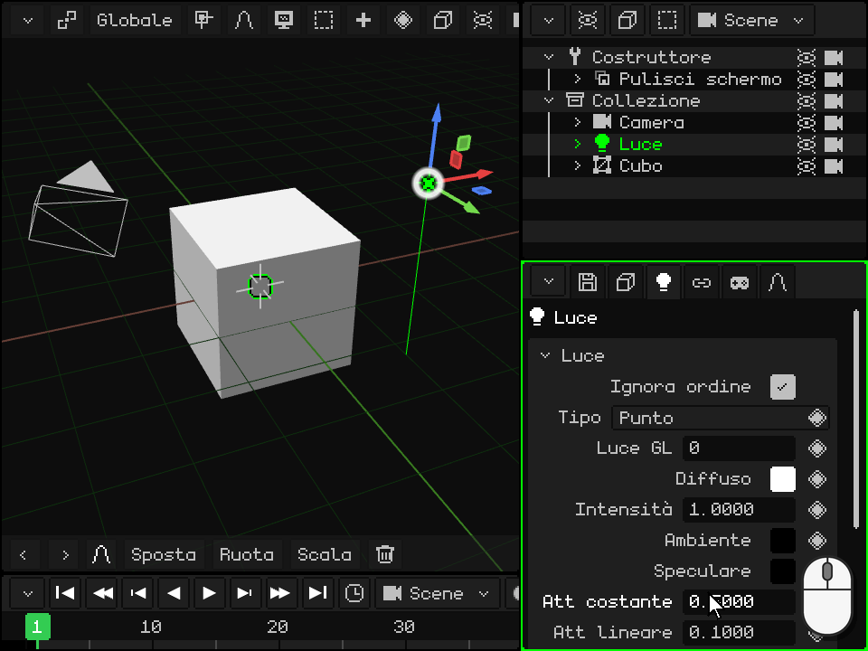

  Con il mouse o con il dito, si trascina dentro il cerchio e la barra, e i numeri si trascinano di lato, come in Proprietà.

 Sul Nokia N95, **su** e **giù** passano per il cerchio, la barra, le schede, le righe di numeri e OK / Annulla. In una riga di numeri, **sinistra** e **destra** la cambiano (tenute premute, sempre più veloce). Sul cerchio, <kbd>OK</kbd> entra in modifica: **sinistra** e **destra** girano la tonalità, **su** e **giù** cambiano la saturazione, e <kbd>OK</kbd> esce. La barra si modifica allo stesso modo, con su e giù. <kbd>C</kbd> chiude il selettore e torna al colore di prima.

## Gli elenchi

Alcuni riquadri hanno un **elenco**: i modificatori di una mesh, le sue parti, le sue mappe UV. L'elemento scelto è evidenziato, e ciò che sta sotto ne mostra i dati o agisce su di esso. Sotto l'elenco ci sono righe di **pulsanti**.

**Sposta su** e **Sposta giù** cambiano la posizione dell'elemento scelto. L'ordine conta: i modificatori si applicano dall'alto verso il basso, e le parti di una mesh si disegnano in quell'ordine. Questi due pulsanti compaiono quando l'elenco ha due o più elementi.

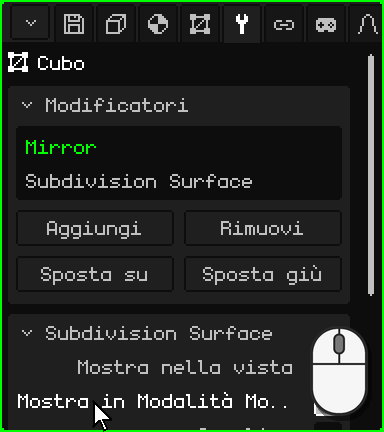

| | Come si usa l'elenco |
|---|---|
|  PC | Un clic sceglie. Se non ci stanno tutti, gira la rotella sopra l'elenco. |
|  Schermo touch | Un tocco sceglie. Se non ci stanno tutti, trascina il dito in su o in giù sull'elenco. |
|  Nokia N95 | <kbd>OK</kbd> sull'elenco, **su** e **giù** scelgono e <kbd>OK</kbd> esce. In una riga di pulsanti, **sinistra** e **destra** passano da un pulsante all'altro (il bordo indica quale) e <kbd>OK</kbd> lo preme. |

## Il rombo: animare una proprietà

A destra delle proprietà che si possono animare c'è un **rombo**; quelle che non ce l'hanno non si animano. Un clic o un tocco sul rombo mette un **keyframe**: salva il valore di quella proprietà nel frame attuale della Timeline. Con keyframe in frame diversi, la proprietà cambia da sola quando si riproduce l'animazione.

Il colore del rombo dice com'è la proprietà **nel frame attuale**:

| Rombo | Cosa significa | Cosa fa un clic |
|---|---|---|
| Grigio | La proprietà non è animata. | Mette il primo keyframe, con il valore attuale. |
| Verde tenue | È animata, ma non ha un keyframe in questo frame. | Mette un keyframe con il valore attuale. |
| Verde | Ha un keyframe in questo frame. | Lo toglie. |

Cambiare un valore non cambia il colore del rombo: il nuovo valore non entra nell'animazione finché non metti il keyframe, e se prima cambi frame, la proprietà torna a ciò che dice l'animazione. In un frame che ha già un keyframe (rombo verde), un nuovo valore si salva con due clic: il primo toglie il keyframe e il secondo lo rimette con il valore attuale.

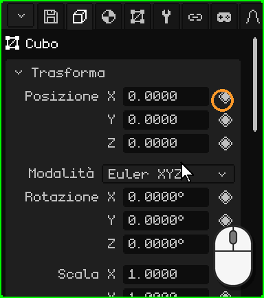

 Sul Nokia N95, fermo sulla riga, la freccia **destra** passa al rombo (lo segna un bordo bianco), <kbd>OK</kbd> mette o toglie il keyframe e **sinistra** torna al valore.

Nella scheda Animazione, il riquadro **Camera attiva** sceglie quale camera comanda in ogni momento dell'animazione: i tagli di una scena. Il suo rombo ha un colore in più, un **verde più chiaro**: la camera scelta non è quella che dice l'animazione in questo frame, un cambio che non è ancora stato salvato. Un clic salva il taglio nel frame attuale.

L'animazione ha un suo tutorial più avanti.

Tutte le schede e i loro riquadri sono nel manuale: [Proprietà](propiedades.md). Torna a [I viewport](viewports.md).

## Cosa contiene ogni scheda

| Scheda | Cosa contiene |
|---|---|
| File / Render (dischetto) | **File**: aprire, salvare, salvare con nome, salvare una versione, estrarre gli asset. **Render**: percorso, dimensione, passate extra, sfondo, **Ray tracing** (raggi, campioni, passate), Renderizza immagine e Renderizza animazione. **Gioco**: piattaforma (Windows, Symbian, Linux .deb, AppImage, WebGL, Android, Android 2.3), finestra, orientamento, icona, fisica, suono, volume, **risoluzione** (la percentuale dello schermo a cui disegna il gioco: su Android 2.3 il sistema la stira, e su quei telefoni disegnare meno pixel dà più fotogrammi) e Compila gioco (con un telefono collegato via adb lo installa e lo apre). **Esporta**: OBJ, glTF, GLB, STL (solo i triangoli, per la stampa 3D o per passare a un programma CAD). **Impostazioni**: lingua, antialiasing, grafica, skin, log, scala, **Scorciatoie da tastiera...** e Salva modifiche. |
| Oggetto | Posizione, rotazione (Eulero, quaternione o asse-angolo), scala, nome, visibile, renderizzabile; animazioni e tavolozza dell'oggetto. |
| Contestuale | Dipende dal tipo: parti della mesh e **materiale** (texture, illuminazione, colore dei vertici, trasparenza, riflessi, normal map, fusione, profondità, livelli di texture, **Avanzato: shader personalizzato** — vedi [Shader scritti](../editor/shaders.md); Rugosità, Metallico, Trasmissione e IOR con il ray tracing), luce, camera, nebbia, particelle, fisica, hitbox, armatura e ossa, elementi 2D, prefab, routine. |
| Mesh 3D | La mesh usata (e quanti la condividono), mappe UV, livelli di colore, gruppi di vertici, gruppi UV. Con una risorsa scelta nella Libreria: i suoi dati e la sua posizione (dentro o fuori dal .w3d). |
| Modificatori | Vedi [Modificatori](../editor/objeto-malla.md#la-scheda-modificatori). |
| Trasforma | Solo in Modalità Modifica: centro della selezione e delle sue UV, modificabili. |
| Armatura 2D | Armature e ossa 2D della mesh. |
| Vincoli | Copia posizione, Copia rotazione, Billboard (guardare verso la camera), Child Of. |
| Script | Gli script Lua dell'oggetto e le loro proprietà (vedi il [documento su Lua](../lua/README.md)). |
| Animazione | L'animazione attiva, livelli di mix (Mix), valori esatti del keyframe scelto e tagli di camera. |

## Routine

Una routine è un elenco di passi di disegno (traslare, ruotare, impostare la texture, disegnare una mesh, chiamare un'altra routine, Chiama Lua…) che si costruisce in Proprietà. È il modo più veloce di disegnare sull'N95.

| Funzione | Descrizione | Scorciatoia |
|---|---|---|
| Aggiungi / Rimuovi passo | Aggiunge passi raggruppati per tema, o rimuove quello scelto. | Pulsanti; <kbd>X</kbd> o <kbd>Delete</kbd> rimuove |
| Afferra passo | Riordina il passo con le frecce; <kbd>Enter</kbd> conferma. | <kbd>G</kbd> |
| Inserisci keyframe | Anima i valori del passo nel frame attuale. | <kbd>I</kbd> |
| Ripeti | Quante volte di seguito viene eseguito l'elenco (ciclo della routine). 1 = routine normale. | Campo Ripeti |
| Modalità render / Usa | Un elenco diverso per ogni modalità di shading, o lo stesso per tutte. | Menu a tendina |
