# Cambiare l'origine: una porta

In questo tutorial farai in modo che una porta si apra dal cardine. Per farlo bisogna cambiare la sua **origine**: il punto attorno a cui gira l'oggetto (vedi [L'origine](modo-objeto.md#lorigine) nel tutorial sulla Modalità Oggetto).

Partiamo dalla porta del tutorial precedente, [Modellare una porta](modelar-puerta.md), con l'origine al centro. Se l'hai fatta spostando un lato, l'origine è rimasta spostata: **Oggetto → Imposta origine → Origine alla geometria** la riporta al centro.

## La porta gira male

Prova a ruotarla. La porta gira sul suo centro, come una porta girevole, e non dal cardine:

 Con il gizmo: un clic sul suo centro lo passa a **Ruota**, e l'anello blu la fa girare sull'asse verticale.

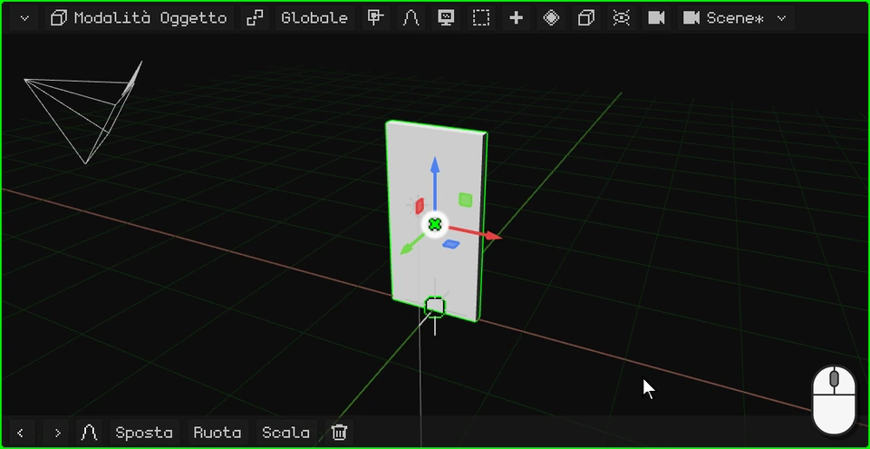

 Con il dito: un tocco sul centro del gizmo lo passa a **Ruota**, e si trascina l'anello blu.

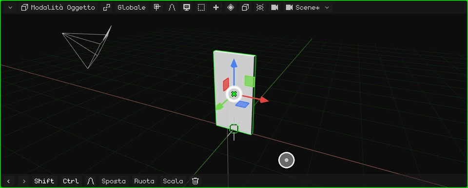

 Sul Nokia N95 il gizmo è spento: <kbd>2</kbd> (ruotare), <kbd>3</kbd> (l'asse Z, quello verticale) e le frecce; <kbd>OK</kbd> conferma.

Gira male perché la sua origine è al centro. Portiamola sul cardine.

## Portare l'origine sul cardine

1. **Entra in Modalità Modifica.** Un clic sul pulsante della modalità e un altro su **Modalità Modifica** (sul PC, anche con <kbd>Tab</kbd>).

   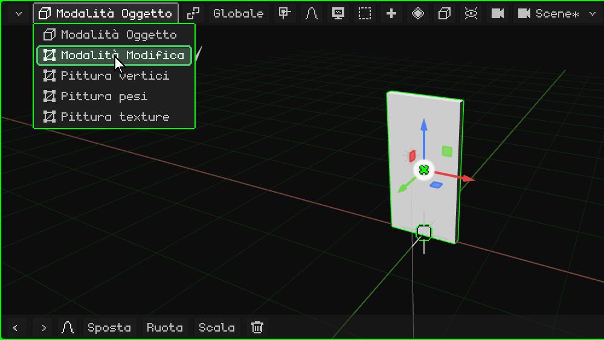

2. **Scegli le facce.** In Modalità Modifica compare il pulsante **Vertice / Spigolo / Faccia**: un clic e scegli **Faccia**.

   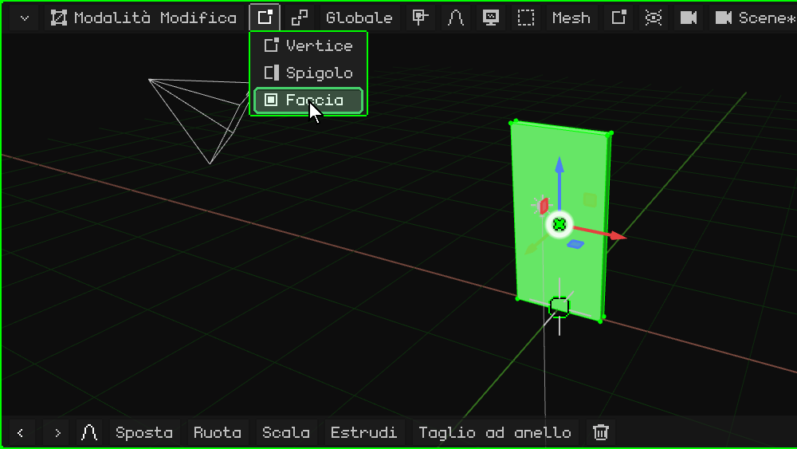

3. **Seleziona la faccia del cardine.** Un clic sulla faccia stretta sul fianco della porta, dal lato dove va il cardine: diventa verde.

   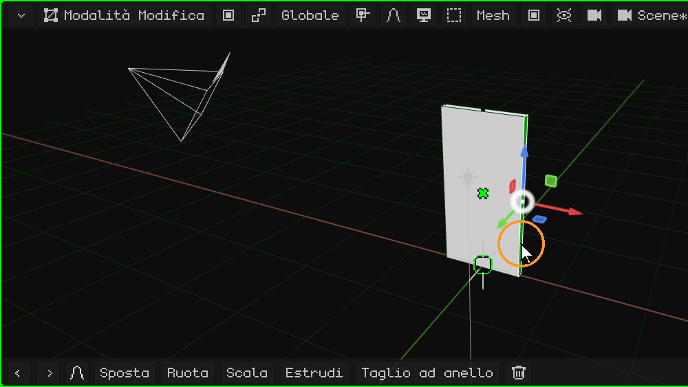

4. **Porta lì il cursore 3D.** Nel menu **Mesh**, **Aggancio** → **Cursore al selezionato**: il cursore 3D si posiziona sul cardine.

   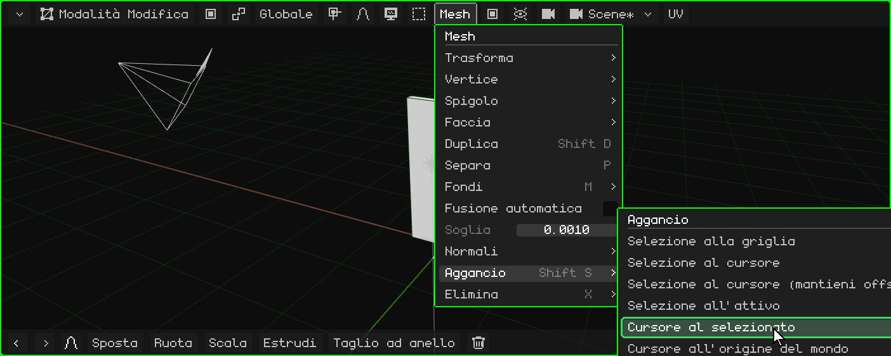

5. **Torna in Modalità Oggetto.** Un clic sul pulsante della modalità e un altro su **Modalità Oggetto** (o <kbd>Tab</kbd>).

   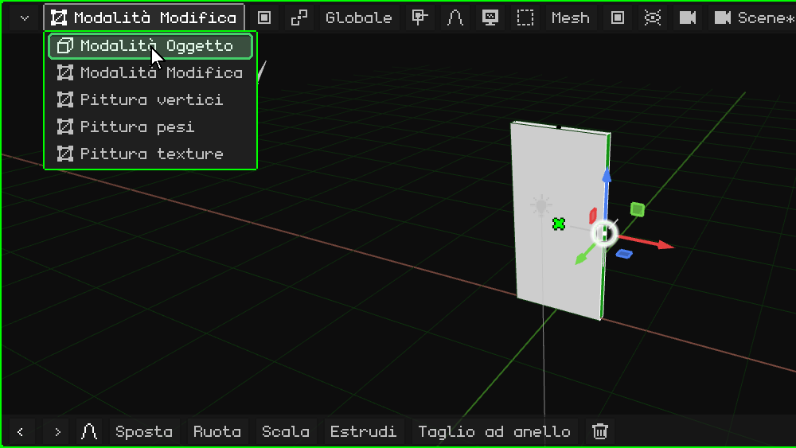

6. **Porta l'origine sul cursore 3D.** Nel menu **Oggetto**, **Imposta origine** → **Origine al cursore 3D**. La porta non si muove: a muoversi è la sua origine, e con lei il gizmo, che resta sul cardine.

   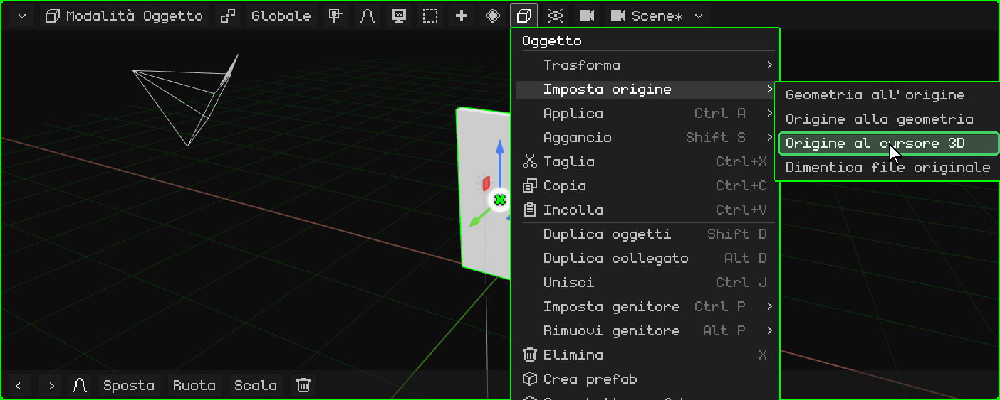

## Ora gira bene

Ruotala di nuovo con il gizmo: ora si apre e si chiude dal cardine.

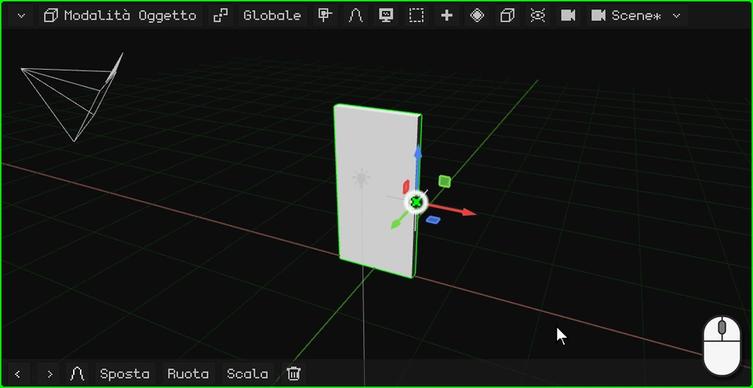

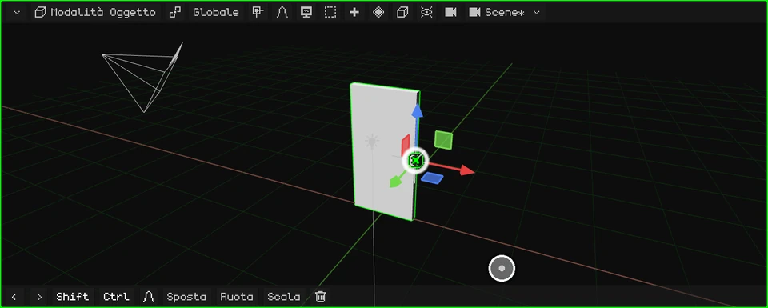

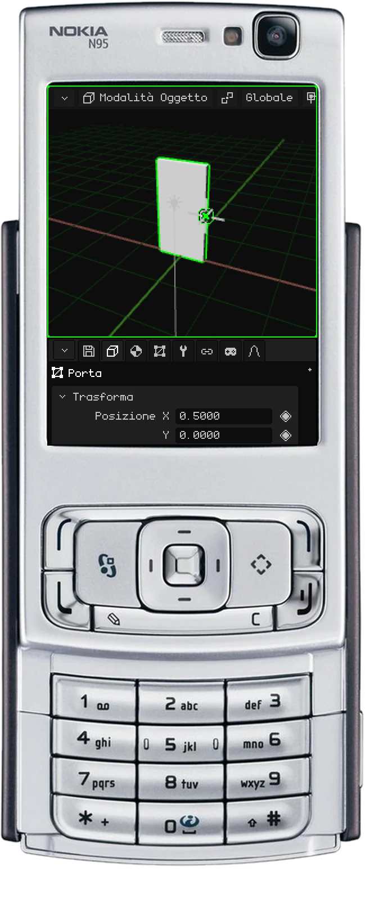

 Su uno schermo touch, i passi qui sopra sono uguali, con i tocchi: i menu si aprono e le opzioni si scelgono con un tocco.

 Sul Nokia N95, <kbd>OK</kbd> passa dalla Modalità Oggetto alla Modalità Modifica e i menu si aprono con il tasto di selezione sinistro.

## Le opzioni di Imposta origine

| Opzione | Cosa fa |
|---|---|
| **Origine alla geometria** | Porta l'origine al centro della mesh. |
| **Origine al cursore 3D** | Porta l'origine dove si trova il cursore 3D. |
| **Geometria all'origine** | Al contrario: lascia l'origine dov'è e sposta la mesh finché il suo centro non coincide con essa. |

Nel prossimo tutorial le facciamo la maniglia: [Modellare la maniglia](modelar-picaporte.md).
