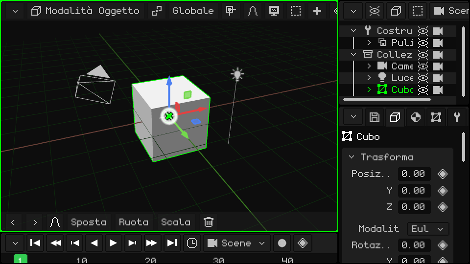
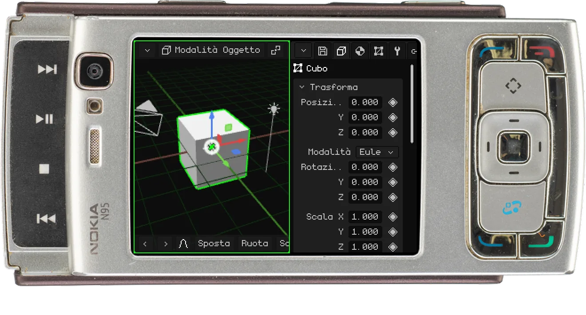
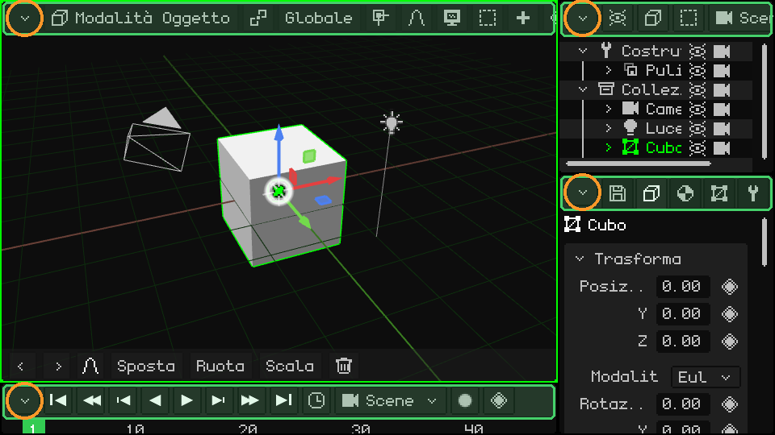
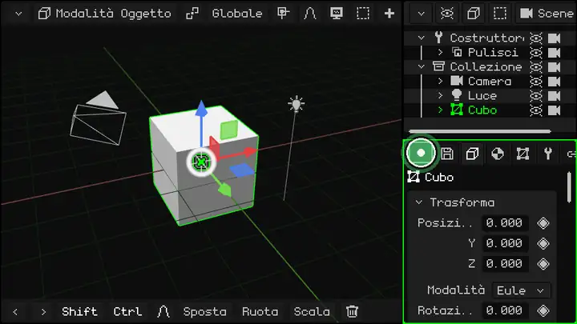
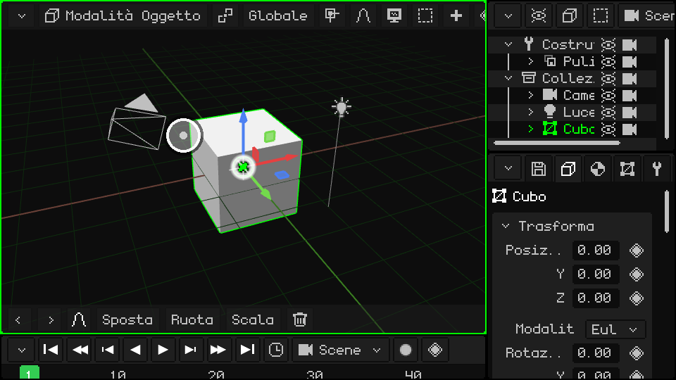
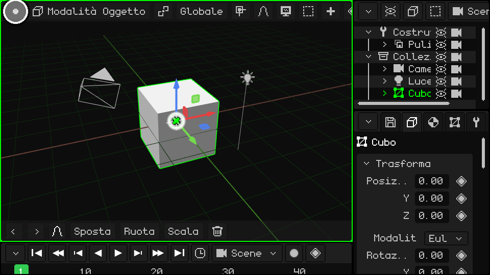
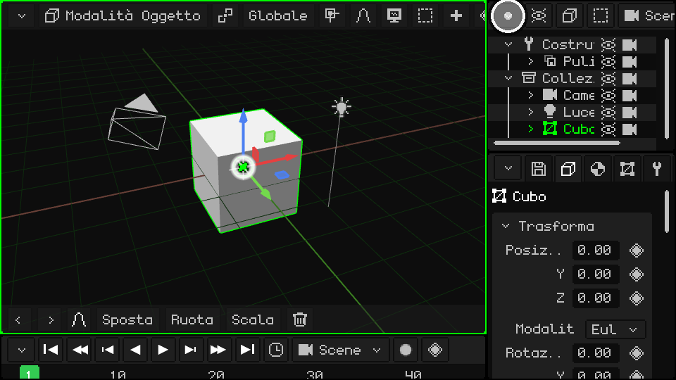
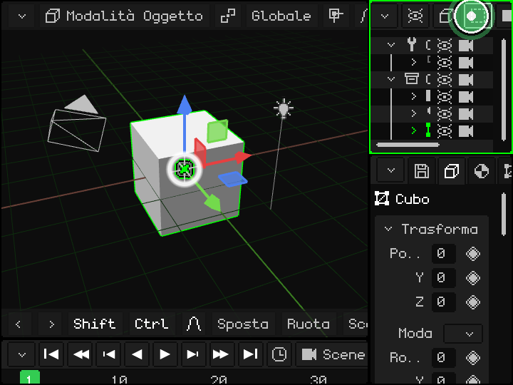
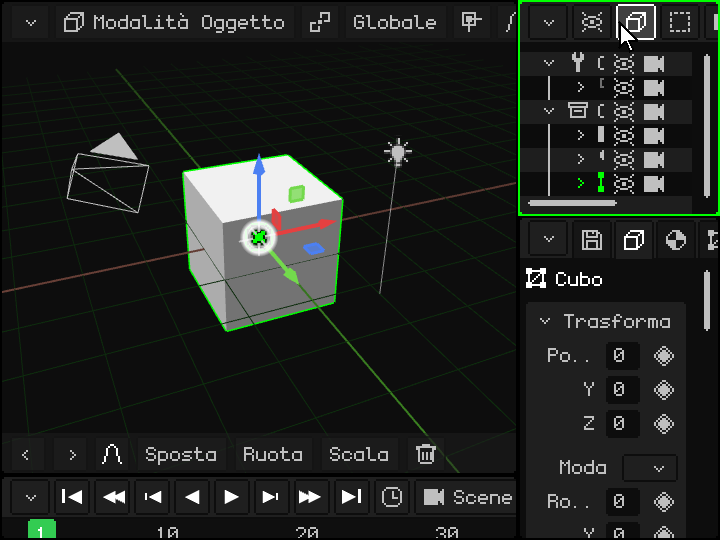

# I viewport

> [!NOTE]
>  Il Nokia N95 supporta mouse e tastiera (via Bluetooth). Le parti di questo tutorial dedicate al Nokia spiegano come usarlo senza mouse né tastiera, solo con i tasti del telefono.

La finestra di Whisk3D è divisa in **viewport**: pannelli, ognuno con il suo editor (il 3D Viewport, l'Outliner, Properties...). Puoi dividerli, cambiarne la dimensione e scegliere cosa mostra ognuno. Funziona allo stesso modo con il mouse, con il dito su uno schermo touch e con la tastiera di un Nokia.

Questo è ciò che si vede quando il programma si avvia per la prima volta:

## Il viewport attivo

Il viewport che si trova sotto il mouse è il **viewport attivo** ed è segnato da un bordo verde. È quello che riceve i comandi della tastiera, i controller e qualsiasi altra periferica. Quando passi con il mouse da un viewport all'altro, il bordo verde lo segue:

 **Su un Nokia N95:** ogni pressione del **tasto verde** di chiamata  passa al viewport successivo. Sullo schermo del N95 ce ne stanno due: il 3D Viewport a sinistra e Properties a destra.

## La barra dei menu e il pulsante dell'angolo

Tutti i viewport hanno in alto una **barra dei menu** (in verde nell'immagine) con i menu e i pulsanti di quell'editor. In alto a sinistra c'è sempre il **pulsante dell'angolo** (in arancione): è quello che cambia o modifica il viewport.

## Cambiare la dimensione

  **Tieni premuto** il pulsante dell'angolo (con il dito o con il mouse) e trascinalo per cambiare la dimensione: questo sposta il bordo sinistro e quello superiore di quel viewport, e quelli accanto si adattano. Un **tocco singolo**, senza trascinare, apre il menu a tendina con le opzioni del viewport. Qui si trascina in cerchio quello in basso a destra e tutti e tre cambiano dimensione:

 **Su un Nokia:** tieni premuto il **tasto verde** di chiamata  e premi una freccia: il bordo del viewport attivo (quello con la cornice verde) si sposta da quel lato, e così lo ingrandisci o lo rimpicciolisci. Il tasto verde da solo, senza frecce, passa al viewport successivo.

## Le opzioni del viewport

Un tocco sul pulsante dell'angolo apre questo menu:

In alto ci sono i **tipi di viewport**: sceglierne uno trasforma il viewport in quell'editor. Sotto la linea c'è ciò che si può fare con il viewport:

| Opzione | Cosa fa |
|---|---|
| Expand | Il viewport prende il posto di quello accanto, che si chiude (se quello accanto è diviso, si chiude tutto quel gruppo). |
| Split in Columns | Lo divide in due, uno accanto all'altro. |
| Split in Rows | Lo divide in due, uno sopra l'altro. |
| Maximize | Lo ingrandisce a tutta la finestra. Mentre è massimizzato, il menu ha solo **Minimize**, che lo riporta al suo posto. |

### Cambiare il tipo

Il 3D Viewport trasformato in UV Editor:

### Split in Columns e Split in Rows

### Expand

L'Outliner prende il posto di Properties:

### Maximize e Minimize

## Quando la barra non ci sta

Se il viewport è stretto, la sua barra non ci sta tutta. Lo stesso succede con la barra inferiore del 3D Viewport. Per vedere il resto:

-  **Con il dito:** trascinala di lato.
-  **Con il mouse:** tieni premuto il pulsante del mouse sulla barra e trascina, oppure gira la **rotella** sopra la barra.
-   **Con la tastiera:** <kbd>M</kbd> sul PC, o il **tasto di selezione sinistro** sul Nokia, ti porta nella barra del viewport attivo. Con le frecce sinistra e destra la percorri, e ogni menu si apre quando ci arrivi. Con su e giù ti muovi nel menu, e con OK (<kbd>Enter</kbd> sul PC) scegli. La barra scorre da sola per mostrare dove sei.

 Su un Nokia N95: il tasto di selezione sinistro porta nella barra e le frecce la percorrono.

## I tipi di viewport

| Viewport | A cosa serve |
|---|---|
| [3D Viewport](../editor/vista-3d.md) | Dove si vede e si modifica la scena: modellare, spostare oggetti, dipingere, mettere in posa e animare. |
| [Outliner](../editor/outliner.md) | L'elenco di tutto ciò che c'è nella scena. |
| [Library](../editor/outliner.md#vista-library) | Le risorse del progetto: mesh, materiali, texture, animazioni, suoni, script e altro. |
| [Properties](../editor/propiedades.md) | I dati dell'oggetto attivo, in schede. |
| [UV Editor](../editor/editor-uv.md) | Come la texture si appoggia sulla mesh. |
| [Timeline](../editor/linea-de-tiempo.md) | L'animazione: i keyframe e le curve. |
| [2D Editor](../editor/editor-2d.md) | Interfacce di gioco, HUD e giochi 2D. |
| [Console](../editor/consola.md) | Il registro del motore: errori, avvisi e informazioni. |
| [IDE](../editor/editor-de-scripts.md) | L'editor di script Lua e di shader. |

Ogni viewport avrà il suo tutorial con più dettagli. Nel frattempo, il [Manuale di Whisk3D](../editor/README.md) li spiega uno per uno.

Whisk3D continua a crescere: col tempo si aggiungeranno nuovi viewport e quelli attuali potranno cambiare. Funzioneranno tutti allo stesso modo, con la barra in alto e il pulsante nell'angolo.

Prossimo tutorial: [Navigare nel 3D Viewport](navegacion.md).
