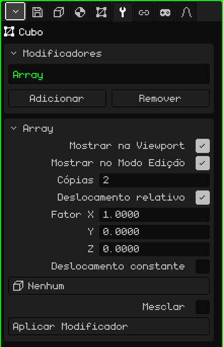

# Array

O modificador **Array** faz cópias da malha em fila, cada uma deslocada em relação à anterior. Serve para tudo o que se repete: os postes de uma cerca, os degraus de uma escada, as colunas de um corredor ou os elos de uma corrente. Você modela uma só peça e o Array monta o resto; se você mudar a peça, todas as cópias mudam.

## Como adicionar

1. Selecione a malha.
2. Em Propriedades, abra a aba **Modificadores** (o ícone da chave inglesa).
3. Toque em **Adicionar** e escolha **Array**.

Na lista ele aparece como **Array**, e embaixo se abre o cartão com os seus parâmetros. Como todos os modificadores, ele não destrói a malha: dá para desligá-lo, mudá-lo de lugar com **Subir** e **Descer**, tirá-lo com **Remover** ou incorporá-lo à malha com **Aplicar Modificador**.

## Parâmetros

| Parâmetro | O que faz |
|---|---|
| Mostrar na Viewport | Desligado, as cópias não são calculadas: nem na vista nem ao renderizar. |
| Mostrar no Modo Edição | Desligado, enquanto você edita só aparece a peça original. |
| Cópias | Quantas peças há no total, contando a original (por padrão, 2). Com 1 fica só a original. |
| Deslocamento relativo | Desloca cada cópia conforme o **tamanho** da peça. Vem ligado, com Fator X em 1: cada cópia fica encostada na anterior, sem vão e sem se sobrepor. |
| Fator X / Y / Z | Quantas vezes o seu próprio tamanho cada cópia se desloca nesse eixo: 1 = encostadas, 2 = com um vão do tamanho de uma peça, 0.5 = sobrepostas pela metade. Y é a profundidade e Z a altura, como na aba Objeto. Só aparecem com o Deslocamento relativo ligado. |
| Deslocamento constante | Desloca cada cópia uma distância fixa, independentemente do tamanho da peça. Vem desligado. Se os dois deslocamentos estiverem ligados, eles se somam. |
| Distância X / Y / Z | Os metros que cada cópia se desloca em cada eixo. Só aparecem com o Deslocamento constante ligado. |
| Objeto de deslocamento | Um objeto da cena (o mais prático é um Vazio) que desloca, gira e escala cada cópia um pouco mais que a anterior. Veja mais abaixo. Em **Nenhum**, não é usado. |
| Mesclar | Solda os vértices que ficam encostados entre uma cópia e a seguinte, para que formem uma só superfície: um corrimão contínuo em vez de trechos soltos. Vem desligado. |
| Distância de Mesclagem | Quão perto dois vértices precisam estar para se soldar (por padrão, 0.001 m). Só aparece com Mesclar ligado. |
| Aplicar Modificador | Incorpora as cópias à malha. Veja a nota abaixo. |

## Exemplos

- **Uma cerca:** um poste (um Cubo estreito e alto), Cópias em 10 e Fator X em 3: dez postes com um vão de dois postes entre cada um.
- **Uma escada:** um degrau (um Cubo achatado), Fator X em 0, Fator Y em 1 e Fator Z em 1: cada degrau fica um passo mais para trás e um passo mais para cima.

## O Objeto de deslocamento

Com um objeto escolhido, cada cópia repete o quanto esse objeto está **deslocado, girado e escalado em relação à malha**, e vai acumulando: a segunda cópia faz isso uma vez, a terceira duas vezes, e assim por diante.

- Se o Vazio está no mesmo lugar que a malha e girado 30° ao redor da vertical, cada cópia gira 30° a mais que a anterior: com 12 cópias se dá a volta inteira.
- Se, além disso, ele estiver um pouco mais acima, cada cópia sobe um pouco mais: uma escada caracol.
- Se estiver escalado a 0.9, cada cópia é um pouco menor que a anterior: uma espiral que se fecha.

Com o Vazio no mesmo lugar que a malha, as cópias giram ao redor da origem da malha. Para que formem um círculo e não girem sobre si mesmas, afaste a peça da origem no Modo Edição e desligue o Deslocamento relativo. Ao mover ou girar o objeto, as cópias se atualizam na hora.

## A ordem importa

O Deslocamento relativo mede a malha **tal como ela chega** do modificador de cima: se em cima há um [Espelho](modificador-espejo.md), ele mede o objeto já refletido. Com uma [Superfície de Subdivisão](modificador-subdivision.md) embaixo, as cópias soldadas com Mesclar são suavizadas como uma só peça; sem Mesclar, cada cópia é suavizada separadamente.

> [!NOTE]
> Aplicar Modificador em um Array incorpora à malha **todos** os modificadores da lista que estiverem ligados, não só o Array (com os valores da vista), e deixa a lista vazia: também vão embora os que estavam desligados e os que não geram geometria, como uma [Armação](modificador-esqueleto.md). Dá para desfazer.

Voltar para [Malha 3D](objeto-malla.md)
