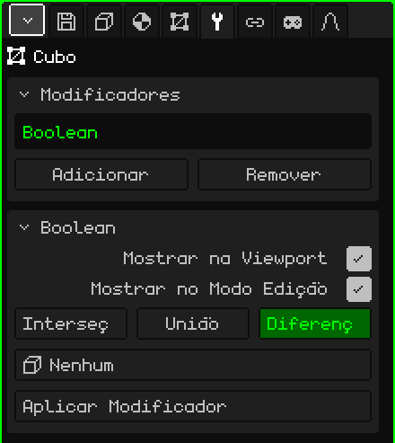

# Booleano

O modificador **Booleano** combina a malha com outra: subtrai dela o volume da outra, soma esse volume ou fica com o que as duas têm em comum. Serve para o que daria muito trabalho modelar à mão: o buraco de uma janela em uma parede, o oco de uma xícara, uma ranhura, ou duas peças fundidas em uma só.

## Como adicionar

1. Selecione a malha que vai mudar (por exemplo, a parede).
2. Em Propriedades, abra a aba **Modificadores** (o ícone da chave inglesa).
3. Toque em **Adicionar** e escolha **Booleano**.

Na lista ele aparece com o seu nome interno, **Boolean**, e embaixo se abre o cartão com os seus parâmetros. Como todos os modificadores, ele não destrói a malha: a parede continua inteira por baixo, e se você tirar o modificador o buraco desaparece. Dá para desligá-lo, mudá-lo de lugar com **Subir** e **Descer**, tirá-lo com **Remover** ou incorporá-lo à malha com **Aplicar Modificador**.

## Parâmetros

| Parâmetro | O que faz |
|---|---|
| Mostrar na Viewport | Desligado, a operação não é feita, nem na vista nem ao renderizar: aparece a malha original. |
| Mostrar no Modo Edição | Desligado, enquanto você edita aparece a malha sem a operação. |
| Interseção | Deixa só a parte que está dentro das duas malhas ao mesmo tempo. |
| União | Junta as duas em uma só superfície e tira as faces que ficaram dentro. |
| Diferença | Subtrai desta malha o volume da outra: é a que faz buracos. Vem escolhida. |
| Objeto | A outra malha, o **cortador**. Em **Nenhum** não faz nada. A lista mostra todos os objetos da cena, mas só uma malha serve. |
| Aplicar Modificador | Incorpora o resultado à malha. Veja a nota abaixo. |

A operação escolhida aparece em verde.

## Exemplo: uma janela em uma parede

1. Adicione um **Cubo** e escale-o para que seja uma parede: larga, alta e fina.
2. Adicione outro **Cubo** (ou um **Cilindro**, para uma janela redonda) e coloque-o onde vai a janela, atravessando a parede de um lado ao outro.
3. Selecione a parede, adicione um **Booleano**, deixe **Diferença** e em **Objeto** escolha o cortador.
4. Oculte o cortador (Ocultar / Mostrar do [Modo Objeto](modo-objeto.md), ou desmarque **Visível** na aba Objeto). Fica o buraco.

O cortador oculto continua cortando. Para movê-lo, mostre-o de novo ou selecione-o no Outliner.

## O que é bom saber

- As duas malhas precisam estar **fechadas**, sem buracos na superfície: senão o Booleano não tem como saber o que fica dentro e o que fica fora.
- Mover, girar, escalar ou editar o cortador atualiza o corte na hora. Assim você pode ajeitar a janela olhando o resultado.
- As faces que o corte não toca ficam como estavam: um quadrilátero continua sendo um quadrilátero. As que são cortadas ficam como polígonos de vários lados, não como triângulos, e assim a malha continua cômoda de editar depois de aplicá-lo.
- As faces que o cortador coloca (por exemplo, a borda de dentro da janela) pegam o primeiro material da malha.
- As UV e as cores de vértice são preservadas; onde há corte, elas são interpoladas.
- As partes que ficam no mesmo plano não se juntam: a união de duas caixas encostadas deixa a tampa partida em vários pedaços.

 No Nokia N95 o corte é recalculado cada vez que você move ou edita o cortador. Com malhas grandes, ajeite-o, aplique o modificador e continue trabalhando com a malha já cortada.

> [!NOTE]
> Aplicar Modificador no Booleano incorpora à malha **todos** os modificadores da lista que estiverem ligados, não só este, e deixa a lista vazia: também vão embora os que estavam desligados e os que não geram geometria, como uma [Armação](modificador-esqueleto.md). Dá para desfazer. O cortador não é apagado: fica como mais um objeto.

Voltar para [Malha 3D](objeto-malla.md)
