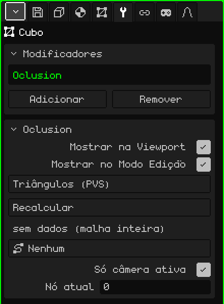

# Culling

O modificador **Culling** desenha só os triângulos da malha que são vistos da zona onde a câmera está. Ele usa listas de visibilidade calculadas de antemão, uma por zona, como faziam os jogos de PlayStation 1 (um **PVS**, *conjunto potencialmente visível*). Serve para cenários grandes: de um nível inteiro, só é desenhado o que se vê do corredor onde você está.

 Ele foi pensado para o Nokia N95, onde cada triângulo que não é desenhado é velocidade ganha. Mudar de zona quase não custa nada: as listas são montadas uma só vez e, ao passar de uma zona para outra, só muda qual delas é usada. Não há nenhum cálculo por quadro.



## Como adicionar

1. Selecione a malha do cenário.
2. Em Propriedades, abra a aba **Modificadores** (o ícone da chave inglesa).
3. Toque em **Adicionar** e escolha **Culling**.

Na lista ele aparece com o seu nome interno, **Oclusion**, e embaixo se abre o cartão com os seus parâmetros. Ele não mexe na malha: só escolhe quais triângulos desenhar, então a malha continua inteira e editável. Por isso ele não tem Aplicar Modificador.

Não o confunda com o objeto **Culling** do menu Adicionar da Viewport 3D, que trabalha com objetos inteiros e não com os triângulos de uma malha.

## De onde vêm os dados

O modificador não calcula o que é visto: ele lê isso de um arquivo que acompanha o modelo. Para uma malha importada de `nivel.obj`, ele procura `nivel.pvs.json` na mesma pasta:

```json
{ "sectores": 2, "tris": [[0, 1], [2, 3]] }
```

`sectores` é quantas zonas há, e `tris` tem, para cada zona, os triângulos que são desenhados, numerados a partir de 0 na ordem das faces do `.obj`. O normal é que ele venha do jogo original ou de uma ferramenta à parte. Cada zona é um **nó**: o nó 1 é a primeira lista, e o nó 0 desenha a malha completa.

## Parâmetros

| Parâmetro | O que faz |
|---|---|
| Mostrar na Viewport | Desligado, a malha completa é desenhada. |
| Mostrar no Modo Edição | Não muda nada: no Modo Edição a malha é sempre desenhada completa. |
| Método | **Triângulos (PVS)** usa as listas do `.pvs.json`. **BSP (pendente)** aparece em cinza: ainda não dá para escolhê-lo. |
| Recalcular | Lê o `.pvs.json` de novo, por exemplo depois de gerá-lo outra vez. Avisa "PVS recalculado" ou, se não o encontrar, "PVS: falta <modelo>.pvs.json junto ao .obj de origem". |
| (linha de estado) | Embaixo de Recalcular: "4 nós \| nó ativo: 2", "sem dados (malha inteira)" se não houver arquivo, ou "sidecar não carregado (Recalcular)". |
| Caminho | Um caminho da cena (**Adicionar → Caminho**), por exemplo o trilho por onde a câmera passa. Cada nó do caminho é uma zona, e o motor escolhe sozinho o nó mais próximo do olho. Em **Nenhum**, a zona é definida à mão ou por um script. |
| Só câmera ativa | Ligado (por padrão), quem manda é a câmera ativa enquanto a cena é reproduzida; em pausa nada é escolhido sozinho e o nó é definido à mão. Desligado, quem manda é a vista da viewport: você pode voar livremente pelo cenário e ver como os triângulos aparecem e desaparecem. |
| Ramos | Só aparece se o caminho tiver mais de um ramo, por exemplo o caminho principal e um de bônus. Escolhe quais ramos contam na busca do nó mais próximo; cada ramo ligado aparece em verde. O botão diz, por exemplo, "Ramos: 3 (todos)" ou "Ramos: 2/3". |
| Nó atual | A zona que está sendo desenhada; 0 = a malha completa. Dá para mudá-lo à mão para revisar cada zona. Quando o Caminho escolhe o nó sozinho, o motor o sobrescreve. |

Por um script, `setSector(objeto, n)` muda o nó ativo (0 = a malha completa). Veja [Partículas, névoa e visibilidade](../lua/api-particulas-niebla.md).

## O que é bom saber

- Enquanto a malha está no Modo Edição, ela é desenhada completa, para que você possa editar tudo.
- Se na lista houver outro modificador ligado que gera geometria ([Espelho](modificador-espejo.md), [Array](modificador-array.md), [Superfície de Subdivisão](modificador-subdivision.md)…), o Culling não é usado e tudo é desenhado: os números de triângulo do `.pvs.json` são os da malha original.
- As listas identificam os triângulos pelo número. Se você editar a malha e adicionar ou apagar faces, os números mudam e as listas podem ficar apontando para outros triângulos: o Culling é para cenários terminados, não para os que ainda estão sendo modelados.

Voltar para [Malha 3D](objeto-malla.md)
