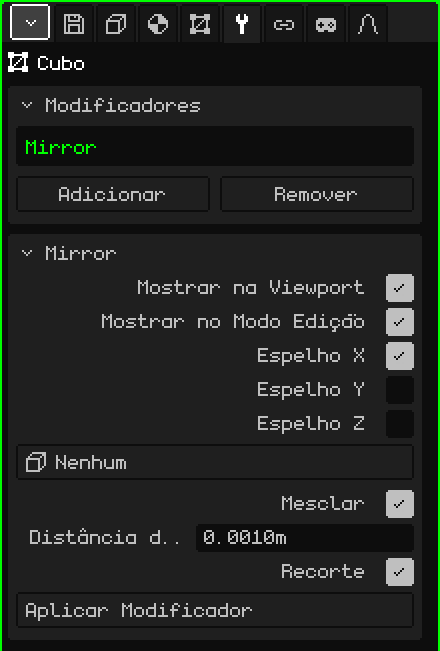

# Espelho

O modificador **Espelho** reflete a malha do outro lado de um plano. Serve para tudo o que é simétrico: você modela a metade de um personagem, de um rosto ou de um carro, e a outra metade aparece sozinha, refletida. O que você muda de um lado se repete do outro enquanto você trabalha.

## Como adicionar

1. Selecione a malha.
2. Em Propriedades, abra a aba **Modificadores** (o ícone da chave inglesa). Ela só aparece quando o objeto ativo é uma malha.
3. Toque em **Adicionar** e escolha **Espelho**.

Na lista do cartão Modificadores ele aparece com o seu nome interno, **Mirror**, e embaixo se abre um cartão com os seus parâmetros.

Um modificador não destrói a malha: a original fica intacta e você continua editando-a, e o que aparece é o resultado. Dá para desligá-lo a qualquer momento, mudá-lo de lugar na lista com **Subir** e **Descer** (aparecem quando há dois ou mais), tirá-lo com **Remover** ou incorporá-lo à malha com **Aplicar Modificador**.

## Parâmetros

| Parâmetro | O que faz |
|---|---|
| Mostrar na Viewport | Desligado, o reflexo não é calculado: nem na vista nem ao renderizar. Serve para comparar com e sem. |
| Mostrar no Modo Edição | Desligado, enquanto você edita a malha só aparece a metade original; ao voltar para o Modo Objeto, o reflexo aparece. |
| Espelho X | Reflete da esquerda para a direita. Vem ligado: é o que serve para um personagem ou um carro. |
| Espelho Y | Reflete da frente para trás. |
| Espelho Z | Reflete de cima para baixo. |
| Objeto Espelho | Em **Nenhum**, o plano do espelho passa pela origem da malha. Se você escolher outro objeto (por exemplo um Vazio), o plano passa pela origem desse objeto e gira com ele; a escala dele não conta. Ao movê-lo ou girá-lo, o reflexo se atualiza na hora. |
| Mesclar | Solda a costura: os vértices que estão quase sobre o plano grudam nele e passam a ser compartilhados pelas duas metades. Assim não fica uma linha no meio e o sombreamento suave passa de um lado para o outro sem cortes: meia esfera parece uma esfera inteira. Vem ligado. |
| Distância de Mesclagem | Quão perto do plano um vértice precisa estar para se soldar (por padrão, 0.001 m). Se a costura ficar aberta, aumente-a um pouco; se grudarem vértices que você não queria, diminua-a. Também é a margem do Recorte. |
| Recorte | Enquanto você move vértices no Modo Edição, não os deixa passar para o outro lado do plano: o que chega ao plano fica grudado nele e só desliza sobre ele. Os vértices do centro não se soltam, e assim a costura não se abre sem querer. Vem ligado. |
| Aplicar Modificador | Incorpora o reflexo à malha: as duas metades passam a ser vértices de verdade e o modificador sai da lista. As faces de quatro lados continuam sendo de quatro lados. Dá para desfazer. |

Se você ligar mais de um eixo, cada reflexo é feito sobre o resultado do anterior. Com X e Y ligados, você modela um quarto do objeto e saem as quatro partes.

## A ordem importa

Os modificadores são aplicados de cima para baixo: cada um trabalha sobre o que o anterior deixou. O Espelho quase sempre vai primeiro:

- **Espelho acima da [Superfície de Subdivisão](modificador-subdivision.md):** primeiro o modelo inteiro é montado e depois tudo é suavizado junto, sem marca no centro. Ao contrário, cada metade é suavizada separadamente e na junção fica uma dobra.
- **Espelho acima do [Array](modificador-array.md):** o Array copia o objeto já completo, e o seu Deslocamento relativo usa o tamanho do objeto inteiro.

Aplicar Modificador no Espelho incorpora só o Espelho, não importa onde ele esteja na lista: os outros modificadores continuam ali.

## Dicas

- Trabalhe com a origem da malha no centro do modelo, porque o plano do espelho passa por ali. Deixe os vértices que vão no meio exatamente sobre o plano.
- Para modelar com conforto, olhe de frente em ortográfica (veja [Navegar na Viewport 3D](../tutoriales/navegacion.md#as-vistas-de-frente-de-lado-e-de-cima)): o plano do Espelho X fica como uma linha vertical no meio.
- Quando o modelo estiver terminado, aplique o Espelho se quiser retocar cada metade separadamente, por exemplo para que um personagem não seja perfeitamente simétrico.

Voltar para [Malha 3D](objeto-malla.md)
