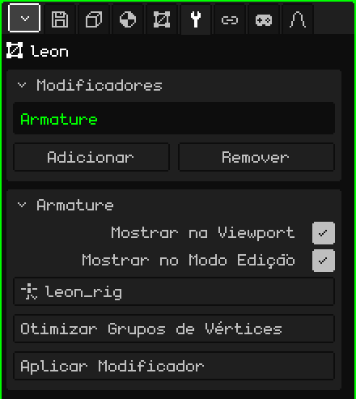

# Armação

O modificador **Armação** faz a malha seguir os ossos de uma armação: quando você posa ou anima a armação, a malha se dobra com ela. É o que transforma um modelo parado em um personagem que anda, pula ou acena.

## Como adicionar

1. Selecione a malha.
2. Em Propriedades, abra a aba **Modificadores** (o ícone da chave inglesa).
3. Toque em **Adicionar** e escolha **Armação**.

Na lista ele aparece com o seu nome interno, **Armature**, e embaixo se abre o cartão com os seus parâmetros. Como todos os modificadores, ele não destrói a malha: a pose de repouso continua intacta. Dá para desligá-lo, tirá-lo com **Remover** ou incorporá-lo à malha com **Aplicar Modificador**.

Ao importar um FBX ou um glTF com armação, o modificador já vem colocado e apontando para a sua armação.

## Parâmetros

| Parâmetro | O que faz |
|---|---|
| Mostrar na Viewport | Desligado, a malha não se deforma: fica na sua pose de repouso. |
| Mostrar no Modo Edição | Desligado, enquanto você edita os vértices a malha fica em repouso, sem deformar. |
| Alvo | A armação que a move. A lista mostra só as armações da cena. Em **Nenhum**, ela não se deforma. |
| Otimizar Grupos de Vértices | Deixa cada vértice com um só osso, o que mais o movia, com o peso completo. Pede confirmação porque os pesos intermediários se perdem. |
| Aplicar Modificador | Incorpora à malha a pose do quadro atual e tira o modificador: a malha fica congelada nessa pose. A armação não é alterada. Dá para desfazer. |

## Como a malha sabe qual osso a move

Com os **grupos de vértices**. Cada grupo tem o **mesmo nome de um osso** e diz quais vértices esse osso move e quanto: o **peso**, de 0 (nada) a 1 (tudo). Um vértice pode estar em vários grupos; em um cotovelo, metade no braço e metade no antebraço, para que ele dobre de forma suave.

Os grupos ficam na aba **Malha 3D**, cartão **Grupos de Vértices**:

| Botão | O que faz |
|---|---|
| Adicionar Grupo de Vértices / Renomear | Cria um grupo e dá um nome a ele. Tem que ser igual ao do osso, letra por letra. |
| Atribuir / Remover | No Modo Edição, coloca no grupo os vértices selecionados (com peso 1) ou os tira dele. |
| Selecionar / Desselecionar | Mostra quais vértices o grupo tem. |

Para os pesos finos, como as transições de ombros e joelhos, use a [Pintura de Pesos](pintura.md#pintura-de-pesos): ela pinta o peso do grupo escolhido, de azul (nada) a vermelho (tudo).

## Passo a passo

1. Monte a armação (**Adicionar → Armação**) e ajeite os ossos dentro do modelo (veja [Armações](esqueletos.md)).
2. Adicione à malha o modificador **Armação** e em **Alvo** escolha a armação.
3. Crie um grupo por osso, com o mesmo nome dele, e atribua ou pinte os pesos.
4. Selecione a armação, passe para o **Modo Pose** e mova um osso: a malha o segue.

## O que é bom saber

- O lugar da Armação na lista não muda nada: ela não é calculada junto com os outros, mas deforma a malha a cada quadro, ao desenhá-la.
- Ela deforma a malha original. Se houver outros modificadores ligados que geram geometria ([Espelho](modificador-espejo.md), [Array](modificador-array.md), [Superfície de Subdivisão](modificador-subdivision.md), [Parafuso](modificador-screw.md), [Booleano](modificador-booleano.md)), o que aparece é a malha gerada, que não segue os ossos. Aplique-os antes de animar.
- Aplicar um desses modificadores (exceto o Espelho) esvazia a lista inteira, e a Armação também vai embora. Os grupos de vértices ficam: adicione a Armação de novo e escolha outra vez o Alvo.

 No Nokia N95, deformar a malha a cada quadro custa caro, e mais ainda quanto mais ossos influenciam cada vértice. **Otimizar Grupos de Vértices** deixa um só por vértice e o skinning fica muito mais rápido; em troca, as articulações dobram de forma mais dura. Faça isso no final, quando os pesos já estiverem prontos.

Voltar para [Malha 3D](objeto-malla.md)
