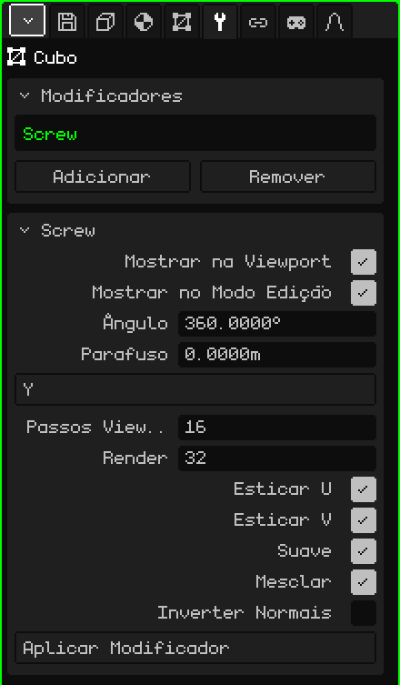

# Parafuso

O modificador **Parafuso** (*Screw*, em inglês) faz um perfil girar ao redor de um eixo e monta a superfície que ele deixa ao girar, como um torno. Você desenha meia silhueta de um vaso, de uma taça ou de uma garrafa, e o Parafuso a transforma no objeto inteiro. Se, além disso, o perfil subir enquanto gira, sai uma rosca ou uma mola.

## Como adicionar

1. Selecione a malha com o perfil.
2. Em Propriedades, abra a aba **Modificadores** (o ícone da chave inglesa).
3. Toque em **Adicionar** e escolha **Parafuso**.

Na lista ele aparece com o seu nome interno, **Screw**, e embaixo se abre o cartão com os seus parâmetros. Como todos os modificadores, ele não destrói a malha: o perfil continua ali e você pode editá-lo enquanto vê o resultado. Dá para desligá-lo, mudá-lo de lugar com **Subir** e **Descer**, tirá-lo com **Remover** ou incorporá-lo à malha com **Aplicar Modificador**.

## O perfil

O perfil é uma linha: vértices unidos por arestas, sem faces. O eixo do giro passa pela **origem** da malha, então a distância de cada vértice até a origem é o raio do objeto nessa altura. Um jeito de desenhá-lo:

1. **Adicionar → Malha → Vértice** cria um vértice solto na origem e entra direto no Modo Edição.
2. Olhe de frente (veja [Navegar na Viewport 3D](../tutoriales/navegacion.md#as-vistas-de-frente-de-lado-e-de-cima)).
3. Com **Extrudar Vértices** (menu Malha → Vértice), puxe o vértice seguinte para o lado para fazer o fundo, e depois para cima para a parede, ponto por ponto.

Os vértices que ficam sobre o eixo fecham o objeto: o primeiro, na origem, é o centro do fundo do vaso.

## Parâmetros

| Parâmetro | O que faz |
|---|---|
| Mostrar na Viewport | Desligado, o perfil não gira: aparece só o perfil, nem na vista nem ao renderizar. |
| Mostrar no Modo Edição | Desligado, enquanto você edita o perfil aparece só a linha. |
| Ângulo | Quantos graus o perfil gira, do primeiro passo ao último (por padrão, 360, a volta inteira). Com 180 sai meio objeto. Um valor negativo gira para o outro lado. Pode passar de 360: com 1080 dá três voltas. |
| Parafuso | Quantos metros o perfil sobe ao longo do eixo, do começo ao fim do giro. Em 0 é um torno (vaso, taça, garrafa); com outro valor, uma rosca ou uma mola. |
| Eixo | Ao redor de qual eixo ele gira: X, Y ou Z. Por padrão é **Z**, a vertical: um perfil desenhado na vista frontal sai em pé, como um vaso sobre a mesa. |
| Passos Viewport | Quantas cópias do perfil são feitas ao longo do giro na vista, de 2 a 512 (por padrão, 16). Mais passos, mais redondo e mais pesado. |
| Render | Os passos usados ao **Renderizar Imagem** ou **Renderizar Animação** (por padrão, 32). |
| Esticar U | Monta as coordenadas UV ao redor do giro, para que uma textura envolva o objeto como um rótulo. |
| Esticar V | Monta as coordenadas UV ao longo do perfil, de cima para baixo. Com os dois desligados não há UV. |
| Suave | Sombreamento suave na superfície gerada: ela parece redonda e não facetada. Vem ligado. |
| Mesclar | Solda os vértices que caem no mesmo lugar: os do perfil que tocam o eixo (o fundo, a boca de uma garrafa fechada) e a costura onde a volta se fecha. Vem ligado. |
| Inverter Normais | Inverte para onde as faces apontam. Use-o se o objeto parecer do avesso, escuro ou como visto por dentro. |
| Aplicar Modificador | Incorpora o resultado à malha com os **Passos Viewport**. Veja a nota abaixo. |

A volta se fecha sozinha, sem costura, só com o Ângulo em 360 e o Parafuso em 0. Com outro ângulo, ou com o perfil subindo, o começo e o fim ficam abertos.

## Exemplos

- **Um vaso:** o perfil de meia silhueta, Ângulo 360, Parafuso 0 e entre 16 e 32 passos.
- **Uma rosca:** um perfil curto afastado do eixo, Ângulo 1080 e Parafuso em 3: três voltas que sobem um metro cada uma. Aumente os passos para que a espiral não fique quebrada.

 No Nokia N95 cada passo é mais uma cópia do perfil para desenhar. Use poucos Passos Viewport enquanto modela e deixe os valores altos para Render.

> [!NOTE]
> Aplicar Modificador no Parafuso incorpora à malha **todos** os modificadores da lista que estiverem ligados, não só este, e deixa a lista vazia: também vão embora os que estavam desligados e os que não geram geometria, como uma [Armação](modificador-esqueleto.md). Dá para desfazer.

Voltar para [Malha 3D](objeto-malla.md)
