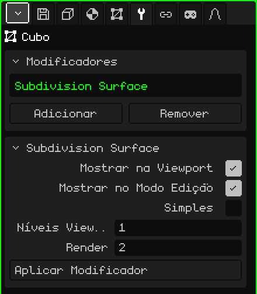

# Superfície de Subdivisão

O modificador **Superfície de Subdivisão** divide cada face em faces menores e, por padrão, arredonda a forma. Serve para modelar com poucos polígonos, o que é rápido de editar e leve, e ver o resultado suave: de um cubo sai algo parecido com uma esfera, e de um personagem low-poly, um de formas arredondadas.

## Como adicionar

1. Selecione a malha.
2. Em Propriedades, abra a aba **Modificadores** (o ícone da chave inglesa).
3. Toque em **Adicionar** e escolha **Superfície de Subdivisão**.

Na lista ele aparece com o seu nome interno, **Subdivision Surface**, e embaixo se abre o cartão com os seus parâmetros. Como todos os modificadores, ele não destrói a malha: dá para desligá-lo, mudá-lo de lugar com **Subir** e **Descer**, tirá-lo com **Remover** ou incorporá-lo à malha com **Aplicar Modificador**.

## Parâmetros

| Parâmetro | O que faz |
|---|---|
| Mostrar na Viewport | Desligado, a malha não é subdividida: nem na vista nem ao renderizar. |
| Mostrar no Modo Edição | Desligado, enquanto você edita aparece a malha sem subdividir e a edição fica mais rápida; ao voltar para o Modo Objeto, ela aparece suave de novo. |
| Simples | Desligado (por padrão), cada nível suaviza a forma e arredonda os cantos. Ligado, só divide as faces sem mover os vértices: a forma continua igual, mas com mais vértices, por exemplo para pintar cores de vértice com mais detalhe. |
| Níveis Viewport | Quantas vezes a malha é subdividida na vista, de 0 a 6 (por padrão, 1). Cada nível multiplica as faces por 4: um cubo de 6 faces passa a 24 com 1 nível, a 96 com 2 e a 384 com 3. Em 0 não é subdividida. |
| Render | Os níveis usados ao **Renderizar Imagem** ou **Renderizar Animação** (por padrão, 2). Assim a vista fica leve e a imagem final sai mais suave. |
| Aplicar Modificador | Incorpora a subdivisão à malha com os **Níveis Viewport** (não com os de Render). Veja a nota abaixo. |

## Como trabalhar com a subdivisão

- Funciona melhor com faces de quatro lados. Um triângulo é dividido em 3 quadriláteros e uma face de cinco lados, em 5.
- Subdividir não muda o sombreamento: uma malha plana continua parecendo facetada. Para vê-la lisa, no Modo Edição selecione as faces e use o menu Face → **Sombrear Suave**.
- Para que uma borda fique mais marcada, adicione um corte perto dela com **Loop Cut e Deslizar** (veja [Modo Edição](modo-edicion.md)): quanto mais perto da borda, mais dura ela fica.
- As bordas abertas, em uma malha que não está fechada, são suavizadas seguindo a borda.

## A ordem importa

Os modificadores são aplicados de cima para baixo. Coloque o [Espelho](modificador-espejo.md) **acima** da Subdivisão: assim o modelo inteiro é suavizado de uma vez. Se o Espelho ficar embaixo, cada metade é suavizada separadamente e no meio fica uma dobra. Com um [Array](modificador-array.md) acontece o mesmo: as cópias soldadas com Mesclar são suavizadas juntas.

 No Nokia N95 cada nível pesa: com 1 nível já há quatro vezes mais faces para desenhar, e com 2, dezesseis vezes mais. Deixe os Níveis Viewport em 0 ou 1, desligue Mostrar no Modo Edição enquanto modela e guarde os níveis altos para Render.

> [!NOTE]
> Aplicar Modificador na Subdivisão incorpora à malha **todos** os modificadores da lista que estiverem ligados, não só este, e deixa a lista vazia: também vão embora os que estavam desligados e os que não geram geometria, como uma [Armação](modificador-esqueleto.md). Dá para desfazer.

Voltar para [Malha 3D](objeto-malla.md)
