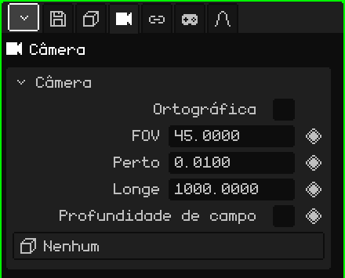

# Câmera

Uma **câmera** é um ponto de vista colocado na cena. A **câmera ativa** é a que serve para o jogo e para os renders: o que ela vê é o que se vê ao jogar e o que sai na imagem ou no vídeo. Este artigo é a referência das suas propriedades; como os objetos são adicionados e movidos está no tutorial [O Modo Objeto](../tutoriales/modo-objeto.md).

## As abas

| Aba | O que tem |
|---|---|
| Objeto | Posição, rotação, nome e visibilidade, igual a todos os objetos: veja [Malha 3D](objeto-malla.md#a-aba-objeto). |
| Câmera | A lente da câmera: o cartão abaixo. |
| Restrições | Veja [Restrições](restricciones.md). |
| Scripts | Os scripts Lua do objeto. Veja [Lua no Whisk3D](../lua/README.md). |

## O cartão Câmera

| Propriedade | O que faz |
|---|---|
| Ortográfica | Sem perspectiva: o que está longe não diminui e as linhas paralelas não se juntam. Veja [Perspectiva e ortográfica](../tutoriales/navegacion.md#perspectiva-e-ortográfica). |
| FOV ◆ | O ângulo de visão, em graus (de cima a baixo). Menor é como uma teleobjetiva: cabe menos e se vê mais de perto. Maior é uma grande angular: cabe mais e a perspectiva fica exagerada. Começa em 45. |
| Perto ◆ | A distância mínima de desenho: o que está mais perto da câmera não é desenhado. Começa em 0.01. |
| Longe ◆ | A distância máxima de desenho: o que está mais longe não é desenhado. Começa em 1000. |
| Profundidade de campo | Liga o desfoque: o que está na distância de foco sai nítido e o resto, borrado. Quem o desenha é o ray tracing; o Pós-processamento também pode usar o mesmo foco. |
| Abertura (f) | Quanto desfoca, como em uma câmera de verdade: um número menor desfoca mais. |
| Distância de foco ◆ | A quantos metros a câmera foca. A linha e a cruz desenhadas na câmera marcam onde. |
| Objeto de foco | Um objeto que o foco segue sozinho, esteja onde estiver. Com um objeto escolhido, Distância de foco desaparece. **Nenhum** volta à distância definida à mão. |
| Alvo | Um objeto para o qual a câmera ativa sempre olha: se o objeto se move, a câmera gira para segui-lo. **Nenhum** a deixa olhando para onde você a rotacionou. |

Abertura (f), Distância de foco e Objeto de foco aparecem com Profundidade de campo marcada.

### Quando mexer em Perto e Longe

Se uma parede ou um personagem muito colado na câmera aparece cortado, diminua **Perto**. Se o fundo de um cenário grande desaparece, aumente **Longe**. É melhor não esticar o intervalo mais do que o necessário: com muita distância entre Perto e Longe, as faces que estão muito juntas podem piscar, principalmente no Nokia N95.

Perto e Longe podem ser animados: serve, por exemplo, para afastar o limite de desenho quando a câmera sobe e mostra mais cenário.

### Uma câmera que segue um personagem

Há dois jeitos, conforme a tomada:

- **A câmera fica no lugar e gira:** coloque o personagem em **Alvo**. A câmera ativa o mantém no centro da tomada mesmo que ele corra, como alguém que o olha passar.
- **A câmera viaja com ele:** deixe Alvo em Nenhum e adicione a ela uma restrição **Child Of** com o personagem como fonte e só **Posição** marcada. Ela vai com ele à mesma distância e com o mesmo ângulo, sem girar quando ele gira (veja [Child Of](restricciones.md#child-of)).

## Escolher a câmera ativa

A cena pode ter várias câmeras, mas só uma ativa. Para mudá-la:

| | Como escolher |
|---|---|
|  PC | Selecionar a câmera e <kbd>Ctrl</kbd> + <kbd>Num 0</kbd> |
| Menu | Vista → Câmeras → Objeto Ativo como Câmera |
| Propriedades | Aba Animação → cartão **Câmera ativa** |

No cartão Câmera ativa, o losango monta **cortes de câmera**: passar de uma câmera para outra em um quadro. Veja [Linha do Tempo](linea-de-tiempo.md).

Para olhar pela câmera ativa e ajeitar a tomada navegando, veja [A câmera ativa](../tutoriales/navegacion.md#a-câmera-ativa) no tutorial de navegação.
