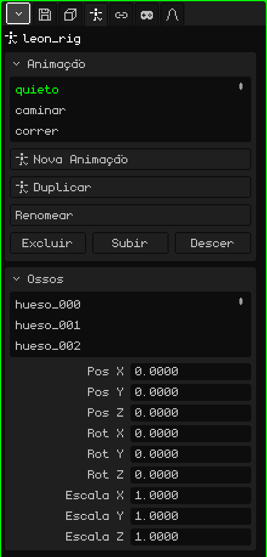

# Armação

Uma **armação** é um objeto feito de **ossos** que serve para animar personagens e coisas que se dobram. Os ossos se movem e a malha os segue, deformando-se: você anima um braço girando um par de ossos em vez de mover centenas de vértices. Este artigo é a referência das suas propriedades; como os objetos são adicionados e movidos está no tutorial [O Modo Objeto](../tutoriales/modo-objeto.md).

Adicionar → Armação cria uma com um só osso, pronta para receber mais. Na Viewport 3D, cada osso é desenhado como uma linha azul por cima de tudo, para que você o veja mesmo quando ele está dentro da malha.

## Repouso e pose

Cada osso tem dois jeitos de estar:

- **Repouso:** onde ele foi colocado ao montar a armação. É a postura em que a malha está sem deformar (um personagem com os braços abertos, por exemplo).
- **Pose:** como ele está em um quadro da animação: o braço levantado, a cabeça virada. Posar não muda o repouso: sempre dá para voltar a ele.

## Os modos

Uma armação tem três modos, que são escolhidos no menu **Modo** da Viewport 3D:

| Modo | Para que serve |
|---|---|
| Modo Objeto | Mover, rotacionar e escalar a armação inteira, como qualquer objeto. |
| Modo Edição | Montar a armação: criar ossos a partir das pontas, movê-los, parenteá-los. Muda o repouso. |
| Modo Pose | Posar e animar: girar os ossos e salvar keyframes. |

 <kbd>Tab</kbd> alterna entre o Modo Objeto e o Modo Pose (e, a partir do Modo Edição, passa para o Modo Pose).

As ferramentas e os atalhos de cada modo estão em [Armações](esqueletos.md), no manual.

## As abas

| Aba | O que tem |
|---|---|
| Objeto | Posição, rotação, escala, nome e visibilidade da armação inteira, igual a todos os objetos: veja [Malha 3D](objeto-malla.md#a-aba-objeto). |
| Armação | As animações e os ossos: os dois cartões abaixo. |
| Restrições | Veja [Restrições](restricciones.md). |
| Scripts | Os scripts Lua do objeto. Veja [Lua no Whisk3D](../lua/README.md). |

## A aba Armação

### Animação

As animações da armação (os **clipes**): andar, correr, pular. Cada clipe guarda as poses dos ossos ao longo do tempo.

| Propriedade | O que faz |
|---|---|
| A lista | Os clipes da armação. O escolhido é o que é editado e reproduzido. |
| Nova Animação | Cria um clipe vazio, com os ossos em repouso. |
| Duplicar | Copia o clipe escolhido, para fazer uma variante sem mexer no original (aparece se houver clipes). |
| Renomear | Muda o nome do clipe. Ele não pode se repetir dentro da mesma armação. |
| Excluir / Subir / Descer | Exclui o clipe ou o move na lista. |

Como animar: [Linha do Tempo](linea-de-tiempo.md).

### Ossos

A lista dos ossos da armação. Ao escolher um, o cartão mostra os dados dele:

| Propriedade | O que faz |
|---|---|
| Nome | O nome do osso. Ao mudá-lo, o grupo de vértices dele nas malhas da armação também é renomeado, e assim a malha continua seguindo-o. |
| Pai | De qual osso ele pende (**Nenhum** se for a raiz). Ao mover o pai, os filhos se movem. O menu não oferece o próprio osso nem os que pendem dele, para que não se forme um círculo. |
| Conectado | Só se ele tiver pai. Marcado, o começo do osso fica soldado à ponta do pai: mover um move o outro. Marcá-lo com o osso separado o move até encostá-lo. Desmarcado, ele continua sendo filho, mas com a ponta solta (aparece uma linha pontilhada). |
| Pos X, Y, Z | Onde o osso está na pose atual, medido a partir do pai. |
| Rot X, Y, Z | Quanto ele está girado na pose atual, em graus. |
| Escala X, Y, Z | O tamanho dele na pose atual: 1 é o original. |

Pos, Rot e Escala editam a **pose** e aparecem na hora, mas não ficam salvos na animação até você inserir um keyframe (Inserir Keyframe, no Modo Pose).

## Fazer uma malha seguir a armação

Para que uma malha se deforme com os ossos, são necessárias duas coisas:

1. **O modificador Armação** na malha (Propriedades → aba Modificadores → Adicionar → Armação), com a armação escolhida em **Alvo**. Veja [Armação (modificador)](modificador-esqueleto.md).
2. **Grupos de vértices** com os nomes dos ossos (Propriedades → aba Malha 3D → [Grupos de Vértices](objeto-malla.md#grupos-de-vértices)). Cada grupo diz quais vértices o seu osso move e quanto; os pesos são pintados com a [Pintura de pesos](pintura.md#pintura-de-pesos).

Para um objeto rígido, como uma espada na mão ou um chapéu, nada disso é necessário: basta uma restrição [Child Of](restricciones.md#child-of) com a armação como fonte e o osso da mão ou da cabeça. É muito mais leve que deformar uma malha, e no Nokia N95 isso se nota.

## Importar um personagem

Adicionar → Importar → glTF ou GLB traz um personagem montado de uma vez. Por exemplo, o Leon:

- a **malha**, como filha da armação;
- a **armação**, com o nome do arquivo e `_rig` no final;
- os **grupos de vértices**, um para cada osso que move a malha, com os pesos que o arquivo trazia;
- as **animações**, como clipes no cartão Animação;
- e, se o arquivo trouxer animações, o **modificador Armação** já colocado na malha, apontando para a sua armação.

Escolha um clipe da lista, dê Play na Linha do Tempo e o personagem se move.
