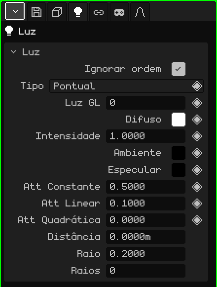

# Luz

Uma **luz** ilumina a cena: os materiais com Iluminação ligada ficam mais claros ou mais escuros conforme as luzes que chegam até eles. Este artigo é a referência das suas propriedades; como os objetos são adicionados e movidos está no tutorial [O Modo Objeto](../tutoriales/modo-objeto.md).

## Os três tipos

| Tipo | Como ilumina | Para quê |
|---|---|---|
| **Pontual** | A partir de um ponto, para todos os lados, como uma lâmpada. | Lâmpadas, velas, fogueiras, o brilho de um objeto. |
| **Sol** | Com raios paralelos que vêm todos do mesmo lado. Importa para onde ela aponta, não onde está. | A luz do dia em exteriores. |
| **Foco** | Em um cone, como uma lanterna. | Lanternas, faróis de um carro, refletores de um palco. |

Adicionar → Luz cria uma luz Pontual; Adicionar → Sol e Adicionar → Foco criam direto os outros dois. O tipo pode ser mudado depois na propriedade **Tipo**.

O sol e o foco são orientados rotacionando o objeto. O sol sempre desenha uma linha até o chão, para onde ilumina; com a luz selecionada, o foco mostra o seu cone e a pontual, uma esfera do tamanho da sua **Distância**.

## As abas

| Aba | O que tem |
|---|---|
| Objeto | Posição, rotação, nome e visibilidade, igual a todos os objetos: veja [Malha 3D](objeto-malla.md#a-aba-objeto). |
| Luz | O cartão abaixo. |
| Restrições | Veja [Restrições](restricciones.md). |
| Scripts | Os scripts Lua do objeto. Veja [Lua no Whisk3D](../lua/README.md). |

## O cartão Luz

| Propriedade | O que faz |
|---|---|
| Ignorar ordem | Marcado (como vem), a luz ilumina a cena toda, esteja onde estiver no Outliner. Desmarcado, ela só ilumina o que é desenhado **depois** dela no Outliner: serve para iluminar certas coisas com certas luzes. |
| Tipo | Pontual, Sol ou Foco. |
| Luz GL ◆ | Qual das 8 luzes do OpenGL ela usa (de 0 a 7). Veja [Mais de 8 luzes](#mais-de-8-luzes). |
| Difuso ◆ | A cor da luz. |
| Intensidade ◆ | Quão forte ela ilumina. 1 é a cor tal como é; mais é mais forte. |
| Ambiente ◆ | Uma luz uniforme que chega a todos os lugares, também às faces que não estão viradas para a luz. Começa em preto (sem ambiente). Aumente-a um pouco para que as sombras não fiquem pretas. |
| Especular ◆ | A cor do brilho que a luz deixa nos materiais. Começa em preto (sem brilho). |
| Att Constante, Att Linear, Att Quadrática ◆ | A **atenuação**: como a luz se apaga com a distância. Constante a enfraquece por igual em todos os lugares; Linear a apaga aos poucos ao se afastar; Quadrática a apaga muito mais rápido longe. Não aparecem no Sol. |
| Ângulo Spot ◆ | Só no Foco: quão aberto é o cone, em graus, do centro até a borda. Com 45, o cone abre 90° no total. |
| Expoente Spot ◆ | Só no Foco: como a luz se distribui no cone. 0 ilumina por igual; mais alto a concentra no centro e escurece as bordas. |
| Distância | Até onde uma luz Pontual ou um Foco ilumina no ray tracing, em metros; também é o comprimento do cone desenhado. 0 é sem limite. Não aparece no Sol. |
| Raio | Para o ray tracing: o tamanho da lâmpada. 0 dá sombras duras, de borda nítida; maior dá sombras de borda suave. No Sol são graus. |
| Raios | Para o ray tracing: quantos raios de sombra esta luz lança. Mais raios, sombras suaves mais limpas, porém mais lentas. 0 usa os da aba Arquivo / Render. |

### Distância e atenuação

As duas mudam até onde uma luz se nota, mas não do mesmo jeito:

- A **atenuação** vale sempre, na Viewport 3D, no jogo e no ray tracing: a luz vai se apagando com a distância, mas nunca é cortada de todo.
- A **Distância** é um corte para o ray tracing: a luz se apaga suavemente até chegar a zero exatamente ali, e além disso não ilumina. No OpenGL ela não corta: ali quem manda é a atenuação. Serve também como guia, porque a esfera ou o cone mostram onde ela termina.

## Mais de 8 luzes

O OpenGL desenha até **8 luzes ao mesmo tempo**, numeradas de 0 a 7: é a propriedade **Luz GL**. A cena pode ter muito mais; passadas as 8, as novas compartilham o número com alguma das anteriores. O ray tracing, por outro lado, usa todas.

Com **Ignorar ordem** desmarcado, dá para reutilizar um número de propósito: uma luz com a Luz GL 0 ilumina o que é desenhado depois dela no Outliner, e outra luz mais abaixo com a mesma Luz GL 0 a substitui para o que vem em seguida. Assim um cenário longo pode ter luzes diferentes em cada zona sem passar de 8.

## Exemplos

| Cena | Como montar |
|---|---|
| Um exterior de dia | Um Sol, com Difuso levemente amarelo, e um pouco de Ambiente azul-claro para que as sombras não fiquem pretas. |
| Um quarto com uma lâmpada | Uma Pontual na lâmpada, com Att Linear um pouco mais alta para que ela se apague em direção às paredes. Para o ray tracing, uma Distância do tamanho do quarto. |
| Uma lanterna | Um Foco com um Ângulo Spot pequeno e um Expoente Spot alto, preso à mão do personagem com uma restrição [Child Of](restricciones.md#child-of). |
| Uma luz que pisca | Keyframes na Intensidade (◆), com valores que sobem e descem. |
