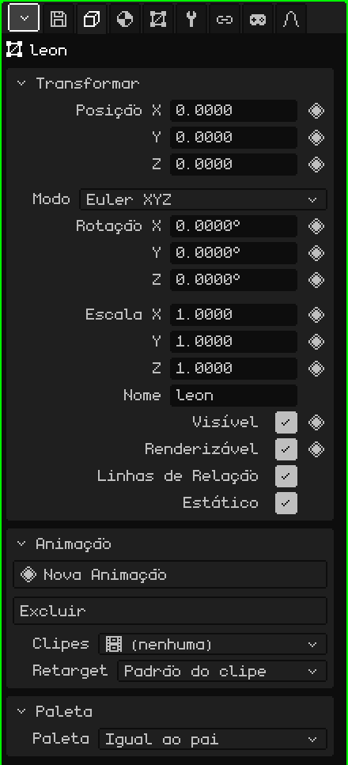
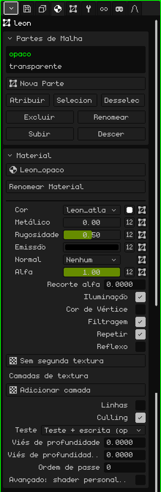
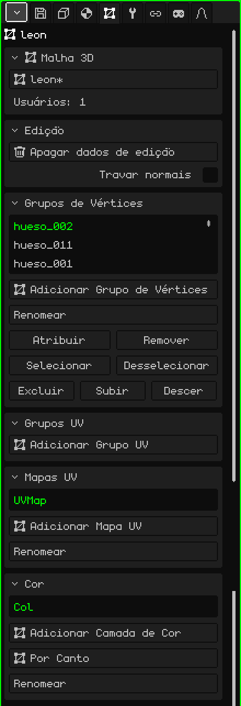
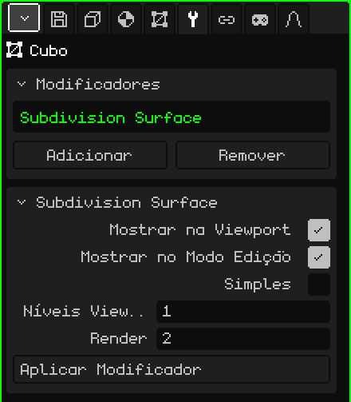

# Malha 3D

Uma **malha 3D** é o objeto que tem forma: ela é feita de vértices, arestas e faces, e é o que se modela, se pinta e se anima. Um cubo, um personagem ou um cenário inteiro são malhas. Este artigo é a referência das suas propriedades; como os objetos são criados, movidos e parenteados está no tutorial [O Modo Objeto](../tutoriales/modo-objeto.md).

## As abas

Com uma malha selecionada, Propriedades mostra estas abas, além de Arquivo / Render e Animação, que estão sempre ali:

| Aba | O que tem |
|---|---|
| Objeto | O que é comum a todos os objetos: posição, rotação, escala, nome e visibilidade. |
| Material | As partes da malha e o material de cada uma. |
| Malha 3D | Os dados da malha: qual ela usa, os seus grupos de vértices, os seus mapas UV e as suas camadas de cor. |
| Modificadores | Os modificadores, que mudam a forma sem destruí-la. |
| Transformar | Só no Modo Edição: o centro do que está selecionado, para digitá-lo com números. |
| Restrições | Veja [Restrições](restricciones.md). |
| Scripts | Os scripts Lua do objeto. Veja [Lua no Whisk3D](../lua/README.md). |

## A aba Objeto

Ela é igual para todos os tipos de objeto: câmeras, luzes, armações e sons também a têm.

### Transformar

| Propriedade | O que faz |
|---|---|
| Posição X, Y, Z ◆ | Onde o objeto está, em metros. Z é a altura. |
| Modo | Como a rotação é escrita: **Euler XYZ** (três ângulos em graus, o mais fácil de ler), **Quaternion (WXYZ)** ou **Ângulo de Eixo**. Com os dois últimos aparece **Rotação W**. Mudar o modo não gira o objeto: só muda como os números são mostrados. |
| Rotação X, Y, Z ◆ | O giro em cada eixo. |
| Escala X, Y, Z ◆ | O tamanho em cada eixo: 1 é o tamanho original, 2 o dobro e 0.5 a metade. |
| Nome | O nome do objeto, o mesmo que o Outliner mostra. Não pode se repetir: se já existir, ele recebe um número (`.001`). |
| Visível ◆ | Se o objeto aparece. É o mesmo olho do Outliner. |
| Renderizável ◆ | Se ele sai nos renders. Desmarcado, continua aparecendo na Viewport 3D, mas não aparece na imagem nem no vídeo. |
| Linhas de Relação | A linha que une o objeto ao pai. Vale a pena desligá-la quando um objeto tem muitos filhos e as linhas tapam a vista. |
| Estático | Marca que o objeto nunca se move. Só importa dentro de um objeto Culling com o método de grade: um objeto estático é colocado na sua célula uma só vez, em vez de ser medido a cada quadro. |

### Animação e Paleta

- **Animação:** as animações próprias do objeto, como uma animação de vértices, e os seus clipes. Veja [Linha do Tempo](linea-de-tiempo.md).
- **Paleta:** qual paleta de cores o objeto usa. Com **Igual ao pai** (como vem) ele a herda; escolher uma paleta do projeto repinta o objeto e tudo o que pende dele.

## A aba Material

### Partes de Malha

Uma malha pode estar dividida em **partes**, e cada parte tem o seu material. Uma casa, por exemplo, pode ter as paredes em uma parte e o vidro das janelas em outra.

| Propriedade | O que faz |
|---|---|
| A lista | As partes da malha. A escolhida é a que o cartão Material abaixo mostra. |
| Nova Parte | Cria uma parte vazia. |
| Atribuir | Passa para a parte escolhida as faces selecionadas no Modo Edição. |
| Selecionar / Desselecionar | Seleciona ou desseleciona as faces dessa parte. Se for preciso, Selecionar passa para o Modo Edição para mostrá-las. |
| Excluir / Renomear | Exclui a parte (as faces dela passam para a anterior) ou muda o nome dela. Excluir aparece se houver mais de uma. |
| Subir / Descer | Mudam a ordem. As partes são desenhadas nessa ordem: é melhor deixar o que é transparente no final. |

### Material

O material decide como a parte aparece: a cor, a textura e como a luz bate nela. O material padrão não é editável: para mudar algo, primeiro crie um com o seletor de cima (**Novo Material**), que também serve para escolher outro material do projeto. As opções mais usadas:

| Propriedade | O que faz |
|---|---|
| Renomear Material | Muda o nome do material. |
| Cor | A textura da parte, o quadradinho da **Cor Base** e o mapa UV que a textura usa. |
| Metálico, Rugosidade, Emissão, Normal, Alfa | Cada um pode ser um número ou uma textura (o botão **Número / textura**). Alfa é a transparência: com menos de 1, ou com uma textura de alfa, o material passa a ser transparente. |
| Recorte alfa | Corta o que tem alfa baixo, sem misturar: para grades, alambrados ou folhas. 0 o desliga. |
| Transmissão, IOR | Vidro e refração. Só com o **Ray Tracing** ligado (aba Arquivo / Render). |
| Iluminação | Se as luzes da cena a iluminam. Desligada, a cor aparece chapada, sempre igual. Se o backend gráfico tiver shaders, aparece **Sombreamento**: Por vértice ou Por pixel. |
| Cor de Vértice | Usa as cores pintadas na malha (veja [Pintura de vértices](pintura.md#pintura-de-vértices)) em vez da cor base. |
| Filtragem / Repetir | Suaviza a textura de perto (desmarcado, os pixels aparecem) / a repete como um mosaico. |
| Reflexo | Um reflexo do ambiente, como cromo. |
| Camadas de textura | Até quatro texturas a mais por cima da primeira, cada uma com o seu mapa UV e a sua mistura. |
| Linhas / Espessura da linha | Desenha as arestas da parte, com a espessura em pixels. |
| Culling | Não desenha as faces de trás. |
| Teste, Viés de profundidade, Ordem de passe | Opções avançadas de profundidade, para decalques e coisas que se apoiam sobre outras. |
| Avançado: shader personalizado | Um arquivo que desenha o material sob medida: veja [Shaders escritos](shaders.md). |

Se o objeto tem física (Adicionar → Física), o cartão **Física** dele também aparece nesta aba.

## A aba Malha 3D

### Malha 3D

A forma do objeto é um recurso do projeto, e vários objetos podem **compartilhar** a mesma malha (é o que Duplicar Vinculado faz): editar uma edita todas.

| Propriedade | O que faz |
|---|---|
| O seletor | A malha que o objeto usa (com um `*` se tiver alterações não salvas). Dali você escolhe outra malha do projeto ou **Nova cópia**. |
| Usuários | Quantos objetos da cena usam esta malha. |
| Tornar única | Aparece se a malha estiver compartilhada: dá ao objeto a sua própria cópia, para editá-la sem mexer nos outros. |

Se a malha for de uma biblioteca, aparece o aviso "Pertence a uma biblioteca (somente leitura): abra a biblioteca para editá-lo", e o que a mudaria desaparece do painel.

### Edição

**Apagar dados de edição** serve para um cenário que não vai mais ser modelado: tira da malha os dados que o Modo Edição usa, e assim ela carrega mais rápido e ocupa menos memória (importa no Nokia N95). Enquanto isso, não dá para entrar no Modo Edição. **Converter em malha editável** os calcula de novo.

A caixa **Travar normais** faz com que, no Modo Edição, as normais desta malha não sejam recalculadas ao mover vértices. Assim são preservadas as que vieram com um modelo importado ou as que foram arrumadas à mão. Ela vem desligada, e cada malha tem a sua.

### Grupos de Vértices

Um **grupo de vértices** é uma lista de vértices com um peso cada um. É o que uma [armação](objeto-esqueleto.md) usa para saber quais vértices cada osso move: o grupo tem o mesmo nome do osso. Os pesos são pintados com a [Pintura de pesos](pintura.md#pintura-de-pesos).

| Propriedade | O que faz |
|---|---|
| Adicionar Grupo de Vértices / Renomear | Cria um grupo ou muda o nome dele. |
| Atribuir / Remover | Coloca no grupo (com peso 1) ou tira dele os vértices selecionados no Modo Edição. |
| Selecionar / Desselecionar | Seleciona ou desseleciona os vértices do grupo, para ver o que ele pega. |
| Excluir / Subir / Descer | Exclui o grupo ou o move na lista. |

**Grupos UV** funciona igual, mas os pesos dele são para as armações 2D do [Editor UV](editor-uv.md).

### Mapas UV

Um **mapa UV** diz como a textura se apoia sobre a malha. Uma malha pode ter vários: por exemplo, um para a textura de cor e outro para uma camada de textura que se repete de outro jeito. Cada textura do material escolhe qual usa.

**Adicionar Mapa UV** cria um, **Renomear** muda o nome dele, e Excluir, Subir e Descer aparecem quando há mais de um.

### Cor

As **camadas de cor** guardam as cores pintadas na malha com a Pintura de vértices. **Adicionar Camada de Cor** cria uma; **Modo de Cor** alterna entre **Por Vértice** (as faces que compartilham um vértice compartilham a cor dele) e **Por Canto** (cada face pode ter a sua, para bordas duras). Renomear, Excluir, Subir e Descer, como nos mapas UV.

## A aba Modificadores

Um **modificador** muda a malha sem destruí-la: dá para desligá-lo, reordená-lo ou excluí-lo quando você quiser, e a malha original continua ali.

O cartão **Modificadores** tem a lista (eles são aplicados em ordem, de cima para baixo), **Adicionar** (o menu com os tipos), **Remover** e **Subir / Descer**. Embaixo, o cartão do modificador escolhido (com o nome dele como título) traz **Mostrar na Viewport** (desligado, ele não é calculado), **Mostrar no Modo Edição** (desligado, editar é mais rápido e ele é recalculado ao sair), as suas propriedades e **Aplicar Modificador**, que o incorpora à malha e o tira da lista.

Cada modificador tem o seu artigo:

| Modificador | Para que serve |
|---|---|
| [Parafuso](modificador-screw.md) | Gira um perfil ao redor de um eixo: parafusos, vasos, molas. |
| [Espelho](modificador-espejo.md) | Reflete a malha: você modela uma metade e a outra sai sozinha. |
| [Array](modificador-array.md) | Cópias em fila: escadas, cercas, correntes. |
| [Superfície de Subdivisão](modificador-subdivision.md) | Suaviza a malha subdividindo-a. |
| [Booleano](modificador-booleano.md) | Une, faz a interseção ou subtrai outro objeto. |
| [Culling](modificador-culling.md) | Otimização: não desenha o que não se vê da câmera. |
| [Armação](modificador-esqueleto.md) | Deforma a malha com uma armação. |
