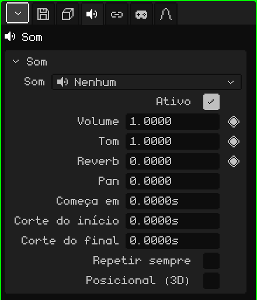

# Som

Um objeto **Som** é um áudio colocado na cena: uma música, um efeito, o barulho de uma máquina. Na Viewport 3D ele aparece como um alto-falante. Pode soar igual em todos os lugares, como uma música, ou a partir de onde está, mais alto quanto mais perto. Este artigo é a referência das suas propriedades; como os objetos são adicionados e movidos está no tutorial [O Modo Objeto](../tutoriales/modo-objeto.md).

Um objeto Som novo começa sem áudio: **Nenhum**. O arquivo é escolhido no cartão Som.

## Com o som já escolhido

-  Arrastar um som da [Biblioteca](outliner.md#vista-biblioteca) para a Viewport 3D cria um objeto Som onde ele cai, com esse som.
-  Soltar um arquivo de som (por exemplo um `.wav`) sobre a Viewport 3D o adiciona ao projeto e cria o objeto ali.

## As abas

| Aba | O que tem |
|---|---|
| Objeto | Posição, nome e visibilidade, igual a todos os objetos: veja [Malha 3D](objeto-malla.md#a-aba-objeto). Um som oculto não toca, e ocultar uma coleção cala os sons que estão dentro dela. |
| Som | O cartão abaixo. |
| Restrições | Veja [Restrições](restricciones.md). |
| Scripts | Os scripts Lua do objeto, que podem fazê-lo tocar ou calá-lo em um jogo. Veja [Lua no Whisk3D](../lua/README.md). |

## O cartão Som

| Propriedade | O que faz |
|---|---|
| Som | O arquivo que toca, com a sua duração. O menu lista os sons do projeto, **Nenhum** e **Carregar som do explorador...**, que traz um do disco para o projeto. |
| Ativo | Desmarcado, não toca. Serve para desligá-lo sem excluí-lo. |
| Volume ◆ | Quão alto ele soa: 1 é o volume do arquivo, 0 é mudo e 2 o dobro. |
| Tom ◆ | Mais agudo ou mais grave. 1 é o original; 2 soa uma oitava mais agudo e duas vezes mais rápido, 0.5 uma oitava mais grave e na metade da velocidade. Por isso mudar o tom também muda quanto ele dura. |
| Reverb ◆ | Quanto deste som vai para o eco da reverberação: 0 nada, 1 tudo. Dá a sensação de caverna, de igreja ou de corredor. |
| Pan | De que lado ele soa: -1 à esquerda, 0 no meio, 1 à direita. Só sem Posicional (3D): com ele, quem decide o lado é onde o objeto está. |
| Começa em | Em que segundo da cena ele começa. |
| Corte do início | Quantos segundos são cortados do começo do arquivo. |
| Corte do final | Quantos segundos são cortados do final do arquivo. |
| Repetir sempre | O trecho que fica entre os dois cortes se repete sem parar, sem interrupções. Para músicas de fundo e ruídos contínuos. |
| Posicional (3D) | Soa a partir de onde o objeto está. Veja abaixo. |
| Raio de volume pleno | Só com Posicional (3D): até esta distância, em metros, ele soa por inteiro. |
| Alcance audível | Só com Posicional (3D): a partir desta distância, em metros, ele não é mais ouvido. |

## Os tempos são em segundos

Os tempos do som são medidos em **segundos**, não em quadros. Assim, se a cena passar de 30 para 60 quadros por segundo, os sons continuam presos ao mesmo momento e não é preciso reajustar nada.

Na [Linha do Tempo](linea-de-tiempo.md#sons), cada som selecionado tem a sua **faixa**: onde começa e quanto dura. Arrastar a faixa muda **Começa em**, e pegar uma das suas pontas muda os cortes. Ele toca com o Play da linha do tempo e se cala ao parar.

Em um jogo, o som começa quando aparece (por exemplo, o de uma explosão que faz parte de um prefab), mais o que **Começa em** disser.

## Posicional (3D)

Desmarcado, o som é ouvido igual esteja onde estiver, como uma música. Marcado, ele é ouvido **a partir de onde está**, em relação a quem escuta:

- Mais perto, mais alto: até o **Raio de volume pleno** ele soa por inteiro, e dali vai baixando até se apagar no **Alcance audível**.
- Se está à direita, soa pela direita; se está à esquerda, pela esquerda.
- Se está atrás, soa mais baixo e mais para o meio.

Quem escuta é a câmera ativa no jogo e a Viewport 3D ativa no editor (ou a câmera, se você estiver olhando por ela). Com o som selecionado, a Viewport 3D desenha duas esferas: a do raio de volume pleno e a do alcance audível.

## Exemplos

| Som | Como montar |
|---|---|
| Música de fundo | Sem Posicional (3D), com Repetir sempre. |
| Uma cachoeira | Posicional (3D) e Repetir sempre, com um Raio de volume pleno pequeno e um Alcance audível grande: começa a ser ouvida de longe e cresce ao se aproximar. |
| Uma pancada aos 4 segundos de uma animação | Começa em 4, ou a faixa movida até ali na Linha do Tempo. A 30 FPS é o quadro 121: o quadro 1 é o segundo 0. |
| Uma música que se apaga no final | Keyframes no Volume (◆): 1 um pouco antes do final e 0 no final. |
