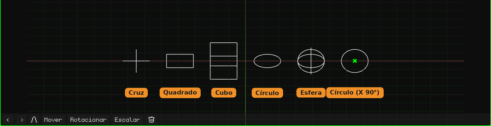

# Vazio

Um **Vazio** é um objeto sem malha: não aparece ao renderizar nem no jogo. Ele serve como ponto de referência: um pivô para girar ou escalar outros objetos que pendem dele, um lugar para onde apontar uma câmera ou uma restrição, um controle para animar. É adicionado com **Adicionar → Vazio**, no cursor 3D. Como os objetos são adicionados e movidos está no tutorial [O Modo Objeto](../tutoriales/modo-objeto.md).

Na Viewport 3D ele é desenhado com linhas. Um Vazio novo é um **círculo deitado no chão**, fácil de ver e de pegar. A forma, o tamanho e o giro do desenho são mudados no seu cartão. É **só a aparência**: não muda o objeto, nem a sua transformação, nem os seus filhos.

## As abas

| Aba | O que tem |
|---|---|
| Objeto | Posição, rotação, escala, nome e visibilidade, igual a todos os objetos: veja [Malha 3D](objeto-malla.md#a-aba-objeto). Escalar o Vazio também escala os seus filhos. |
| Vazio (a cruz) | O cartão abaixo. |
| Restrições | Veja [Restrições](restricciones.md). |
| Scripts | Os scripts Lua do objeto. Veja [Lua no Whisk3D](../lua/README.md). |

## O cartão Vazio

| Propriedade | O que faz |
|---|---|
| Forma | Como ele é desenhado, cada uma com o seu ícone: **Cruz** (os três eixos), **Quadrado**, **Cubo**, **Círculo** ou **Esfera** (três círculos, um por eixo). O quadrado e o círculo nascem deitados no chão. Nas telas pequenas (o Nokia N95, o PSP, o 3DS e o Dreamcast) o círculo e a esfera são desenhados com metade das linhas: ali não se nota a diferença e o aparelho desenha menos. |
| Tamanho | O que o desenho mede, em metros, de ponta a ponta. 1 é um metro. |
| Rotação X, Y, Z | Gira o desenho, em graus. Por exemplo, o círculo com **X** em 90 fica em pé. |

Nada disso move nem gira o objeto: o Vazio continua no mesmo lugar e os seus filhos nem ficam sabendo. Isso é salvo com o projeto.

## Para que serve

- **Um pivô:** um objeto filho de um Vazio gira e é escalado a partir do Vazio. Por exemplo, uma bola parenteada a um Vazio colocado no seu ponto de baixo se achata contra o chão ao escalar o Vazio.
- **Organizar a cena:** vários objetos pendurados em um Vazio se movem juntos movendo só o Vazio.
- **Um alvo:** as [restrições](restricciones.md) podem apontar para um Vazio, por exemplo para que uma câmera continue olhando para ele.
