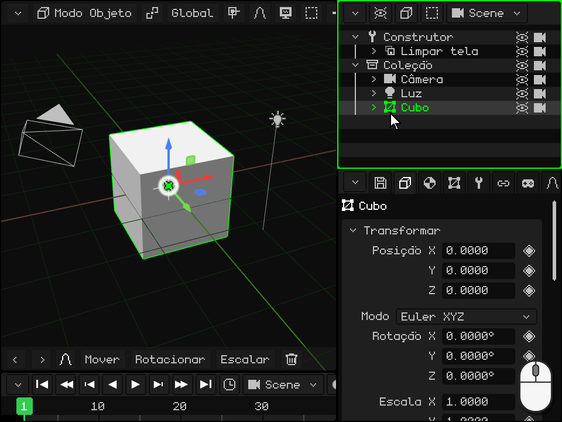
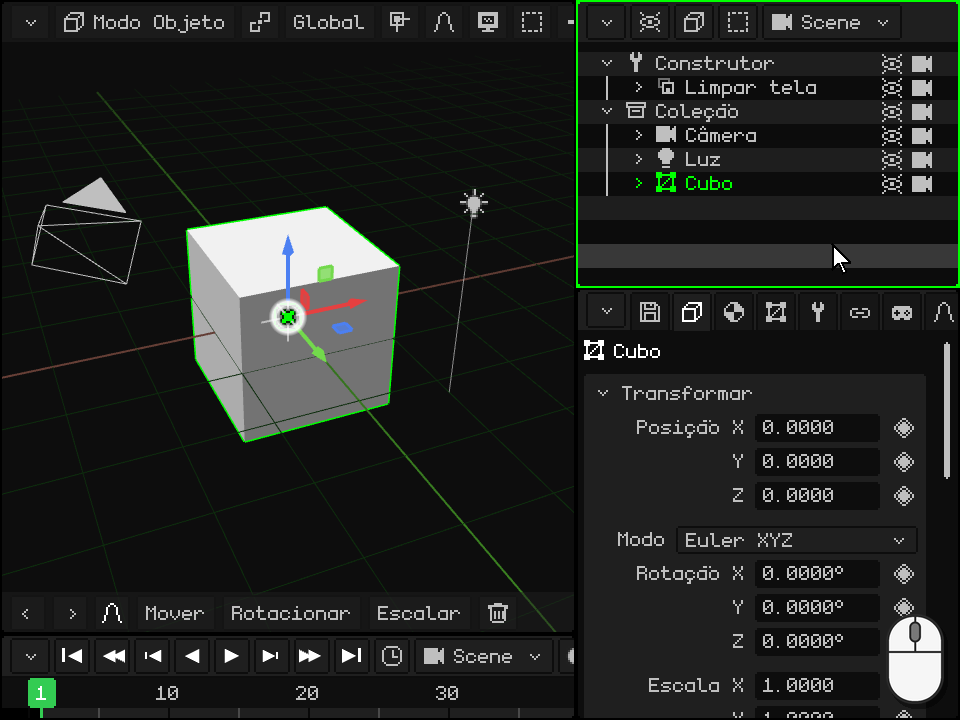
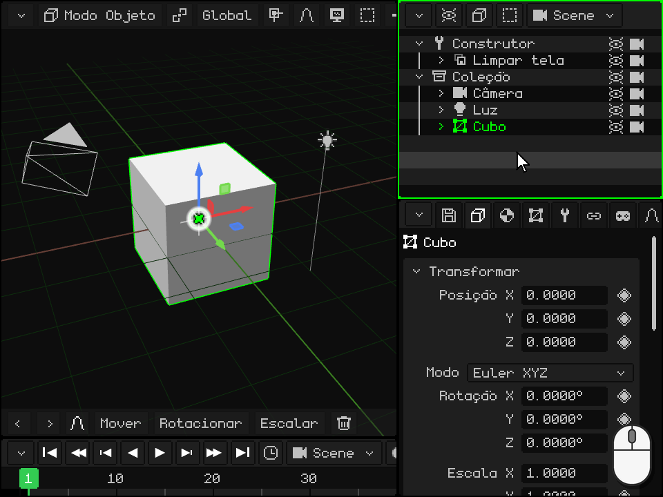
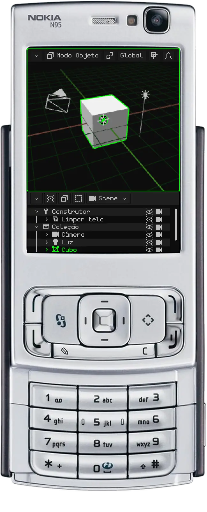
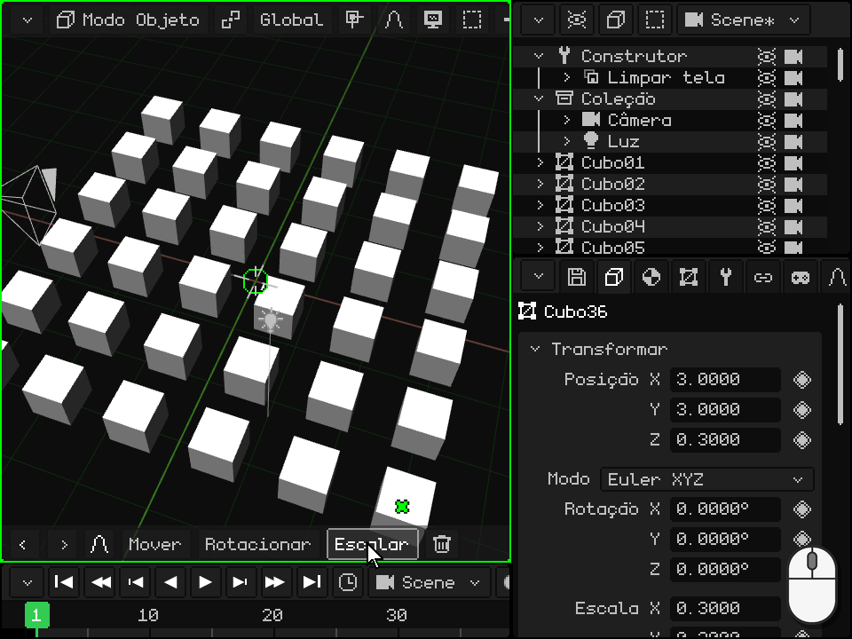

# O Outliner

> [!NOTE]
>  O Nokia N95 suporta mouse e teclado (por Bluetooth). As partes desta página sobre o Nokia explicam como usá-lo sem mouse nem teclado, só com as teclas do telefone.

O **Outliner** é a lista de tudo o que há na cena: objetos, câmeras, luzes e coleções. É uma das viewports vistas em [As viewports](interfaz.md); no PC, fica no canto superior direito. Daqui você seleciona os objetos, oculta-os, organiza-os, coloca uns dentro de outros e muda o nome deles.

O que você seleciona no Outliner fica selecionado também na Viewport 3D, e vice-versa. O último que você selecionou é o **objeto ativo**: o que as Propriedades mostram.

 **No Android** o Outliner não vem na tela: o espaço fica para a Viewport 3D e as Propriedades. Para usá-lo, transforme uma viewport em Outliner (ou divida uma) com o botão do canto, como em [Mudar o tipo](interfaz.md#mudar-o-tipo). Também dá para trabalhar sem o Outliner: os objetos são selecionados tocando neles na Viewport 3D, e as Propriedades têm o nome e as caixas **Visível** e **Renderizável**.

 **No Nokia N95** o Outliner não vem na tela: só cabem duas viewports. Enquanto você organiza a cena, transforme as Propriedades em Outliner: com a **soft esquerda** você entra nas abas dela e com a seta esquerda chega ao menu do botão do canto; ali, escolha Outliner. Para voltar, a soft esquerda no Outliner abre esse menu diretamente. Com a **tecla verde**  você o torna a viewport ativa: tudo o que vem a seguir sobre o N95 é com a borda verde no Outliner.

## O que cada linha mostra

Cada linha é um objeto. A **seta** recolhe ou expande o que há dentro dele; o **ícone** indica o tipo (malha, câmera, luz, coleção...); depois vem o **nome**, em verde se for o ativo e em um verde mais escuro se estiver selecionado; e à direita, o **olho** e a **câmera**. Um objeto que está dentro de outro aparece mais à direita, pendurado nele, e uma linha apagada é um objeto oculto.

Em um projeto novo, em cima fica o **Construtor**, uma rotina que prepara a tela, e embaixo a **Coleção** com a câmera, a luz e o cubo. Uma coleção é uma pasta para organizar.

## Selecionar

| | Como selecionar |
|---|---|
|  PC | Um clique na linha seleciona só esse objeto. <kbd>Shift</kbd> + clique seleciona todas as linhas desde o ativo até essa. <kbd>Ctrl</kbd> + clique adiciona ou remove uma. Com o mouse sobre o Outliner, as setas para cima e para baixo passam para a linha anterior ou para a seguinte. |
|  Tela touch | Um toque na linha. Com **Shift** ou **Ctrl** ligados na barra de ferramentas da Viewport 3D, o toque faz o mesmo que com o teclado. Arrastar o dedo rola a lista. |
|  Nokia N95 | As setas para cima e para baixo passam para a linha anterior ou para a seguinte, e a lista rola sozinha para acompanhá-la. |
| Menu | Selecionar → Selecionar tudo, Desselecionar tudo ou Inverter seleção |

## Recolher e expandir

Quando um objeto tem outros dentro dele, a seta dele os mostra ou os esconde. Recolher o que você não está usando deixa a lista curta.

| | Como recolher e expandir |
|---|---|
|  PC | Um clique na seta. Com o mouse sobre o Outliner, a seta para a direita do teclado expande o ativo e a para a esquerda o recolhe; se ele já estava recolhido, a esquerda sobe para o de fora e o recolhe. |
|  Tela touch | Um toque na seta. |
|  Nokia N95 | Direita expande o ativo e esquerda o recolhe; se ele já estava recolhido, esquerda sobe para o de fora e o recolhe. |

## Ocultar: o olho e a câmera

- O **olho** mostra ou oculta o objeto na Viewport 3D. Um objeto oculto também não sai no render. Se ele tiver outros dentro, eles são ocultados junto e as linhas deles ficam apagadas.
- A **câmera** decide se ele sai no **render**. Desligada, o objeto continua visível enquanto você trabalha, mas não aparece nas imagens nem nos vídeos que você renderiza.

Mexer neles não muda a seleção.

| | O olho | A câmera |
|---|---|---|
|  PC | Clique no olho, ou <kbd>H</kbd> (com o mouse sobre o Outliner) para o ativo | Clique na câmera |
|  Tela touch | Um toque no olho | Um toque na câmera |
|  Nokia N95 | <kbd>2</kbd>, o do ativo | <kbd>3</kbd>, a do ativo |
| Menu | Elemento → Ocultar/Mostrar (o do ativo) | — |

Os dois também estão nas Propriedades, no cartão Transformar: **Visível** e **Renderizável**. Eles têm o seu losango, então dá para animá-los: por exemplo, para que algo apareça em um momento do vídeo.

## Organizar e colocar um objeto dentro de outro

A ordem da lista pode ser mudada, e um objeto pode ser colocado **dentro** de outro: ele passa a ser **filho** dele, e quando o pai se move, rotaciona ou escala, o filho o acompanha. É o que em [O Modo Objeto](../tutoriales/modo-objeto.md#o-outliner-os-objetos-da-cena) se chama **parentear**. O objeto não sai do seu lugar na cena: só muda na lista.

 **Com o mouse:** pegue a linha e arraste-a. Sobre a borda de cima ou de baixo de outra linha aparece uma **linha verde**: ao soltar, o objeto fica antes ou depois dessa linha, no mesmo nível dela. Sobre o meio de outra linha, essa linha fica destacada: ao soltar, o objeto fica **dentro** dela. Solto abaixo da última linha, ele sai de tudo o que o continha. Perto da borda de cima ou de baixo, a lista rola sozinha, e assim se chega a qualquer linha de uma lista longa.

 **Com o dedo:** mantenha o dedo parado sobre a linha por um segundo, até o telefone vibrar: a linha fica presa. Depois arraste-a e solte-a do mesmo jeito que com o mouse. Se você soltá-la sem movê-la, o menu do objeto se abre. Sem essa espera, arrastar o dedo rola a lista.

 **No Nokia N95:** selecione a linha com as setas e aperte <kbd>1</kbd>. A linha fica verde, e agora as setas a movem:

-  **Cima** e **baixo** a sobem ou descem entre as que estão no mesmo nível dela.
-  **Direita** a coloca dentro da que está acima dela, no mesmo nível.
-  **Esquerda** a tira de dentro do que a contém: ela fica depois dele, no nível dele.
-  <kbd>1</kbd> de novo (ou <kbd>OK</kbd>) a deixa ali. <kbd>C</kbd> cancela e a devolve para onde estava.

 Todo o percurso é desfeito de uma vez, com <kbd>C</kbd> + esquerda. Serve, por exemplo, para colocar uma luz antes dos objetos que ela ilumina.

## Encontrar o ativo e enquadrá-lo

Em uma cena grande a lista é longa, e selecionar algo na Viewport 3D não a move: a linha dele pode ficar fora da vista. Para encontrá-la na lista, ou para ver o objeto na Viewport 3D (**enquadrá-lo**, como em [Enquadrar a seleção](../tutoriales/navegacion.md#enquadrar-a-seleção)):

| | No Outliner | Na Viewport 3D |
|---|---|---|
|  PC | <kbd>Num .</kbd> com o mouse sobre o Outliner (**Mostrar o ativo**): a lista rola até o que está selecionado ficar no meio. Se ele estiver dentro de algo recolhido, não tem linha: expanda primeiro. | <kbd>Num .</kbd> com o mouse sobre a Viewport 3D |
|  Tela touch | Arraste a lista com o dedo | Toque duplo com dois dedos sobre a Viewport 3D |
|  Nokia N95 | A lista acompanha sozinha a linha que você seleciona com as setas | Um toque no <kbd>0</kbd>, mesmo que a viewport ativa seja o Outliner |
| Menu | — | Vista → Enquadrar Seleção, na barra da Viewport 3D |

## Renomear

| | Como renomear |
|---|---|
|  PC | Clique duplo no nome, ou <kbd>F2</kbd> para o ativo: a linha vira um campo de texto. Digite o nome novo e confirme com <kbd>Enter</kbd> ou com um clique fora; <kbd>Esc</kbd> o deixa como estava. |
|  Tela touch | Toque duplo no nome: o teclado da tela se abre. |
|  Nokia N95 | Com a soft esquerda você entra na barra e com a seta direita chega a Elemento → Renomear. Digite com o T9 e confirme com <kbd>OK</kbd>. |
| Menu | Elemento → Renomear |

Dois objetos da mesma cena não podem ter o mesmo nome: se o nome já estiver em uso, o Whisk3D acrescenta um número e avisa você. Se um script usava o nome do objeto, ele é atualizado sozinho.

## Duplicar e excluir

| | Duplicar | Excluir |
|---|---|---|
|  PC | <kbd>Shift</kbd> + <kbd>D</kbd>; <kbd>Alt</kbd> + <kbd>D</kbd> para Duplicar Vinculado | <kbd>X</kbd> ou <kbd>Delete</kbd> |
|  Nokia N95 | Elemento → Duplicar | <kbd>C</kbd> |
| Menu | Elemento → Duplicar ou Duplicar Vinculado | Elemento → Excluir |

A partir do Outliner, a cópia fica exatamente em cima do original, sem seguir o mouse como na Viewport 3D: mova-a depois. Excluir pede confirmação, e as duas coisas podem ser desfeitas.

## A barra de menus do Outliner

| Botão | O que tem |
|---|---|
| **Opções de visualização** (o olho) | O que é mostrado: o Construtor, as demais rotinas, e as colunas do olho e da câmera (**Ícones de visibilidade** e **Ícones de render**). |
| **Elemento** (o cubo) | Excluir, Renomear, Mover, Ocultar/Mostrar, Duplicar, Duplicar Vinculado, Criar prefab e Desempacotar prefab. |
| **Selecionar** | Selecionar tudo, Desselecionar tudo e Inverter seleção. |
| A cena | Qual cena, jogo ou prefab do projeto está sendo editado ([Cenas, jogos e prefabs](outliner.md#cenas-jogos-e-prefabs)). |

 Um clique direito em uma linha a seleciona e abre o mesmo menu ali, no ponteiro.

 Com o dedo, mantenha a linha pressionada até vibrar e solte-a sem movê-la: o mesmo menu se abre.

## A Biblioteca

Os **recursos** do projeto (malhas, materiais, texturas, animações, sons, scripts, prefabs...) não ficam no Outliner: eles têm a sua própria viewport, a **Biblioteca**, que é escolhida com o botão do canto. Ela mostra miniaturas em pastas, indica quais recursos são usados e quais não, e um recurso pode ser arrastado para a Viewport 3D: uma malha cria um objeto, e um material é aplicado ao que fica embaixo. Ela é explicada em [Vista Biblioteca](outliner.md#vista-biblioteca); o resto do Outliner, no [manual](outliner.md) dele e em [Atalhos](atajos.md#outliner).

## Vista Biblioteca

| Função | Descrição |
|---|---|
| Recursos | Malhas, materiais, texturas, animações, prefabs, cenas, sons, scripts, [shaders](shaders.md), fontes e vídeos, em pastas. Um material ou um shader arrastado sobre uma malha da Viewport 3D aparece na parte sob o ponteiro antes de soltá-lo. Visto verde = em uso; X vermelho = órfão; `*` = não salvo. |
| Filtro / Lista ou grade | Mostrar um só tipo; ver miniaturas. |
| Arrastar um recurso | Para uma pasta (move-o), para a Viewport 3D (malha = objeto novo, material ou textura = é atribuído ao que for tocado, prefab = instância) ou para uma lista suspensa de Propriedades. |
| Nova pasta / Mover para pasta | Organizar (as pastas servem só para organizar). |
| Duplicar recurso / Selecionar usuários / Purgar órfãos | Copiar, encontrar quem o usa, excluir o que ninguém usa. |
| Dentro do .w3d / Externo | Em Propriedades (cartão Recurso): move o recurso para dentro ou para fora do projeto. |

## Cenas, jogos e prefabs

O botão com o nome da cena (no Outliner e na Viewport 3D) lista as cenas, jogos e prefabs do projeto. Por ele você cria novos, escolhe a cena inicial e converte uma cena em jogo (ou o contrário).
