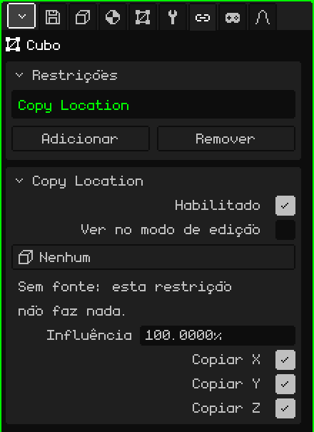
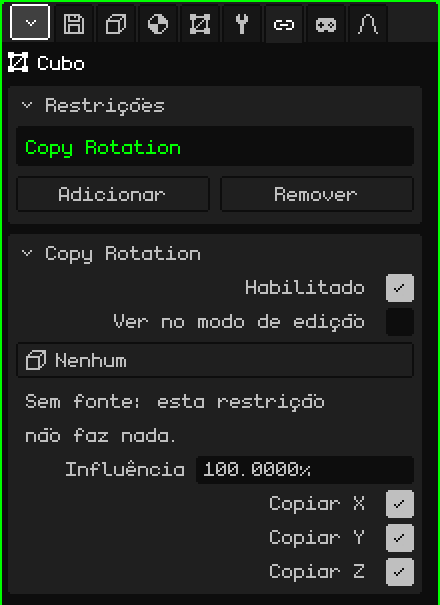
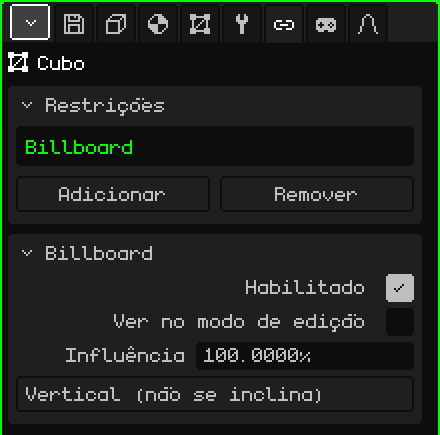
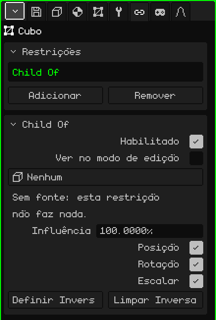

# Restrições

Uma **restrição** (em inglês, *constraint*) faz um objeto pegar algo de outro: a posição, a rotação, olhar sempre para a câmera ou segui-lo como se fosse filho dele. Serve para que as coisas se ajeitem sozinhas, sem animá-las à mão: uma sombra que vai embaixo do personagem, uma árvore plana que sempre fica de frente, uma espada presa à mão. Este artigo explica cada uma e todos os seus parâmetros; como os objetos são adicionados e movidos está no tutorial [O Modo Objeto](../tutoriales/modo-objeto.md).

## Onde ficam

Em Propriedades → aba **Restrições**. Qualquer objeto 3D a tem: malhas, câmeras, luzes, armações, sons, vazios. Os elementos 2D de uma interface não a têm.

Antes de ver cada uma, três coisas que valem para todas:

- **Elas não mudam os números do objeto.** A restrição é aplicada por cima ao desenhar. O cartão Transformar da aba Objeto continua mostrando a posição e a rotação próprias do objeto, e se a restrição for desligada ou excluída, o objeto volta exatamente para ali.
- **Elas são calculadas para cada vista.** As que dependem da câmera (Billboard, ou uma fonte **Vista**) usam a câmera que está desenhando: com duas Viewports 3D abertas, cada uma vê o resultado do seu próprio ponto de vista. No jogo, a câmera ativa.
- **Funcionam igual em todo lugar:** no editor, no jogo compilado, no Android e no Nokia N95.

## O cartão Restrições

| Propriedade | O que faz |
|---|---|
| A lista | As restrições do objeto. A escolhida é a que o cartão abaixo mostra. |
| Adicionar | O menu com os quatro tipos: **Copy Location**, **Copy Rotation**, **Billboard** e **Child Of**. |
| Remover | Exclui a restrição escolhida. |
| Subir / Descer | Mudam a ordem (aparecem com duas ou mais). |

A **ordem** importa: elas são aplicadas de cima para baixo, e cada uma trabalha sobre o que as de cima deixaram. Se duas mexem na mesma coisa, ganha a de mais abaixo.

## O que é comum a todas

Embaixo aparece o cartão da restrição escolhida, com o nome dela como título. Estas três linhas estão em todos os tipos:

| Propriedade | O que faz |
|---|---|
| Habilitado | Liga ou desliga a restrição sem excluí-la. Serve para comparar como fica com e sem ela. |
| Ver no modo de edição | Desligado (como vem), enquanto os vértices do objeto são editados a restrição não é aplicada: a malha aparece e é editada onde ela está de verdade. Ligado, é aplicada também no Modo Edição. |
| Influência | Quanto ela pesa, de 0 a 100 %. Com 100 é aplicada por inteiro; com 0 não faz nada; no meio, o objeto fica entre onde estaria sozinho e onde a restrição o leva (com 50, na metade do caminho). |

**Ver no modo de edição** vem desligado de propósito: editar uma árvore que gira perseguindo a câmera, ou uma malha que escapa para outro lugar, é muito incômodo.

## Copy Location

**Copia a posição** de outro objeto: o objeto vai exatamente para onde a fonte está, nos eixos escolhidos.

| Propriedade | O que faz |
|---|---|
| Fonte | De onde copia. **Nenhum**, **Vista** (a câmera que está desenhando) ou qualquer objeto da cena, exceto ele próprio e os que pendem dele. |
| Copiar X, Copiar Y, Copiar Z | Quais eixos copia. Os eixos são os mesmos do cartão Transformar: Z é a altura. Um eixo desmarcado fica com o valor próprio do objeto. |

Copia a posição tal como é, sem deixar distância: com os três eixos, o objeto fica em cima da fonte. Para que fique deslocado, desmarque o eixo que ele não deve seguir, ou desloque a malha no Modo Edição (veja [Child Of](#child-of) para seguir algo mantendo a distância).

Avisos do cartão:

- "Sem fonte: esta restrição não faz nada." Aparece com a fonte em Nenhum, e também se o objeto fonte for excluído: o botão passa a dizer Nenhum sozinho.
- "Sem eixos: esta restrição não faz nada." Aparece com os três eixos desmarcados.

**Exemplos:**

- **Uma sombra redonda embaixo do personagem:** um plano com uma mancha escura, com Copiar X e Copiar Y marcados e Copiar Z desmarcado. Ele vai embaixo do personagem por todo o chão, e quando o personagem pula, a sombra fica no chão.
- **Um céu que nunca se alcança:** uma esfera grande com o céu pintado e a fonte em **Vista**. O céu vai sempre centralizado na câmera, então por mais que você ande, nunca chega à borda.
- **Uma luz que acompanha o personagem:** uma luz com o personagem como fonte e só Copiar X e Copiar Y. Ela o segue de cima, na altura própria da luz.

## Copy Rotation

**Copia a rotação** de outro objeto: o objeto gira igual à fonte, sem sair do lugar.

| Propriedade | O que faz |
|---|---|
| Fonte | De onde copia: **Nenhum**, **Vista** (a câmera que está desenhando) ou um objeto da cena, exceto ele próprio e os que pendem dele. |
| Copiar X, Copiar Y, Copiar Z | Quais giros copia, com os mesmos eixos da rotação do cartão Transformar. Com os três, o objeto fica com exatamente a mesma orientação da fonte; com um ou dois, copia só esses ângulos e os outros ficam com os valores próprios. |

Tem os mesmos avisos que Copy Location ("Sem fonte…" e "Sem eixos…"). Com uma influência intermediária, o giro vai sempre pelo caminho mais curto.

**Exemplos:**

- **Os ventiladores de teto de um bar:** anime o giro das pás de um só, e as pás dos outros copiam a rotação dele. Como todos pendem retos, basta marcar os três eixos. Para mudar a velocidade de todos, mude a animação de um.
- **Algo preso à tela em primeira pessoa** (as mãos e a arma de um jogo, a cabine de uma nave): duas restrições no mesmo objeto, Copy Location e Copy Rotation, as duas com a fonte em **Vista**. O objeto vai para onde a câmera vai e gira com ela. A malha é deslocada no Modo Edição para que fique à frente, embaixo e à direita.

## Billboard

Faz o objeto **ficar de frente para a câmera**: ele gira sozinho para ficar de frente para a tela. Não tem fonte: é sempre a câmera que está desenhando.

| Propriedade | O que faz |
|---|---|
| Modo | **Vertical (não se inclina)**: gira só para os lados, como uma pessoa que se vira, e fica sempre reto. **Olhar para a câmera**: além disso, se inclina para olhar para a câmera quando ela está em cima ou embaixo. |

O billboard se alinha com o **plano** da tela, não com o ponto onde a câmera está: todos os billboards da vista ficam paralelos à tela.

Com influência 100, quem decide a rotação é o billboard, e a do cartão Transformar não conta. Se o plano ficar de lado, gire-o no Modo Edição (como Ver no modo de edição vem desligado, ali ele aparece sem a restrição).

Aviso do cartão: "Com influência entre 0 e 100 o billboard pode girar 180 graus ao cruzar a câmera. Com 100% não acontece." É assim por causa de como ele se mistura com uma orientação que vai girando: se esse giro incomodar, use 100 %.

**Exemplos:**

- **Árvores baratas:** um plano com a foto de uma árvore (com transparência) e o modo Vertical (não se inclina). De qualquer lado parece uma árvore inteira, e é um só plano: ideal para encher uma floresta no Nokia N95.
- **Fumaça, faíscas, o brilho de uma lâmpada, um sol de fundo:** um plano com a textura e o modo Olhar para a câmera, para que apareça de frente também visto de cima.
- **Uma placa com o nome de um personagem ou uma barra de vida** sobre a cabeça: Olhar para a câmera, e parenteado ao personagem para que o siga.

## Child Of

Faz o objeto se comportar como **filho** de outro objeto, ou de um **osso** de uma armação, mesmo que no Outliner ele penda de outro lugar. Ele o segue quando se move, gira ou é escalado, como se estivesse grudado.

| Propriedade | O que faz |
|---|---|
| Fonte | O objeto que faz o papel de pai: **Nenhum** ou um objeto da cena, exceto ele próprio e os que pendem dele. Aqui não há a opção Vista. |
| Osso | Só se a fonte for uma armação: o osso do qual ele pende. **Nenhum** segue a armação inteira. |
| Posição | Se segue os movimentos da fonte. |
| Rotação | Se gira quando a fonte gira. |
| Escalar | Se aumenta ou diminui com a fonte. |
| Definir Inversa | Deixa o objeto onde ele estava antes da restrição e, a partir desse momento, faz com que siga a fonte. |
| Limpar Inversa | Volta a medir a posição do objeto a partir da fonte: com Posição 0, 0, 0 ele fica exatamente na fonte (ou na base do osso). |

Se a fonte for excluída, aparece o aviso "Sem fonte: esta restrição não faz nada.", igual às outras.

### Definir ou limpar a inversa

Ao escolher a fonte, o objeto pula: a posição dele passa a ser medida a partir da fonte. Há dois jeitos de trabalhar:

- **Posicionar primeiro e definir:** coloque o objeto onde ele deve ficar (a espada na mão, por exemplo), escolha a fonte e o osso, e toque em **Definir Inversa**: ele volta para onde você o colocou e dali segue a fonte.
- **Limpar e digitar:** com **Limpar Inversa**, o cartão Transformar do objeto passa a ser a distância até a fonte. Serve quando você sabe o número exato: Posição 0, 0, 0 o coloca exatamente no osso.

A restrição vem com a inversa limpa, por isso o pulo ao escolher a fonte.

### A influência no Child Of

Com 0 quem manda é o pai real do objeto (o do Outliner) e com 100 quem manda é a fonte. Por isso uma espada pode ser filha do personagem no Outliner (assim ela se move com ele quando ele é levado para outro lugar) e ter além disso um Child Of na mão: ela a segue sem se mover duas vezes.

**Exemplos:**

- **Uma arma na mão do Leon:** Child Of com a armação do Leon como fonte e o osso da mão direita em Osso; ajeite a arma na mão e toque em Definir Inversa. Para um objeto rígido, é muito mais leve que deformar uma malha com a armação, e no Nokia N95 isso se nota.
- **Um chapéu ou uns óculos:** igual, com o osso da cabeça.
- **Uma câmera que acompanha sem girar:** só Posição marcada. A câmera vai com o personagem à mesma distância, mas não dá voltas quando ele se vira.
- **Um objeto sobre uma plataforma que se move:** Child Of na plataforma, com Posição e Rotação, para que ele viaje com ela sem mudá-lo de lugar no Outliner.

## Quando usar cada uma

| Para que o objeto… | Restrição |
|---|---|
| vá para onde está outro objeto, ou a câmera | Copy Location |
| gire igual a outro objeto, ou à câmera | Copy Rotation |
| fique sempre de frente para a câmera | Billboard |
| siga outro objeto ou um osso, mantendo a distância | Child Of |

Se dois objetos se copiam entre si (A copia de B e B copia de A), o Whisk3D corta o círculo para não travar e avisa no [Console](consola.md): um dos dois fica com a sua própria posição. A solução é tirar uma das duas restrições.
