# A barra de menus da Viewport 3D

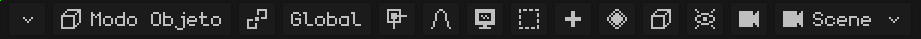

Se a barra de menus não couber inteira, dá para rolá-la: veja [Quando não dá para ver todas as opções da barra de menus](interfaz.md#quando-não-dá-para-ver-todas-as-opções-da-barra-de-menus).

## O modo

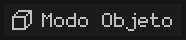 Mostra o modo em que você está trabalhando, e ao tocá-lo você escolhe outro. Os modos que aparecem dependem do objeto ativo: uma malha tem o Modo Edição e as três pinturas; uma armação, o Modo Edição e o Modo Pose. Com outro tipo de objeto (uma luz, uma câmera) o botão não aparece, porque o único modo é o Modo Objeto. Cada modo é explicado em [Os modos](vista-3d.md#os-modos).

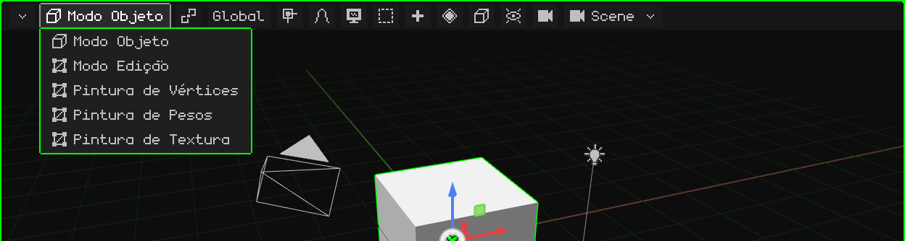

 <kbd>Tab</kbd> passa do Modo Objeto para o Modo Edição e volta.  No N95, <kbd>OK</kbd>.

No **Modo Edição** de uma malha, aparece ao lado o botão de **Vértice / Aresta / Face**: o que é selecionado com um clique (veja [Modo Edição](modo-edicion.md)).

## O pivô

 O **ponto pivô** é o lugar a partir do qual a transformação acontece: ao redor de que se rotaciona e a partir de onde se escala o que está selecionado. O ícone do botão muda conforme o pivô escolhido, e assim dá para ver num relance qual está definido.

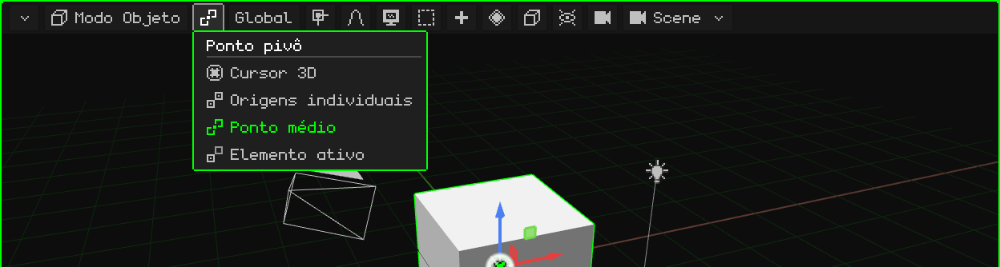

| Pivô | A partir de onde rotaciona e escala |
|---|---|
| 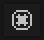 **Cursor 3D** | A partir do cursor 3D. Serve para girar coisas ao redor de qualquer ponto: coloque o cursor ali (com o [menu Ímã](#o-ímã)) e rotacione. |
|  **Origens individuais** | Cada objeto a partir da sua própria origem: todos giram ao mesmo tempo, cada um no seu lugar. |
|  **Ponto médio** | A partir do centro de tudo o que está selecionado. É o padrão. |
|  **Elemento ativo** | A partir da origem do objeto ativo (o último selecionado): os outros giram ao redor dele. |

Um exemplo de cada um, em vídeo, está no tutorial [O Modo Objeto](../tutoriales/modo-objeto.md#o-ponto-pivô).

## A orientação

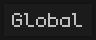 Os eixos usados ao mover, rotacionar ou escalar em um eixo (com <kbd>X</kbd>, <kbd>Y</kbd>, <kbd>Z</kbd>, com o gizmo ou com as teclas do N95). O botão mostra a orientação escolhida.

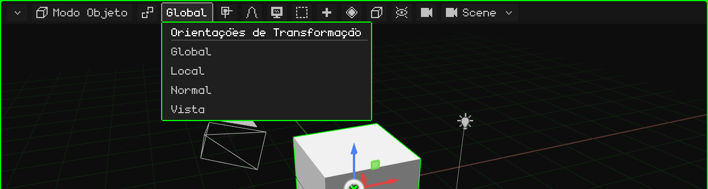

| Orientação | Os eixos |
|---|---|
| **Global** | Os do mundo: sempre iguais, com o Z para cima. É a padrão. |
| **Local** | Os do próprio objeto: giram com ele. Um carro girado avança no seu eixo Local. |
| **Normal** | No Modo Edição: a direção para a qual a face selecionada aponta (é a que Extrudar usa). |
| **Vista** | Os da tela: X para o lado, Y para cima. |

 Durante um transform, a segunda letra do eixo muda de Global para Local: <kbd>G</kbd> <kbd>Y</kbd> <kbd>Y</kbd>.

## O ímã

 Com o **ímã** ligado, o que se move gruda em algo: nos vértices, nas arestas ou nas faces de outros objetos, ou nos seus centros. O botão fica verde quando está ligado.

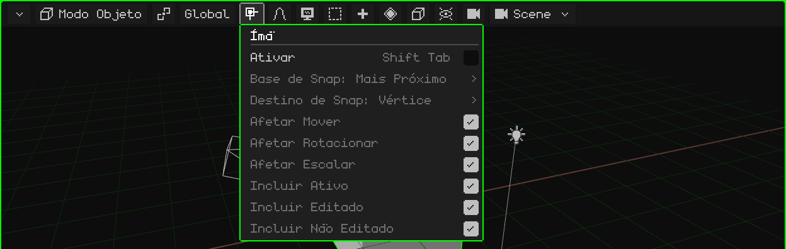

| Opção | O que faz | Atalho |
|---|---|---|
| Ativar | Liga ou desliga o ímã. | <kbd>Shift+Tab</kbd> |
| Base de Snap | Qual ponto do que se move gruda: o mais próximo, o centro, a mediana ou o ativo. | Menu |
| Destino de Snap | Em que ele gruda: vértice, aresta, face, os seus centros. Com Projetar na face / Face mais próxima, os vértices se apoiam sobre outra superfície (para retopologia). | Menu |
| Afetar Mover / Rotacionar / Escalar | Em quais operações ele atua. | Menu |
| Incluir Ativo / Editado / Não Editado | Em quais objetos ele pode grudar. | Menu |

O **cursor 3D** é movido com outro menu, o do ímã do cursor: <kbd>Shift</kbd> + <kbd>S</kbd> ou menu Objeto → Ímã (Cursor para o selecionado, Seleção para Cursor...). Isso é explicado em [O Modo Objeto](../tutoriales/modo-objeto.md#o-cursor-3d).

## A edição proporcional

 Com a **edição proporcional**, ao mover, rotacionar ou escalar algo, o que está perto acompanha suavemente: mais quanto mais perto estiver. Serve para modelar formas orgânicas (um terreno, um rosto) sem mover vértice por vértice. Fica verde quando está ligada.

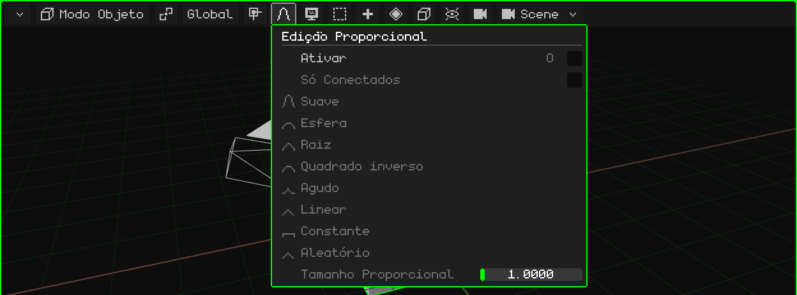

| Opção | O que faz | Atalho |
|---|---|---|
| Ativar | Liga ou desliga a edição proporcional. | <kbd>O</kbd> |
| Só Conectados | Mede a distância pelas arestas: não arrasta peças soltas que estejam perto. | Menu |
| A queda | Como a influência se distribui com a distância: Suave, Esfera, Raiz, Quadrado inverso, Agudo, Linear, Constante ou Aleatório. | Menu |
| Tamanho Proporcional | O raio de influência. Durante o transform, muda com a roda ou com <kbd>Page Up</kbd> / <kbd>Page Down</kbd>. | Menu / roda |

## Vista

 Tudo o que é de **navegar**: de onde se olha a cena. Cada opção, com o seu vídeo, está no tutorial [Navegar na Viewport 3D](../tutoriales/navegacion.md).

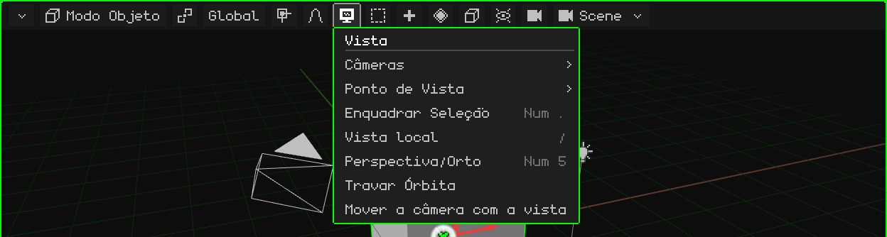

| Opção | O que faz |  Atalho |
|---|---|---|
| Câmeras | Olhar pela câmera ativa, ou tornar o objeto selecionado a câmera ativa. | <kbd>Num 0</kbd> / <kbd>Ctrl+Num 0</kbd> |
| Ponto de Vista | Frontal, Traseira, Direita, Esquerda, Superior, Inferior. | <kbd>Num 1</kbd>, <kbd>Num 3</kbd>, <kbd>Num 7</kbd> (com <kbd>Ctrl</kbd>, a oposta) |
| Enquadrar Seleção | Centraliza a vista no que está selecionado e a aproxima para que caiba certinho. | <kbd>Num .</kbd> |
| Vista local | Deixa à vista só o que está selecionado, e volta. | <kbd>/</kbd> |
| Perspectiva/Orto | Passa de perspectiva para ortográfica e volta. | <kbd>Num 5</kbd> |
| Travar Órbita | O que orbitava passa a deslocar a vista. | — |
| Mover a câmera com a vista | Olhando pela câmera: navegar move a câmera. | — |

## Selecionar

 Selecionar de uma vez tudo, nada, o contrário do que está selecionado, ou o que ficar dentro de uma caixa.

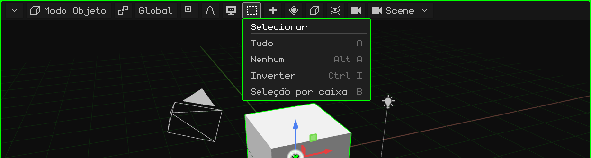

| Opção | O que faz | Atalho |
|---|---|---|
| Tudo | Seleciona tudo. | <kbd>A</kbd> |
| Nenhum | Não deixa nada selecionado. | <kbd>Alt+A</kbd> |
| Inverter | O que estava selecionado deixa de estar, e vice-versa. | <kbd>Ctrl+I</kbd> |
| Seleção por caixa | Uma caixa que se arrasta: da esquerda para a direita (verde) seleciona só o que fica inteiro dentro; da direita para a esquerda (azul) basta encostar. <kbd>Shift</kbd> adiciona. | <kbd>B</kbd>, ou arrastar no fundo |

No Modo Edição, ele acrescenta Selecionar Vinculado, os loops e os caminhos (veja [Modo Edição](modo-edicion.md)).

## Adicionar

 Cria objetos novos, que aparecem no cursor 3D e ficam selecionados. Só existe no Modo Objeto.

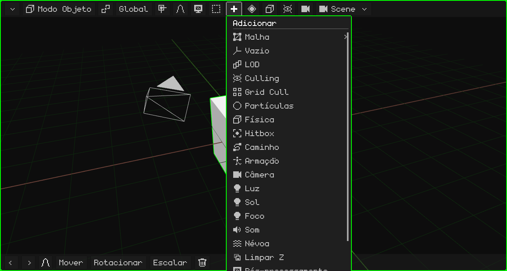

Cada tipo está em [Modo Objeto → Menu Adicionar](modo-objeto.md#menu-adicionar).  <kbd>Shift</kbd> + <kbd>A</kbd> o abre onde o mouse está.

No Modo Edição, no lugar dele aparecem **Malha** (as operações de modelagem, veja [Modo Edição](modo-edicion.md)) e **UV** (desdobrar e projetar as UV, veja [Editor UV](editor-uv.md)). Na Pintura de Textura aparece um **disquete**, que salva a textura pintada; ele fica verde quando há pintura não salva.

## Animação

 Os **keyframes** do que está selecionado: salvar o valor da posição, da rotação ou da escala no quadro atual, para que a animação vá de um keyframe ao outro. Aparece quando há algo selecionado, no Modo Objeto e no Modo Pose, e as suas opções dependem do que está selecionado.

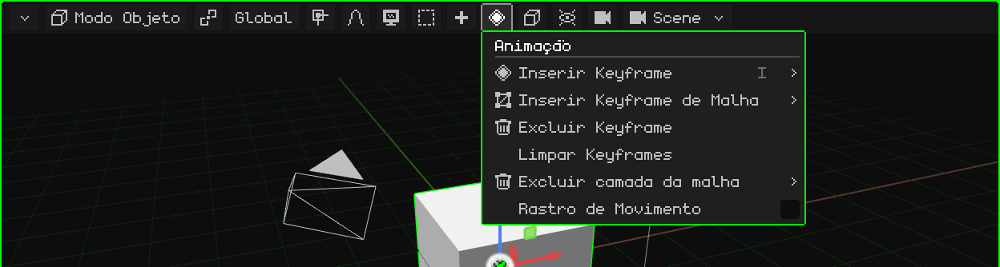

| Opção | O que faz | Atalho |
|---|---|---|
| Inserir Keyframe | Um menu para escolher o que é salvo: posição, rotação, escala ou tudo. | <kbd>I</kbd> (<kbd>Shift+I</kbd>: tudo sem perguntar) |
| Inserir Keyframe de Malha | Só com uma malha 3D: escolhe o que é salvo da animação da malha: os vértices, as normais ou as UV. | Menu |
| Excluir Keyframe | Exclui o keyframe do quadro atual. | Menu |
| Limpar Keyframes | Exclui toda a animação do que está selecionado. | Menu |
| Excluir camada da malha | Só com uma malha 3D: exclui por inteiro uma camada da animação da malha, a dos **vértices**, a das **normais** (por exemplo, em um modelo sem iluminação) ou a das **UV**. Sempre fica pelo menos um keyframe. | Menu |
| Rastro de Movimento | Desenha na vista o caminho que os objetos animados percorrem. | Menu |

### No Modo Pose

Ao posar uma armação, o menu trabalha com os keyframes dos ossos selecionados (e do ativo):

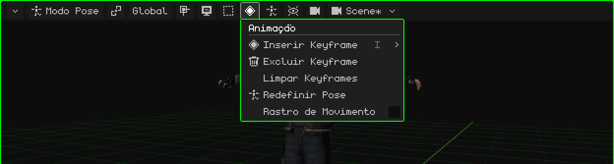

| Opção | O que faz | Atalho |
|---|---|---|
| Inserir Keyframe | Salva a pose dos ossos selecionados no quadro atual: posição, rotação, escala ou tudo. | <kbd>I</kbd> |
| Excluir Keyframe | Exclui o keyframe do quadro atual desses ossos. Dá para desfazer com <kbd>Ctrl+Z</kbd>. | Menu |
| Limpar Keyframes | Exclui todos os keyframes desses ossos na animação ativa. Dá para desfazer com <kbd>Ctrl+Z</kbd>. | Menu |
| Redefinir Pose | Os ossos selecionados (ou todos, se nenhum estiver selecionado) voltam à posição, à rotação e à escala que têm no Modo Edição. Dá para desfazer com <kbd>Ctrl+Z</kbd>. | Menu |
| Rastro de Movimento | Desenha na vista o caminho que os objetos animados percorrem. | Menu |

A animação tem o seu próprio tutorial e o seu capítulo, [Linha do Tempo](linea-de-tiempo.md).

## Objeto

 O que se pode fazer com o que está selecionado. É o mesmo menu que se abre com o clique direito na vista (ou, em uma tela touch, mantendo um dedo parado). Aparece quando há algo selecionado.

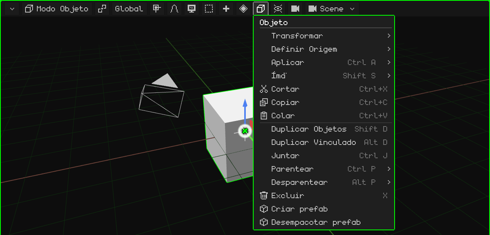

Cada opção está em [Modo Objeto](modo-objeto.md). No Modo Edição, este botão passa a ser o menu do que é selecionado (Vértice, Aresta ou Face); no Modo Pose, o de Pose; na edição de uma armação, o de Armação.

## Sobreposições

 As **sobreposições** são as ajudas desenhadas por cima da cena para trabalhar, que não saem no render: o piso, os eixos, o gizmo, o cursor 3D. Daqui elas são ligadas e desligadas, todas juntas ou uma a uma.

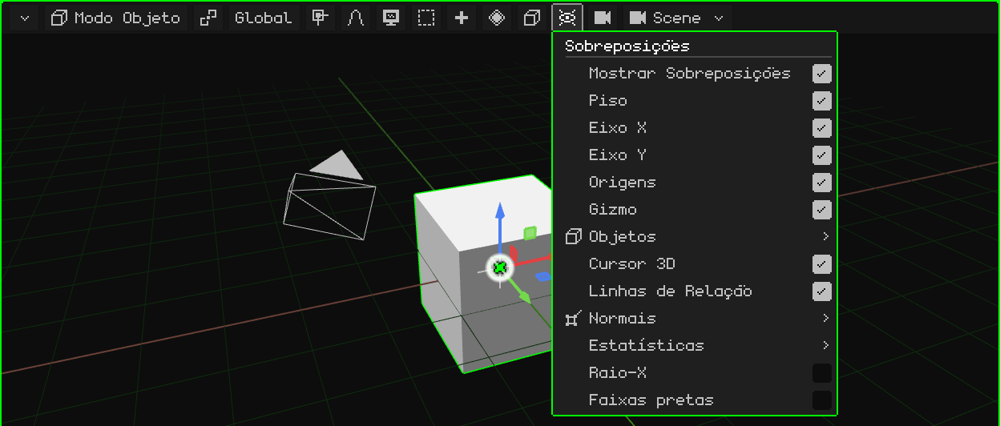

| Opção | O que faz | Atalho |
|---|---|---|
| Mostrar Sobreposições | Liga ou desliga todas as ajudas de uma vez. | <kbd>K</kbd> |
| Piso, Eixo X, Eixo Y, Origens, Cursor 3D, Linhas de Relação | Cada ajuda separadamente. As linhas de relação unem cada filho ao seu pai. | Menu |
| Gizmo | O gizmo de mover, rotacionar e escalar. No Nokia N95 ele vem desligado. | Menu |
| Objetos | Quais tipos de objeto são desenhados: armações, luzes, câmeras, vazios, partículas, curvas, hitboxes. | Menu |
| Normais | Desenha as normais dos vértices ou das faces, com o seu tamanho. | Menu |
| Estatísticas | Os quadros por segundo, os vértices, as faces, as chamadas de desenho e os tempos. | Menu |
| Raio-X | No Modo Edição, a malha fica semitransparente e dá para selecionar os elementos de trás. | Menu |
| Faixas pretas | Olhando por uma câmera com uma proporção diferente da tela, tapa o que fica fora da tomada. | Menu |

## Render

 O **modo de sombreamento**: como a cena é desenhada na vista. Não muda o projeto, só como ele aparece enquanto você trabalha.

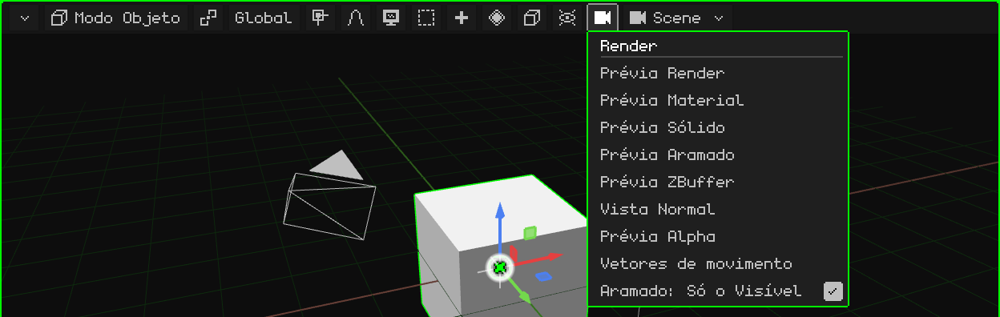

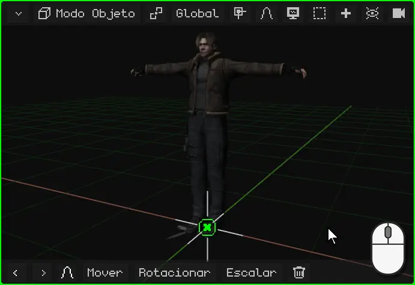

| Modo | Como aparece |
|---|---|
| Prévia Render | Com as luzes da cena. Com o ray tracing ligado, mostra a imagem traçada aos poucos. |
| Prévia Material | A padrão: os materiais e as texturas com uma luz neutra a partir da vista, sem depender das luzes da cena. |
| Prévia Sólido | Tudo cinza, para ver a forma. |
| Prévia Aramado | Só as arestas. Com **Aramado: Só o Visível**, só as do que se vê de frente. |
| Prévia ZBuffer | A profundidade: claro perto, escuro longe. |
| Vista Normal | As normais, em cores. |
| Prévia Alpha | A transparência, em preto e branco. |
| Vetores de movimento | Quanto cada pixel se moveu desde o quadro anterior (vermelho = X, verde = Y). É a mesma imagem da passada `_vectores` do render. |

 <kbd>Z</kbd> passa para o modo seguinte.  No N95, o <kbd>6</kbd>.

## A cena

 O nome do que está sendo editado: uma **cena**, um **jogo** ou um **prefab** do projeto. Ao tocá-lo, você escolhe outra, cria uma nova ou converte a cena em jogo.

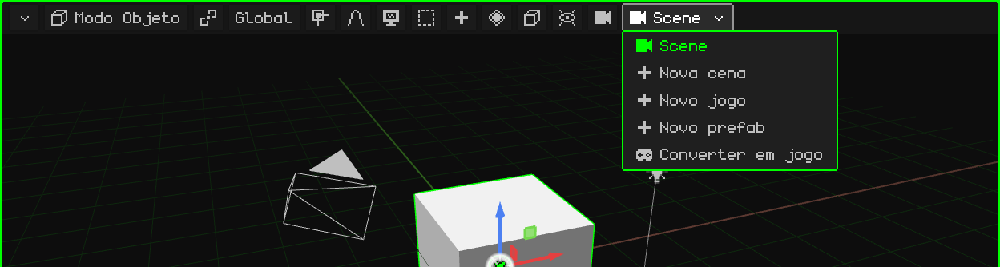

As cenas, os jogos e os prefabs estão em [O projeto](proyecto.md).
