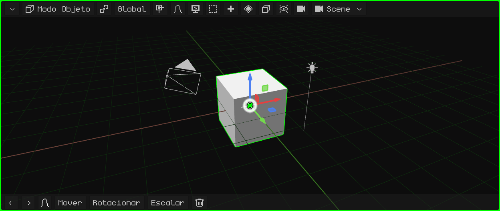
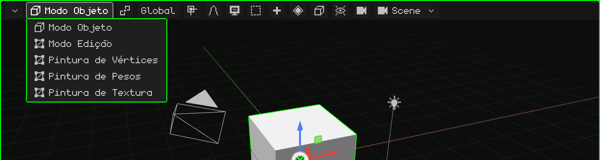
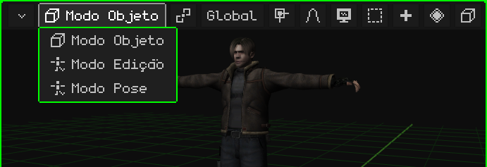
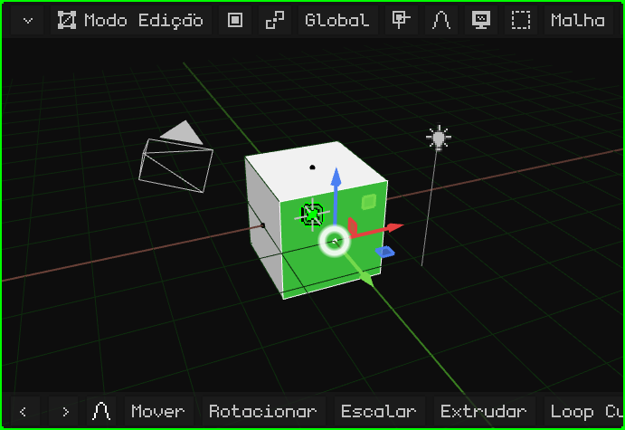
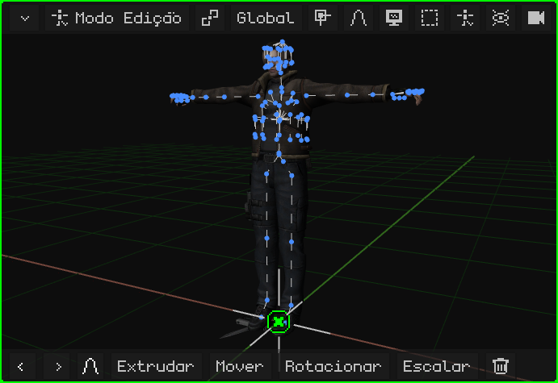
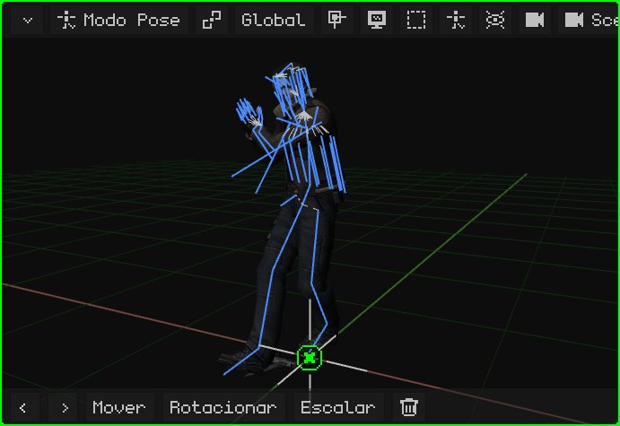
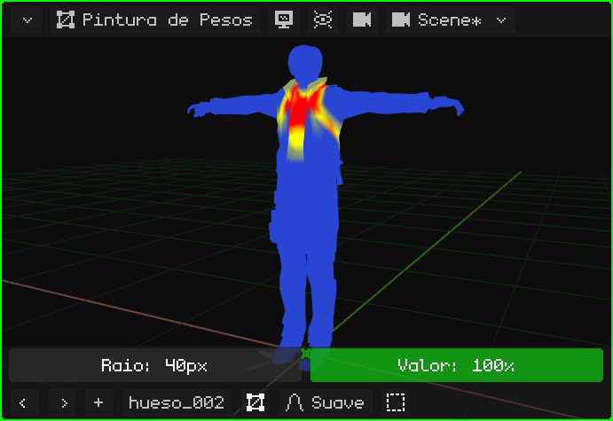
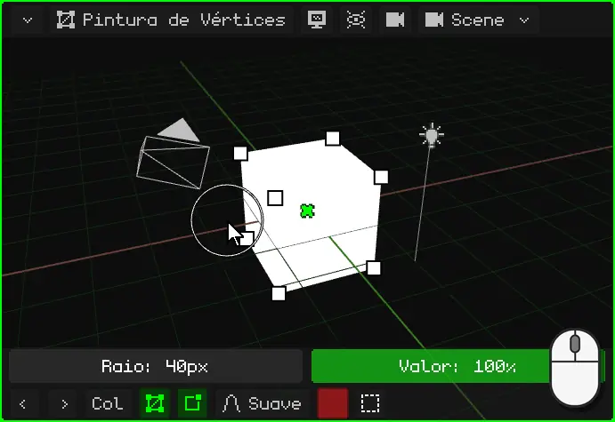
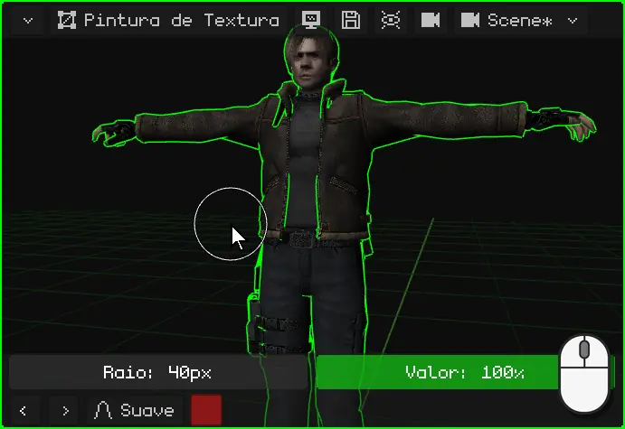
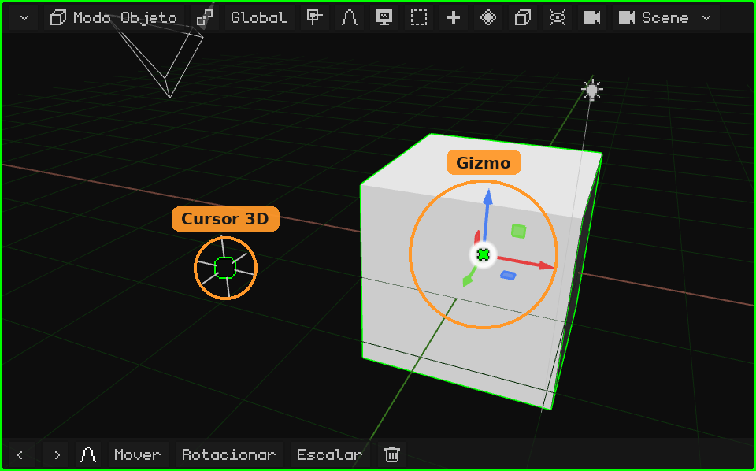

# Viewport 3D

A **Viewport 3D** é a viewport onde se vê e se edita a cena: é nela que se modela, se movem os objetos, se pinta, se posa e se anima. Como todas as viewports, ela tem em cima a sua **barra de menus** e embaixo a sua **barra de ferramentas**.

- **A barra de menus**, botão por botão, com os seus menus: [A barra de menus da Viewport 3D](vista-3d-barra.md).
- **Navegar** (orbitar, deslocar, zoom, as vistas, a câmera): [Navegação na Viewport 3D](navegacion.md) e o tutorial [Navegar na Viewport 3D](../tutoriales/navegacion.md).
- **Mover, rotacionar e escalar**, o gizmo, o pivô e a orientação: [Mover, rotacionar e escalar](transformar.md).

## Os modos

A Viewport 3D trabalha em diferentes **modos**: o que fazem os cliques, as teclas e os menus depende do modo em que ela está. O modo é escolhido com o primeiro botão da barra de menus, que mostra o modo atual, ou com <kbd>Tab</kbd> (Objeto ↔ Edição; no Nokia N95, <kbd>OK</kbd>).

Os modos que podem ser escolhidos dependem do **objeto ativo**. O **Modo Objeto** existe para todos. Uma malha 3D acrescenta o Modo Edição e as três pinturas; uma armação, o Modo Edição e o Modo Pose. Com qualquer outro objeto (uma luz, uma câmera, um som), o único modo é o Modo Objeto, e o botão não aparece.

| Modo | Quais objetos o têm | Para que serve |
|---|---|---|
| [Modo Objeto](modo-objeto.md) | Todos | Trabalhar com os objetos inteiros: criá-los, movê-los, rotacioná-los, escalá-los, duplicá-los, parenteá-los e excluí-los. |
| [Modo Edição](modo-edicion.md) | Malhas 3D e curvas | Modelar: mover, adicionar e excluir os vértices, as arestas e as faces da malha. |
| [Modo Edição](esqueletos.md#modo-edição-de-armação) | Armações | Montar a armação: criar ossos e ajustá-los na sua posição de repouso. |
| [Modo Pose](esqueletos.md#modo-pose) | Armações | Posar os ossos e salvar as poses: é assim que se anima um personagem. |
| [Pintura de Pesos](pintura.md#pintura-de-pesos) | Malhas 3D | Pintar o quanto cada osso move cada vértice. |
| [Pintura de Vértices](pintura.md#pintura-de-vértices) | Malhas 3D | Pintar cores diretamente sobre os vértices. |
| [Pintura de Textura](pintura.md#pintura-de-textura) | Malhas 3D | Pintar sobre a textura, diretamente em cima do objeto. |

### Modo Objeto

É o modo em que o Whisk3D começa, e o único que todos os objetos têm. Trabalha-se com os objetos inteiros: eles são selecionados, movidos, rotacionados, escalados, adicionados e excluídos. Veja [Modo Objeto](modo-objeto.md) e o tutorial [O Modo Objeto](../tutoriales/modo-objeto.md).

### Modo Edição de uma malha

Modela-se a **forma** da malha: os vértices, as arestas e as faces. Na barra de menus aparecem o botão **Vértice / Aresta / Face** (o que se seleciona com um clique) e os menus **Malha** e **UV**. O resto da cena continua visível, mas não pode ser mexido.

### Modo Edição de uma armação

Monta-se a **armação**: os ossos são criados (extrudando-os a partir da ponta de outro), movidos e parenteados. Essa é a posição de **repouso** dela, a que ela tem quando não está animada.

### Modo Pose

**Posa-se** a armação: os ossos são rotacionados e movidos sem mudar a armação em si, e a malha os acompanha. As poses salvas em diferentes frames são a animação do personagem.

### Pintura de Pesos

Pinta-se **o quanto cada osso move cada parte da malha**: em vermelho o que o osso escolhido move totalmente, em azul o que ele não move. É isso que faz com que, ao dobrar o braço, o braço se dobre, e não a cintura.

### Pintura de Vértices

Pintam-se **cores sobre os vértices** da malha, sem textura. Serve para dar cor a modelos simples, para sombras pintadas à mão e para efeitos nos shaders.

### Pintura de Textura

Pinta-se **diretamente sobre a textura**, em cima do objeto, como em um boneco. O que foi pintado é salvo com o disquete que aparece na barra de menus.

Nos modos de pintura, acima da barra de ferramentas aparece a linha do pincel (o **Raio** e o **Valor**). Veja [Modos de pintura](pintura.md).

## A barra de ferramentas

Embaixo da Viewport 3D ficam **Desfazer** e **Refazer** (as setas), os **últimos comandos usados** (no começo, Mover, Rotacionar, Escalar e Excluir; o que é usado passa para a frente) e a **edição proporcional**. Enquanto se move, rotaciona ou escala, a barra de ferramentas muda: o visto verde confirma, o X vermelho cancela, a orientação, e **X**, **Y** e **Z** restringem o movimento a esses eixos. Veja [Mover, rotacionar e escalar](transformar.md#barra-de-ferramentas).

 Em uma tela touch, ela acrescenta **Shift** e **Ctrl**, que ficam ligados (em verde) e fazem o papel dessas teclas, e o botão **Vista** (o monitor), para que no Modo Edição e nas pinturas o dedo navegue em vez de selecionar ou pintar.

 No Nokia N95 ela vem oculta, para deixar a tela para a cena, e aparece quando é necessária: nos modos de pintura aparece a linha do pincel (o **Raio** e o **Valor**), e enquanto se move, rotaciona ou escala com a edição proporcional ligada, a barra do raio dela. Os botões dela são usados com o **mouse virtual**: ele é ligado com a tecla de seleção direita, as setas o movem e <kbd>OK</kbd> clica.

## O gizmo e o cursor 3D

- O **gizmo** são as setas coloridas sobre o que está selecionado: elas são agarradas para mover, rotacionar e escalar. Um clique sobre o gizmo passa de um modo para o outro. Veja [O gizmo](transformar.md#o-gizmo).
- O **cursor 3D** é o círculo com uma cruz: é ali que aparece o que é adicionado com Adicionar, e ele pode ser o ponto pivô. Veja [O cursor 3D](../tutoriales/modo-objeto.md#o-cursor-3d).

 No Nokia N95 o gizmo vem desligado, porque a tela é pequena e lá se move com as teclas. Ele é ligado em **Sobreposições → Gizmo**, e é agarrado com o mouse virtual.
