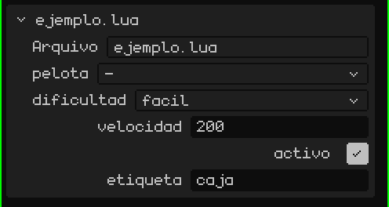
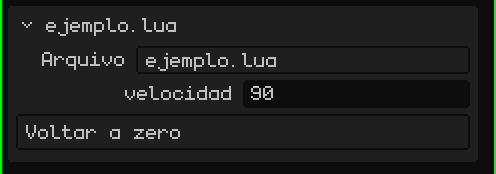

# Um script é um componente de um objeto

No Whisk3D, um script sempre pertence a um **objeto** da cena (uma malha, um vazio, um botão 2D…). Um objeto pode ter vários scripts; cada um roda separadamente, com suas próprias variáveis, na ordem em que aparecem.

No script, `yo()` devolve o objeto dono. Para usar *outros* objetos, o script declara uma tabela global chamada `propiedades`. O editor a lê e mostra um campo para cada entrada no cartão do script, no painel de Propriedades:

```lua
propiedades = {
  pelota     = "objeto",                          -- um campo para escolher um objeto da cena
  dificultad = { "facil", "normal", "dificil" },  -- uma lista suspensa (a primeira é a padrão)
  velocidad  = 200,                               -- um número próprio de cada objeto que usar o script
  activo     = true,                              -- um sim/não
  etiqueta   = "caja",                            -- um texto
}

function inicio()
  local p   = objeto("pelota")         -- o objeto escolhido no campo "pelota"
  local dif = opcion("dificultad")     -- "facil", "normal" ou "dificil"
  local v   = propiedad("velocidad")   -- 200, ou o que tiver sido definido nesse objeto
end
```

> [!NOTE]
> Para ler `propiedades`, o editor **executa o arquivo** mesmo que o jogo não esteja rodando. Por isso, fora das funções coloque só declarações (tabelas, constantes, `local`), nunca código que faça coisas.

Assim fica no cartão do script, em Propriedades: um campo para cada propriedade, na mesma ordem que no código.



Assim, o mesmo script serve para muitos objetos com valores diferentes: o campo `velocidad` de um inimigo pode valer 200 e o de outro, 350.

## Mudar as propriedades em tempo real

`propiedad("velocidad")` lê o valor no momento. Se você o mudar em Propriedades com o jogo rodando, o script vê a mudança no quadro seguinte, mas só se o ler de novo com `propiedad()`. Se você o guardou em uma variável (`local v = propiedad("velocidad")` em `inicio()`), a variável fica com o valor do começo.

```lua
function actualizar(dt)
  -- é lido a cada quadro: vê o que você mudar em Propriedades com o jogo rodando
  mover(yo(), propiedad("velocidad") * dt, 0, 0)
end
```

Ler `propiedad()` a cada quadro é mais lento que usar uma variável. Não convém trabalhar assim no jogo todo: use isso enquanto ajusta os valores e, quando estiverem prontos, guarde-os em variáveis em `inicio()`.

## Botões

Se uma propriedade for uma **função**, aparece um **botão** no cartão: tocar nele chama essa função. Para que o botão diga outra coisa além do nome, coloque o texto e a função em uma tabela:

```lua
propiedades = {
  velocidad = 90,
  cero = { "Voltar a zero", function()
    setRotacion(yo(), 0, 0, 0)
  end },
}
```



Com o jogo rodando, a função é executada no script que está em jogo. Sem o jogo, o script é carregado só para essa chamada: assim, um botão serve como um **complemento do editor**, que faz algo na cena. Por exemplo, com `seleccionados()`, os objetos selecionados no editor:

```lua
propiedades = {
  subir = { "Subir a seleção", function()
    for _, o in ipairs(seleccionados()) do
      mover(o, 0, 0, 1)   -- um metro para cima
    end
  end },
}
```

> [!NOTE]
> O que um botão faz com o jogo parado fica na cena, como se você tivesse feito à mão, e se desfaz do mesmo jeito: <kbd>Ctrl</kbd> + <kbd>Z</kbd> desfaz de uma vez tudo o que o botão fez. Com o jogo rodando nada vai para o histórico: ao tocar em **Parar**, tudo volta a ser como era.

Os scripts não compartilham variáveis entre si. Para passar dados uns aos outros (os pontos, se o jogador ganhou…), eles usam um espaço compartilhado: `setCompartido("puntos", 10)` escreve e `compartido("puntos")` lê. Ele guarda números, sim/não e textos, e é esvaziado ao parar o jogo.
