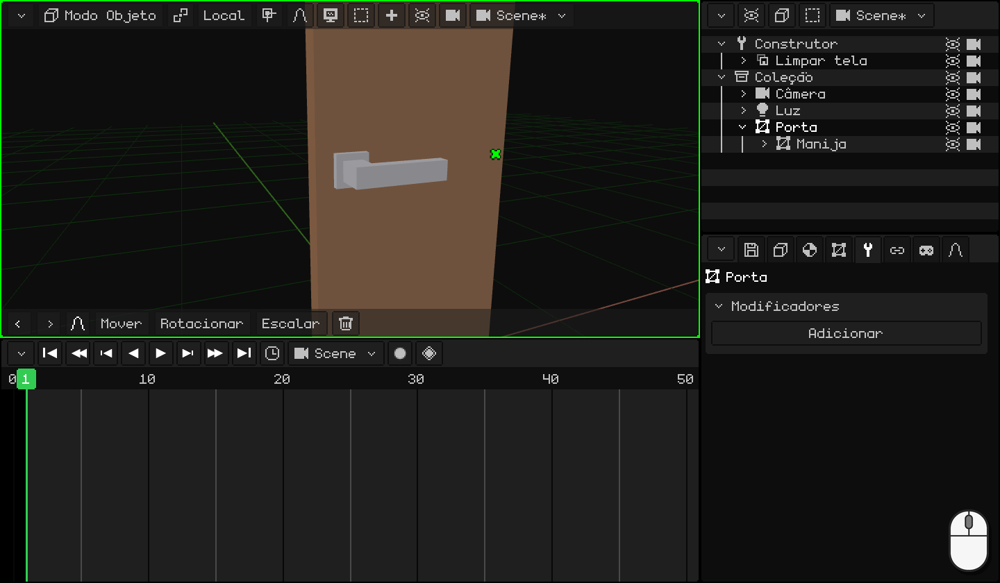
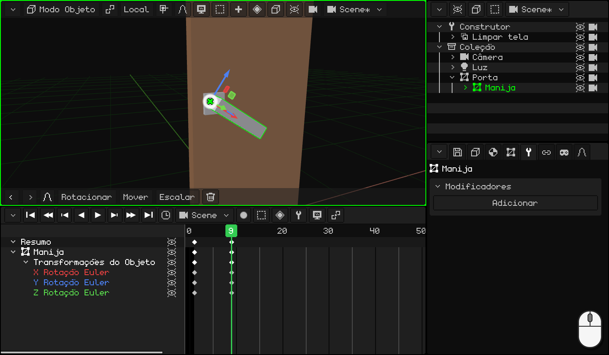
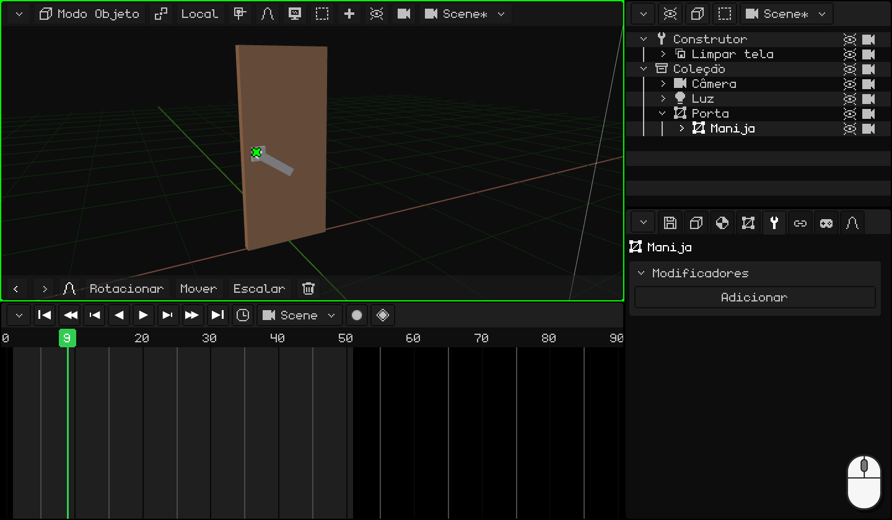
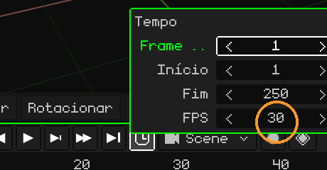
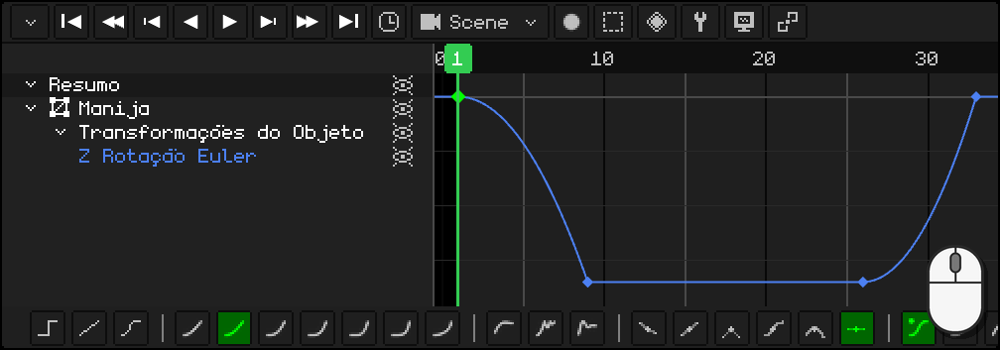
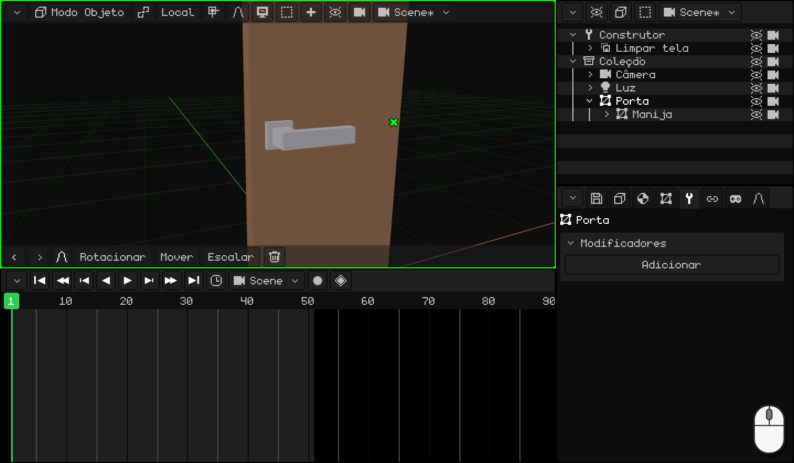

# Animar a porta

Partimos da porta com a sua maçaneta do tutorial anterior, [Modelar a maçaneta](modelar-picaporte.md): a porta tem a origem na dobradiça, a alavanca tem a dela onde gira e é filha da porta. Agora vamos animá-la como uma porta de verdade: primeiro a maçaneta desce, só quando ela está embaixo a porta começa a abrir, e no final a maçaneta volta para o seu lugar.

No caminho você vai aprender a:

- pôr **keyframes**: a pose de um objeto em um quadro;
- **duplicar** keyframes que já estão do jeito que você quer;
- ajustar o **tempo** da animação e escolher os seus **quadros por segundo**;
- usar o **editor de curvas**: o que é uma curva e como mudá-la com um clique e a barra de ferramentas.

## 1. A maçaneta

Um **keyframe** guarda como um objeto está em um quadro: a posição, a rotação ou a escala dele. Com dois keyframes, o programa calcula todos os quadros do meio: isso é a animação.

1. Clique na **alavanca** para selecioná-la. Na **Linha do Tempo**, vá para o quadro **1**: a maçaneta está em cima.
2. Com o mouse sobre a Viewport 3D, aperte <kbd>I</kbd> e escolha **Somente Rotação**: na Linha do Tempo aparece um losango no quadro 1.
3. Vá para o quadro **9** (um clique nos números da Linha do Tempo) e abaixe a maçaneta: <kbd>R</kbd> <kbd>Y</kbd> `-34` <kbd>Enter</kbd>. Ela gira ao redor da sua origem, a que colocamos no tutorial anterior.
4. De novo <kbd>I</kbd> → **Somente Rotação**: outro losango, no 9.

 Em uma tela touch: o keyframe é posto com o botão do losango da barra de menus da Viewport 3D, **Animação → Inserir Keyframe → Somente Rotação**, e o quadro é mudado com um toque nos números da Linha do Tempo. A maçaneta é abaixada com **Rotacionar** **Y** `-34` na barra de ferramentas, com os números no teclado da barra de cima.

 No Nokia N95: <kbd>2</kbd> (rotacionar), <kbd>2</kbd> (o eixo Y), o lápis + `-34` e <kbd>OK</kbd>. O keyframe, com **Animação → Inserir Keyframe → Somente Rotação**.

## 2. Duplicar keyframes

A maçaneta precisa ficar embaixo enquanto a porta se abre e, no final, voltar para cima. Você já tem essas duas poses: não é preciso girá-la de novo.

1. Na Linha do Tempo, clique no losango do quadro **9** (embaixo), <kbd>Shift</kbd> + <kbd>D</kbd>, leve a cópia ao quadro **26** e clique. Do 9 ao 26 a maçaneta fica embaixo.
2. Clique no losango do quadro **1** (em cima), <kbd>Shift</kbd> + <kbd>D</kbd> e a cópia para o **33**: a maçaneta volta para cima.

Olhe para o losango da cópia, não para o ponteiro: ele sai um quadro à direita do mouse. Enquanto a cópia passa por cima de outro keyframe, nada acontece com ele: ela só o **substitui** se você a soltar exatamente em cima dele.

  Em tela touch e no N95 (com o mouse virtual), em vez de duplicar você copia e cola: um toque no keyframe do quadro 9 e, no menu **Key** da Linha do Tempo (o botão do losango), **Copiar**; um toque nos números para ir ao quadro 26 e **Key → Colar**. O mesmo com o do 1 para o 33.

## 3. A porta

1. Clique na **porta**, para selecionar só ela. Vá para o quadro **11** e <kbd>I</kbd> → **Somente Rotação**: até aqui a porta está fechada. Só no 11 ela começa a abrir, quando a maçaneta já está embaixo.
2. Vá para o quadro **26**, abra-a: <kbd>R</kbd> <kbd>Z</kbd> `-80` <kbd>Enter</kbd>, e de novo <kbd>I</kbd> → **Somente Rotação**.

Dê **Play** (<kbd>Espaço</kbd>, ou o botão ▶ da Linha do Tempo): a maçaneta desce, a porta se abre e a maçaneta volta para cima. Enquanto isso, ela acompanha a porta, porque é filha dela.

 Em uma tela touch: **Rotacionar** **Z** `-80` e **Animação → Inserir Keyframe → Somente Rotação**.

 No Nokia N95: <kbd>2</kbd>, <kbd>3</kbd> (o eixo Z), o lápis + `-80` e <kbd>OK</kbd>; e **Animação → Inserir Keyframe → Somente Rotação**.

## 4. O tempo

Tudo acontece rápido demais, ou devagar demais? É preciso mover os keyframes:

- <kbd>G</kbd> move os keyframes selecionados no tempo (por exemplo, a maçaneta que volta, do 33 para o 36).
- <kbd>S</kbd> os escala: com todos selecionados, `2` faz a animação durar o dobro.

A animação termina no quadro **50**: no **relógio** da Linha do Tempo, **Fim** `50` <kbd>Enter</kbd>.

### Os quadros por segundo

O tempo de uma animação é contado em **quadros**, e quantos quadros cabem em um segundo é o que dizem os **FPS** (*frames per second*: quadros por segundo). Eles são mudados no mesmo **relógio**, em **FPS**. Cada animação tem os seus: a da cena e cada clipe podem ter FPS diferentes.

O Whisk3D começa em **30**: os 50 quadros da porta duram um segundo e meio e pouco.

| FPS | Para quê |
|---|---|
| **24** | O cinema. Dá à animação um estilo mais cinematográfico e, se você for renderizá-la, são muito menos quadros: um minuto a 24 são 1440 quadros; a 30, 1800. |
| **30** ou **60** | Séries e videogames. |

Não é preciso animar a 60. No jogo, o motor calcula sozinho os quadros que ficam no meio: uma animação feita a 30 fica suave em uma tela a 60 e ocupa menos memória.

Escolha os FPS **antes** de animar. Os keyframes ficam no seu quadro: se depois você aumentar os FPS, a animação fica mais rápida, e se diminuir, mais lenta.

## 5. As curvas

Passe a Linha do Tempo para o **editor de curvas** (**Vista → Curvas**). Ali cada valor animado é uma **curva**: ela diz em que posição, rotação ou escala o objeto está em cada momento. Na horizontal é o **tempo**; na vertical, o **valor**.

**Somente Rotação** salva os três eixos, mas a maçaneta e a porta giram em um só: as outras duas curvas são linhas planas que não fazem nada. Exclua-as: selecione essas linhas e <kbd>X</kbd>. Ficam só as curvas que mudam, e fica mais confortável trabalhar.

### A forma da curva

Se a curva é uma **linha reta**, o objeto se move sempre na mesma velocidade: arranca e para de golpe. Parece **robótico**. Às vezes queremos justamente isso, mas quase nada se move assim na vida real: as coisas **aceleram** ao arrancar e **freiam** ao chegar.

Veja seis bolas que vão da esquerda para a direita no **mesmo tempo**, cada uma com uma curva diferente. Ao lado de cada uma está a sua curva, com um ponto que avança junto com ela:

| Curva | Como se move | Para quê |
|---|---|---|
| **Linear** | Sempre na mesma velocidade. | Uma máquina, uma esteira, algo robótico. |
| **Acelera e freia** (na entrada e na saída) | Arranca devagar, vai rápido no meio e chega devagar. | Quase tudo: uma pessoa andando, uma porta, uma câmera. |
| **Acelera e freia de golpe** (na entrada) | Arranca devagar e chega a toda a velocidade. | Algo que cai e bate, uma maçaneta que chega ao batente. |
| **Sai rápido e vai freando** (na saída) | Arranca a toda a velocidade e vai freando aos poucos. | Algo que é arremessado, uma gaveta que se fecha sozinha. |
| **Quique** | Chega, quica contra o final algumas vezes e para. | Algo que cai e quica, uma tampa que se fecha. |
| **Elástica** | Passa do ponto, volta e oscila como uma mola até parar. | Uma mola, uma antena, algo que aparece na tela com graça. |

As curvas fazem a animação parecer **natural**.

### A barra de ferramentas

Com um keyframe ou um trecho selecionado, a barra de ferramentas da Linha do Tempo muda a curva dele com um clique:

- **Modo de Interpolação:** **Constante**, **Linear** e **Bezier**; depois as calculadas, da mais suave à mais brusca (**Senoidal**, **Quadrática**, **Cúbica**, **Quártica**, **Quíntica**, **Exponencial** e **Circular**), e as de efeito (**Recuo**, **Quique** e **Elástica**).
- **Tipo de Alça:** como são montadas as alças de uma curva **Bezier**.
- **Suavização:** nas calculadas, onde fica o efeito: **Automática**, **Na entrada**, **Na saída** ou **Na entrada e na saída**.

Com o teclado: <kbd>E</kbd> abre o **Modo de Interpolação** e <kbd>Ctrl</kbd> + <kbd>E</kbd>, a **Suavização**.

### A maçaneta: TUC!

Uma maçaneta de verdade você abaixa, ela ganha velocidade e para de golpe contra o batente: TUC! Ao soltá-la, a mola a sobe e ela volta a parar de golpe em cima. Nas duas vezes ela **acelera e freia de golpe**.

1. Com a **alavanca** selecionada, no editor de curvas, clique na linha da curva que sobrou: a Linha do Tempo a enquadra inteira.
2. Clique sobre o trecho da curva que desce, entre o quadro 1 e o 9: um clique na linha seleciona esse trecho.
3. Na barra de ferramentas, **Quadrática**. A suavização dela, **Automática**, é **Na entrada**: acelera e freia de golpe.
4. O mesmo com o trecho que volta, entre o 26 e o 33.

  Em tela touch e no N95: um toque (ou o mouse virtual) no trecho e outro em **Quadrática**: a barra de ferramentas é a mesma.

### A porta

A porta fica bem com a curva de sempre, **Bezier**: **acelera e freia**. Você a empurra, ela ganha velocidade e vai freando até ficar aberta. Não é preciso mudar nada.

No próximo tutorial, [Fazer uma bola quicar](pelota.md), vamos usar as curvas para dar peso a uma bola, junto com outro princípio da animação: esticar e achatar.
