# Modelar a maçaneta

Partimos da porta do tutorial anterior, [Mudar a origem: uma porta](puerta.md): ela mede 0,90 × 0,10 × 2 metros e tem a origem na dobradiça. Vamos fazer uma maçaneta em duas partes: uma **placa** colada na porta e uma **alavanca** que gira.

No caminho você vai aprender a:

- duplicar uma face e montar uma peça nova a partir dela;
- **separar** uma parte de uma malha em outro objeto (<kbd>P</kbd>) e **juntá-la** de novo (<kbd>Ctrl</kbd> + <kbd>J</kbd>);
- dar um **material** diferente a cada parte de uma malha;
- usar o modificador **Espelho** para ter a maçaneta dos dois lados da porta;
- ver com **Raio-X** as faces que nunca aparecem, e excluí-las;
- pôr a **origem** onde a alavanca vai girar, com o cursor 3D;
- **parentear** a alavanca à porta, para que elas se movam juntas.

## 1. A placa

1. Com a porta selecionada, entre no **Modo Edição** (<kbd>Tab</kbd>) e, no botão **Vértice / Aresta / Face**, escolha **Face**.
2. Clique na face grande da frente da porta.
3. **Duplique-a:** <kbd>Shift</kbd> + <kbd>D</kbd>. A cópia sai presa ao mouse; um clique direito (ou <kbd>Esc</kbd>) a deixa onde estava, exatamente em cima da original.
4. **Diminua-a** até ficar um quadrado pequeno. No olho: <kbd>S</kbd> e mova o mouse; depois <kbd>S</kbd> <kbd>Z</kbd> para ajustar só a altura. Com números: <kbd>S</kbd> `0.15` <kbd>Enter</kbd> e <kbd>S</kbd> <kbd>Z</kbd> `0.45` <kbd>Enter</kbd> deixam um quadrado de 13,5 cm.
5. **Leve-a** para o lado oposto ao da dobradiça, onde vai a maçaneta: <kbd>G</kbd> <kbd>X</kbd> `-0.31` <kbd>Enter</kbd>.
6. **Extrude-a** um pouquinho, para que ela tenha espessura: <kbd>E</kbd> `0.03` <kbd>Enter</kbd> (3 cm).

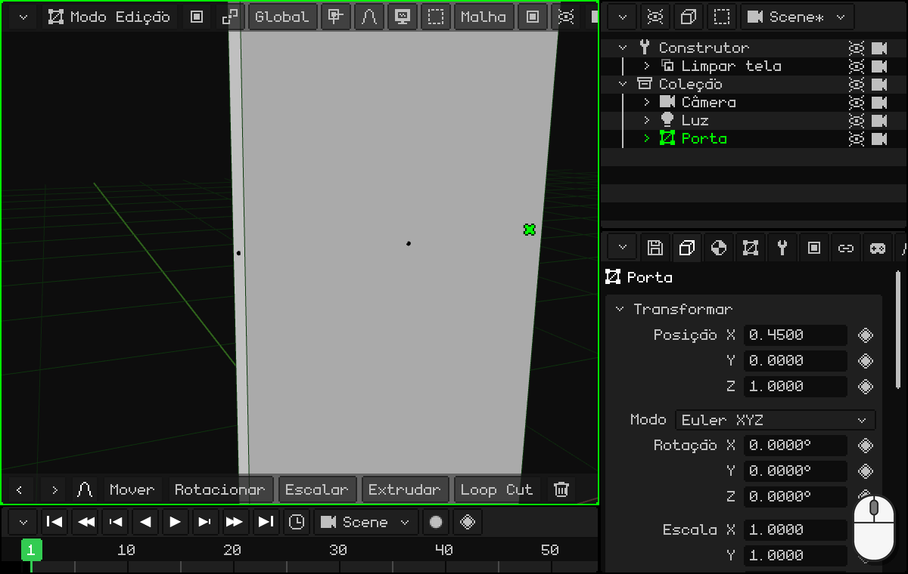

 Em uma tela touch: um toque na face e **Malha → Duplicar** (a cópia fica em cima). Depois **Escalar**, **Mover** e **Extrudar** na barra de ferramentas, com os números no teclado da barra de cima, e o visto.

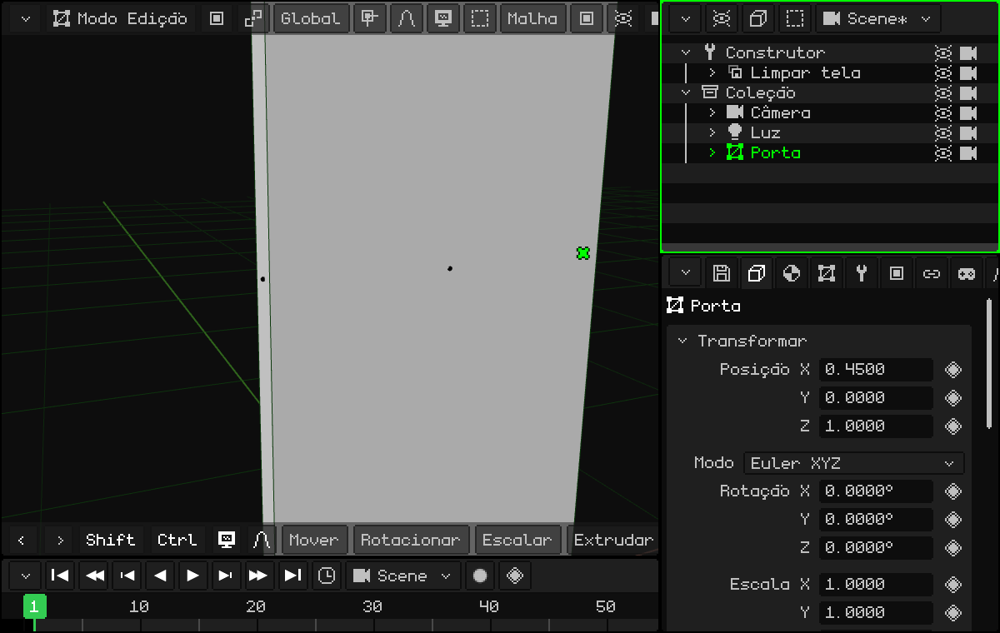

 No Nokia N95: **Malha → Duplicar** com a soft esquerda; depois <kbd>3</kbd> (escalar), <kbd>1</kbd> (mover) e <kbd>7</kbd> (extrudar), com o lápis mantido para os números e <kbd>OK</kbd>.

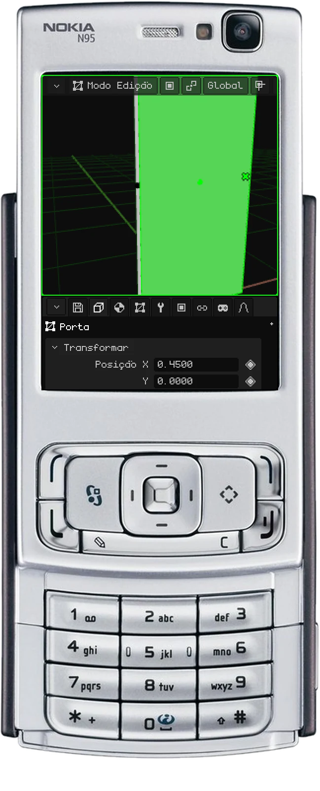

## 2. Separar a placa

A placa ainda é parte da malha da porta. Vamos passá-la para um objeto próprio:

1. Com a placa selecionada, <kbd>L</kbd> (**Selecionar Vinculado**) seleciona a peça inteira: as 6 faces da placa, sem a porta.
2. <kbd>P</kbd> (**Separar**): a placa passa a ser um objeto novo, **Porta.001**. Você o vê no Outliner.

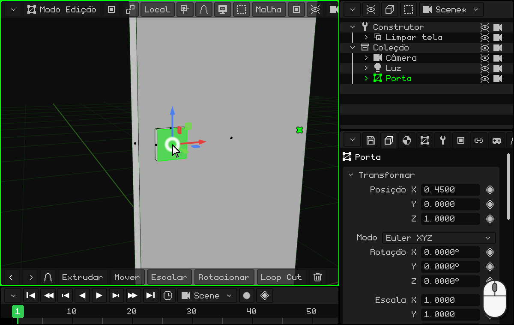

  Em tela touch e no N95: **Selecionar → Selecionar Vinculado** e um toque na placa; depois **Malha → Separar**.

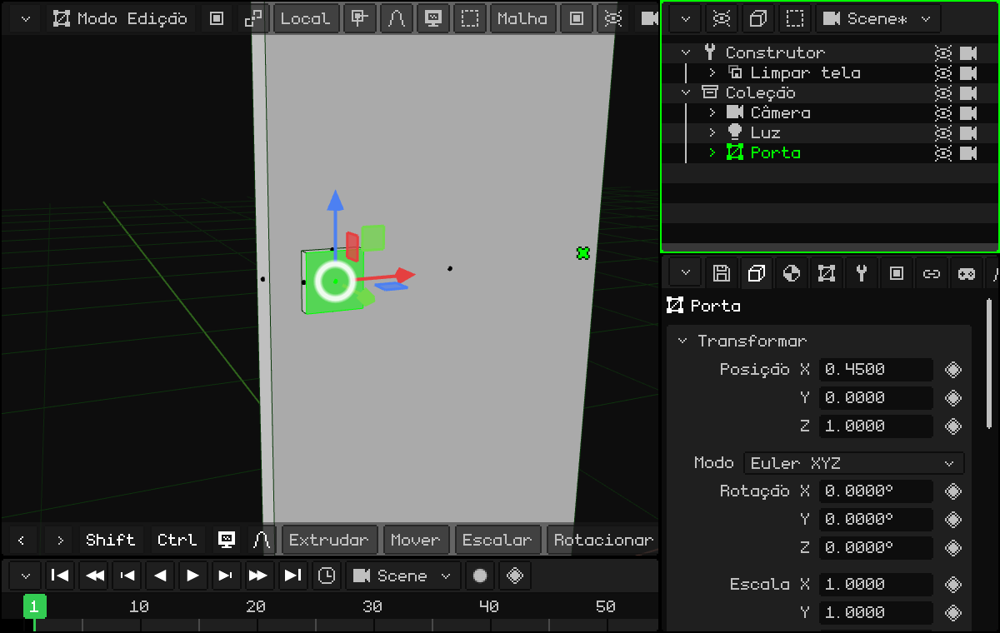

Ao separar, não sobra nada da placa na porta: nem as faces nem as linhas dela.

## 3. Os materiais: madeira e metal

Agora cada parte pode ter o seu material. Nas **Propriedades**, na aba **Material**:

1. Selecione a porta. Em **Renomear Material** digite `Madeira`, e em **Cor** escolha um marrom.
2. Selecione a placa (Porta.001). Como ela saiu da porta, também tem a Madeira: toque em **Novo Material**, chame-o de `Metal` e dê a ele um cinza.

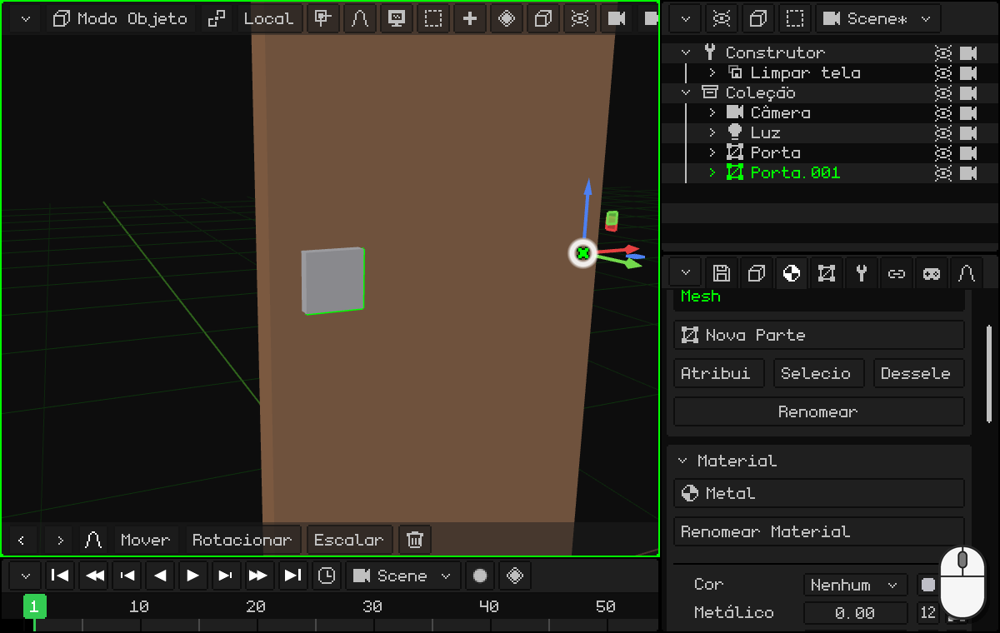

## 4. Do outro lado da porta: o Espelho

Uma maçaneta fica dos dois lados. Em vez de fazer outra placa, usamos o modificador **Espelho**:

1. Com a placa selecionada, em **Propriedades → Modificadores**, adicione **Espelho**.
2. Desligue **Espelho X** e ligue **Espelho Y**: aparece a outra placa, do outro lado da porta.

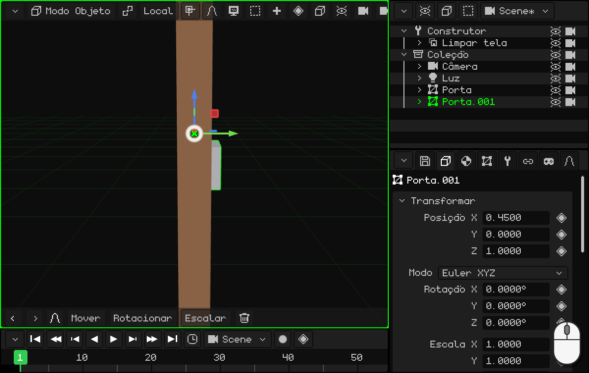

O espelho é feito sobre a **origem** do objeto. A placa saiu da porta, então tem a mesma origem: a dobradiça, exatamente na metade da espessura da porta. Por isso a cópia fica exatamente do outro lado. Veja [Espelho](../editor/modificador-espejo.md).

## 5. A alavanca

A alavanca sai da placa, com o mesmo truque:

1. Com a placa selecionada, aperte <kbd>/</kbd> no teclado numérico (**Vista local**): só a placa aparece, mais fácil de trabalhar. Entre no **Modo Edição**.
2. Selecione a face da frente da placa, **duplique-a** (<kbd>Shift</kbd> + <kbd>D</kbd> e clique direito) e diminua-a: <kbd>S</kbd> `0.6` <kbd>Enter</kbd>.
3. **Extrude-a** para fora: <kbd>E</kbd> `0.08` <kbd>Enter</kbd>. É o eixo da alavanca.

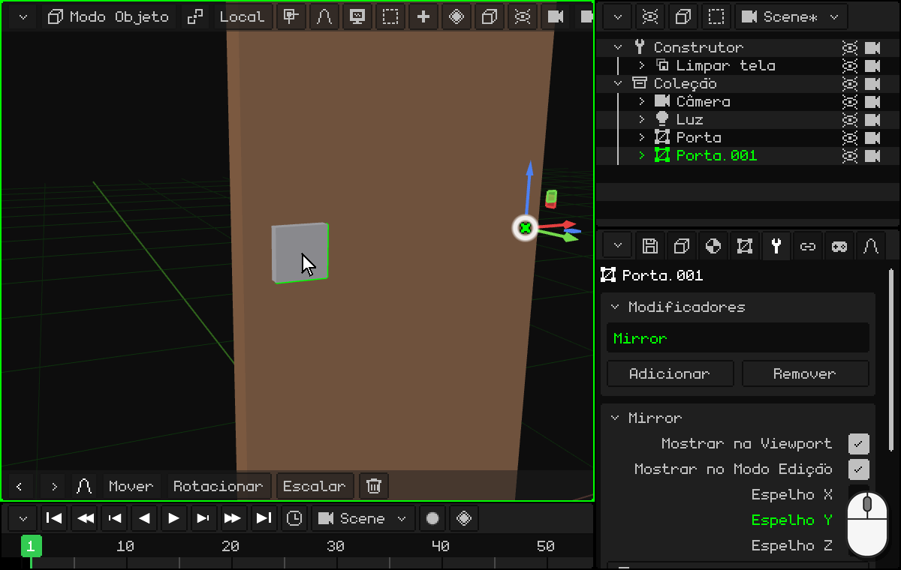
4. Passe para **Aresta** e selecione a aresta de fora do lado da borda da porta. Mova-a para fora: <kbd>G</kbd> <kbd>Y</kbd> `0.05` <kbd>Enter</kbd>. A face da frente fica inclinada.
5. Passe para **Face** e selecione essa face inclinada. Extrude-a **em X**, não na sua normal: <kbd>E</kbd>, <kbd>X</kbd>, `0.34` e <kbd>Enter</kbd>. Sai o braço da alavanca.
6. A ponta ficou inclinada. Para deixá-la reta, escale-a a zero em X: <kbd>S</kbd> <kbd>X</kbd> `0` <kbd>Enter</kbd>. Todos os vértices dela ficam no mesmo X: a ponta fica plana.

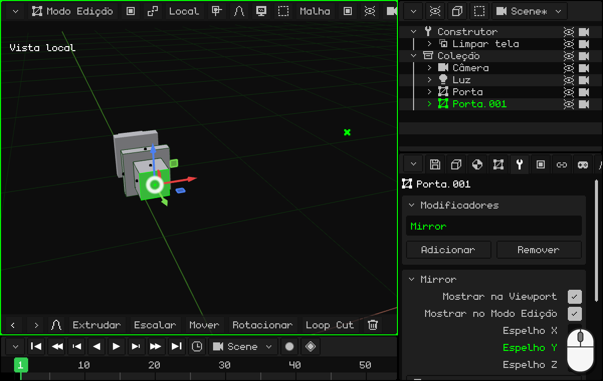
7. <kbd>L</kbd> seleciona a alavanca inteira e <kbd>P</kbd> a separa: ela fica em **Porta.002**. Dê um nome a ela: clique duplo no Outliner e digite `Alavanca`.

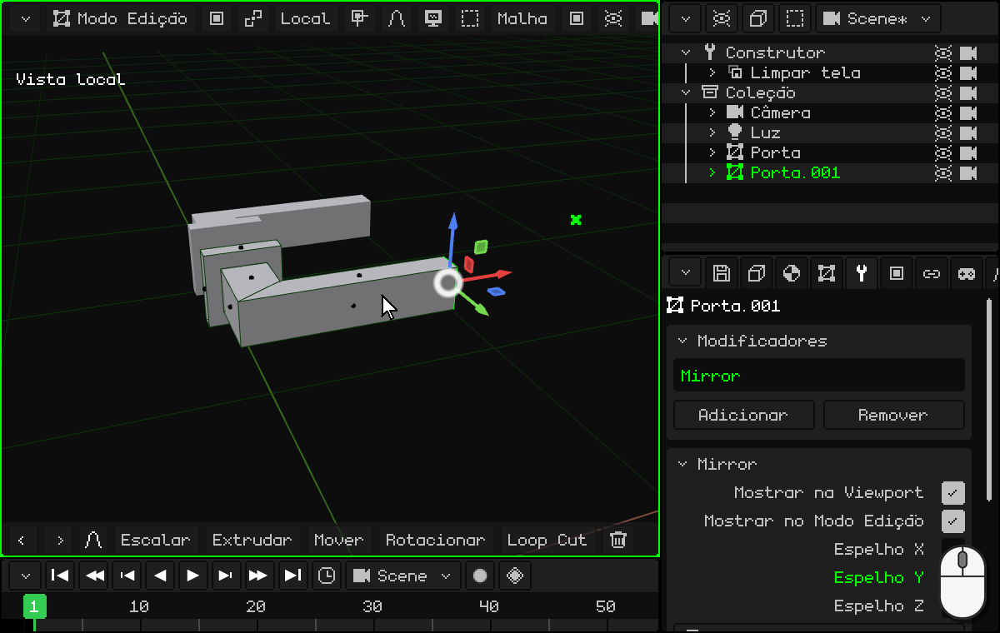

 Em uma tela touch: um toque na face, **Malha → Duplicar**, **Escalar** `0.6` e **Extrudar** `0.08`; **Aresta**, um toque na de fora e **Mover** **Y** `0.05`; **Face**, um toque na inclinada, **Extrudar** **X** `0.34` e **Escalar** **X** `0`. Para separar, **Selecionar → Selecionar Vinculado** e **Malha → Separar**.

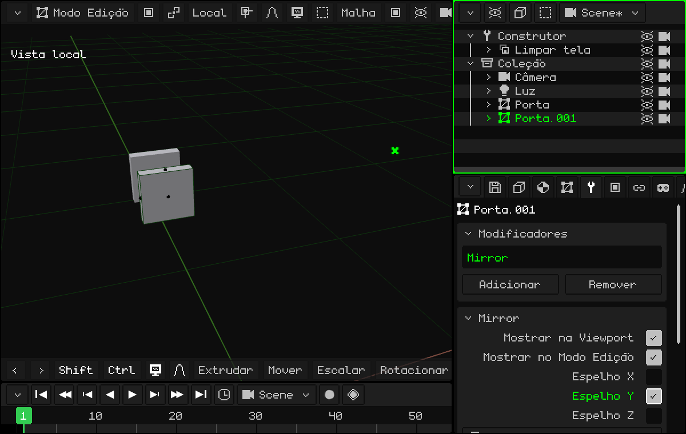

 No Nokia N95: <kbd>3</kbd> e `0.6`, <kbd>7</kbd> e `0.08`; a aresta (com o mouse virtual), <kbd>1</kbd>, <kbd>2</kbd> (o eixo Y) e `0.05`; a face inclinada, <kbd>7</kbd>, <kbd>1</kbd> (o eixo X) e `0.34`; <kbd>3</kbd>, <kbd>1</kbd> e `0`.

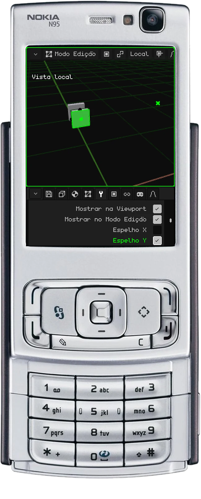

A alavanca saiu da placa, então traz o material dela (Metal) e o modificador Espelho.

## 6. Juntar a placa à porta

A placa não se move sozinha: ela é parte da porta. Vamos juntá-las de novo:

1. Selecione a placa e, em **Modificadores**, toque em **Aplicar Modificador**: o espelho vira geometria de verdade.
2. Selecione a placa, depois a porta com <kbd>Shift</kbd> + clique (a porta fica ativa) e <kbd>Ctrl</kbd> + <kbd>J</kbd> (**Juntar**). Agora são uma malha só, com os seus dois materiais.

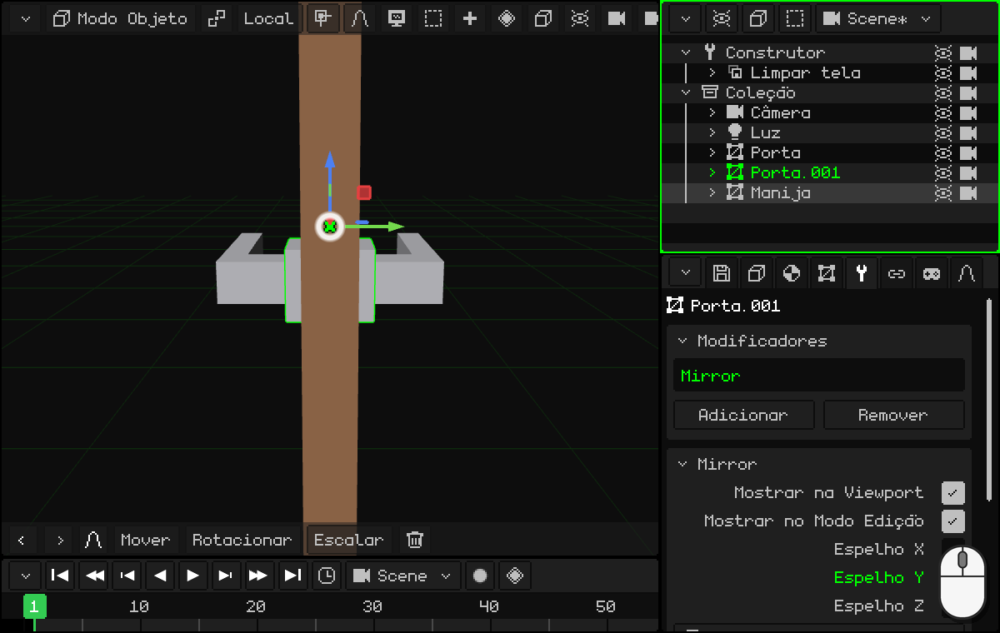

  Em tela touch e no N95: **Objeto → Juntar**.

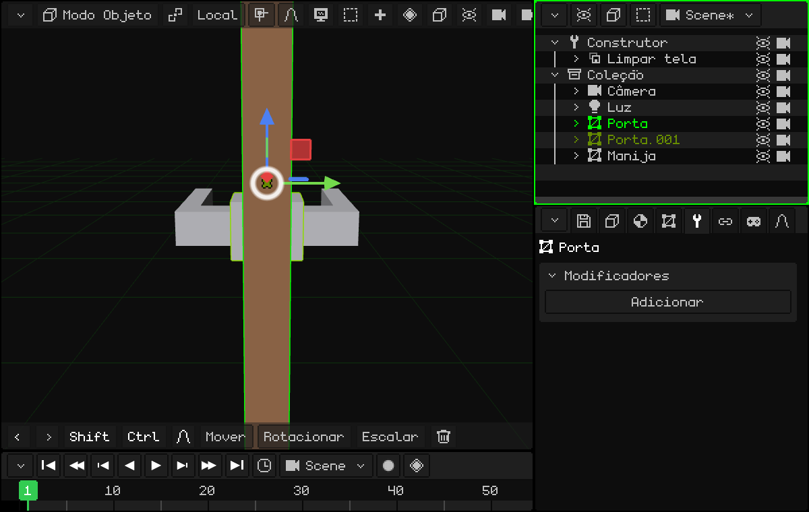

É assim que se separam e se juntam partes de uma malha: <kbd>P</kbd> para separar, <kbd>Ctrl</kbd> + <kbd>J</kbd> para juntar.

## 7. As faces que nunca aparecem

A placa está apoiada contra a porta. A face de trás de cada placa fica tapada: ela nunca vai aparecer, mas o programa a desenha mesmo assim. Para vê-la:

1. Selecione a porta e entre no **Modo Edição**.
2. Em **Sobreposições**, ligue **Raio-X**: a malha fica transparente e as faces de trás aparecem.
3. Selecione a face de trás de cada placa (a que encosta na porta) e exclua-as: <kbd>X</kbd> → **Faces**.

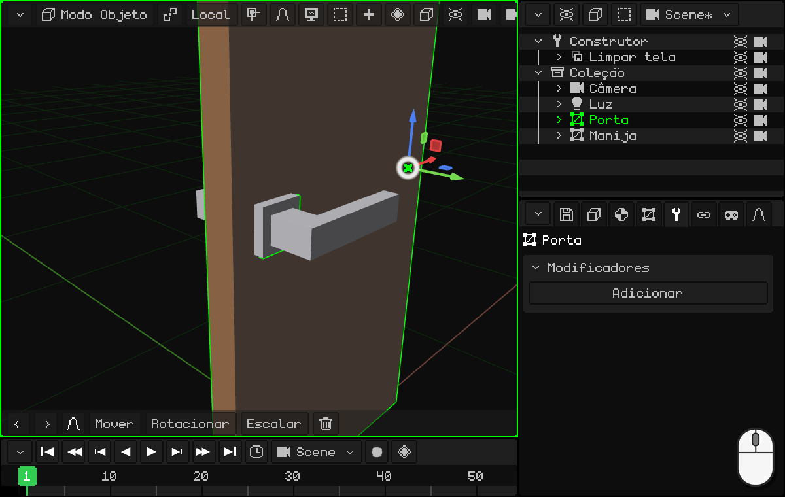

Vale a pena excluir a geometria que não aparece: são faces desenhadas à toa. Em um modelo pequeno não se nota, mas em uma cena grande, ou em um celular, é desempenho que se ganha.

## 8. Onde a alavanca gira: a origem

A alavanca precisa girar sobre o seu eixo, não sobre a dobradiça da porta.

1. Selecione a alavanca e aplique o Espelho dela (**Modificadores → Aplicar Modificador**).
2. Entre no **Modo Edição**, com **Raio-X**. Selecione as duas faces de trás da alavanca, as que encostam nas placas (uma de cada lado).
3. <kbd>Shift</kbd> + <kbd>S</kbd> → **Cursor para o selecionado**: o cursor 3D fica no meio das duas, exatamente no eixo da alavanca.
4. Essas duas faces também não aparecem: exclua-as (<kbd>X</kbd> → **Faces**).
5. Volte para o **Modo Objeto** e leve a origem até o cursor: <kbd>W</kbd> (ou clique direito) → **Definir Origem → Origem para Cursor 3D**.

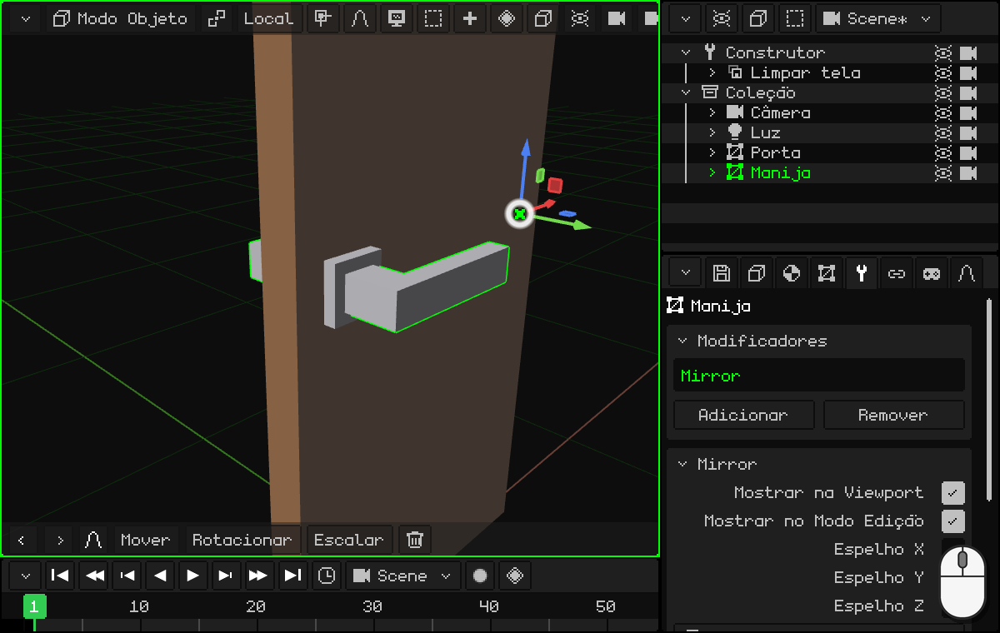

É o mesmo que fizemos com a dobradiça em [Mudar a origem: uma porta](puerta.md#levar-a-origem-até-a-dobradiça).

## 9. Que a alavanca acompanhe a porta

Experimente girar a porta: a alavanca fica flutuando no ar. São dois objetos soltos. Desfaça o giro (<kbd>Ctrl</kbd> + <kbd>Z</kbd>).

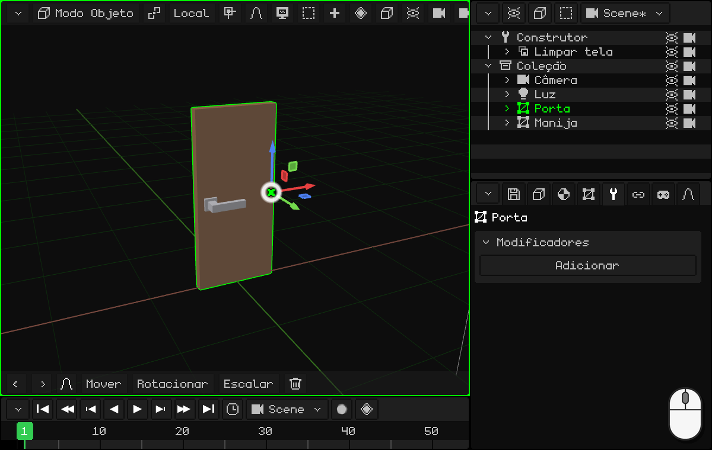

Para que a alavanca se mova com a porta, é preciso **parenteá-la**: a alavanca passa a ser **filha** da porta.

1. Selecione a alavanca e depois a porta com <kbd>Shift</kbd> + clique (a porta, o pai, fica ativa).
2. <kbd>Ctrl</kbd> + <kbd>P</kbd> → **Objeto (Manter Transform.)**. No Outliner, a alavanca fica dentro da porta.

Selecione só a porta (um clique nela) e gire-a de novo: agora a alavanca a acompanha. E a alavanca continua girando sobre o seu próprio eixo, como uma maçaneta de verdade. Se as duas estiverem selecionadas, só a porta gira, e a alavanca a segue por ser filha dela.

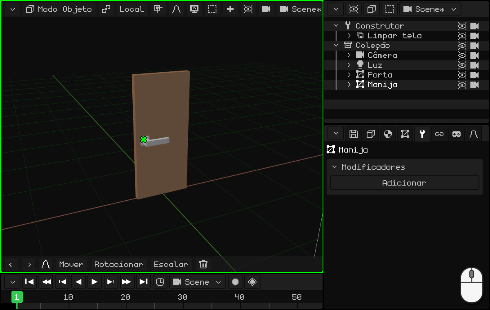

  Em tela touch e no N95: **Objeto → Parentear → Objeto (Manter Transform.)**.

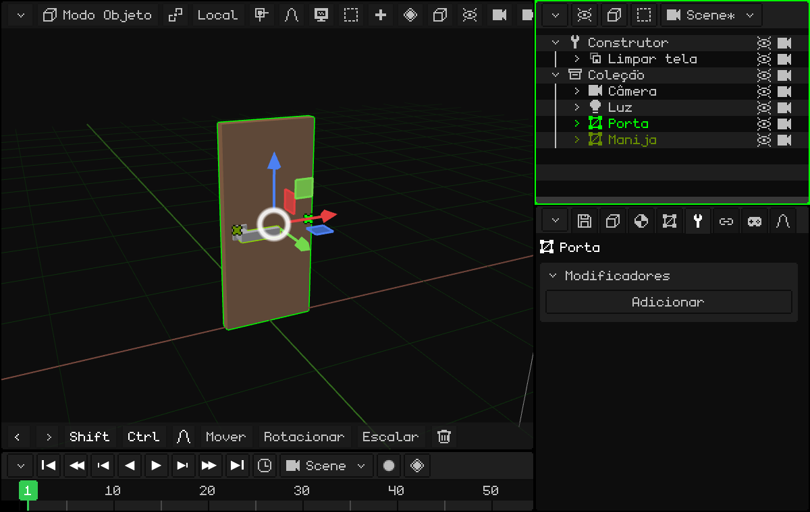

No próximo tutorial vamos animar a porta: [Animar a porta](animar-puerta.md).
