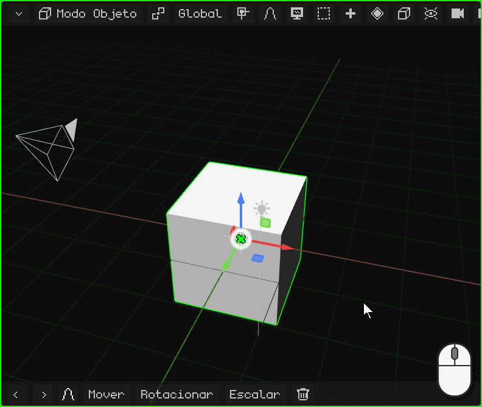
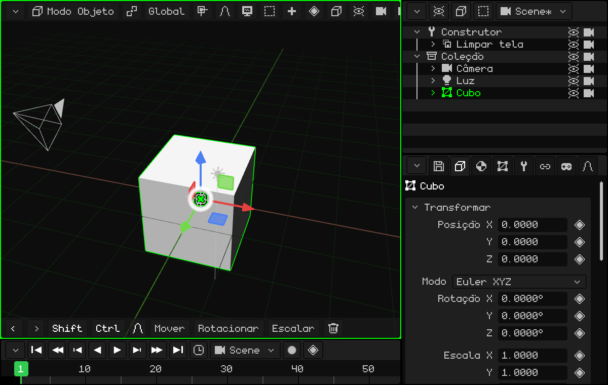
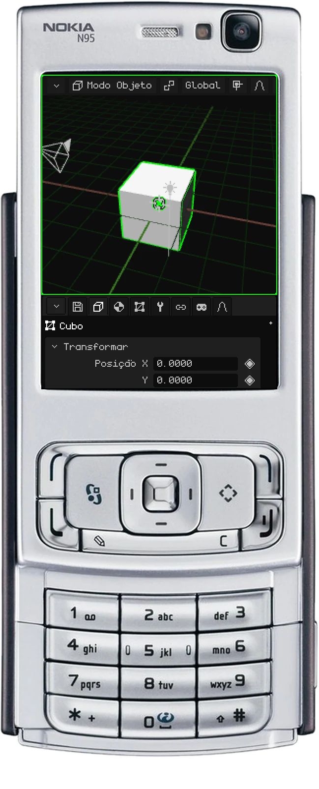
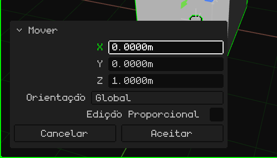
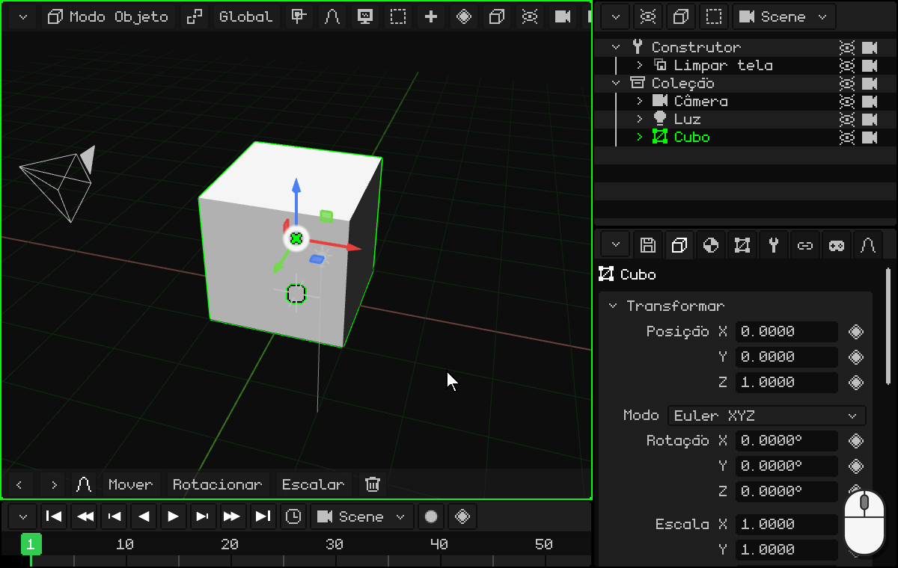
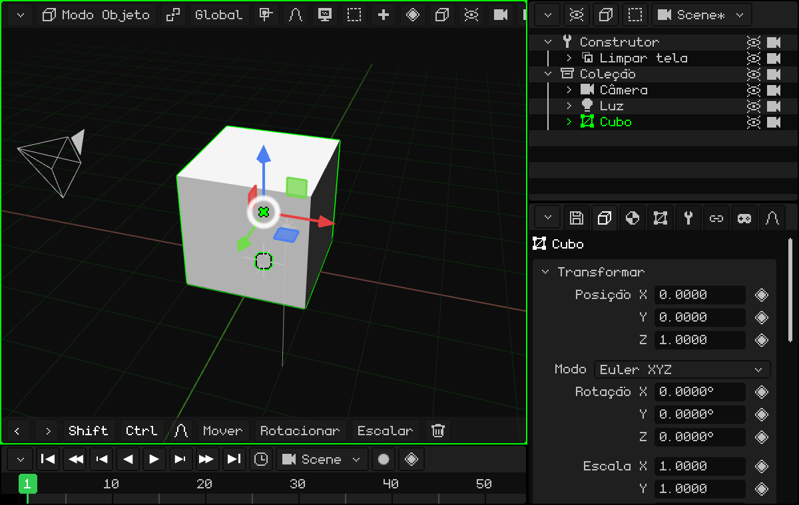
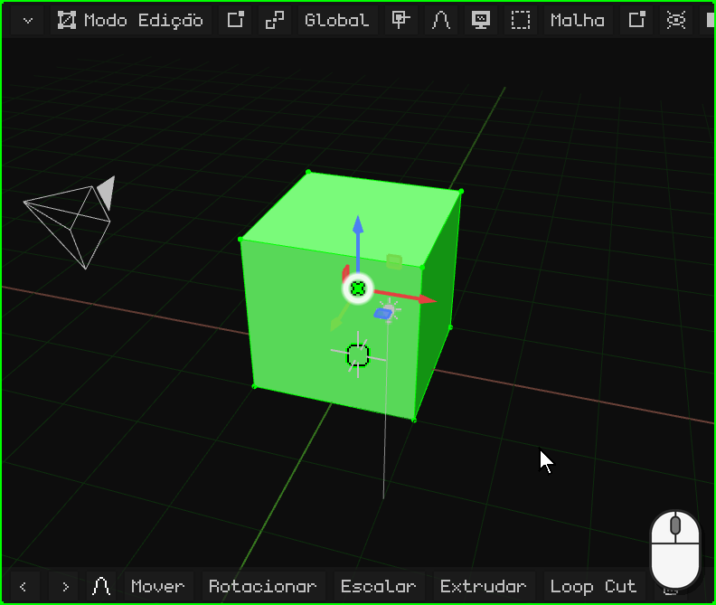
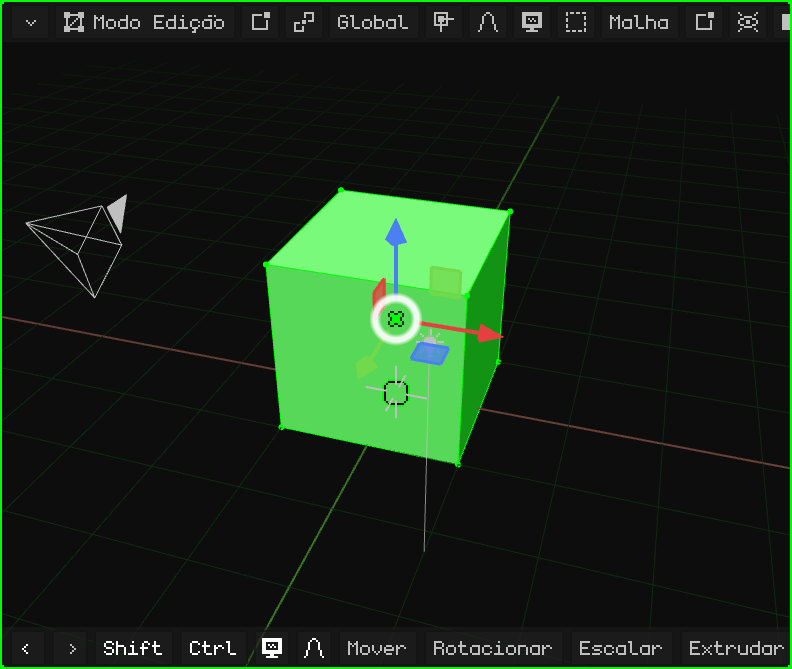
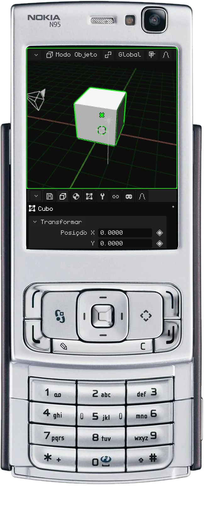
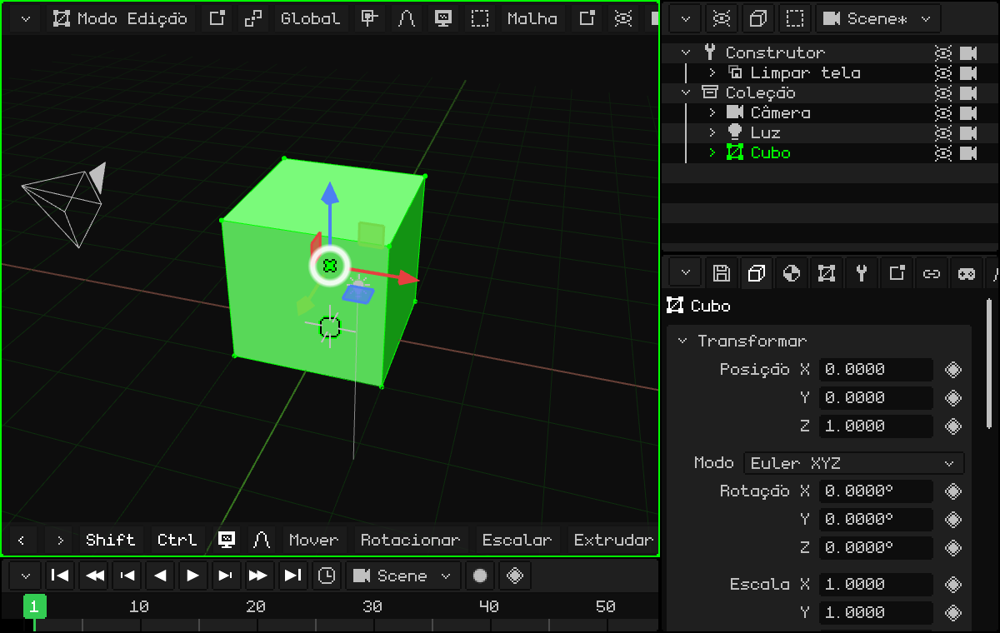

# Modelar uma porta

Vamos fazer o nosso primeiro modelo simples: uma porta! Para começar, serve o cubo que vem na cena, que mede 2 × 2 × 2 metros.

Eu (Dante) uso muito as portas para criar espaços: é algo que aprendi estudando construção. As portas quase sempre medem 2 metros de altura, e uma pessoa (normalmente) é mais baixa que uma porta. Com uma porta na cena, você tem na hora a escala de todo o resto.

## Apoiá-la no chão

O cubo tem o centro no chão, então metade dele fica embaixo. Vamos subi-lo 1 metro no eixo Z para que fique apoiado. Com o cubo selecionado:

 Aperte <kbd>G</kbd>: o cubo segue o mouse. Depois <kbd>Z</kbd>: ele fica preso ao eixo Z (aparece a linha azul). Digite `1` e aperte <kbd>Enter</kbd>.

 Toque em **Mover** na barra de ferramentas, depois em **Z**, um toque na barra de cima para o teclado numérico, `1`, **OK** e o visto verde.

 <kbd>1</kbd> (mover), <kbd>3</kbd> (o eixo Z), o **lápis** mantido e <kbd>1</kbd>, e <kbd>OK</kbd>.

Como digitar os números em cada dispositivo está em [Com números exatos](modo-objeto.md#com-números-exatos).

### Corrigir a última operação

Depois de mover, rotacionar ou escalar, aparece embaixo à esquerda um painel pequeno, **Ajustar a última operação**, no lugar da barra de ferramentas. Recolhido, ele só diz o que você fez (por exemplo, **Mover**); um toque ou um clique no título o expande:

Cada valor pode ser corrigido: se em vez de 1 metro você queria 1,2, toca em Z, digita `1.2` e a operação é refeita com o valor novo. **Aceitar** o fecha e a barra de ferramentas volta; **Cancelar** desfaz a operação.

## Dar forma

Há duas formas de modelar a porta.

### A mais fácil, que eu não recomendo: escalar o objeto

No Modo Objeto, escale o cubo no eixo X e no eixo Y até ele ter a forma da porta. Por exemplo, <kbd>S</kbd> <kbd>X</kbd> `0.45` <kbd>Enter</kbd> (90 cm de largura) e <kbd>S</kbd> <kbd>Y</kbd> `0.05` <kbd>Enter</kbd> (10 cm de espessura).

Não a recomendo porque o objeto fica com uma escala diferente em cada eixo (0,45, 0,05 e 1), e o ideal é que ele tenha escala **1** nos três eixos (veja [Melhor com a escala em 1](modo-objeto.md#melhor-com-a-escala-em-1)). Se você chegar a fazer assim, **sempre aplique a transformação**: <kbd>Ctrl</kbd> + <kbd>A</kbd> → **Escalar** (ou Objeto → Aplicar → Escalar). A forma não muda e a escala volta para 1.

 Em uma tela touch: **Escalar**, **X**, a barra de cima, `0.45` e OK, e o mesmo com **Y** e `0.05`. Depois, **Objeto → Aplicar → Escalar**.

### A que eu recomendo: o Modo Edição

Com o cubo selecionado, entre no Modo Edição: aperte <kbd>Tab</kbd> ou escolha **Modo Edição** no botão do modo da Viewport 3D. Ao entrar, todos os vértices ficam selecionados.

No Modo Edição você seleciona **vértices**, **arestas** e **faces**: isso é o básico. E, igual ao Modo Objeto, eles podem ser movidos, rotacionados e escalados (veja [Modo Edição](../editor/modo-edicion.md)).

Com tudo selecionado, diminua em X e em Y até ter a porta do jeito que você quer. Em Z não é preciso, porque ela já mede 2 metros! Como o que muda é a malha e não o objeto, a escala continua em 1.

**No olho, com o gizmo:** um clique (ou um toque) no centro do gizmo o passa para Rotacionar, e outro para **Escalar**. Pegue a ponta vermelha (X) e arraste-a em direção ao centro até a largura que você quiser; depois a verde (Y), até ela ficar fininha como uma porta.

**Com números:** <kbd>S</kbd>, <kbd>X</kbd>, `0.45`, <kbd>Enter</kbd> e <kbd>S</kbd>, <kbd>Y</kbd>, `0.05`, <kbd>Enter</kbd>.

 Em uma tela touch: o botão do modo → **Modo Edição**; depois **Escalar**, **X**, um toque na barra de cima, `0.45`, **OK** e o visto, e o mesmo com **Y** e `0.05`.

 No Nokia N95: <kbd>OK</kbd> passa para o Modo Edição. <kbd>3</kbd> (escalar), <kbd>1</kbd> (o eixo X), o lápis mantido e `0` <kbd>*</kbd> `45` (o <kbd>*</kbd> é o ponto), e <kbd>OK</kbd>. O mesmo com <kbd>2</kbd> (o eixo Y) e `0.05`.

## Com medidas exatas

Se em vez de fazer no olho você quer, por exemplo, uma porta de exatamente **90 cm de largura**: no botão **Vértice / Aresta / Face** escolha **Face** e clique em uma das laterais. Sabemos que o cubo mede 2 metros, então precisamos tirar o que sobra para que fique com 0,9: é preciso deslocar essa lateral **1,1 metro**. <kbd>G</kbd> <kbd>X</kbd> `-1.1` <kbd>Enter</kbd>.

Ao mover, o eixo **X** trava o movimento em um só eixo, para que o cubo não se deforme:

-  Com a tecla <kbd>X</kbd>.
-  Com um toque em **X** na barra de ferramentas. O `-1.1` é digitado com o teclado numérico, tocando na barra de cima.
-  Com <kbd>1</kbd> enquanto move. O número é digitado com o lápis mantido: <kbd>#</kbd> muda o sinal e <kbd>*</kbd> é o ponto. A face é selecionada com o mouse virtual (a tecla de seleção direita, as setas e <kbd>OK</kbd>).

Para a espessura, com tudo selecionado, <kbd>S</kbd> <kbd>Y</kbd> `0.05` <kbd>Enter</kbd>, como antes.

E já temos o nosso primeiro modelo 3D! Parabéns.

No próximo tutorial vamos fazer a porta abrir a partir da dobradiça: [Mudar a origem: uma porta](puerta.md).
