# O Modo Objeto

No **Modo Objeto** você trabalha com os objetos inteiros: eles são selecionados, movidos, rotacionados, escalados, adicionados, excluídos e colocados uns dentro dos outros. É o modo em que o Whisk3D começa, e é isso que diz o botão do canto superior esquerdo da Viewport 3D. Para mudar a forma de uma malha (os vértices, arestas e faces dela) existe o Modo Edição, que tem o seu próprio tutorial.

## O que é um objeto

Tudo o que há na cena é um **objeto**: o cubo com que um projeto começa, a câmera, a luz, um personagem. Cada objeto tem:

- um **nome**, que aparece no Outliner;
- a sua **transformação**: onde ele está (posição), como está girado (rotação) e qual é o seu tamanho (escala);
- **propriedades**, que dependem do tipo: uma luz tem cor e intensidade, uma câmera tem a sua lente, uma malha tem o seu material.

Existem objetos de muitos tipos, mas todos são selecionados, movidos, rotacionados e escalados do mesmo jeito.

## Selecionar um objeto

| | Como selecionar |
|---|---|
|  PC | Um clique sobre o objeto. <kbd>Shift</kbd> + clique adiciona ou remove outro. Um clique no vazio deixa tudo desselecionado. |
|  Tela touch | Um toque sobre o objeto. Com **Shift** ligado na barra de ferramentas da Viewport 3D, cada toque adiciona ou remove outro. |
|  Nokia N95 | A tecla do **lápis** passa de um objeto para o seguinte. Com o lápis e as setas você adiciona, remove, seleciona tudo ou nada. |

O que está selecionado aparece com um contorno, e o último que você selecionou é o **objeto ativo**: o que as Propriedades mostram.

### Selecionar vários com uma caixa

 Arraste o mouse com o clique primário sobre a Viewport 3D, começando pelo fundo: uma **caixa** é desenhada e, ao soltar, ficam selecionados os objetos que ela pegou. Ela também pode ser feita com <kbd>B</kbd>.

 Em uma tela touch, arrastar um dedo orbita a vista: a caixa é pedida no menu **Selecionar → Seleção por caixa**, e depois você arrasta o dedo.

O sentido do arraste muda o que é selecionado, e a caixa avisa isso com a sua cor:

| Arraste | Cor da caixa | O que seleciona |
|---|---|---|
| Da esquerda para a direita | Verde | Só o que fica **inteiro dentro** da caixa. |
| Da direita para a esquerda | Azul | Tudo o que a caixa **encosta**, mesmo que só um pouquinho. |

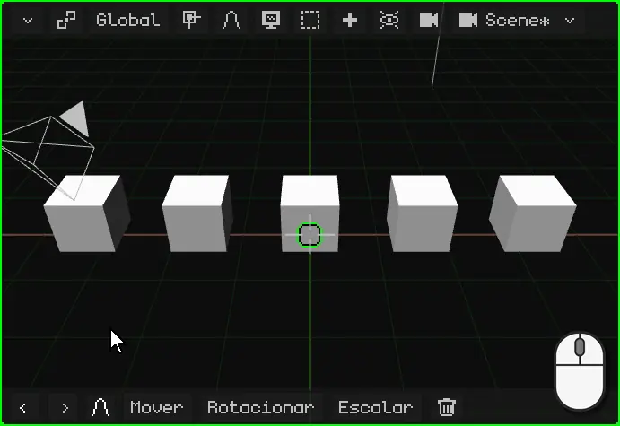

## O menu de contexto

Como em qualquer programa, o **menu de contexto** deixa à mão o que dá para fazer com o que está selecionado. No Modo Objeto, ele é o menu **Objeto**, que se abre onde está o ponteiro:

| | Como abrir |
|---|---|
|  PC | Clique direito sobre a Viewport 3D |
|  Tela touch | Manter um dedo parado sobre a Viewport 3D por meio segundo |
|  Nokia N95 | A soft esquerda abre a barra de menus; ali, o menu Objeto |

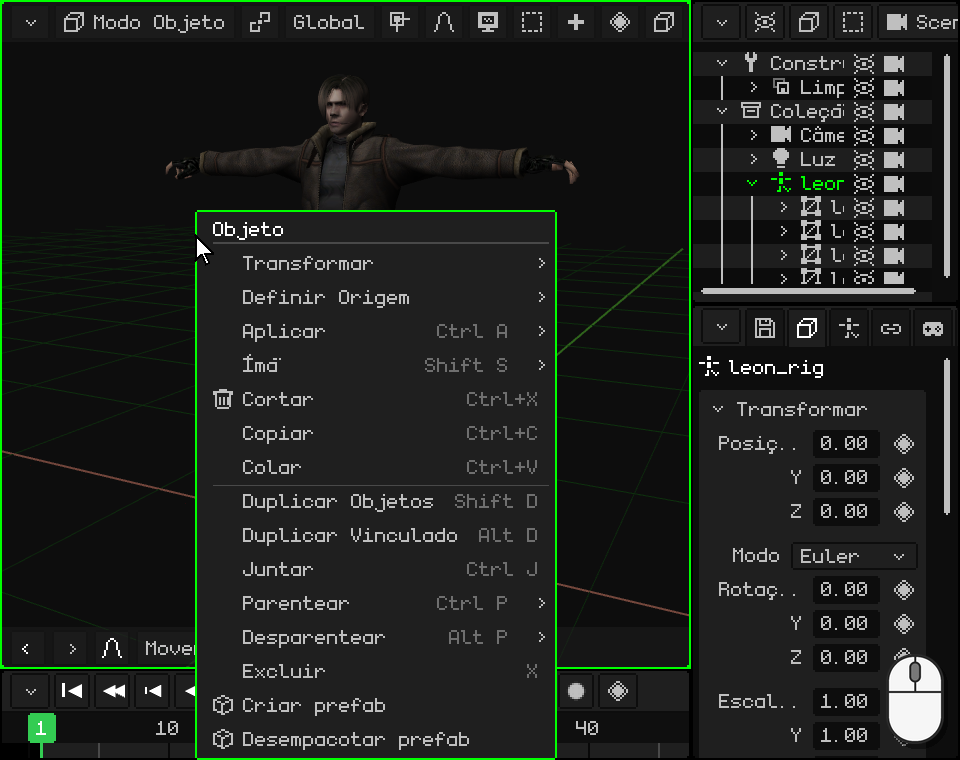

 Com Leon selecionado, um dedo parado sobre a Viewport 3D: depois de meio segundo o celular vibra e o menu se abre. Ao levantar o dedo nada é escolhido: você toca na opção depois.

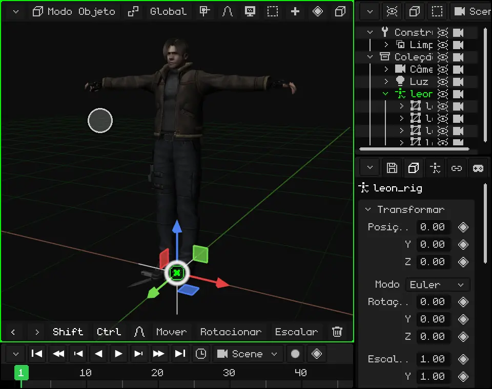

| Opção | O que faz |  Atalho |
|---|---|---|
| **Cortar** | Guarda o que está selecionado para colar depois e o tira da cena. | <kbd>Ctrl</kbd> + <kbd>X</kbd> |
| **Copiar** | Guarda uma cópia do que está selecionado, com os filhos, para colar depois: nesta cena, em outro projeto ou em outra janela do Whisk3D aberta. | <kbd>Ctrl</kbd> + <kbd>C</kbd> |
| **Colar** | Coloca na cena a última coisa que foi copiada ou cortada, no mesmo lugar, e a deixa selecionada. | <kbd>Ctrl</kbd> + <kbd>V</kbd> |
| **Duplicar Objetos** | Faz uma cópia do que está selecionado, independente do original, e a deixa presa ao ponteiro para você movê-la: um clique (ou <kbd>OK</kbd>) a deixa onde está. | <kbd>Shift</kbd> + <kbd>D</kbd> |
| **Duplicar Vinculado** | Como Duplicar, mas a cópia **compartilha a malha** com o original: se você muda a forma de uma, as duas mudam. A posição, a rotação e a escala são de cada uma. Serve para muitas coisas iguais, como as árvores de uma floresta ou as cadeiras de um salão: todas são editadas de uma vez e ocupam menos memória. | <kbd>Alt</kbd> + <kbd>D</kbd> |
| **Excluir** | Exclui o que está selecionado. Pede confirmação. | <kbd>X</kbd> ou <kbd>Delete</kbd> |

As outras opções do menu aparecem neste mesmo tutorial: Transformar (mover, rotacionar e escalar), [Definir Origem e o Ímã](#de-onde-se-move-se-rotaciona-e-se-escala), [Aplicar](#melhor-com-a-escala-em-1), [Parentear e Desparentear](#o-outliner-os-objetos-da-cena). **Juntar** junta várias malhas em uma só, e os **prefabs** (objetos montados para reutilizar) têm o seu próprio tutorial.

## Mover, rotacionar e escalar

As três operações básicas de um objeto são **mover**, **rotacionar** e **escalar**. Cada uma pode ser feita com o gizmo, com o teclado ou, em uma tela touch, com os comandos da barra de ferramentas. Se algo der errado, **Desfazer** (<kbd>Ctrl</kbd> + <kbd>Z</kbd> no PC) volta atrás.

### O gizmo

O **gizmo** são as setas coloridas que aparecem sobre o objeto selecionado. Cada cor é um eixo: **vermelho** é X, **verde** é Y e **azul** é Z, o de cima.

O gizmo tem três modos, um para cada operação. **Um clique sobre o gizmo, sem arrastar, passa para o seguinte**: de Mover para Rotacionar, de Rotacionar para Escalar e de Escalar de novo para Mover.

 Um clique com o mouse sobre o gizmo muda de modo.

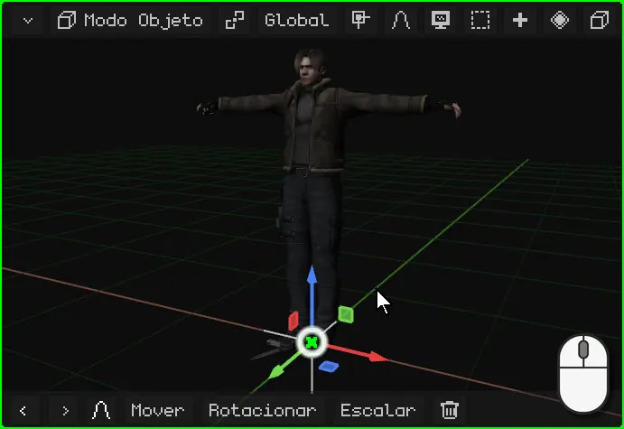

 Um toque sobre o gizmo muda de modo.

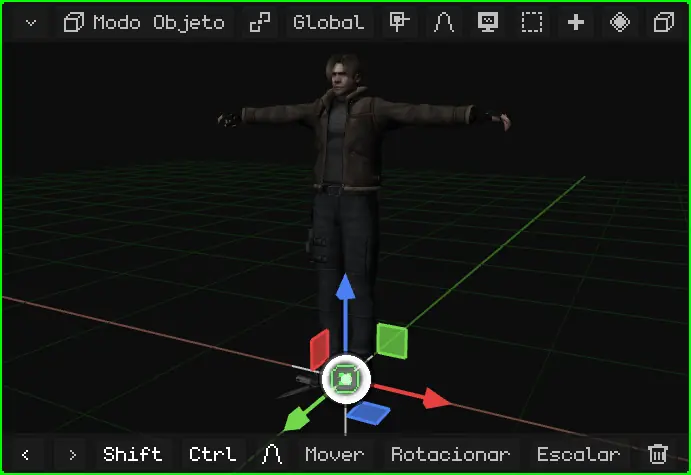

Para usá-lo, pegue uma parte do gizmo e arraste. Ao soltar, está feito.

| Modo | O que você pega | O que faz |
|---|---|---|
| Mover | Uma seta | Move só nesse eixo. |
| Mover | Um quadradinho | Move em um plano: o quadradinho azul move em X e Y, sem mudar a altura. |
| Mover | O círculo do centro | Move livremente, seguindo o ponteiro. |
| Rotacionar | Um semicírculo colorido | Gira ao redor desse eixo. |
| Rotacionar | O anel branco | Gira de frente para a vista. |
| Escalar | Uma ponta quadrada | Estica ou encolhe nesse eixo. |
| Escalar | O círculo do centro | Aumenta ou diminui por igual, nos três eixos. |

 Com o mouse: clique em uma parte do gizmo e arraste.

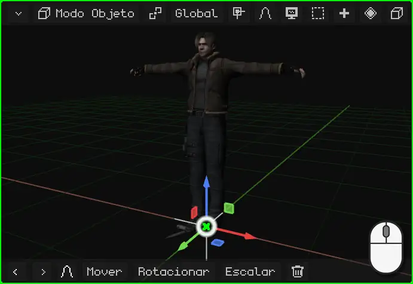

 Com o dedo: apoie-o em uma parte do gizmo e arraste. Se você apoiá-lo no fundo, orbita a vista.

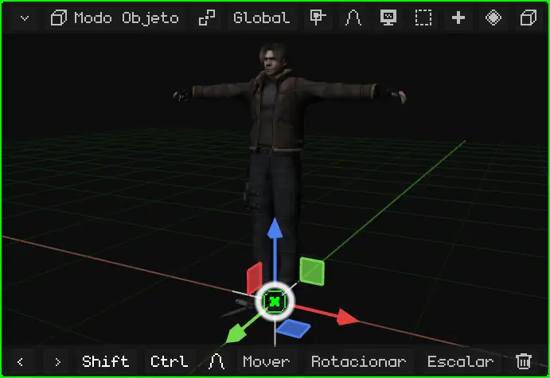

 No Nokia N95 o gizmo vem desligado: você move, rotaciona e escala com as teclas, como explicado abaixo. Ele pode ser ligado em Sobreposições → Gizmo, para usá-lo com um mouse Bluetooth.

### Com o teclado ou os comandos

Com o teclado não é preciso apontar para nada: você aperta a tecla e o objeto segue o mouse (ou as setas, no celular) até você confirmar.

| | Mover | Rotacionar | Escalar | Só em um eixo | Confirmar | Cancelar |
|---|---|---|---|---|---|---|
|  PC | <kbd>G</kbd> | <kbd>R</kbd> | <kbd>S</kbd> | <kbd>X</kbd> / <kbd>Y</kbd> / <kbd>Z</kbd> | Clique ou <kbd>Enter</kbd> | <kbd>Esc</kbd> ou clique direito |
|  Nokia N95 | <kbd>1</kbd> | <kbd>2</kbd> | <kbd>3</kbd> | <kbd>1</kbd> / <kbd>2</kbd> / <kbd>3</kbd> | <kbd>OK</kbd> (o centro do direcional) | <kbd>C</kbd> |

 Você aperta <kbd>G</kbd> e move o mouse: o objeto o segue. Se você apertar <kbd>X</kbd>, ele só se move em X; outro <kbd>X</kbd> muda de Global para Local. O mesmo ao rotacionar: <kbd>R</kbd> e depois <kbd>Z</kbd> gira sobre o eixo Z, o vertical; sem eixo, gira de frente para a vista. Você também pode digitar um número: <kbd>G</kbd>, <kbd>X</kbd>, <kbd>2</kbd> e <kbd>Enter</kbd> o deslocam 2 metros em X.

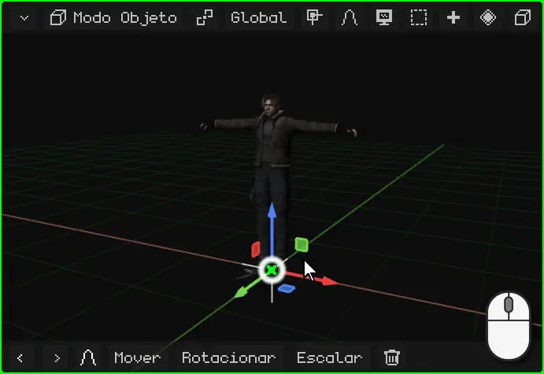

 No Nokia N95: <kbd>1</kbd> para mover, <kbd>2</kbd> para rotacionar e <kbd>3</kbd> para escalar, e as **setas** fazem o movimento. Enquanto ele dura, <kbd>1</kbd>, <kbd>2</kbd> e <kbd>3</kbd> não mudam mais de operação: escolhem o eixo X, Y ou Z. Por exemplo, <kbd>2</kbd> e depois <kbd>3</kbd> gira sobre o eixo Z, o vertical. <kbd>OK</kbd> confirma e <kbd>C</kbd> cancela.

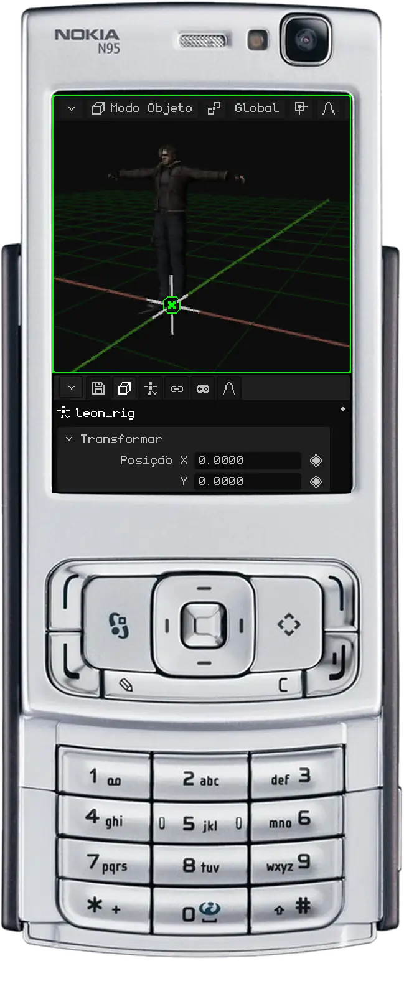

 **Em uma tela touch**, sem teclado, você pode usar o gizmo, como visto acima, ou os **comandos** da barra de ferramentas da Viewport 3D. Você toca em **Mover**, **Rotacionar** ou **Escalar** e arrasta o dedo em qualquer parte da vista: o objeto segue o dedo. A barra muda: o **visto verde** confirma, o **X vermelho** cancela, e os botões **X**, **Y** e **Z** restringem o movimento a esses eixos.

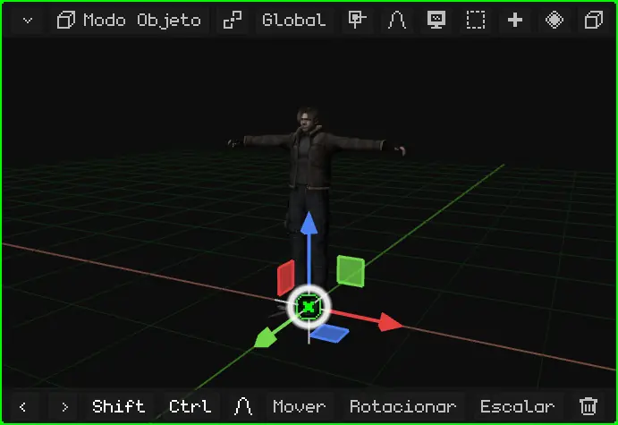

### Com números exatos

Para trabalhar com precisão, o movimento é digitado com um número: girar algo exatamente 90°, escalá-lo pela metade com `0.5` ou para o dobro exato do tamanho com `2`, ou movê-lo 1,5 metro. **Uma unidade do Whisk3D é um metro.**

Enquanto a operação dura, a barra de menus da Viewport 3D mostra o que está sendo feito e o valor.

 **Com o teclado:** depois de <kbd>G</kbd>, <kbd>R</kbd> ou <kbd>S</kbd>, digite o número e aperte <kbd>Enter</kbd>. <kbd>R</kbd> <kbd>Z</kbd> <kbd>9</kbd> <kbd>0</kbd> <kbd>Enter</kbd> o gira 90° sobre o eixo vertical; <kbd>S</kbd> <kbd>0</kbd> <kbd>.</kbd> <kbd>5</kbd> <kbd>Enter</kbd> o deixa pela metade e <kbd>S</kbd> <kbd>2</kbd> <kbd>Enter</kbd>, no dobro; <kbd>G</kbd> <kbd>X</kbd> <kbd>1</kbd> <kbd>.</kbd> <kbd>5</kbd> <kbd>Enter</kbd> o desloca 1,5 metro em X.

 **Em uma tela touch:** comece a operação com **Mover**, **Rotacionar** ou **Escalar** na barra de ferramentas e toque na barra de cima, a que mostra o valor: o teclado numérico do Whisk3D se abre. Digite o número e toque em **OK**; o visto verde conclui. O teclado também faz contas, como `90/2`.

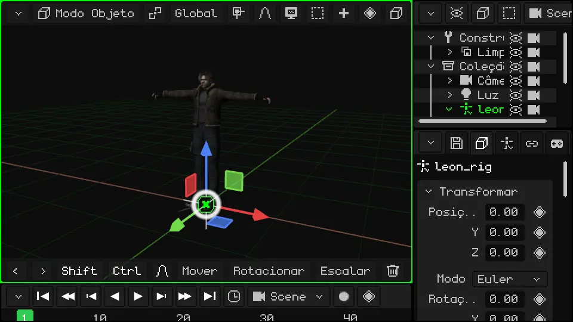

Todos os atalhos do Modo Objeto estão no manual: [Mover, rotacionar e escalar](../editor/transformar.md) e [Modo Objeto](../editor/modo-objeto.md).

### A barra de ferramentas: os últimos comandos

  Na **barra de ferramentas** da Viewport 3D (a de baixo) estão Desfazer e Refazer (as setas), e depois **os últimos comandos que você usou**, com o último na frente. No começo são Mover, Rotacionar, Escalar e Excluir. Se você escala um objeto, Escalar passa para a frente: o que você mais usa fica sempre à mão.

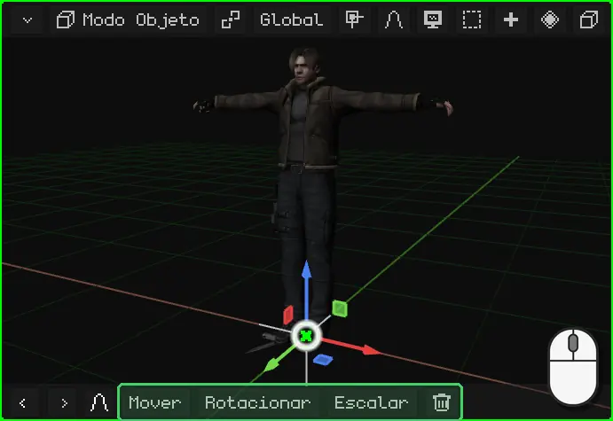

 No Nokia N95 a barra de ferramentas vem oculta, para deixar a tela para a cena: mover, rotacionar e escalar se faz com as teclas do celular. Quando ela aparece (por exemplo, a da edição proporcional durante uma transformação), os seus botões são usados com o **mouse virtual**: ele é ligado com a tecla de seleção direita, as setas o movem e <kbd>OK</kbd> clica.

## De onde se move, se rotaciona e se escala

### A origem

Cada objeto tem uma **origem**: o ponto de onde sai o gizmo. É o ponto a partir do qual ele é transformado: o objeto gira ao redor da sua origem e aumenta ou diminui a partir dela. A **posição** que as Propriedades mostram é a da sua origem.

Nas primitivas, a origem fica no centro. Em um modelo importado, fica onde o programa em que ele foi feito a deixou: em Leon, aos pés dele.

### O cursor 3D

O **cursor 3D** é o círculo com uma cruz da Viewport 3D. No começo ele fica no centro do mundo.

 Ele serve para duas coisas:

- tudo o que é adicionado com **Adicionar** aparece ali;
- ele pode ser o centro a partir do qual se rotaciona e se escala, como mostrado em [O ponto pivô](#o-ponto-pivô).

O cursor 3D é movido com o menu **Ímã**, que também leva os objetos até o cursor:

| | Como abrir o menu Ímã |
|---|---|
|  PC | <kbd>Shift</kbd> + <kbd>S</kbd> |
| Menu | Objeto → Ímã (no Modo Edição, Malha → Ímã) |

| Opção | O que faz |
|---|---|
| Cursor para o selecionado | Leva o cursor 3D ao centro do que está selecionado. No Modo Edição, ao centro dos vértices, arestas ou faces selecionados. |
| Cursor para o ativo | Leva o cursor 3D à origem do objeto ativo. |
| Cursor para a origem do mundo | Devolve o cursor ao centro do mundo. |
| Cursor para a grade | Leva o cursor ao ponto mais próximo da grade. |
| Seleção para Cursor | Leva o que está selecionado até o cursor 3D. |
| Seleção para o cursor (manter deslocamento) | Igual, mas com vários objetos mantém a distância entre eles: o grupo chega inteiro. |
| Seleção para o ativo | Leva o que está selecionado até o objeto ativo. |
| Seleção para a grade | Encaixa cada objeto selecionado no ponto mais próximo da grade. |

Por exemplo, para pôr uma caixa na mão de alguém, ou um objeto exatamente onde está outro: você seleciona o de destino, **Cursor para o selecionado**; depois seleciona o que quer levar e **Seleção para Cursor**.

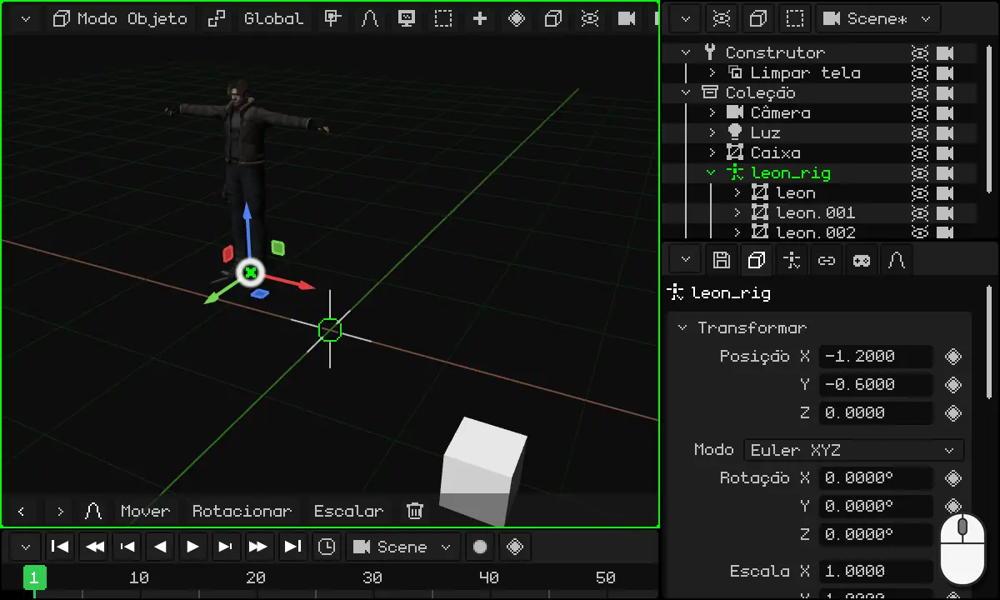

### O ponto pivô

O **ponto pivô** é o centro a partir do qual o que está selecionado é rotacionado e escalado. Ele é escolhido com o botão do pivô da barra da Viewport 3D, à esquerda de **Global** (o ícone muda conforme o pivô escolhido):

| Pivô | A partir de onde rotaciona e escala |
|---|---|
| **Ponto médio** | A partir do centro de tudo o que está selecionado. É o padrão. Com um só objeto, é a origem dele. |
| **Elemento ativo** | A partir da origem do objeto ativo (o último que você selecionou): os outros giram ao redor dele. |
| **Origens individuais** | Cada objeto a partir da sua própria origem: todos giram ao mesmo tempo, cada um no seu lugar. |
| **Cursor 3D** | A partir do cursor 3D. |

Com **Cursor 3D** você pode rotacionar qualquer coisa ao redor de qualquer ponto: coloca o cursor ali (com o menu Ímã) e rotaciona. Serve para arrumar cadeiras ao redor de uma mesa, os ponteiros de um relógio ou o que precisar girar ao redor de algo.

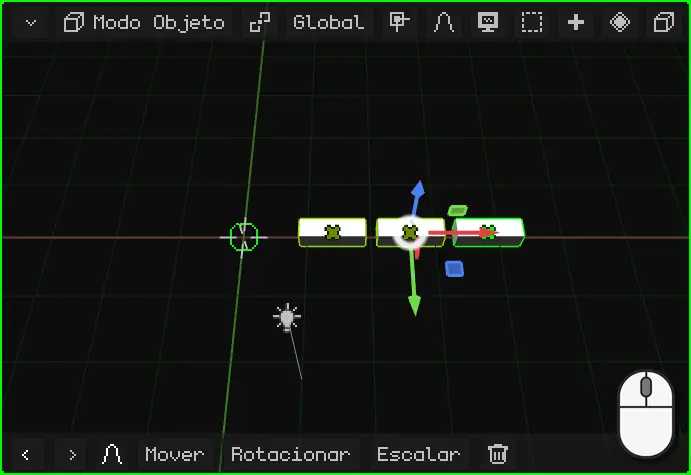

### Global e Local

Quando você move, rotaciona ou escala em um eixo, esse eixo pode ser o do **mundo** ou o do **objeto**. Isso é escolhido com o botão **Global** da barra da Viewport 3D:

| Orientação | Os eixos |
|---|---|
| **Global** | Os do mundo: sempre iguais, com o Z para cima. É a padrão. |
| **Local** | Os do próprio objeto, que giram com ele. |
| **Vista** | Os da tela: X para o lado, Y para cima. |
| **Normal** | No Modo Edição, a direção para a qual a face selecionada aponta. |

A diferença aparece quando o objeto está girado. Por exemplo, Leon rotacionado 40°: em **Global**, o eixo Y dele é o do mundo e ele se move na diagonal em relação a para onde olha; em **Local**, o eixo Y gira com ele e ele anda reto para a frente. O mesmo vale para um carro que virou uma esquina: para ele avançar, você o move no seu eixo Local.

 Com o teclado, a segunda letra do eixo muda de Global para Local: <kbd>G</kbd> <kbd>Y</kbd> move no Y do mundo e <kbd>G</kbd> <kbd>Y</kbd> <kbd>Y</kbd>, no Y do objeto. No Nokia N95, o mesmo com <kbd>2</kbd> <kbd>2</kbd> enquanto move.

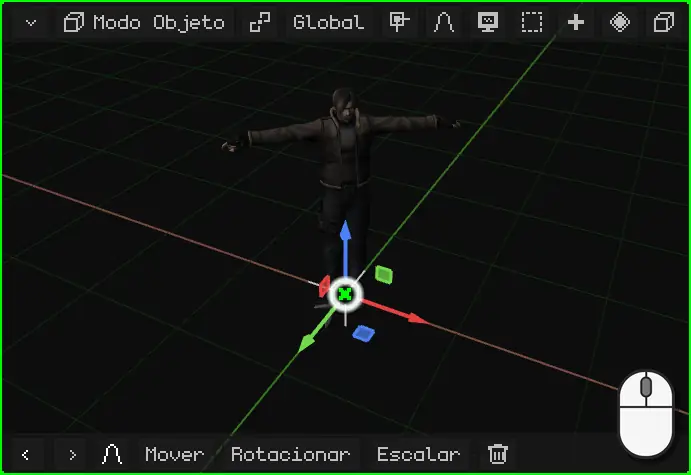

### Mudar a origem

A origem de uma malha 3D pode mudar de lugar sem mover a malha, com **Objeto → Definir Origem**. Como fazer isso, com o exemplo de uma porta que precisa abrir a partir da dobradiça, está no tutorial [Mudar a origem: uma porta](puerta.md).

## As propriedades

As **propriedades** do objeto ativo ficam na viewport Propriedades. A aba **Objeto** (a do cubo) é igual para todos os objetos: em cima está o cartão **Transformar**, com a posição, a rotação e a escala. Você pode digitar os números à mão: um clique (ou um toque) no número e você digita. Mover o objeto na Viewport 3D muda esses números, e mudar os números o move.

As outras abas dependem do tipo de objeto: uma luz tem a aba da luz, uma malha tem a do material e a dos modificadores.

### O losango: o que pode ser animado

Ao lado de muitas propriedades há um **losango**. O losango quer dizer que essa propriedade **pode ser animada**: um clique no losango salva o valor dela no quadro atual (um *keyframe*), e outro clique no losango verde o remove. Com vários keyframes, a propriedade muda sozinha com o tempo.

A cor do losango diz como a propriedade está: **cinza**, ainda não está animada; **verde** aceso, já está animada e tem um keyframe neste quadro; **verde fraco**, está animada, mas não tem keyframe neste quadro.

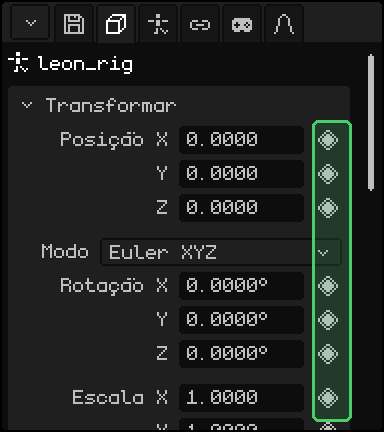

A animação tem o seu próprio tutorial mais adiante.

### Melhor com a escala em 1

Uma dica: **deixe a escala dos objetos em 1**. Aumentar ou diminuir um objeto com Escalar é prático, mas um objeto escalado pode trazer problemas depois: os filhos herdam a escala e se deformam ao rotacionar, e as físicas, as colisões e alguns modificadores podem calcular errado.

Se você escalou um objeto, **aplique a escala**: o tamanho que ele tem passa a ser o seu tamanho real e a escala volta para 1, sem mudar o que se vê.

| | Como aplicar a escala |
|---|---|
|  PC | <kbd>Ctrl</kbd> + <kbd>A</kbd> → Escalar |
| Menu | Objeto → Aplicar → Escalar |

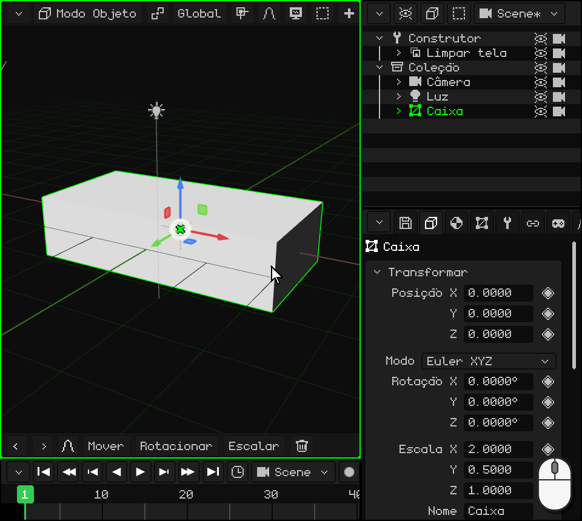

No mesmo menu, **Posição** e **Rotação** fazem o mesmo com a posição e a rotação, e **Todas as Transformações** aplica as três.

## O Outliner: os objetos da cena

O **Outliner** é a lista de todos os objetos da cena. Um clique (ou um toque) em uma linha seleciona esse objeto, igual à Viewport 3D. No PC, ele fica no canto superior direito.

Um objeto pode estar **dentro de outro**: ele aparece mais à direita, pendurado nele. O de fora é o **pai** e o de dentro é o **filho**. O filho **herda as transformações** do pai: se você move, rotaciona ou escala o pai, o filho o acompanha. O filho ainda pode ser movido sozinho, mas sempre em relação ao pai.

Leon é um exemplo: as malhas dele, as quatro partes que se veem, são filhas da sua armação, `leon_rig`. Mover a armação move o Leon inteiro.

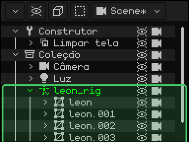

Colocar um objeto dentro de outro se chama **parentear**:

| | Como parentear |
|---|---|
|  PC | No Outliner, arrastar a linha do filho e soltá-la em cima da do pai. Ou selecionar o filho, depois o pai (com <kbd>Shift</kbd>) e <kbd>Ctrl</kbd> + <kbd>P</kbd>. |
|  Tela touch | Selecionar o filho; ligar **Shift** na barra de ferramentas e tocar no pai; depois, menu Objeto → Parentear. |
|  Nokia N95 | Com o Outliner ativo e o filho selecionado: <kbd>1</kbd>, a seta **direita** o coloca dentro do de cima e a **esquerda** o tira; <kbd>1</kbd> de novo confirma. |
| Menu | Objeto → Parentear; para tirá-lo, Objeto → Desparentear |

 No vídeo, uma caixa é arrastada no Outliner até `leon_rig`: ela passa a ser filha dele, e ao mover Leon a caixa o acompanha.

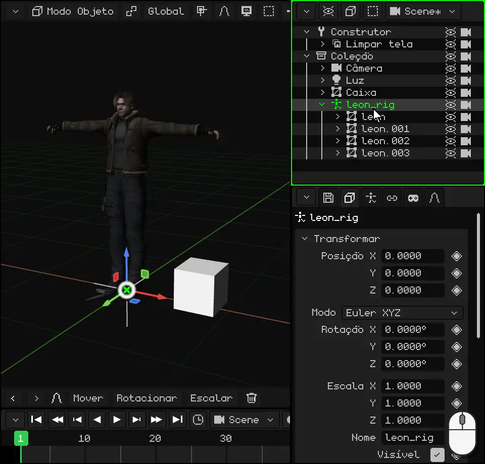

## Os tipos de objetos

Todos os objetos são adicionados pelo menu **Adicionar** (o botão **+** da barra da Viewport 3D, ou <kbd>Shift</kbd> + <kbd>A</kbd> no PC). O novo aparece no cursor 3D e fica selecionado.

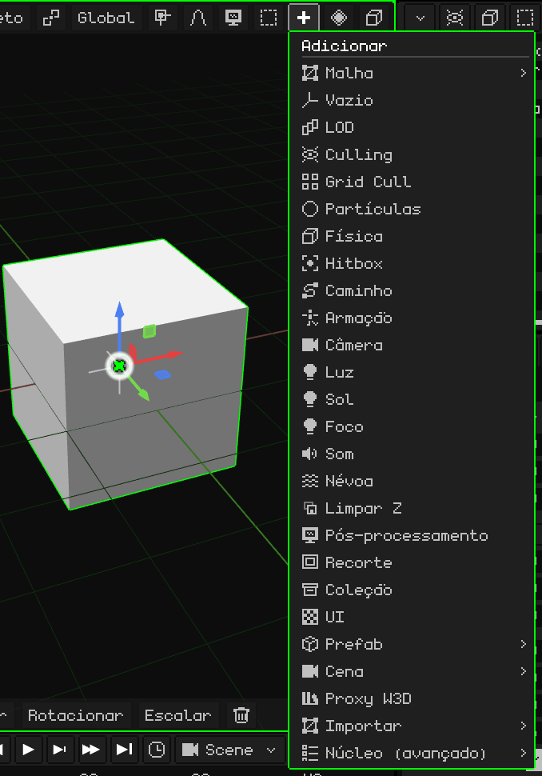

Os básicos são estes:

| Objeto | O que é |
|---|---|
| [Malha 3D](../editor/objeto-malla.md) | Um modelo 3D: um personagem, uma casa, uma pedra. É feito de vértices, arestas e faces, e aparece com o seu material e as suas texturas. As primitivas de Adicionar → Malha (cubo, esfera, cilindro...) são malhas para começar a modelar. |
| [Câmera](../editor/objeto-camara.md) | O ponto de vista do jogo e dos renders. O que a câmera ativa vê é o que aparece ao jogar e o que sai em uma imagem ou em um vídeo. |
| [Luz](../editor/objeto-luz.md) | Ilumina a cena. Há três tipos: Pontual (uma lâmpada), Sol (luz do dia, com raios paralelos) e Foco (um cone, como uma lanterna). |
| [Armação](../editor/objeto-esqueleto.md) | Uma cadeia de ossos que move uma malha, para animar personagens. Leon tem uma: quando a armação anda, a malha a segue. |
| [Som](../editor/objeto-sonido.md) | Um som colocado na cena. Pode tocar de fundo, como uma música, ou a partir de onde o objeto está. |
| Vazio | Um objeto sem forma: um ponto na cena. Serve de pai para agrupar outros ou como referência. |
| Coleção | Uma pasta para organizar os objetos no Outliner. |

Há mais: caminhos, névoa, partículas, hitbox para as colisões, interfaces 2D para os jogos e objetos para otimizar. E no futuro muitos outros vão ser adicionados. Este tutorial fala dos objetos em geral; cada um tem o seu artigo, onde as suas propriedades são explicadas uma por uma.

## O que todos os objetos têm

Além da transformação e das propriedades, qualquer objeto pode ter:

- **Scripts** de Lua, que lhe dão comportamento no jogo: que se mova sozinho, que responda às teclas, que colida. Eles aparecem mais adiante.
- **Animações**: qualquer propriedade com losango pode ser animada. Elas têm o seu próprio tutorial.
- **Restrições**: regras que o prendem a outro objeto, como copiar a posição dele ou olhar sempre para a câmera. Elas são explicadas em [Restrições](../editor/restricciones.md).

Alguns tipos têm ainda coisas próprias. As malhas 3D, por exemplo, têm **modificadores**, que mudam a forma sem destruí-la: espelhá-la, repeti-la, suavizá-la. Eles estão em [Malha 3D](../editor/objeto-malla.md).

## Importar modelos 3D

Além de modelar no Whisk3D, você pode trazer modelos feitos em outros programas. Os formatos aceitos são:

| Formato | O que traz |
|---|---|
| **GLB** e **glTF** | A malha, os materiais e as texturas, a armação e as animações. É o formato mais completo: Leon vem em um .glb. |
| **OBJ** | A malha, os materiais e as texturas (com o seu .mtl). Sem armação nem animações. |
| **FBX** | A malha, os materiais, a armação e as animações. |
| **STL** | Só a forma: os triângulos, sem materiais nem cores. É o formato da impressão 3D e dos programas de CAD. |

Eles são importados por **Adicionar → Importar**, escolhendo o formato e depois o arquivo.

 No PC você também pode arrastar o arquivo da pasta e soltá-lo sobre a Viewport 3D.

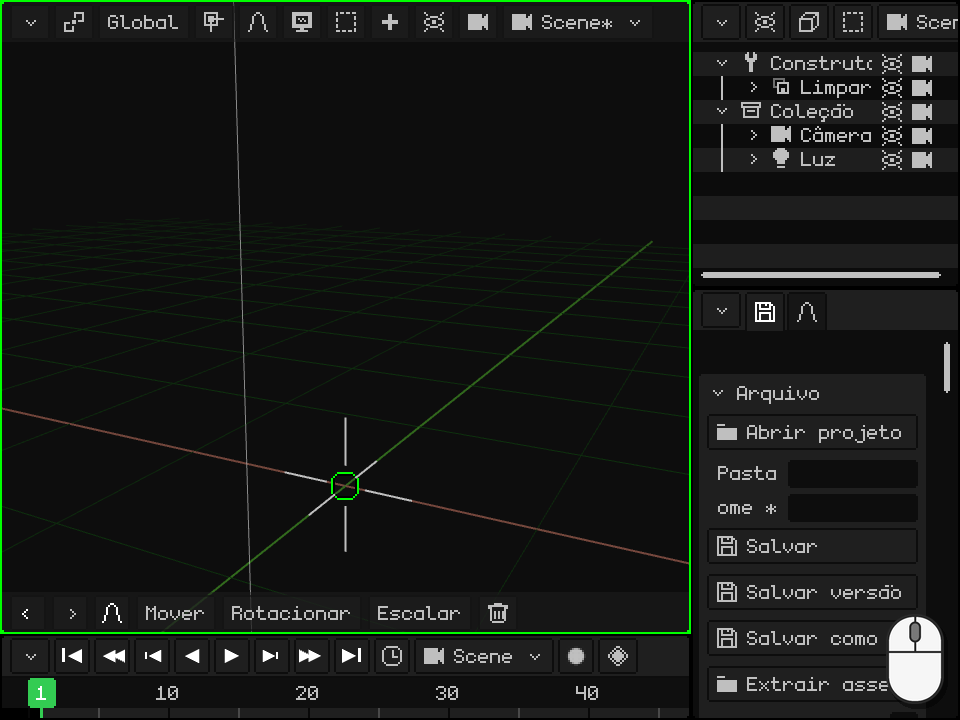

Um modelo com armação entra como uma **armação com as malhas dentro**: a armação é o pai e as malhas, as filhas dela, como visto no [Outliner](#o-outliner-os-objetos-da-cena). As animações ficam salvas na armação, prontas para usar.

Para levar um modelo para outro programa ou para uma impressora 3D existe o caminho inverso: Propriedades → a aba do disquete → **Exportar**, com OBJ, glTF, GLB ou STL.
