# Navegar na Viewport 3D

> [!NOTE]
>  O Nokia N95 suporta mouse e teclado (por Bluetooth). As partes deste tutorial sobre o Nokia explicam como usá-lo sem mouse nem teclado, só com as teclas do telefone.

Este tutorial explica como navegar na Viewport 3D. Navegar é mover o seu ponto de vista: girar ao redor da cena, se deslocar para um lado e se aproximar ou se afastar.

Saber navegar é importante: para fazer modelos 3D e animações de um jeito confortável e rápido, você precisa saber se mover pela cena e se colocar numa posição confortável para trabalhar.

Como foi explicado no [tutorial anterior](viewports.md#a-viewport-ativa), para usar os comandos a seguir, a Viewport 3D precisa ser a viewport ativa, a da borda verde.

As três coisas que você mais vai usar são **orbitar**, **deslocar** e dar **zoom**. Cada uma pode ser feita com o mouse, com os dedos em uma tela touch ou com o teclado do Nokia N95. Nos vídeos do PC, o mouse no canto inferior direito mostra em verde o botão que está sendo apertado.

## Orbitar

Orbitar é girar a vista ao redor da cena, como se você andasse em volta de uma mesa para ver de todos os lados o que há em cima dela.

 **Com o mouse:** mantenha pressionado o **botão do meio** (para apertá-lo, pressione a roda para baixo) e arraste. Em um trackpad, ou em um mouse sem botão do meio, mantenha <kbd>Alt</kbd> pressionado e arraste com o **clique primário** (o esquerdo).

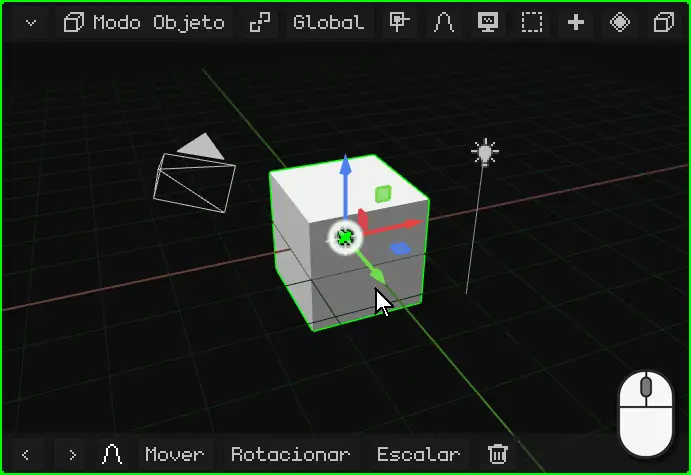

 **Com o dedo:** arraste um dedo sobre a Viewport 3D. Comece pelo fundo: se você apoiar o dedo sobre o gizmo (as setas coloridas do objeto), vai mover o gizmo.

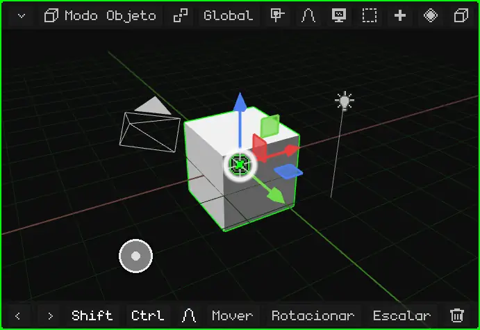

 **No Nokia N95:** mantenha apertada uma **seta** do direcional. A vista gira para esse lado enquanto você a mantiver apertada.

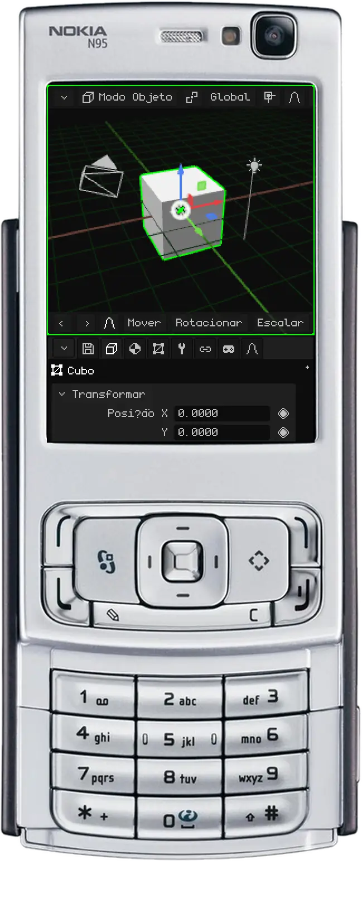

## Deslocar

Deslocar (ou fazer *pan*) move a vista para o lado, para cima ou para baixo, sem girá-la.

 **Com o mouse:** mantenha <kbd>Shift</kbd> pressionado e arraste com o **botão do meio**. Em um trackpad: <kbd>Alt</kbd> + <kbd>Shift</kbd> e arraste com o clique primário.

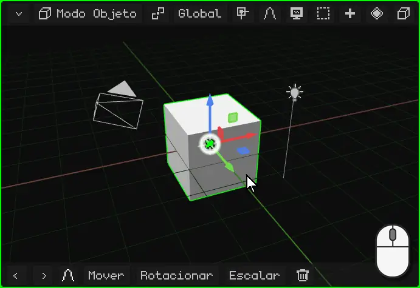

 **Com os dedos:** apoie **dois dedos** e mova-os juntos para o mesmo lado.

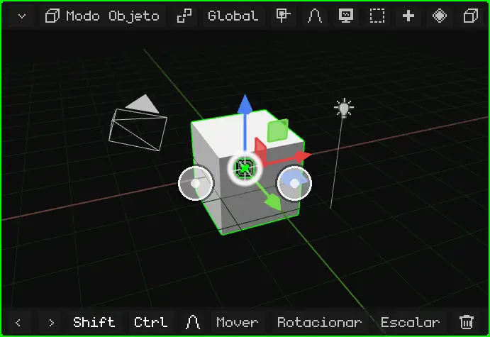

 **No Nokia N95:** mantenha apertada a tecla <kbd>\*</kbd> e use as setas.

## Zoom

O zoom aproxima ou afasta você. O passo se adapta à distância: perto de algo pequeno ele avança devagar, e de longe avança rápido. Por isso serve tanto para olhar a cena inteira quanto um vértice.

 **Com o mouse:** gire a **roda**. Para frente aproxima e para trás afasta. Em um trackpad, deslize dois dedos para cima ou para baixo.

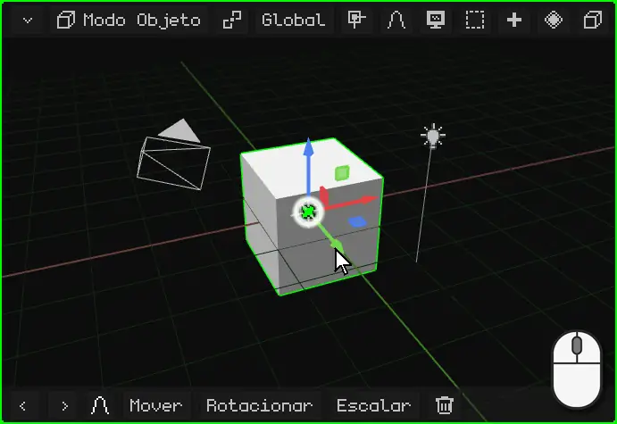

 **Com os dedos:** faça pinça. Afastar os dedos aproxima e juntá-los afasta.

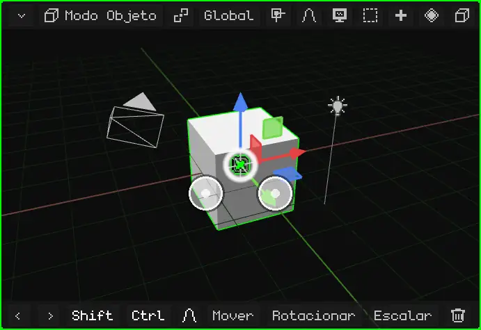

 **No Nokia N95:** mantenha apertado o <kbd>0</kbd> e use a seta **para cima** para aproximar ou a seta **para baixo** para afastar.

## Enquadrar a seleção

Se você se perdeu, ou quer trabalhar em algo específico, **enquadre-o**: a vista se centraliza no que está selecionado e ajusta o zoom para que caiba certinho. A partir daí, orbitar gira ao redor disso.

| | Como enquadrar |
|---|---|
|  PC | <kbd>Num .</kbd> (o ponto do teclado numérico) |
|  Nokia N95 | Um toque no <kbd>0</kbd>, sem setas (mantido com uma seta, é zoom) |
|  Tela touch | Toque duplo com dois dedos |
| Menu | Vista → Enquadrar Seleção |

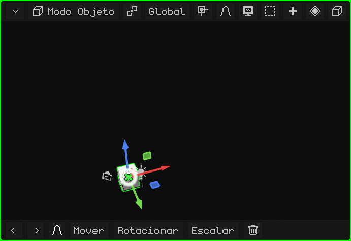

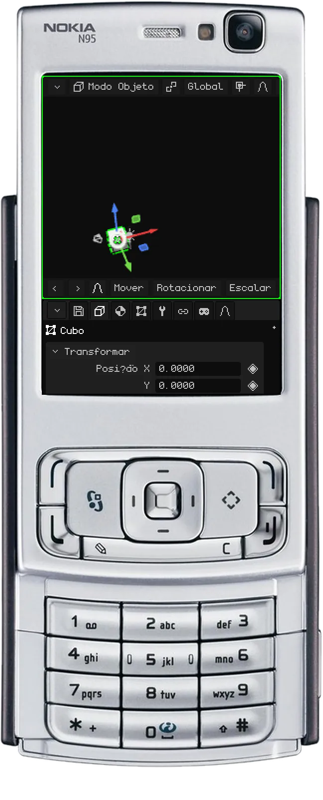

### No Modo Edição

No [Modo Edição](../editor/modo-edicion.md), o que se enquadra é a parte selecionada da malha: os vértices, arestas ou faces que você escolheu, não o objeto inteiro. Serve para trabalhar em um detalhe de um modelo grande: você o seleciona, enquadra e orbita ao redor dele.

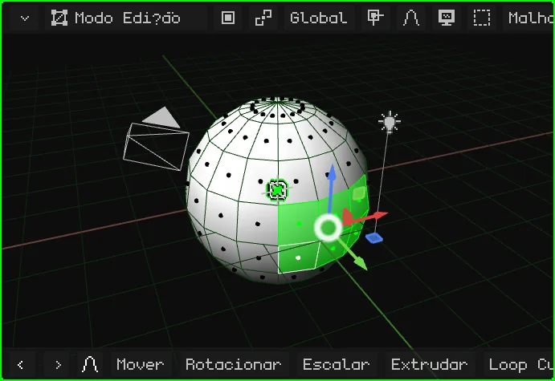

## A vista local

Quando há muitas coisas na cena, trabalhar em uma delas é incômodo: as da frente atrapalham, e ao orbitar elas ficam no meio do caminho. A **vista local** deixa à mostra só o que está selecionado (um ou vários objetos) e o enquadra. O resto não é apagado nem ocultado na cena: só deixa de aparecer nesta viewport. No canto superior esquerdo aparece o aviso "Vista local".

Para voltar, repita o mesmo: tudo volta a aparecer e a vista fica como você a tinha deixado.

| | Como entrar e sair |
|---|---|
|  PC | <kbd>/</kbd> |
|   Nokia N95 e tela touch | Menu Vista → Vista local |

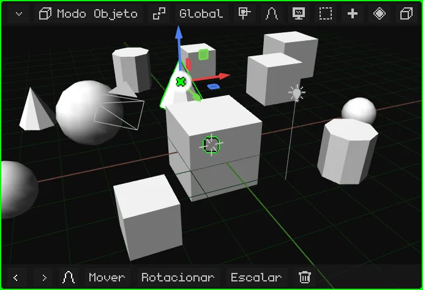

## As vistas de frente, de lado e de cima

Para olhar a cena diretamente de um dos lados, sem ajustar a órbita à mão:

| Vista |  PC | Menu |
|---|---|---|
| Frontal / Traseira | <kbd>Num 1</kbd> / <kbd>Ctrl</kbd> + <kbd>Num 1</kbd> | Vista → Ponto de Vista → Frontal / Traseira |
| Direita / Esquerda | <kbd>Num 3</kbd> / <kbd>Ctrl</kbd> + <kbd>Num 3</kbd> | Vista → Ponto de Vista → Direita / Esquerda |
| Superior / Inferior | <kbd>Num 7</kbd> / <kbd>Ctrl</kbd> + <kbd>Num 7</kbd> | Vista → Ponto de Vista → Superior / Inferior |

Com <kbd>Ctrl</kbd>, cada tecla dá a vista oposta.

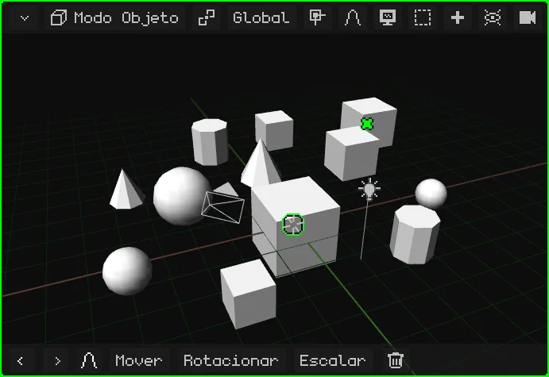

 **No Nokia N95:** mantenha apertada a tecla <kbd>#</kbd> e aperte uma seta. Esquerda e direita giram a vista de 90° em 90° ao redor da cena. Cima passa para a vista de cima; baixo volta para a de lado, e baixo de novo vai para a de baixo. Se você estava orbitando livremente, a primeira seta só endireita a vista para a mais próxima.

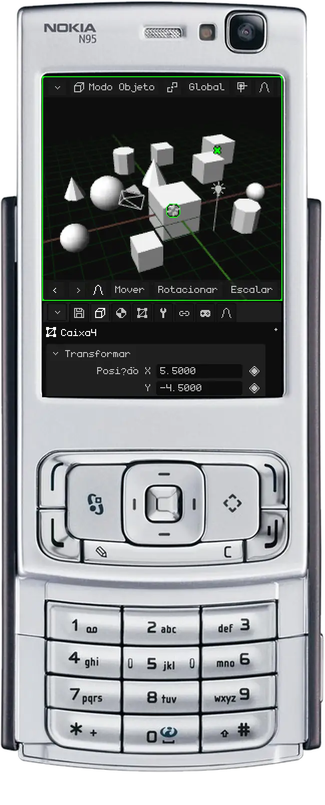

## Perspectiva e ortográfica

A Viewport 3D tem duas maneiras de mostrar a cena:

- **Perspectiva:** como o olho ou uma câmera a vê. O que está longe parece menor, e as linhas paralelas (as bordas de uma rua, as fileiras de caixas do vídeo) se juntam em direção ao horizonte. É assim que as coisas são vistas de verdade, com profundidade.
- **Ortográfica:** sem perspectiva. Tudo mantém o seu tamanho, esteja perto ou longe, e as linhas paralelas continuam paralelas. É como uma planta de arquitetura ou um desenho técnico.

A ortográfica serve para modelar com precisão: alinhar coisas, comparar tamanhos e medir sem que a distância engane. Combinada com as vistas de frente, de lado e de cima, é como trabalhar sobre uma planta. A perspectiva serve para ver como vai ficar.

| | Como alternar |
|---|---|
|  PC | <kbd>Num 5</kbd> |
|  Nokia N95 | Um toque no <kbd>#</kbd>, sem setas |
| Menu | Vista → Perspectiva/Orto |

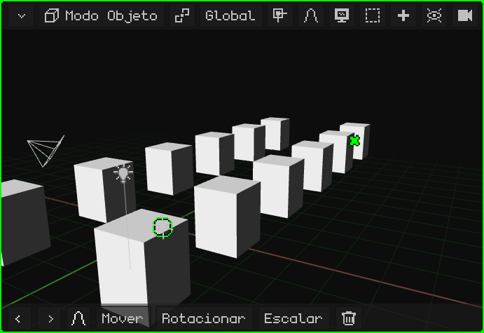

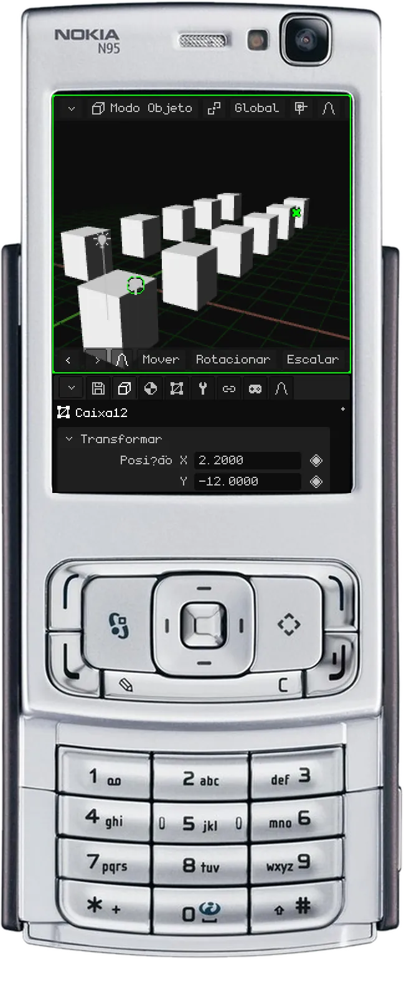

## A câmera ativa

A cena pode ter várias câmeras, mas só uma é a **câmera ativa**: a que serve para o jogo e para os renders. O que essa câmera vê é o que aparece ao jogar e o que sai quando você faz o render de uma imagem ou de um vídeo. A vista com que você navega é só para trabalhar: não aparece nem no jogo nem nos renders.

Para olhar pela câmera ativa:

| | Como entrar e sair |
|---|---|
|  PC | <kbd>Num 0</kbd> |
|  Nokia N95 | <kbd>8</kbd> (fora do Modo Edição: lá o 8 é Loop Cut) |
| Menu | Vista → Câmeras → Câmera Ativa |

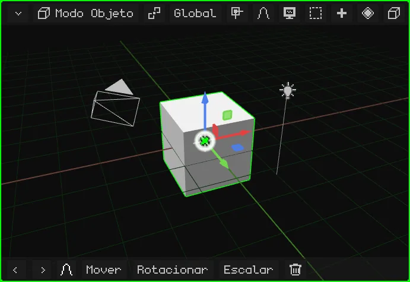

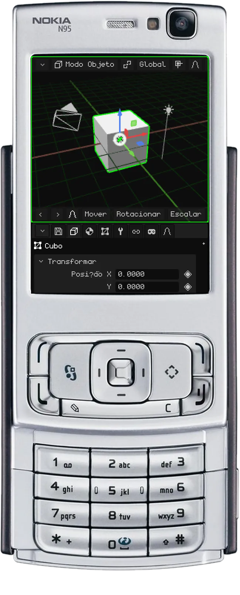

O retângulo é o enquadramento: o que fica dentro dele é o que sai. Embaixo, no centro, há um **cadeado**:

- **Aberto** (como começa): o zoom e o deslocamento só aproximam você para conferir o enquadramento, sem mexer na câmera. Orbitar tira você da vista da câmera, e você continua navegando a partir de onde ela estava.
- **Fechado:** orbitar, deslocar e dar zoom movem a **câmera**. É assim que se ajusta a tomada.

Ele se abre e se fecha com um toque ou com um clique.

Para que outra câmera passe a ser a ativa: selecione-a e aperte <kbd>Ctrl</kbd> + <kbd>Num 0</kbd> (ou Vista → Câmeras → Objeto Ativo como Câmera).

## Mais opções da vista

| Opção | O que faz |  PC |  Nokia N95 |
|---|---|---|---|
| Girar a vista | Gira a vista 15° sobre o seu próprio eixo, como quando se inclina a cabeça. | <kbd>Num 4</kbd> / <kbd>Num 6</kbd> | — |
| Travar Órbita | A vista para de girar: o que orbitava passa a deslocar, como em um tabuleiro 2D. | Vista → Travar Órbita | <kbd>9</kbd> |

Todos os atalhos do editor estão em [Atalhos de teclado](../editor/atajos.md), e a página [Navegação](../editor/navegacion.md) do manual os resume em tabelas.
