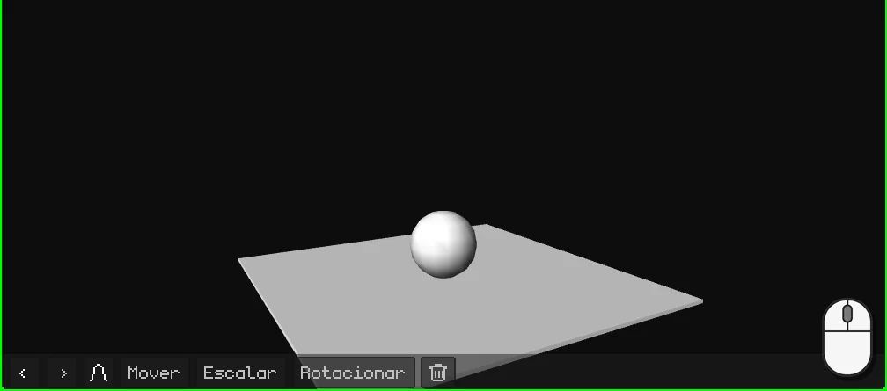
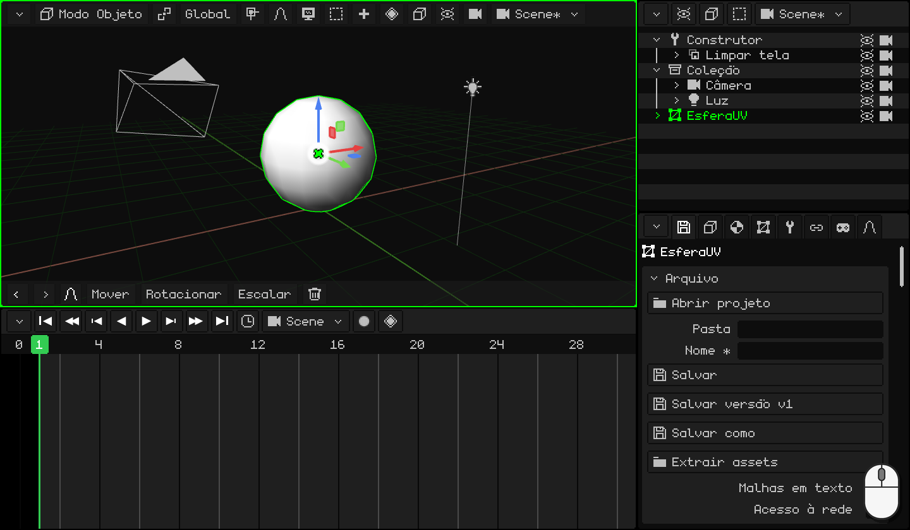
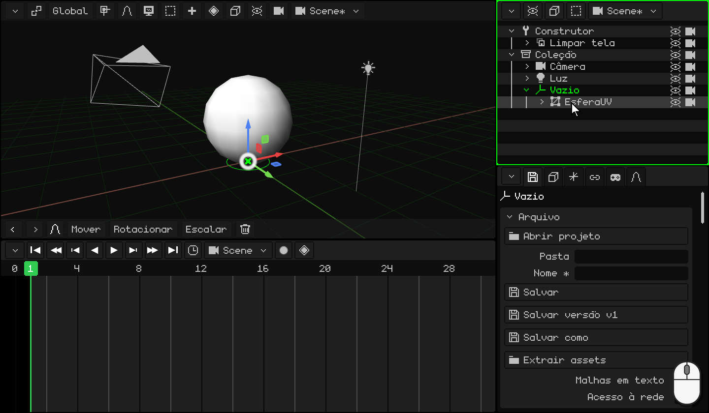
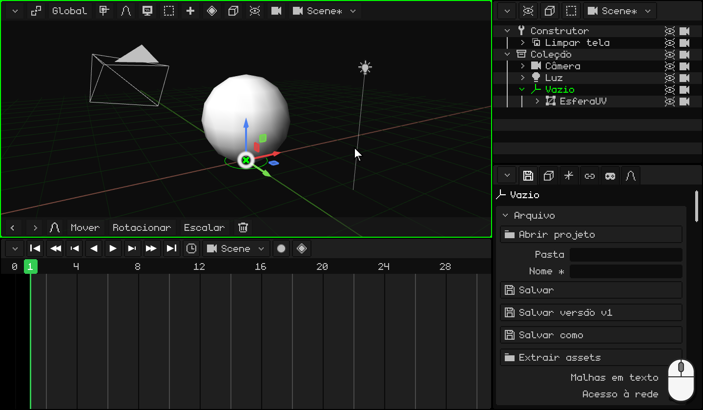
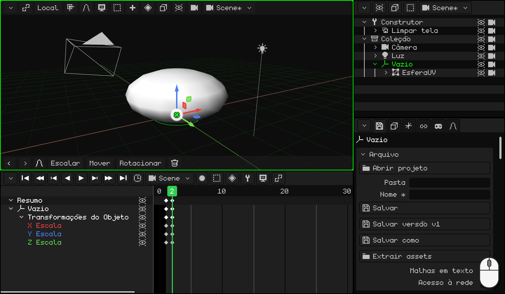
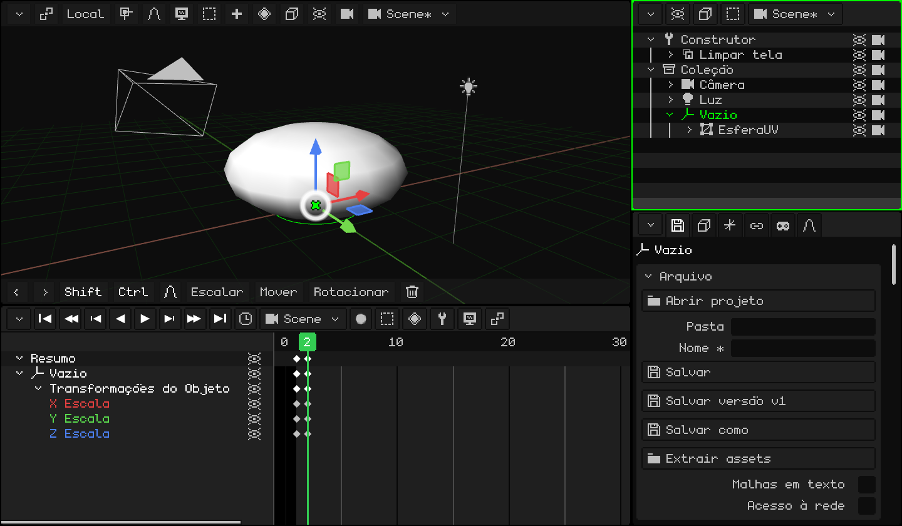
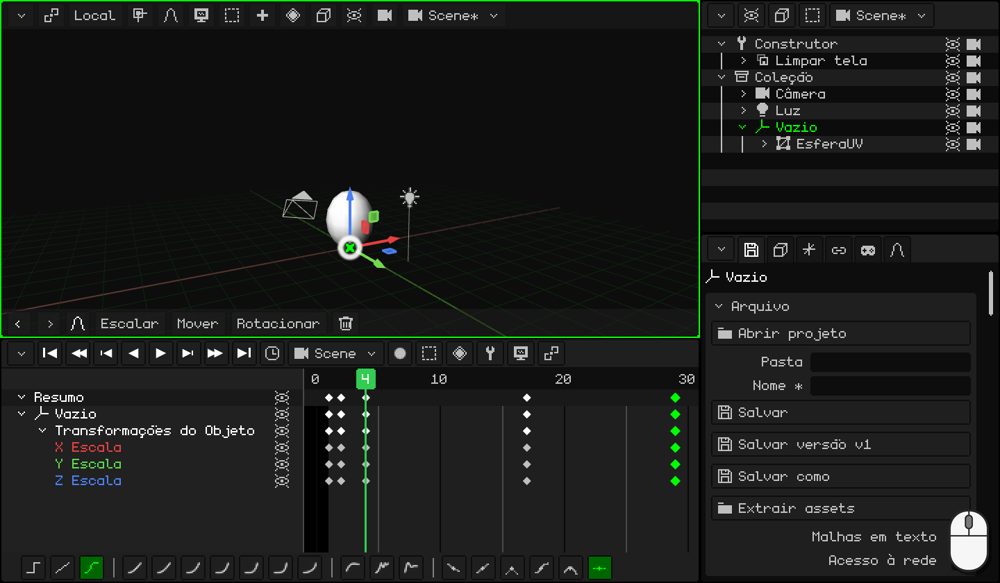
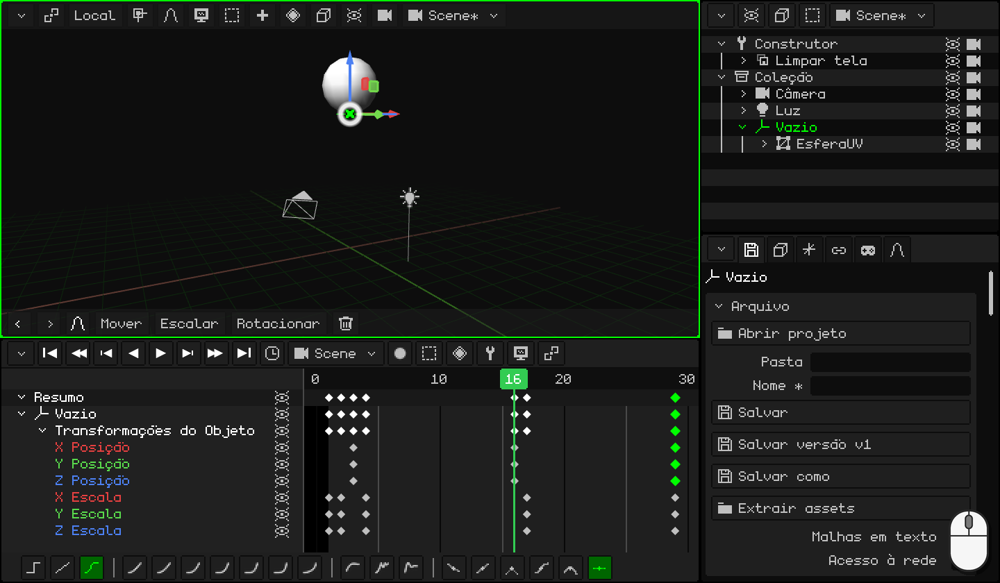
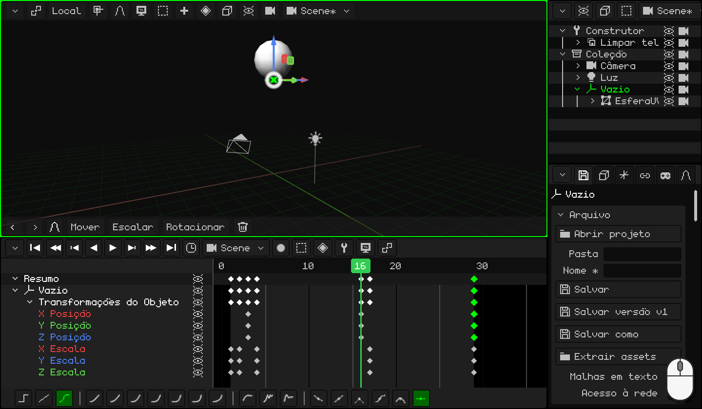

# Fazer uma bola quicar

Uma bola que quica e quica, para sempre: é o exercício com que todo animador começa. Parece fácil, mas para que fique bom são necessários dois dos princípios mais importantes da animação:

- **esticar e achatar**: a bola se achata contra o chão e se estica ao sair dele. Isso lhe dá peso e elasticidade;
- **acelerar e frear**: ela sobe cada vez mais devagar e cai cada vez mais rápido, como com a gravidade.

No caminho você vai aprender a:

- pôr um **Vazio** no chão para achatar a bola contra o chão e não em direção ao centro dela;
- **duplicar** keyframes para voltar a uma pose que você já tem;
- fazer um **loop**: uma animação que se repete sem que se perceba o corte;
- usar as **curvas** para que a bola tenha peso.

Se você ainda não animou nada, comece por [Animar a porta](animar-puerta.md): lá estão os keyframes, a Linha do Tempo e as curvas.

## 1. A bola e o seu Vazio

1. Exclua o cubo e adicione uma esfera: <kbd>Shift</kbd> + <kbd>A</kbd> → **Malha → Esfera UV**. Ela mede 2 metros de altura e nasce com o centro no chão: suba-a para que fique apoiada, <kbd>G</kbd> <kbd>Z</kbd> `1` <kbd>Enter</kbd>.
2. Entre no **Modo Edição** (<kbd>Tab</kbd>) e escolha **Vértice** no botão **Vértice / Aresta / Face**. O vértice mais de baixo fica tapado pela esfera: ligue **Sobreposições → Raio-X** para vê-lo através dela e clique nele.
3. <kbd>Shift</kbd> + <kbd>S</kbd> → **Cursor para o selecionado**: o cursor 3D vai para o ponto de baixo da bola, no chão.
4. Volte para o **Modo Objeto** (<kbd>Tab</kbd>) e desligue o **Raio-X**.
5. <kbd>Shift</kbd> + <kbd>A</kbd> → **Vazio**. Ele nasce onde está o cursor 3D: no chão, exatamente embaixo da bola.
6. **Parenteie** a bola ao Vazio. No **Outliner**, clique em **EsferaUV** e <kbd>Ctrl</kbd> + clique em **Vazio** (o último que você seleciona é o pai). Com o mouse sobre a Viewport 3D, <kbd>Ctrl</kbd> + <kbd>P</kbd> → **Objeto (Manter Transform.)**. No Outliner, a esfera fica dentro do Vazio.

### Para que o Vazio?

Escalar diminui ou aumenta a partir da **origem**. A da esfera fica no centro dela: se você a achatar, ela encolhe em direção ao centro e fica flutuando. O Vazio está no chão: se você achatá-lo, a bola se achata **contra o chão**, como quando quica.

De agora em diante você anima **o Vazio**, nunca a esfera.

  Em tela touch e no N95: o vértice, com um toque (ou com o mouse virtual); o cursor, com **Malha → Ímã → Cursor para o selecionado**; o Vazio, com **Adicionar → Vazio**; e para parentear, a esfera e o Vazio selecionados (o Vazio ativo), **Objeto → Parentear → Objeto (Manter Transform.)**.

## 2. Achatar

Quando a bola toca o chão, ela se **achata**: fica mais baixa e mais larga. Para não parecer que ela encolhe, o que ela perde de altura ganha de largura.

1. Selecione o **Vazio**. No quadro **1**, a bola está redonda e tocando o chão: <kbd>I</kbd> → **Somente Escala**.
2. <kbd>→</kbd> (a seta para a direita) passa para o quadro **2**. Achate-a: <kbd>S</kbd> <kbd>Z</kbd> `0.75` <kbd>Enter</kbd> a deixa mais baixa, e <kbd>S</kbd> <kbd>Shift</kbd> + <kbd>Z</kbd> `1.6` <kbd>Enter</kbd>, mais larga. <kbd>Shift</kbd> + <kbd>Z</kbd> é *todos os eixos menos Z*: X e Y juntos.
3. <kbd>I</kbd> → **Somente Escala**.

 Em uma tela touch: o keyframe é posto com o botão do losango da barra de menus da Viewport 3D, **Animação → Inserir Keyframe → Somente Escala**; o quadro é mudado com um toque nos números da Linha do Tempo. Para achatá-la, **Escalar** **Z** `0.75`, **Escalar** **X** `1.6` e **Escalar** **Y** `1.6`, com os números no teclado da barra de cima.

 No Nokia N95: <kbd>3</kbd>, <kbd>3</kbd> (o eixo Z), o lápis + `0.75` e <kbd>OK</kbd>; depois <kbd>3</kbd>, <kbd>1</kbd> (X) e `1.6`, e <kbd>3</kbd>, <kbd>2</kbd> (Y) e `1.6`. O keyframe, com **Animação → Inserir Keyframe → Somente Escala**.

## 3. Esticar

Ao sair do chão, a bola se **estica** na direção para onde vai: mais alta e mais fina. E quando chega em cima, volta a ficar redonda.

1. A bola redonda você já tem, no keyframe do quadro 1: duplique-o. Na Linha do Tempo, clique no losango do quadro **1**, <kbd>Shift</kbd> + <kbd>D</kbd>, leve a cópia ao quadro **4** e clique. Olhe para o losango da cópia, não para o ponteiro: ele sai um quadro à direita do mouse.
2. Faça o mesmo para os quadros **17** e **29**: ali a bola volta a ficar redonda.
3. Vá para o quadro **4** (um clique nos números da Linha do Tempo). Estique-a: <kbd>S</kbd> <kbd>Z</kbd> `1.1` <kbd>Enter</kbd> e <kbd>S</kbd> <kbd>Shift</kbd> + <kbd>Z</kbd> `0.9` <kbd>Enter</kbd>.
4. <kbd>I</kbd> → **Somente Escala**.

  Em tela touch e no N95 (com o mouse virtual), em vez de duplicar você copia e cola: um toque no keyframe do quadro 1 e, no menu **Key** da Linha do Tempo (o botão do losango), **Copiar**; um toque nos números para ir ao quadro 4 e **Key → Colar**. O mesmo para o 17 e o 29. Para esticá-la, **Escalar** **Z** `1.1`, **Escalar** **X** `0.9` e **Escalar** **Y** `0.9`.

## 4. O salto

1. Vá para o quadro **3**: a bola ainda está no chão, é o momento em que ela sai. <kbd>I</kbd> → **Somente Localização**.
2. Vá para o quadro **16** e suba-a: <kbd>G</kbd> <kbd>Z</kbd> `5` <kbd>Enter</kbd> (5 metros). <kbd>I</kbd> → **Somente Localização**.
3. Para que ela volte ao chão, duplique o keyframe do quadro **3** para o **29**.

Dê **Play** (<kbd>Espaço</kbd>): a bola quica. Mas algo não está certo: ela freia antes de tocar o chão, como se flutuasse. Isso as curvas resolvem, na parte 6.

 Em uma tela touch: **Mover** **Z** `5` e **Animação → Inserir Keyframe → Somente Localização**. O keyframe do 3 é levado para o 29 com **Key → Copiar** e **Key → Colar**, como na parte 3.

 No Nokia N95: <kbd>1</kbd>, <kbd>3</kbd> (o eixo Z), o lápis + `5` e <kbd>OK</kbd>; e **Animação → Inserir Keyframe → Somente Localização**.

## 5. O loop

O quadro **29** é igual ao **1**: a bola redonda, tocando o chão. Se a animação fosse até o 29, apareceriam dois quadros iguais seguidos e a bola ficaria parada por um instante: o corte seria percebido. Por isso ela termina no **28**: depois do 28 vem o 1, que é igual ao 29.

Clique no **relógio** da Linha do Tempo e, em **Fim**, digite `28` <kbd>Enter</kbd>.

No mesmo relógio estão os **FPS** desta animação. A bola vai a 30: cada quique dura 28 quadros, quase um segundo. Se você a quiser com estilo de cinema, coloque em 24, mas **antes** de animar: com os mesmos quadros, a 24 ela ficaria mais lenta. Quais FPS convêm em cada caso está em [Animar a porta](animar-puerta.md), na parte do tempo.

## 6. As curvas: a gravidade

**Somente Localização** salvou os três eixos, mas a bola só se move em Z: as linhas **X Posição** e **Y Posição** são linhas planas. Exclua-as: clique em cada uma e <kbd>X</kbd>.

Agora passe para o editor de curvas (**Vista → Curvas**). A curva de Z é o salto: sobe e desce. Pense em uma bola de verdade:

- **Ao subir**, ela sai do chão a toda a velocidade e vai freando até ficar parada em cima: **sai rápido e vai freando**. Selecione o keyframe do quadro **3** e, na barra de ferramentas da Linha do Tempo, **Cúbica** e **Na saída**.
- **Ao descer**, ela arranca devagar e cai cada vez mais rápido, até o impacto contra o chão: **acelera e freia de golpe**. Selecione o keyframe do quadro **16**: **Cúbica** e **Na entrada**.

(Com o teclado: <kbd>E</kbd> para o **Modo de Interpolação** e <kbd>Ctrl</kbd> + <kbd>E</kbd> para a **Suavização**.)

A curva fica como os arcos de uma bola de verdade: arredondada em cima e em ponta embaixo, onde ela bate no chão. Dê **Play**: agora ela tem peso.

Quer que ela quique mais alto ou mais baixo? No editor de curvas, pegue o keyframe de cima (o do quadro 16) e mova-o.

## 7. Veja como ficou

Para vê-la sem a grade nem o Vazio, desligue **Sobreposições → Mostrar Sobreposições** e dê **Play**.

As três bolas abaixo quicam no mesmo tempo. A primeira tem curvas lineares: sobe e desce sempre na mesma velocidade, como uma máquina. A segunda tem as curvas da gravidade: freia em cima e bate no chão. A terceira, além disso, se estica e se achata: é a deste tutorial.

