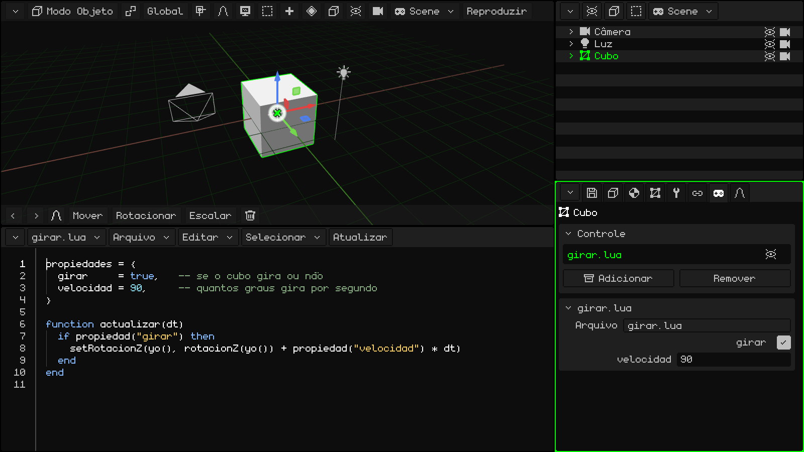
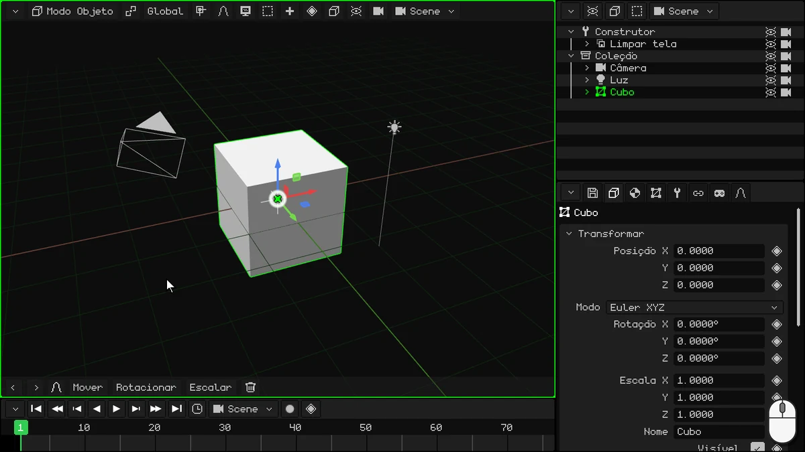
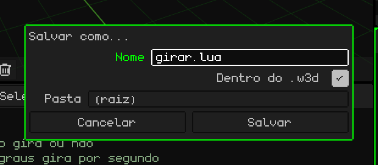
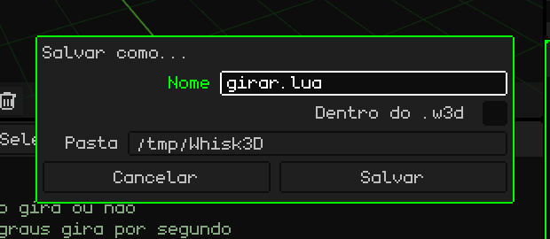
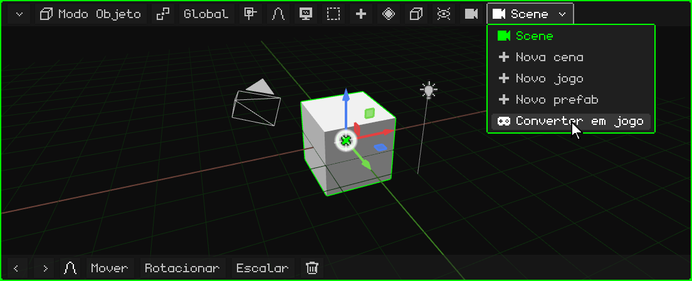
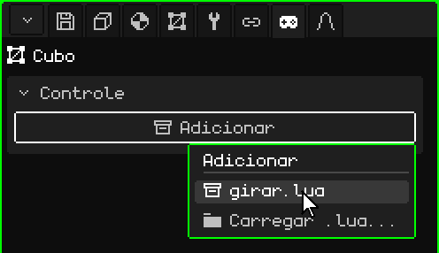
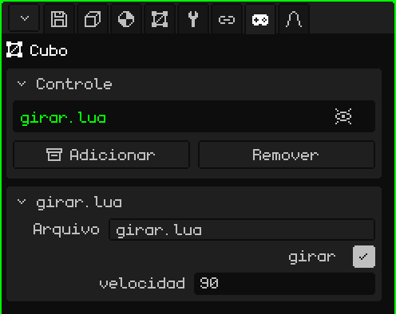
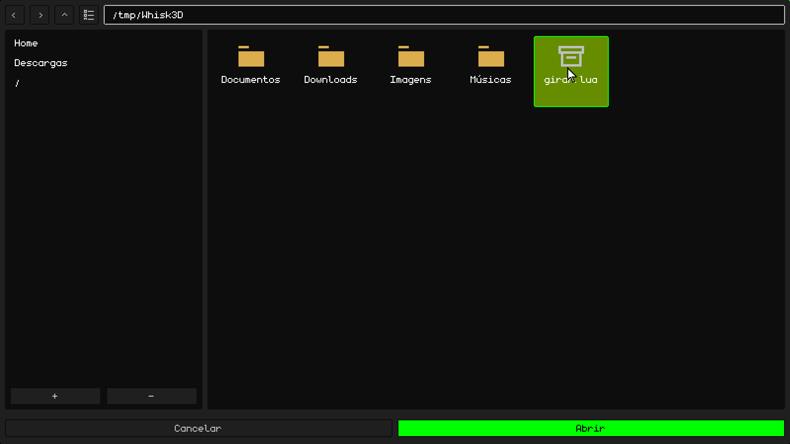
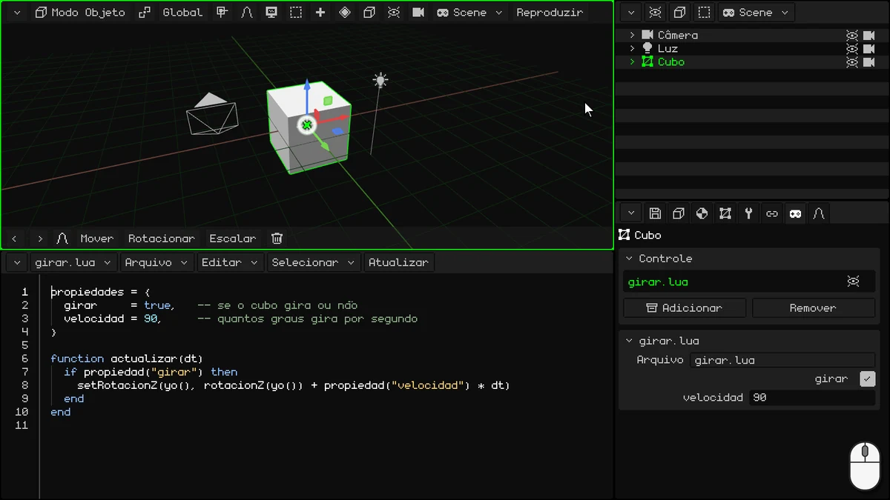

# O seu primeiro script: um cubo que gira

Neste tutorial você vai escrever o seu primeiro script de **Lua**: um que faz o cubo girar.



## 1. O IDE

Neste tutorial você não vai usar a Linha do Tempo: transforme-a no IDE, o editor de scripts. Toque no botão do canto da Linha do Tempo (no canto superior esquerdo) e escolha **IDE**.

O IDE começa vazio. Para escrever com mais conforto, aumente-o: arraste o mesmo botão do canto para cima.



> [!NOTE]
> Também é possível usar outros editores ou IDEs externos e carregar os scripts. Os scripts podem ficar fora ou dentro dos projetos W3D.

## 2. Escreva o script

O script tem duas partes: em cima, as **propriedades**, e embaixo, a **função** que faz o cubo girar.

### As propriedades

```lua
propiedades = {
  girar     = true,   -- se o cubo gira ou não
  velocidad = 90,     -- quantos graus gira por segundo
}
```

- **`propiedades`** são os valores do script que podem ser mudados no painel de Propriedades, um por linha. `girar = true` é um valor **booleano** (verdadeiro ou falso: `true` ou `false`), e no painel aparece como uma caixa de seleção. `velocidad = 90` é um número, e aparece como um campo numérico. O que você escreve aqui é o valor **padrão**: cada objeto que usar o script pode ter o seu.
- O que vem depois de `--` é um **comentário**: o Lua não o lê, é para você.

### A função

```lua
function actualizar(dt)
  if propiedad("girar") then
    setRotacionZ(yo(), rotacionZ(yo()) + propiedad("velocidad") * dt)
  end
end
```

Uma **função** é um bloco de código com um nome: começa com `function nome()` e termina com `end`. O que ela tem dentro não é feito quando você a escreve, e sim cada vez que alguém **chama** a função.

O Whisk3D tem **funções reservadas**: se o seu script tem uma função com um desses nomes, o motor a chama sozinho, no momento certo. Por exemplo:

- **`inicio()`**: uma vez só, ao dar Play. Serve para preparar as coisas.
- **`actualizar(dt)`**: a **cada quadro**, enquanto o jogo roda.

Há mais, como as que avisam quando um objeto colide com outro. Estão todas no manual de Lua: [Quando o motor chama o seu script](../lua/ciclo-del-script.md).

`actualizar` é ideal para um videogame. Um jogo desenha a tela muitas vezes por segundo, e cada uma dessas imagens é um **quadro**: tudo o que se move, se move um pouquinho a cada quadro. Aqui, a cada quadro o cubo gira um pouco mais.

- Ela roda enquanto o objeto está **visível**: se você o ocultar, o script dele para de rodar até que ele volte a aparecer.
- `dt` são os segundos que passaram desde o quadro anterior. Multiplicar a velocidade por `dt` faz o cubo girar 90 graus **por segundo**, quer o jogo rode a 30 ou a 60 quadros por segundo.

O que ela faz dentro:

**`if propiedad("girar") then` … `end`** é uma **condição**. Um `if` ("se") faz o código que tem dentro só se o que vem entre `if` e `then` for verdadeiro. Ele pode ter um `elseif` ("se não for verdade, faz isto se…"), que testa outra condição, e um `else` ("senão"), que é feito quando nenhuma se cumpriu; os dois são opcionais. Sempre termina com `end`. Por exemplo:

```lua
if puntos >= 100 then
  premio = "ouro"
elseif puntos >= 50 then
  premio = "prata"
else
  premio = "nada"
end
```

Com 120 pontos o prêmio é ouro; com 70, prata, e com 10, nada. Só é feita a primeira parte que se cumpre. (Em Lua, `elseif` se escreve tudo junto.)

No script, o `if` não tem `elseif` nem `else`: se **girar** for verdadeiro (a caixa está marcada), o cubo gira; se for falso, nada acontece e a função termina. `propiedad("girar")` lê o valor que esse objeto tem no painel. Como é lido a cada quadro, se você o mudar com o jogo rodando, o script fica sabendo na mesma hora.

- **`yo()`** é o objeto que tem o script: o cubo. **`rotacionZ(yo())`** dá a rotação dele em graus em torno do Z (o eixo vertical, o mesmo Z que você vê no painel de Propriedades), e **`setRotacionZ`** dá a ele uma nova: a mesma, um pouco mais. Assim o cubo gira como um pião.

`propiedad`, `yo`, `rotacionZ` e `setRotacionZ` também são funções, mas ao contrário: quem as traz é o Whisk3D e quem as chama é você. Elas estão no [manual de Lua](../lua/README.md).

### O script completo

Toque dentro do IDE e escreva tudo junto:

```lua
propiedades = {
  girar     = true,   -- se o cubo gira ou não
  velocidad = 90,     -- quantos graus gira por segundo
}

function actualizar(dt)
  if propiedad("girar") then
    setRotacionZ(yo(), rotacionZ(yo()) + propiedad("velocidad") * dt)
  end
end
```

## 3. Salve-o

Primeiro salve o projeto, se ainda não o salvou: o script só pode ser salvo dentro do projeto se o projeto já estiver salvo. Em Propriedades, na aba do **disquete** (o cartão **Arquivo**), escreva um **Nome**, por exemplo `girar-cubo`, e toque em **Salvar**. Ele é salvo na **Pasta** que o cartão mostra.

Depois, na barra de menus do IDE, **Arquivo → Salvar como...**:

1. Em **Nome**, coloque `girar.lua`.
2. Marque **Dentro do .w3d**: o script fica salvo dentro do projeto, no mesmo arquivo `.w3d`. A **Pasta** passa a ser uma de dentro do projeto: **(raiz)** é a principal.
3. Toque em **Salvar**.



Se você não marcar **Dentro do .w3d**, o script é salvo como um arquivo avulso, fora do projeto, na **Pasta** que você escolher. Isso serve, por exemplo, para editá-lo com outro programa.



## 4. Transforme a cena em um jogo

Uma **cena** é para modelar e animar; os scripts rodam em um **jogo**. Um jogo não tem animações próprias: as animações são feitas em uma cena ou em um modelo 3D com armação, e são importadas no jogo para serem usadas lá. Na barra de menus da Viewport 3D (ou do Outliner), toque no botão da cena, o que mostra o nome dela, e escolha **Converter em jogo**.



**Converter em jogo** não muda a sua cena: faz uma cópia, que é um jogo, com tudo do jeito que aparece no quadro atual da Linha do Tempo. As animações da cena não passam para o jogo: esse quadro fica gravado como a posição e o estado inicial do jogo. A cena original continua igual, com as suas animações, e você a encontra de novo no menu do botão da cena.

Agora você está no jogo: o botão da cena mostra um joystick, e na barra de menus da Viewport 3D aparece **Reproduzir**.

## 5. Coloque-o no cubo

1. Selecione o **Cubo** do jogo (no Outliner ou na Viewport 3D).
2. Em Propriedades, vá para a aba do **joystick**.
3. No cartão **Controle**, toque em **Adicionar**: abre-se um menu com os scripts do projeto. Escolha `girar.lua`.



O script aparece na lista do cartão Controle, e embaixo é adicionado o cartão dele, **girar.lua**, com as propriedades que você escreveu: a caixa **girar** (marcada) e a **velocidad** (90).

Na lista, à direita do script, há um **olho**: tocando nele, o script é desligado (o motor não o usa) sem tirá-lo do objeto nem ocultar o objeto. Outro toque o liga de novo.



### Um script de fora

Se você escreveu o script com outro editor, ou o salvou fora do `.w3d`, toque em **Adicionar → Carregar .lua...**. Abre-se o explorador, **Carregar script**: escolha o arquivo e toque em **Abrir**.



## 6. Dê Play

Toque em **Reproduzir**: o cubo gira. Enquanto o jogo roda, a barra de menus da Viewport 3D mostra **Parar** e **Pausar**.

Com o jogo rodando, experimente mudar as propriedades no cartão **girar.lua**:

- coloque **velocidad** em 360: ele gira quatro vezes mais rápido;
- desmarque **girar**: ele fica parado. Marque de novo e ele continua.

Para terminar, toque em **Parar**: o cubo volta a ficar como estava antes de dar Play.



> [!NOTE]
> Tudo o que acontece com o jogo rodando se perde ao tocar em **Parar**: o cubo volta ao seu lugar, e **girar** e **velocidad** voltam aos valores que tinham antes de dar Play. Para mudá-los de verdade, mude-os com o jogo parado.

## Para continuar

- [Lua no Whisk3D](../lua/README.md): o manual de Lua, com todas as funções.
- [Um script é um componente de um objeto](../lua/scripts-y-objetos.md): as propriedades (também listas, textos e objetos da cena).
- [Quando o motor chama o seu script](../lua/ciclo-del-script.md): `actualizar`, `inicio` e as outras.

## Baixe o exemplo

Aqui está o projeto pronto, para você testar ou comparar com o seu: **[girar-cubo.w3d](ejemplos/girar-cubo.w3d)**. Abra-o no Whisk3D e toque em **Reproduzir**. O script está dentro do `.w3d` e aparece no IDE.
