# Propriedades

> [!NOTE]
>  O Nokia N95 suporta mouse e teclado (por Bluetooth). As partes desta página sobre o Nokia explicam como usá-lo sem mouse nem teclado, só com as teclas do telefone.

**Propriedades** é a viewport com os dados do **objeto ativo**, o último que você selecionou: a posição, o nome, o material, a cor de uma luz, os modificadores de uma malha. Ela é organizada em **abas**, e cada aba tem **cartões** com linhas de valores. Quase tudo o que você muda aqui aparece na hora na Viewport 3D.

Como foi explicado em [As viewports](viewports.md#a-viewport-ativa), as teclas vão para a viewport ativa, a da borda verde.

 No Nokia N95, as Propriedades ficam à direita da Viewport 3D: a **tecla verde**  as torna a viewport ativa. Ao voltar, você continua na linha onde parou.

## As abas

As abas são os ícones da barra de menus das Propriedades. Cada uma mostra um grupo de cartões.

As abas **mudam conforme o objeto ativo**: cada tipo de objeto mostra só as que servem para ele. Uma malha tem Material, Malha 3D e Modificadores; uma luz tem, no lugar do material, a aba Luz; uma câmera, a aba Câmera.

| Aba | Quando aparece |
|---|---|
| Arquivo / Render (o disquete) | Sempre, mesmo sem nada selecionado. |
| Objeto | Com qualquer objeto 3D: posição, rotação, escala, nome e visibilidade. |
| A do tipo de objeto | Material em uma malha, Luz em uma luz, Câmera em uma câmera, e assim com cada tipo. O ícone dela muda com o tipo. |
| Malha 3D e Modificadores | Só com uma malha. |
| Transformar | Só com uma malha no Modo Edição. |
| Restrições | Com qualquer objeto 3D. |
| Scripts | Com qualquer objeto. |
| Animação | Sempre. |

A aba do tipo fica no seu lugar: se você estava no material de uma malha e seleciona uma luz, passa para a aba Luz. Se a aba em que você estava não existe para o objeto novo (Modificadores, ao selecionar uma luz), as Propriedades voltam para a aba Objeto.

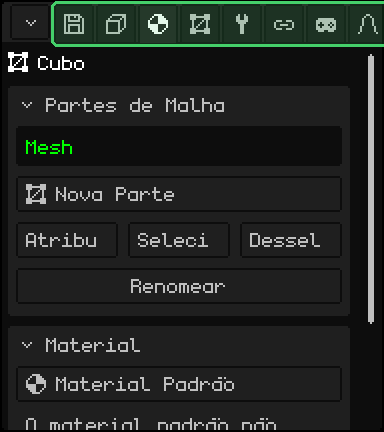

| | Como mudar de aba |
|---|---|
|  PC | Um clique na aba. Se nem todas couberem, gire a roda em cima da barra. |
|  Tela touch | Um toque na aba. Se nem todas couberem, arraste a barra para o lado. |
|  Nokia N95 | Suba com a seta **para cima** até o título do primeiro cartão e mais uma vez: a aba atual fica verde. **Esquerda** e **direita** mudam de aba, e **baixo** volta para os cartões. Na primeira aba, a esquerda abre o menu do botão do canto. |

## Os cartões

Os **cartões** são os quadros de cada aba: um título e as suas linhas. A seta do título diz se o cartão está aberto ou recolhido. Recolher os que você não usa deixa à mão os que você usa.

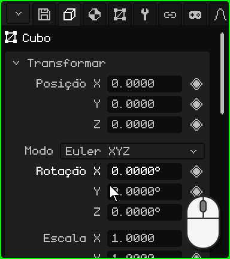

| | Como recolher e expandir |
|---|---|
|  PC | Um clique no título. |
|  Tela touch | Um toque no título. |
|  Nokia N95 | <kbd>OK</kbd> sobre o título. A seta **esquerda** recolhe o cartão a partir de qualquer uma das suas linhas, e a **direita**, sobre o título, o expande. |

Se os cartões não couberem na viewport, o painel rola: com a roda do mouse no PC, ou arrastando o dedo para cima ou para baixo em uma tela touch. No Nokia, o painel segue sozinho a linha selecionada.

### Mover-se com as teclas

 No Nokia N95 há uma **linha selecionada**: o nome dela aparece em verde e o valor, com uma borda branca. **Cima** e **baixo** passam de uma linha para outra e de um cartão para o seguinte, e <kbd>OK</kbd> usa a linha: edita o número, marca a caixa de seleção, abre a lista suspensa. Durante a edição, a borda fica verde.

 No PC, com o mouse em cima das Propriedades, as setas e <kbd>Enter</kbd> fazem o mesmo, e <kbd>Esc</kbd> cancela o que você está editando.

## Os números

A maioria das linhas são **números**: o nome à esquerda e o valor à direita, como a Posição, a Rotação e a Escala do cartão Transformar. Um número pode ser **digitado** ou **arrastado**. Cada um tem o seu ritmo, e alguns têm limite: a Luz GL de uma luz vai de 0 a 7.

### Digitar um número

 Um clique no número, sem mover o mouse: o valor fica marcado e o que você digitar o substitui. <kbd>Enter</kbd> o aplica e <kbd>Esc</kbd> o deixa como estava. Um clique em qualquer outro lugar também o aplica.

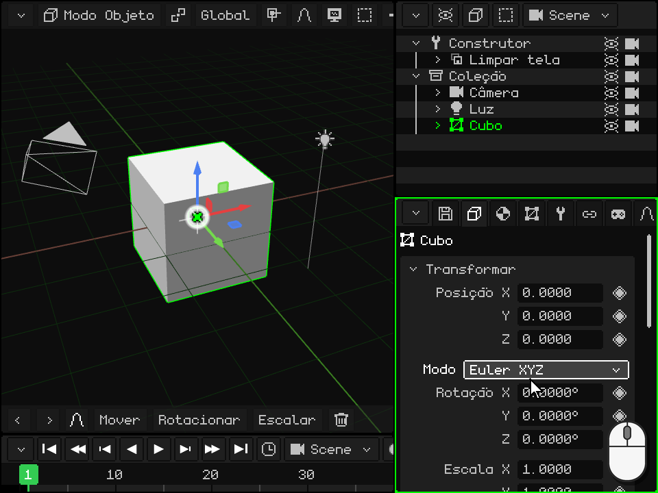

 Um toque no número abre embaixo o **teclado numérico** do Whisk3D, com o nome da linha e o valor dela. Ele tem os números, o ponto, **DEL** para apagar e as setas para mover o cursor. **OK** aplica o valor e **X** o cancela; tocar fora do teclado também o aplica.

 O teclado numérico também faz **contas**: com <kbd>+</kbd>, <kbd>-</kbd>, <kbd>\*</kbd>, <kbd>/</kbd> e os parênteses você pode digitar `2*3` ou `1.5+0.25`, e ao tocar em OK fica o resultado. O <kbd>-</kbd> também serve para digitar um número negativo.

 Chegue à linha com as setas e aperte <kbd>OK</kbd>: o valor fica marcado e as teclas do telefone digitam números (a barra das Propriedades mostra **123**). O primeiro número que você digitar substitui o que estava. A <kbd>\*</kbd> é o ponto decimal, <kbd>C</kbd> apaga, **esquerda** e **direita** movem o cursor, <kbd>OK</kbd> aplica e a **soft esquerda** cancela.

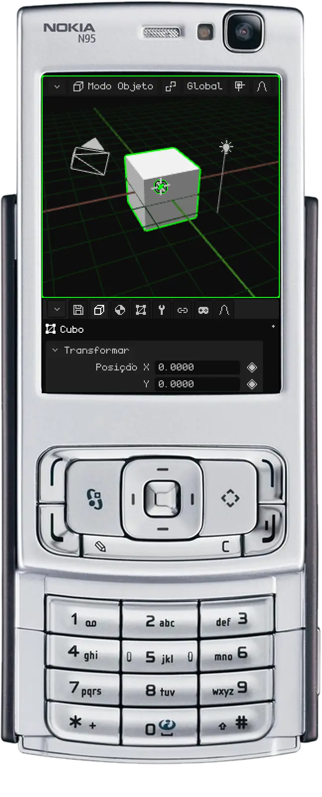

### Arrastar um número

 Mantenha o clique pressionado sobre o número e mova o mouse para o lado: para a direita o valor sobe e para a esquerda desce. Se o ponteiro chegar à borda da viewport, ele aparece do outro lado e você pode continuar arrastando. Ao soltar, o valor fica.

 Apoie o dedo sobre o número (não sobre o nome) e arraste-o para o lado. Se você arrastar para cima ou para baixo, em vez de mudar o valor, o painel rola.

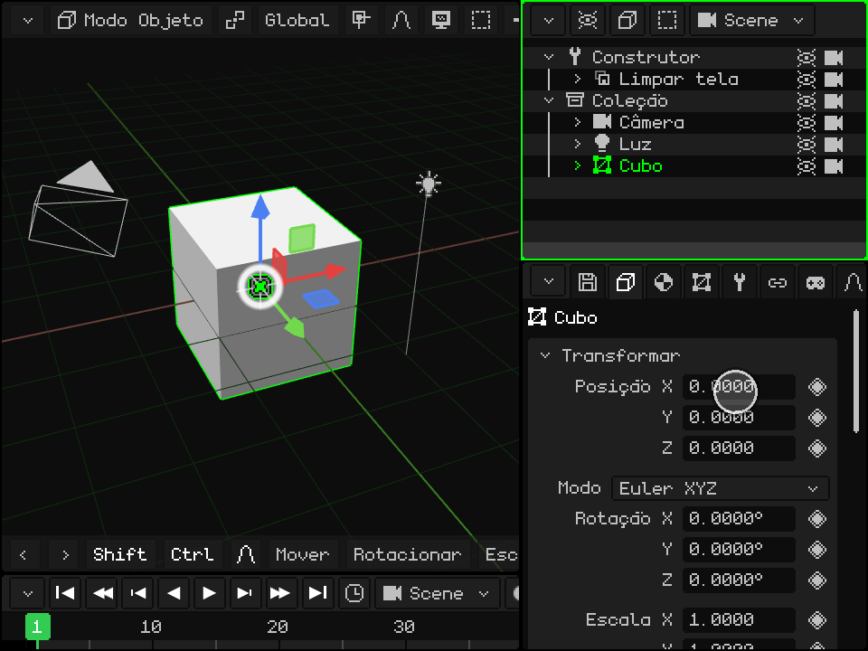

## As listas suspensas

Uma **lista suspensa** é um botão que mostra a opção escolhida, como o **Tipo** de uma luz (Pontual, Sol ou Foco) ou o **Modo** da rotação. Ao ativá-la, abre-se a lista de opções, com a atual em verde; ao escolher outra, a lista se fecha.

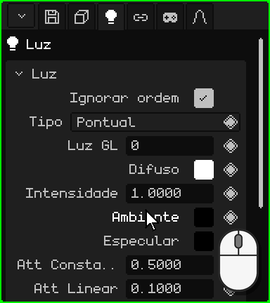

| | Como abrir e escolher |
|---|---|
|  PC | Um clique no botão e outro na opção. |
|  Tela touch | Um toque no botão e outro na opção. |
|  Nokia N95 | <kbd>OK</kbd> a abre, **cima** e **baixo** percorrem as opções e <kbd>OK</kbd> escolhe. <kbd>C</kbd> a fecha sem mudar nada. |

## As caixas de seleção

Uma **caixa de seleção** é ligada ou desligada: marcada é sim e vazia é não. Ela fica à direita da linha, como **Iluminação** no material: desligada, o objeto não recebe as luzes e aparece com a sua cor, chapado. Um clique ou um toque na linha (na caixa ou no nome dela) a muda, e no Nokia, <kbd>OK</kbd>.

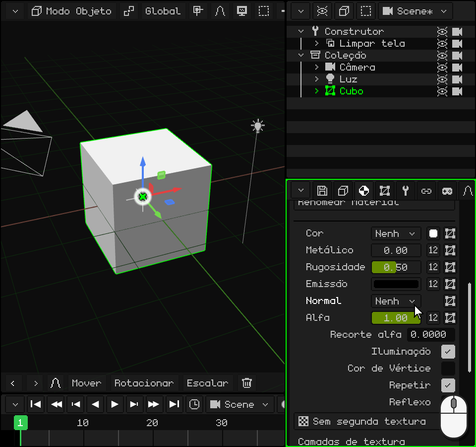

## Os textos

Um **campo de texto** guarda um nome ou um caminho, como o **Nome** do objeto, no final do cartão Transformar. Ao ativá-lo, o cursor aparece no final do texto. O nome novo aparece também no Outliner.

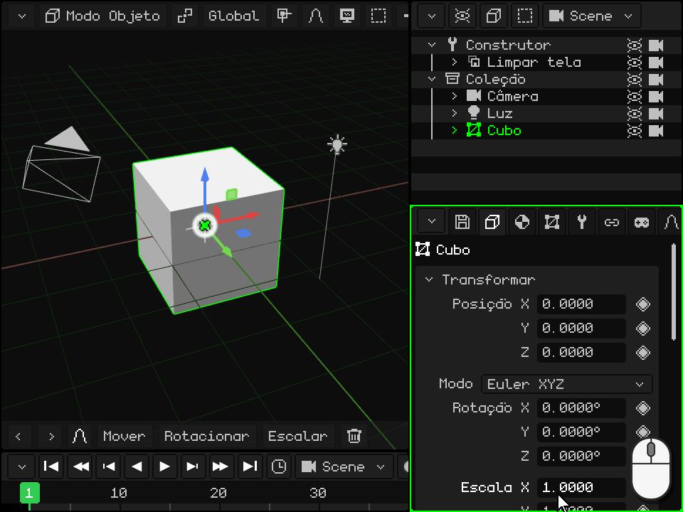

-  **No PC:** um clique no campo e digite. <kbd>Enter</kbd> (ou um clique em outro lugar) confirma e <kbd>Esc</kbd> volta ao texto de antes.
-  **Em uma tela touch:** um toque abre o teclado do Whisk3D, com o ñ. **Aa** passa para maiúsculas, **123** para os números e símbolos, **DEL** apaga e **OK** confirma. Na versão web, abre-se o teclado do celular.
-  **No Nokia N95:** <kbd>OK</kbd> e você escreve com o teclado do telefone, como uma mensagem de texto: cada tecla dá as suas letras apertando-a várias vezes. <kbd>#</kbd> alterna entre Abc, abc e ABC, e mantida passa para 123 (a barra das Propriedades mostra o modo). O <kbd>0</kbd> é o espaço, o <kbd>1</kbd> os sinais de pontuação e a <kbd>\*</kbd> abre mais símbolos. <kbd>C</kbd> apaga, **esquerda** e **direita** movem o cursor, <kbd>OK</kbd> confirma e a **soft esquerda** cancela.

## As cores

Uma linha de **cor** mostra um quadradinho com a cor, à direita, como **Difuso**, **Ambiente** e **Especular** no cartão de uma luz. Ao ativá-la, abre-se o **seletor de cor**:

- o **círculo** escolhe o matiz e a saturação, e a barra ao lado, o valor (o quanto ela é clara);
- as abas **RGB**, **HSV** e **Hex** mostram a cor em números: Vermelho, Verde e Azul; Matiz, Saturação e Valor; ou o código hexadecimal (`#FF8800`), com Copiar e Colar;
- **Alfa** é a transparência;
- **OK** mantém a cor e **Cancelar** volta à de antes.

A cor muda enquanto você a mexe, então ela aparece na cena antes de você confirmar. Um clique ou um toque fora do seletor também o fecha e mantém a cor.

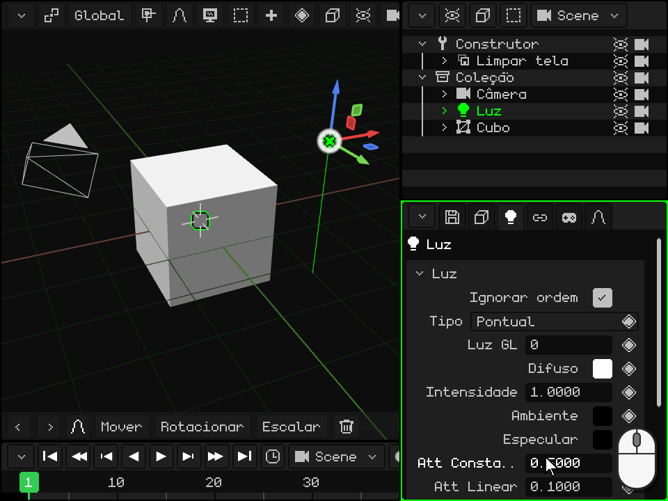

  Com o mouse ou com o dedo, você arrasta dentro do círculo e da barra, e os números são arrastados para o lado, como nas Propriedades.

 No Nokia N95, **cima** e **baixo** passam pelo círculo, pela barra, pelas abas, pelas linhas de números e por OK / Cancelar. Em uma linha de números, **esquerda** e **direita** a mudam (mantidas, cada vez mais rápido). Sobre o círculo, <kbd>OK</kbd> entra para editá-lo: **esquerda** e **direita** giram o matiz, **cima** e **baixo** mudam a saturação, e <kbd>OK</kbd> sai. A barra é editada do mesmo jeito, com cima e baixo. <kbd>C</kbd> fecha o seletor e volta à cor de antes.

## As listas

Alguns cartões têm uma **lista**: os modificadores de uma malha, as suas partes, os seus mapas UV. O escolhido fica marcado, e o que está embaixo mostra os dados dele ou age sobre ele. Embaixo da lista há linhas de **botões**.

**Subir** e **Descer** mudam o lugar do escolhido. A ordem importa: os modificadores são aplicados de cima para baixo, e as partes de uma malha são desenhadas nessa ordem. Esses dois botões aparecem quando a lista tem dois itens ou mais.

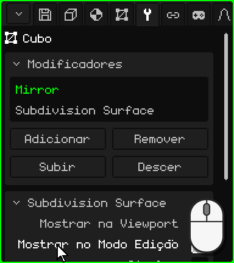

| | Como usar a lista |
|---|---|
|  PC | Um clique escolhe. Se nem todos couberem, gire a roda em cima da lista. |
|  Tela touch | Um toque escolhe. Se nem todos couberem, arraste o dedo para cima ou para baixo sobre a lista. |
|  Nokia N95 | <kbd>OK</kbd> sobre a lista, **cima** e **baixo** escolhem e <kbd>OK</kbd> sai. Em uma linha de botões, **esquerda** e **direita** passam de um botão para outro (a borda marca qual) e <kbd>OK</kbd> o aperta. |

## O losango: animar uma propriedade

À direita das propriedades que podem ser animadas há um **losango**; as que não o têm não são animadas. Um clique ou um toque no losango põe um **keyframe**: salva o valor dessa propriedade no quadro atual da Linha do Tempo. Com keyframes em quadros diferentes, a propriedade muda sozinha ao reproduzir a animação.

A cor do losango diz como está a propriedade **no quadro atual**:

| Losango | O que quer dizer | O que um clique faz |
|---|---|---|
| Cinza | A propriedade não está animada. | Põe o primeiro keyframe, com o valor atual. |
| Verde fraco | Está animada, mas não tem keyframe neste quadro. | Põe um keyframe com o valor atual. |
| Verde | Tem um keyframe neste quadro. | Remove-o. |

Mudar um valor não muda a cor do losango: o valor novo não fica na animação até você pôr o keyframe, e se antes disso você mudar de quadro, a propriedade volta ao que a animação diz. Em um quadro que já tem keyframe (losango verde), um valor novo é salvo com dois cliques: o primeiro remove o keyframe e o segundo o põe de novo com o valor atual.

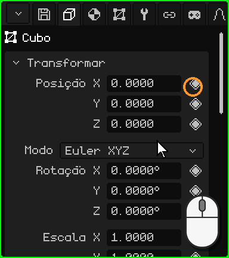

 No Nokia N95, parado na linha, a seta **direita** passa para o losango (uma borda branca o marca), <kbd>OK</kbd> põe ou remove o keyframe e **esquerda** volta para o valor.

Na aba Animação, o cartão **Câmera ativa** escolhe qual câmera manda em cada momento da animação: os cortes de uma cena. O losango dele tem uma cor a mais, um **verde mais claro**: a câmera escolhida não é a que a animação diz neste quadro, uma mudança que ainda não foi salva. Um clique salva o corte no quadro atual.

A animação tem o seu próprio tutorial mais adiante.

Todas as abas e os seus cartões estão no manual: [Propriedades](propiedades.md). Voltar para [As viewports](viewports.md).

## O que cada aba tem

| Aba | O que tem |
|---|---|
| Arquivo / Render (disquete) | **Arquivo**: abrir, salvar, salvar como, salvar versão, extrair assets. **Render**: caminho, tamanho, passes extras, fundo, **Ray Tracing** (raios, amostras, passes), Renderizar imagem e Renderizar animação. **Jogo**: plataforma (Windows, Symbian, Linux .deb, AppImage, WebGL, Android, Android 2.3), janela, orientação, ícone, física, som, volume, **resolução** (a porcentagem da tela em que o jogo desenha: no Android 2.3 o sistema a estica, e nesses celulares desenhar menos pixels dá mais quadros) e Compilar jogo (com um celular conectado por adb, ele o instala e o abre). **Exportar**: OBJ, glTF, GLB, STL (só os triângulos, para imprimir em 3D ou passar para um programa de CAD). **Ajustes**: idioma, antialiasing, gráficos, tema, logs, escala, **Atalhos de teclado…** e Salvar alterações. |
| Objeto | Posição, rotação (Euler, quaternion ou ângulo de eixo), escala, nome, visível, renderizável; animações e paleta do objeto. |
| Contextual | Depende do tipo: partes de malha e **material** (textura, iluminação, cor de vértice, transparência, reflexos, normal map, mistura, profundidade, camadas de textura, **Avançado: shader personalizado** — veja [Shaders escritos](../editor/shaders.md); Rugosidade, Metálico, Transmissão e IOR com ray tracing), luz, câmera, névoa, partículas, física, hitbox, armação e ossos, elementos 2D, prefabs, rotinas. |
| Malha 3D | A malha usada (e quantos a compartilham), mapas UV, camadas de cor, grupos de vértices, grupos UV. Com um recurso escolhido na Biblioteca: seus dados e sua localização (dentro ou fora do .w3d). |
| Modificadores | Veja [Modificadores](../editor/objeto-malla.md#a-aba-modificadores). |
| Transformar | Só no Modo Edição: centro da seleção e de suas UV, editáveis. |
| Armação 2D | Armações e ossos 2D da malha. |
| Restrições | Copiar posição, Copiar rotação, Billboard (olhar para a câmera), Filho De. |
| Scripts | Os scripts Lua do objeto e suas propriedades (veja o [documento de Lua](../lua/README.md)). |
| Animação | A animação ativa, camadas de mistura (Mix), valores exatos do keyframe escolhido e cortes de câmera. |

## Rotinas

Uma rotina é uma lista de passos de desenho (transladar, rotacionar, definir textura, desenhar uma malha, chamar outra rotina, Chamar Lua…) montada nas Propriedades. É a forma mais rápida de desenhar no N95.

| Função | Descrição | Atalho |
|---|---|---|
| Adicionar / Remover passo | Adiciona passos agrupados por tema, ou remove o escolhido. | Botões; <kbd>X</kbd> ou <kbd>Delete</kbd> remove |
| Pegar passo | Reordena o passo com as setas; <kbd>Enter</kbd> confirma. | <kbd>G</kbd> |
| Inserir keyframe | Anima os valores do passo no quadro atual. | <kbd>I</kbd> |
| Repetir | Quantas vezes a lista roda seguida (laço de rotina). 1 = rotina normal. | Campo Repetir |
| Modo de render / Usa | Uma lista diferente por modo de sombreamento, ou a mesma para todos. | Listas suspensas |
