# Mudar a origem: uma porta

Neste tutorial você vai fazer uma porta abrir a partir da dobradiça. Para isso é preciso mudar a sua **origem**: o ponto ao redor do qual o objeto gira (veja [A origem](modo-objeto.md#a-origem) no tutorial do Modo Objeto).

Partimos da porta do tutorial anterior, [Modelar uma porta](modelar-puerta.md), com a origem no centro. Se você a fez deslocando uma lateral, a origem ficou deslocada: **Objeto → Definir Origem → Origem para Geometria** a devolve ao centro.

## A porta gira errado

Experimente girá-la. A porta gira sobre o seu centro, como uma porta giratória, e não a partir da dobradiça:

 Com o gizmo: um clique no centro dele o passa para **Rotacionar**, e o anel azul a gira sobre o eixo vertical.

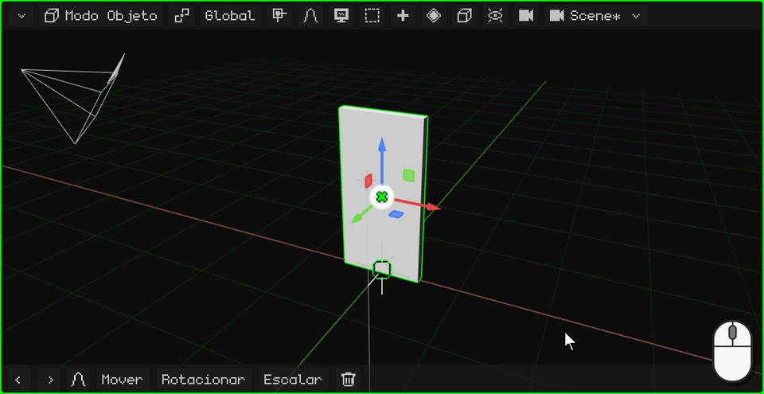

 Com o dedo: um toque no centro do gizmo o passa para **Rotacionar**, e o anel azul é arrastado.

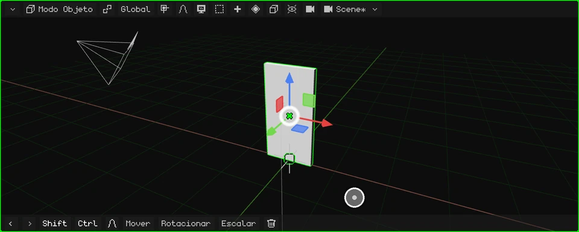

 No Nokia N95 o gizmo vem desligado: <kbd>2</kbd> (rotacionar), <kbd>3</kbd> (o eixo Z, o vertical) e as setas; <kbd>OK</kbd> confirma.

Ela gira errado porque a sua origem está no centro. Vamos levá-la até a dobradiça.

## Levar a origem até a dobradiça

1. **Entre no Modo Edição.** Um clique no botão do modo e outro em **Modo Edição** (no PC, também com <kbd>Tab</kbd>).

   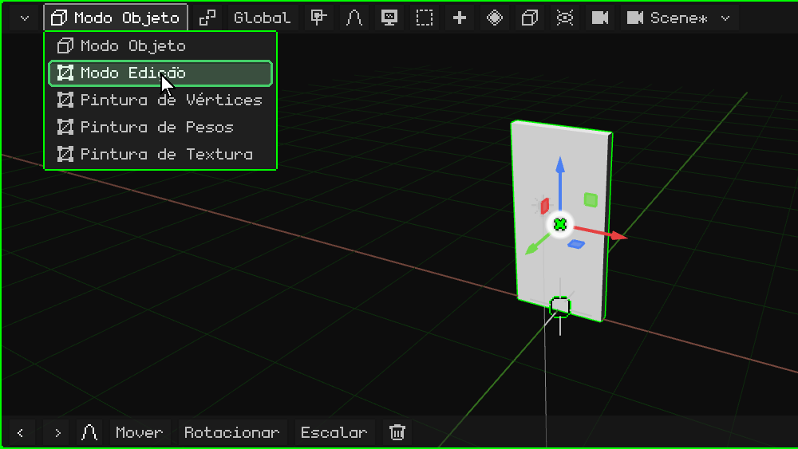

2. **Escolha as faces.** No Modo Edição aparece o botão **Vértice / Aresta / Face**: um clique e escolha **Face**.

   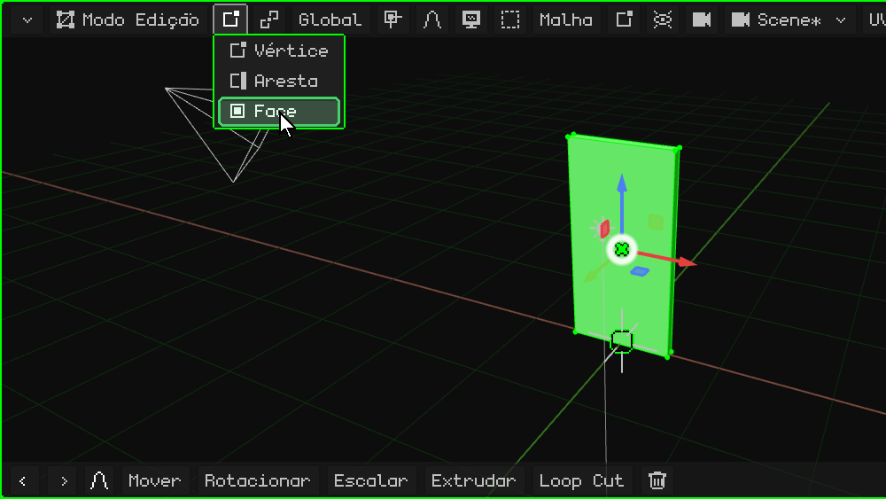

3. **Selecione a face da dobradiça.** Um clique na face estreita da lateral da porta, do lado onde vai a dobradiça: ela fica verde.

   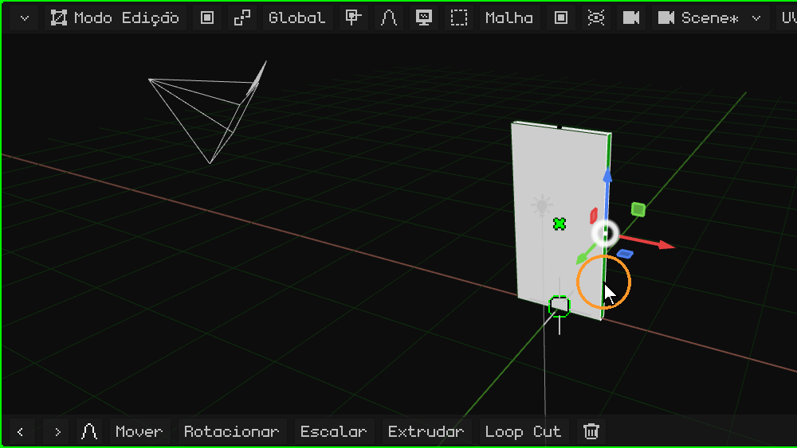

4. **Leve o cursor 3D até ali.** No menu **Malha**, **Ímã** → **Cursor para o selecionado**: o cursor 3D fica sobre a dobradiça.

   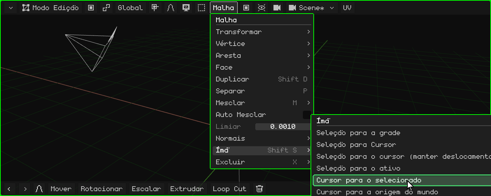

5. **Volte para o Modo Objeto.** Um clique no botão do modo e outro em **Modo Objeto** (ou <kbd>Tab</kbd>).

   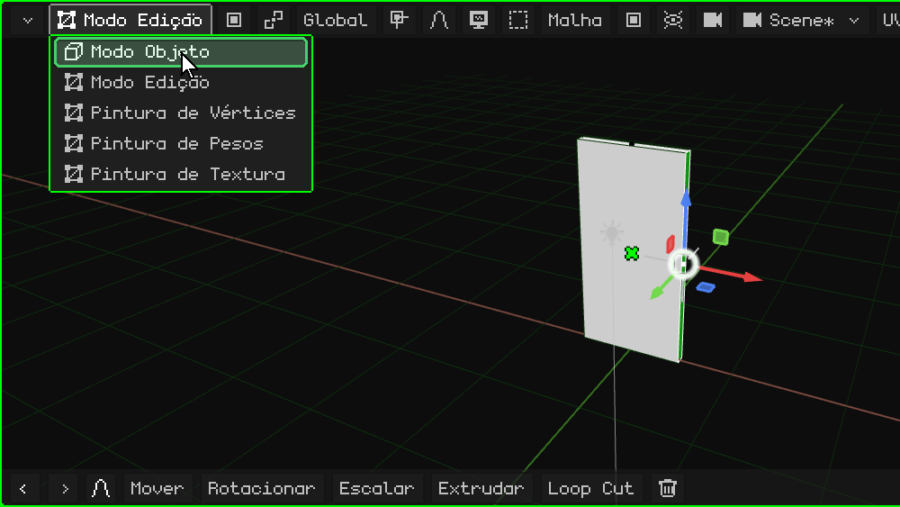

6. **Leve a origem até o cursor 3D.** No menu **Objeto**, **Definir Origem** → **Origem para Cursor 3D**. A porta não se move: quem se move é a origem dela, e com ela o gizmo, que fica na dobradiça.

   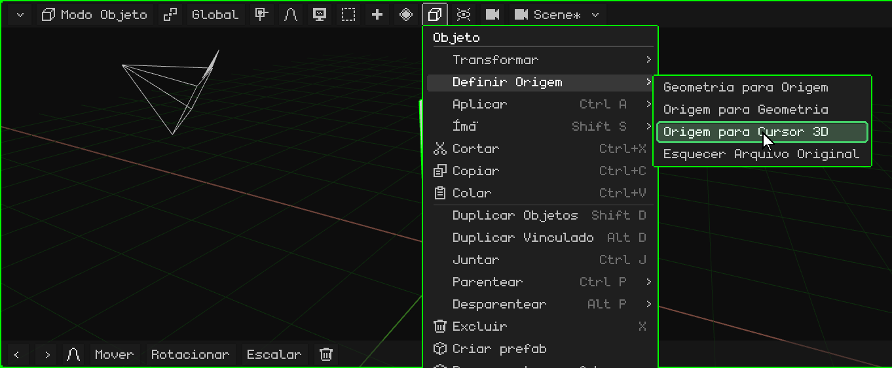

## Agora gira certo

Gire-a de novo com o gizmo: agora ela abre e fecha a partir da dobradiça.

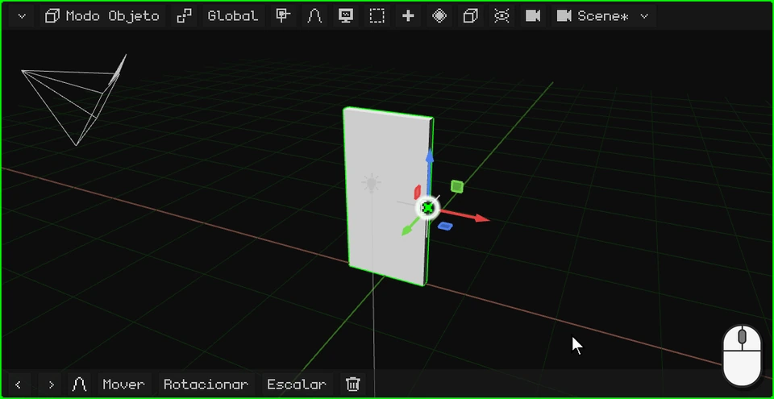

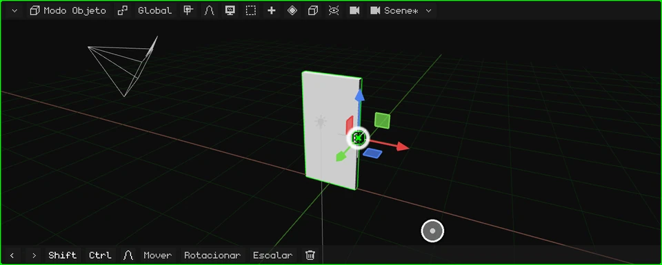

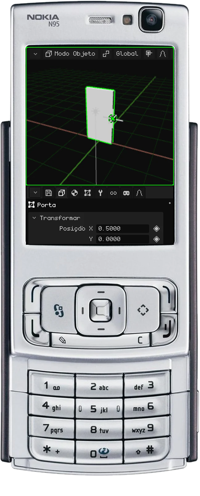

 Em uma tela touch, os passos acima são iguais, com toques: os menus são abertos e as opções escolhidas com um toque.

 No Nokia N95, <kbd>OK</kbd> passa do Modo Objeto para o Modo Edição e os menus são abertos com a soft esquerda.

## As opções de Definir Origem

| Opção | O que faz |
|---|---|
| **Origem para Geometria** | Leva a origem ao centro da malha. |
| **Origem para Cursor 3D** | Leva a origem para onde está o cursor 3D. |
| **Geometria para Origem** | O contrário: deixa a origem e move a malha até o centro dela ficar sobre a origem. |

No próximo tutorial fazemos a maçaneta: [Modelar a maçaneta](modelar-picaporte.md).
