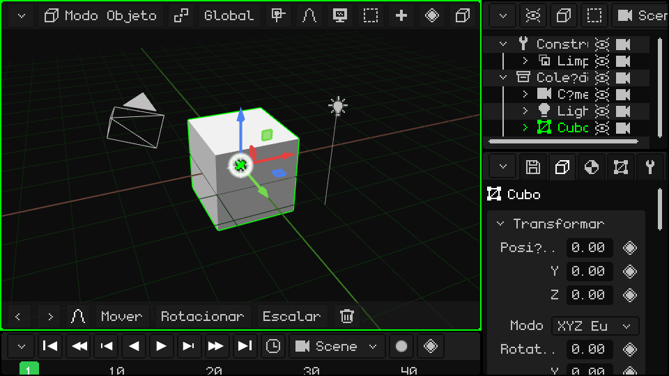
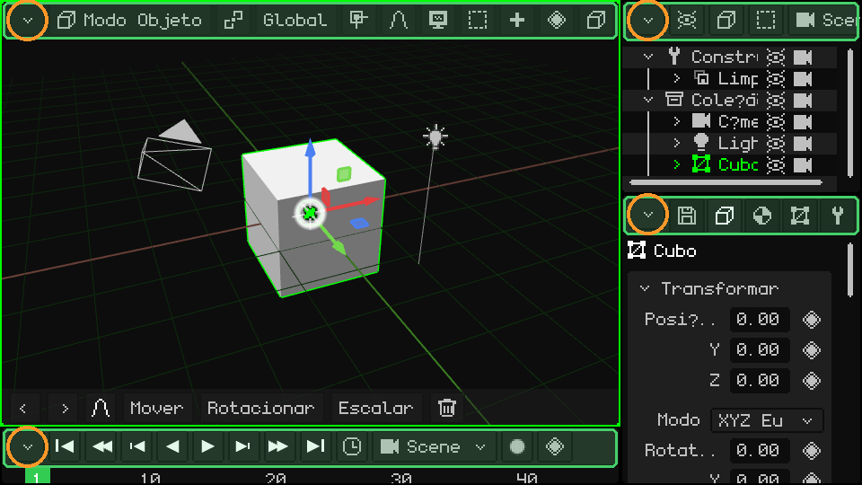
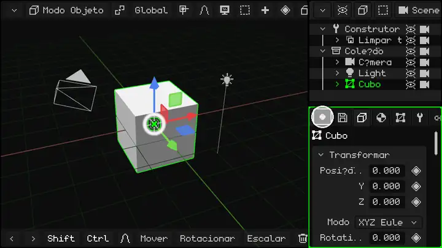
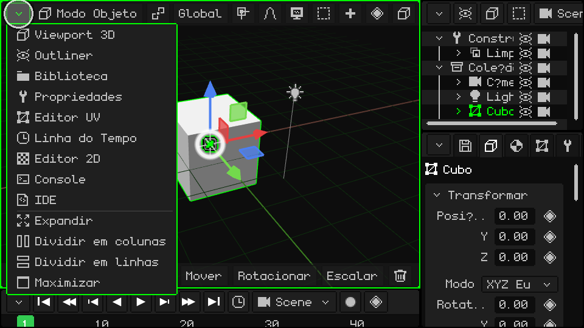
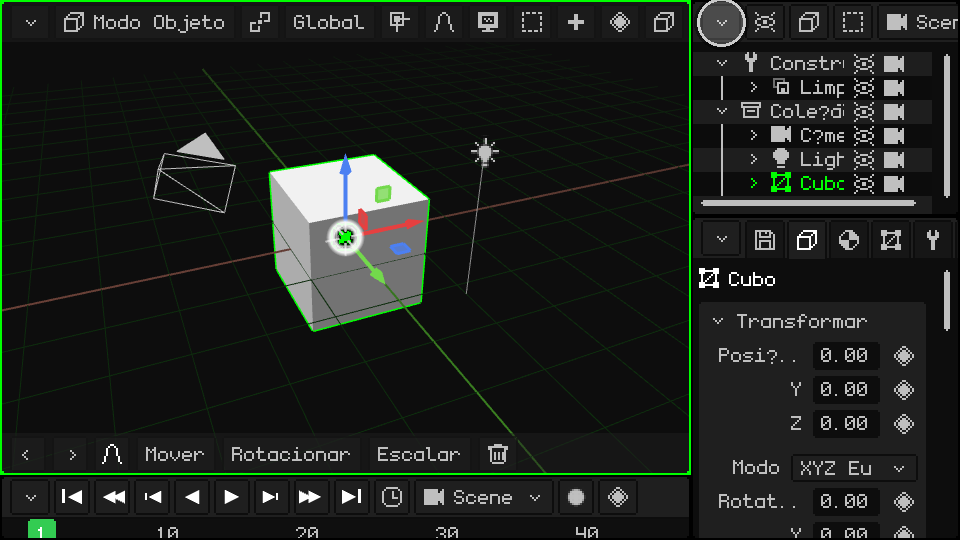
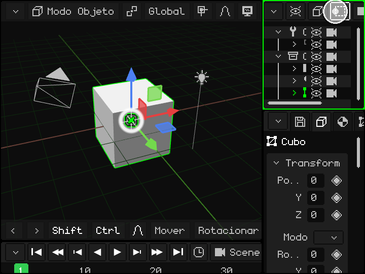
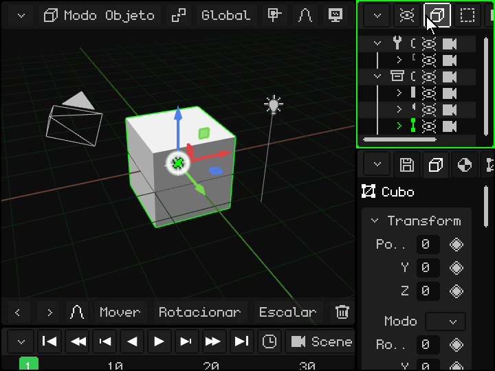
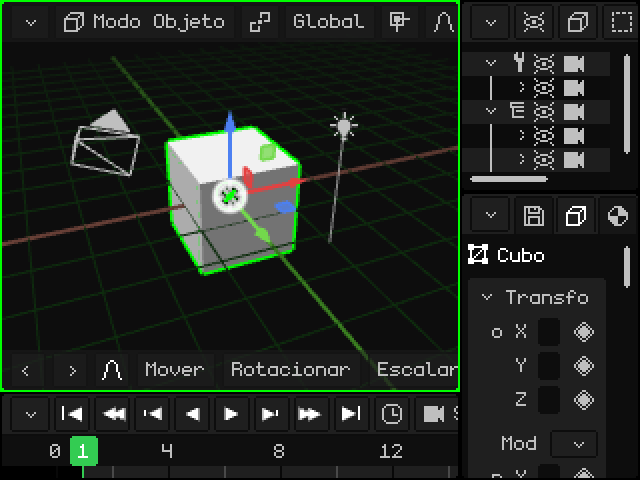

# As viewports

A janela do Whisk3D se divide em **viewports**: painéis, cada um com o seu editor (a Viewport 3D, o Outliner, Propriedades...). Você pode dividir as viewports, mudar o tamanho delas e escolher o que cada uma mostra. Funciona do mesmo jeito com mouse, com o dedo em uma tela touch e com o teclado de um Nokia.

Isto é o que aparece quando o programa abre pela primeira vez:

## A barra de menus e o botão do canto

Todas as viewports têm em cima uma **barra de menus** (em verde na imagem) com os menus e botões desse editor. No canto superior esquerdo fica sempre o **botão do canto** (em laranja): é ele que muda ou modifica a viewport.

## Mudar o tamanho

**Mantenha pressionado** o botão do canto (com o dedo ou com o mouse) e arraste-o para mudar o tamanho: isso move a borda esquerda e a de cima dessa viewport, e as do lado se ajustam. Um **toque simples**, sem arrastar, abre o menu suspenso com as opções da viewport. Aqui, a de baixo à direita é arrastada em círculos e as três mudam de tamanho:

**No Nokia:** mantenha apertada a **tecla verde** de chamada  e aperte uma seta: a borda da viewport ativa (a que tem a moldura verde) se move para esse lado, e assim ela aumenta ou diminui. A tecla verde sozinha, sem setas, passa para a viewport seguinte.

## As opções da viewport

Um toque no botão do canto abre este menu:

Em cima estão os **tipos de viewport**: escolher um transforma a viewport nesse editor. Abaixo da linha está o que dá para fazer com ela:

| Opção | O que faz |
|---|---|
| Expandir | A viewport fica com o lugar da que está ao lado, que se fecha (se a do lado estiver dividida, todo esse grupo se fecha). |
| Dividir em colunas | Divide a viewport em duas, uma ao lado da outra. |
| Dividir em linhas | Divide a viewport em duas, uma em cima da outra. |
| Maximizar | Amplia a viewport para a janela inteira. Enquanto ela está maximizada, o menu tem só **Minimizar**, que a devolve ao seu lugar. |

### Mudar o tipo

A Viewport 3D transformada em Editor UV:

### Dividir em colunas e em linhas

### Expandir

O Outliner fica com o lugar de Propriedades:

### Maximizar e minimizar

## Quando a barra não cabe

Se a viewport for estreita, a barra dela não cabe inteira. O mesmo acontece com a barra de ferramentas de baixo da Viewport 3D. Para ver o resto:

- **Com o dedo:** arraste a barra para o lado.
- **Com o mouse:** mantenha o clique pressionado sobre a barra e arraste, ou gire a **roda** em cima dela.
- **Com o teclado:** <kbd>M</kbd> no PC, ou a **soft esquerda** no Nokia, entra na barra da viewport ativa. Com as setas esquerda e direita você a percorre, e cada menu se abre ao chegar nele. Com cima e baixo você se move pelo menu, e com OK (<kbd>Enter</kbd> no PC) você escolhe. A barra rola sozinha para mostrar onde você está.

Em um Nokia N95: a soft esquerda entra na barra e as setas a percorrem.

## Os tipos de viewport

| Viewport | Para que serve |
|---|---|
| [Viewport 3D](../editor/vista-3d.md) | Onde se vê e se edita a cena: modelar, mover objetos, pintar, posar e animar. |
| [Outliner](../editor/outliner.md) | A lista de tudo o que há na cena. |
| [Biblioteca](../editor/outliner.md#vista-biblioteca) | Os recursos do projeto: malhas, materiais, texturas, animações, sons, scripts e mais. |
| [Propriedades](../editor/propiedades.md) | Os dados do objeto ativo, em abas. |
| [Editor UV](../editor/editor-uv.md) | Como a textura se apoia sobre a malha. |
| [Linha do Tempo](../editor/linea-de-tiempo.md) | A animação: os keyframes e as curvas. |
| [Editor 2D](../editor/editor-2d.md) | Interfaces de jogo, HUD e jogos 2D. |
| [Console](../editor/consola.md) | O registro do motor: erros, avisos e informações. |
| [IDE](../editor/editor-de-scripts.md) | O editor de scripts Lua e de shaders. |

Cada viewport vai ter o seu próprio tutorial, com mais detalhes. Enquanto isso, o [Manual do Whisk3D](../editor/README.md) explica cada uma.

O Whisk3D continua crescendo: com o tempo, novas viewports vão ser adicionadas e as atuais podem mudar. Todas vão funcionar do mesmo jeito, com a barra em cima e o botão no canto.
